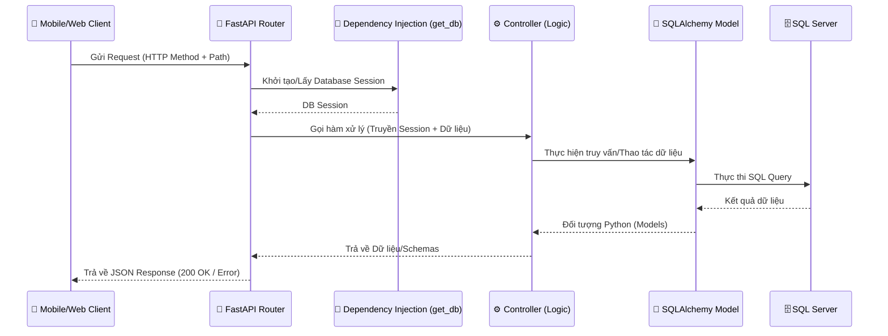
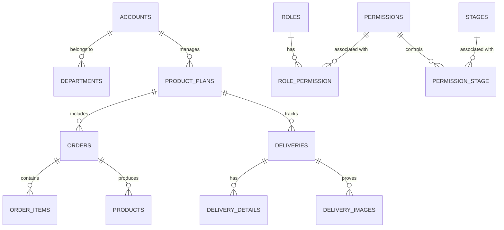

# Tài liệu Hướng dẫn Phát triển Backend - ERP_G7 (Bản Chi tiết)

Tài liệu này cung cấp cái nhìn kỹ thuật sâu sắc, cấu trúc dữ liệu chi tiết và toàn bộ danh mục API dành cho các nhà phát triển Backend của dự án ERP_G7.

---

## 1. Kiến trúc Hệ thống thực thi (Executive Architecture)

Dự án tuân thủ mô hình phân lớp rõ rệt để đảm bảo tính module hóa và dễ bảo trì.

### 1.1. Sơ đồ luồng xử lý (Request Lifecycle)



---

## 2. Cấu trúc Cơ sở dữ liệu (Database Schema)

### 2.1. Sơ đồ quan hệ thực thể (ERD)



### 2.2. Chi tiết các bảng chính

#### Bảng `accounts` (Tài khoản người dùng)
| Trường | Kiểu dữ liệu | Ràng buộc | Mô tả |
| :--- | :--- | :--- | :--- |
| `id` | `Integer` | `PK`, `Index` | ID tự tăng |
| `username` | `NVARCHAR(50)` | `Unique`, `Not Null` | Tên đăng nhập |
| `hashed_password` | `NVARCHAR(255)`| `Not Null` | Mật khẩu đã băm (Bcrypt) |
| `full_name` | `NVARCHAR(100)`| | Họ tên đầy đủ |
| `employee_id` | `NVARCHAR(20)`| `Unique` | Mã nhân viên |
| `status` | `NVARCHAR(50)`| Default: "Đang sử dụng" | Trạng thái tài khoản |

#### Bảng `deliveries` (Phiếu bàn giao)
| Trường | Kiểu dữ liệu | Ràng buộc | Mô tả |
| :--- | :--- | :--- | :--- |
| `id` | `Integer` | `PK` | ID phiếu |
| `plan_id` | `Integer` | `FK(product_plans.id)` | Thuộc kế hoạch sản xuất nào |
| `delivery_stage` | `NVARCHAR(50)` | | Công đoạn giao |
| `receiving_stage`| `NVARCHAR(50)` | | Công đoạn nhận |
| `status` | `NVARCHAR(50)` | | Chờ xác nhận, Hoàn thành... |
| `sx_delivery` | `Integer` | | ID người giao |
| `created_at` | `DateTime` | | Thời gian tạo |

---

## 3. Danh mục Toàn bộ API Endpoints (Complete API List)

Dưới đây là bảng liệt kê tất cả các API hiện có trong hệ thống (`/api/v1`):

### 3.1. Quản trị & Người dùng (`/accounts`, `/roles`, `/permissions`)
| Method | Endpoint | Chức năng | Ghi chú |
| :--- | :--- | :--- | :--- |
| **GET** | `/accounts/` | Danh sách tài khoản | Phân trang, lọc, tìm kiếm |
| **POST** | `/accounts/` | Đăng ký tài khoản mới | |
| **POST** | `/accounts/login` | Đăng nhập hệ thống | Trả về JWT + User Info |
| **GET** | `/roles/` | Danh sách vai trò | |
| **GET** | `/roles/{id}/permissions` | Lấy danh sách quyền theo vai trò | |
| **GET** | `/permissions/{id}/stages` | Lấy công đoạn theo quyền | |

### 3.2. Quản lý Sản phẩm (`/products`, `/master-products`, `/categories`)
| Method | Endpoint | Chức năng | Ghi chú |
| :--- | :--- | :--- | :--- |
| **GET** | `/master-products/` | DS sản phẩm mẫu (BOM) | |
| **POST**| `/master-products/` | Tạo sản phẩm mẫu mới | |
| **POST**| `/master-products/{id}/produce`| Sản xuất từ BOM | Tạo Product thực tế từ Master |
| **GET** | `/products/` | DS sản phẩm thực tế | |
| **POST**| `/products/` | Tạo sản phẩm mới | |
| **PUT** | `/products/{id}` | Cập nhật sản phẩm | |
| **DELETE**| `/products/{id}` | Xóa sản phẩm | |
| **GET** | `/categories/` | Danh sách danh mục | |

### 3.3. Đơn hàng & Kế hoạch (`/orders`, `/plans`)
| Method | Endpoint | Chức năng | Ghi chú |
| :--- | :--- | :--- | :--- |
| **GET** | `/orders/` | Danh sách đơn hàng | Bao gồm cấu trúc BOM |
| **POST**| `/orders/` | Tạo đơn hàng mới | |
| **PUT** | `/orders/{id}` | Cập nhật đơn hàng | |
| **GET** | `/plans/` | Danh sách KHSX | Dạng cây (Plan->Order->Product) |
| **POST**| `/plans/` | Tạo kế hoạch sản xuất mới | |

### 3.4. Giao hàng & Logictics (`/deliveries`)
| Method | Endpoint | Chức năng | Ghi chú |
| :--- | :--- | :--- | :--- |
| **POST**| `/deliveries/` | Tạo phiếu bàn giao mới | **Hỗ trợ Multipart (Ảnh)** |
| **GET** | `/deliveries/{plan_id}` | Lấy DS phiếu theo KHSX | |

---

## 4. Module Giao hàng: Xử lý Multipart/Form-data

Module Giao hàng là module đặc biệt hỗ trợ upload nhiều ảnh minh chứng.

-   **Content-Type:** `multipart/form-data`
-   **Tham số gửi lên:**
    -   `plan_id`, `delivery_stage`, `receiving_stage`, `user_id`, `quantity`, `part_name` (dưới dạng Form fields).
    -   `files`: Danh sách tệp tin ảnh.
-   **Luồng xử lý:**
    1.  Tạo bản ghi trong `deliveries`.
    2.  Tạo chi tiết trong `delivery_details`.
    3.  Lưu file vật lý vào `static/uploads/deliveries/` với tên file là UUID để tránh trùng lặp.
    4.  Lưu đường dẫn URL (ví dụ: `/static/uploads/...`) vào bảng `delivery_images`.

---

## 5. Xác thực & Bảo mật (Security)

Hệ thống sử dụng **JWT (JSON Web Token)** để duy trì trạng thái đăng nhập.

-   **Thuật toán băm:** `HS256`.
-   **Cấu trúc Token Payload:**
    ```json
    {
      "sub": "admin",
      "exp": 1713512345
    }
    ```
-   **Xác thực mật khẩu:** Sử dụng `passlib` với `bcrypt`.
-   **Cơ chế:** Client gửi Token qua Header `Authorization: Bearer <token>`.

---

## 6. Hướng dẫn Triển khai & Khắc phục lỗi

### 6.1. Cài đặt Driver SQL Server
Bạn **BẮT BUỘC** phải cài đặt [Microsoft ODBC Driver 17 or 18](https://learn.microsoft.com/en-us/sql/connect/odbc/download-odbc-driver-for-sql-server) trên máy chủ để `pyodbc` có thể kết nối với MSSQL.

### 6.2. Lỗi thường gặp
-   **Error: `Data truncation`**: Do độ dài dữ liệu gửi lên vượt quá khai báo trong Model (ví dụ: Tên sản phẩm quá dài).
-   **Error: `CORS Error`**: Cần kiểm tra danh sách `allow_origins` trong `main.py`.
-   **Lỗi kết nối DB:** Kiểm tra xem SQL Server có cho phép kết nối từ xa (Remote Connection) và Port 1433 đã được mở chưa.

---

## 7. Quy chuẩn lập trình (Coding Guidelines)

1.  **Hàm Async:** Sử dụng `async def` cho các endpoint có xử lý I/O nặng (như upload file).
2.  **Validation:** Tận dụng tối đa Pydantic Schemas để validate dữ liệu trước khi vào Controller.
3.  **Dependency Injection:** Không khởi tạo Session DB trực tiếp mà luôn thông qua `Depends(get_db)`.
4.  **Migration:** Dự án khuyến khích sử dụng Database-First hoặc cập nhật thủ công Schema đồng bộ với Models.

---
*Tài liệu này được cập nhật vào ngày 19/04/2026 bởi Đội ngũ Phát triển ERP_G7.*
