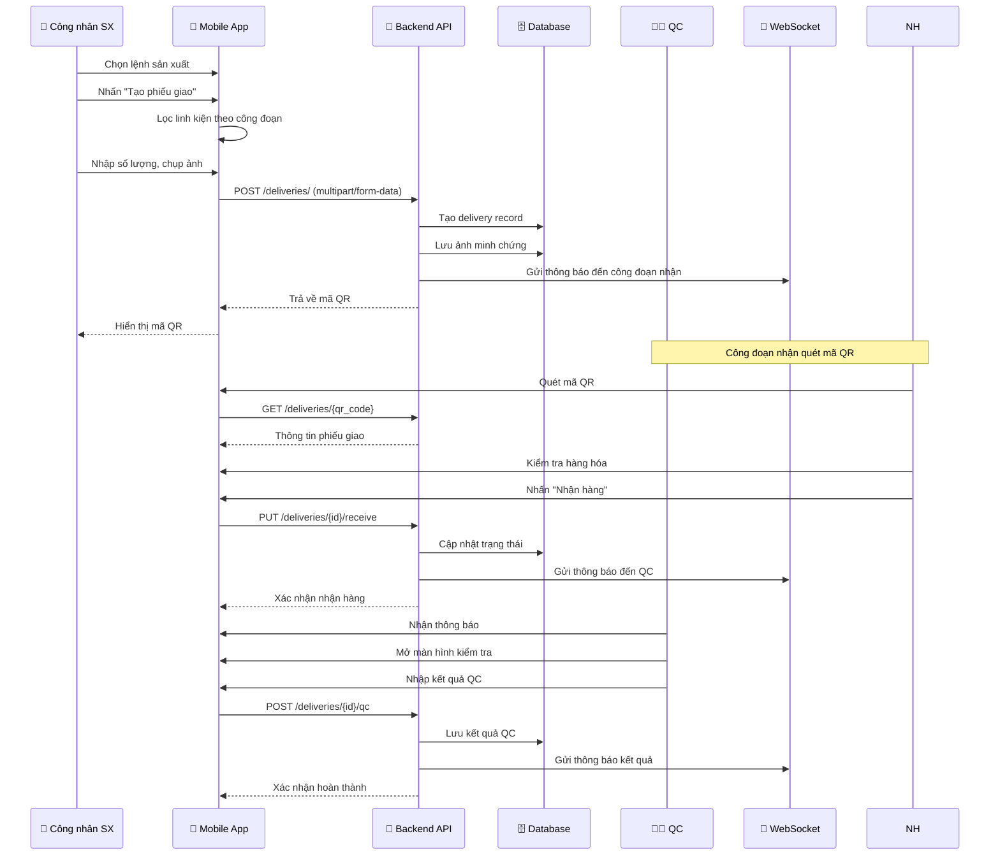
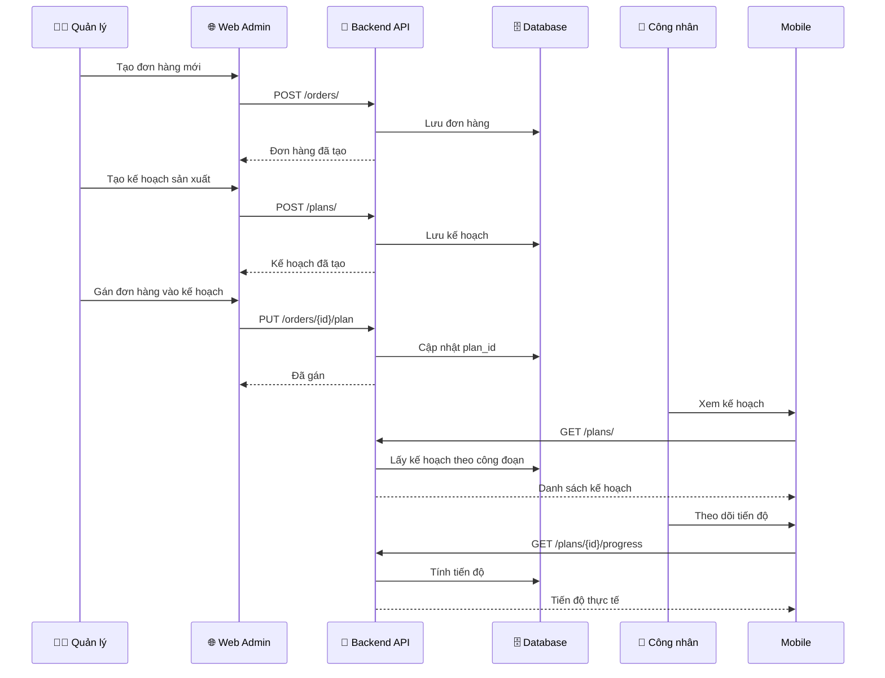
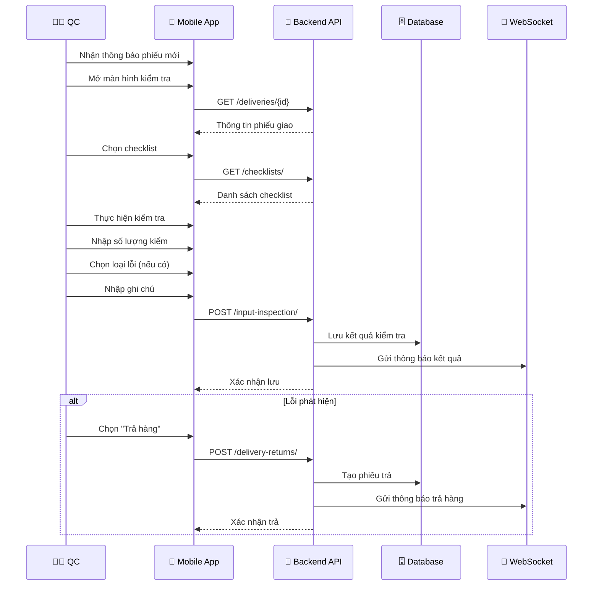
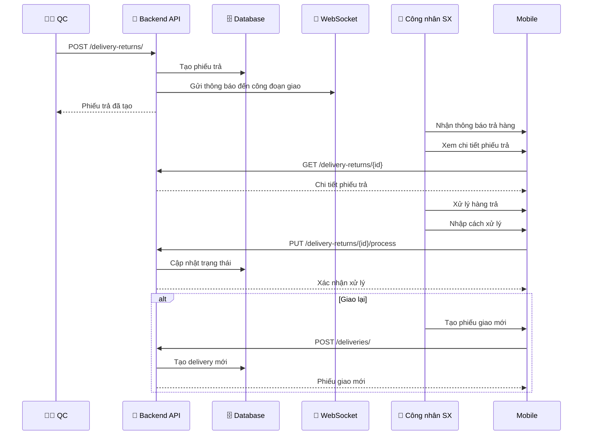
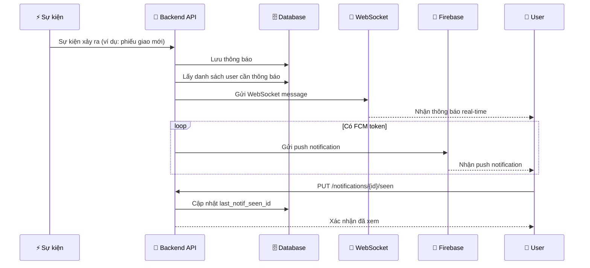

# 🔄 API Flows Documentation - SmartFlow v2

Tài liệu này mô tả chi tiết các luồng nghiệp vụ (business flows) trong hệ thống SmartFlow v2, bao gồm Delivery flow, Production flow, Inspection flow, và các sequence diagrams tương ứng.

---

## 📋 Mục lục (Table of Contents)

1. [Tổng quan](#-tổng-quánverview)
2. [Delivery Flow](#-delivery-flow)
3. [Production Flow](#-production-flow)
4. [Inspection Flow](#-inspection-flow)
5. [Return Flow](#-return-flow)
6. [Notification Flow](#-notification-flow)
7. [Error Handling](#-error-handling)
8. [Rate Limiting](#-rate-limiting)

---

## 🎯 Tổng quan (Overview)

### Business Flows

SmartFlow v2 có 5 luồng nghiệp vụ chính:

1. **Delivery Flow** - Tạo và quản lý phiếu giao giữa các công đoạn
2. **Production Flow** - Quản lý đơn hàng và kế hoạch sản xuất
3. **Inspection Flow** - Kiểm tra chất lượng tại các công đoạn
4. **Return Flow** - Xử lý hàng trả về từ QC
5. **Notification Flow** - Thông báo thời gian thực cho người dùng

### Flow Characteristics

| Flow | Complexity | Real-time | Critical |
|------|------------|-----------|----------|
| Delivery | High | Yes | Yes |
| Production | Medium | No | Yes |
| Inspection | High | Yes | Yes |
| Return | Medium | Yes | Yes |
| Notification | Low | Yes | No |

---

## 📦 Delivery Flow

### 1. Overview

Delivery flow quản lý quá trình bàn giao hàng hóa giữa các công đoạn sản xuất:

```
Công đoạn Giao → Tạo Phiếu Giao → Công đoạn Nhận → Xác nhận → QC Kiểm tra → Hoàn thành
```

### 2. Sequence Diagram



### 3. API Endpoints

#### POST /api/v1/deliveries/
**Description:** Tạo phiếu giao mới

**Request:** `multipart/form-data`
```
plan_id: 1
delivery_stage: "Định hình"
receiving_stage: "Lắp ráp"
part_name: "Chân ghế"
quantity_total: 100
specification: "Gỗ sồi, 50x50mm"
note: "Giao buổi sáng"
files: [image1.jpg, image2.jpg, image3.jpg]
```

**Response (201 Created):**
```json
{
  "id": 123,
  "qr_code": "DLV-20260603-001",
  "backup_qr": "DLV-BACKUP-001",
  "status": "Chờ xác nhận",
  "created_at": "2026-06-03T10:30:00"
}
```

#### PUT /api/v1/deliveries/{id}/receive
**Description:** Công đoạn nhận xác nhận nhận hàng

**Request Body:**
```json
{
  "quantity_received": 98,
  "note": "Nhận đủ, 2 bị hỏng"
}
```

**Response (200 OK):**
```json
{
  "id": 123,
  "status": "Đã nhận",
  "quantity_received": 98,
  "received_at": "2026-06-03T11:00:00"
}
```

#### POST /api/v1/deliveries/{id}/qc
**Description:** QC kiểm tra chất lượng

**Request Body:**
```json
{
  "result": "Đạt",
  "quantity_error": 2,
  "quantity_returned": 0,
  "note": "2 cái bị sước nhẹ, vẫn dùng được"
}
```

**Response (200 OK):**
```json
{
  "id": 123,
  "status": "Hoàn thành",
  "qc_result": "Đạt",
  "qc_at": "2026-06-03T11:30:00"
}
```

### 4. State Transitions

```
[Chờ xác nhận] → [Đã nhận] → [Đang kiểm tra] → [Hoàn thành]
                                    ↓
                                [Trả hàng]
```

**State Descriptions:**
- `Chờ xác nhận`: Phiếu mới tạo, chờ công đoạn nhận
- `Đã nhận`: Công đoạn nhận đã xác nhận
- `Đang kiểm tra`: QC đang kiểm tra
- `Hoàn thành`: QC hoàn thành kiểm tra
- `Trả hàng`: Có hàng bị trả về

### 5. Error Handling

| Error | HTTP Code | Description | Recovery |
|-------|-----------|-------------|----------|
| `DELIVERY_NOT_FOUND` | 404 | Phiếu giao không tồn tại | Kiểm tra QR code |
| `INVALID_STAGE` | 400 | Công đoạn không hợp lệ | Kiểm tra cấu hình |
| `QUANTITY_EXCEEDED` | 400 | Số lượng vượt kế hoạch | Giảm số lượng |
| `IMAGE_UPLOAD_FAILED` | 500 | Upload ảnh thất bại | Thử lại |
| `ALREADY_RECEIVED` | 400 | Phiếu đã được nhận | Kiểm tra trạng thái |

---

## 🏭 Production Flow

### 1. Overview

Production flow quản lý từ đơn hàng đến sản phẩm hoàn thành:

```
Đơn Hàng → Kế Hoạch Sản Xuất → Lệnh Sản Xuất → Sản Phẩm → Giao Hàng
```

### 2. Sequence Diagram



### 3. API Endpoints

#### POST /api/v1/orders/
**Description:** Tạo đơn hàng mới

**Request Body:**
```json
{
  "order_code": "PO-2026-001",
  "customer": "Khách hàng A",
  "delivery_date": "2026-07-01",
  "estimated_date": "2026-06-25",
  "note": "Đơn hàng ưu tiên"
}
```

**Response (201 Created):**
```json
{
  "id": 456,
  "order_code": "PO-2026-001",
  "customer": "Khách hàng A",
  "status": "Mới",
  "created_at": "2026-06-03T09:00:00"
}
```

#### POST /api/v1/plans/
**Description:** Tạo kế hoạch sản xuất

**Request Body:**
```json
{
  "code": "KHSX-06-2026",
  "name": "Kế hoạch tháng 6",
  "month": 6,
  "year": 2026,
  "estimated_date": "2026-06-30"
}
```

**Response (201 Created):**
```json
{
  "id": 789,
  "code": "KHSX-06-2026",
  "name": "Kế hoạch tháng 6",
  "status": "Mới",
  "created_at": "2026-06-03T09:00:00"
}
```

#### PUT /api/v1/orders/{id}/plan
**Description:** Gán đơn hàng vào kế hoạch

**Request Body:**
```json
{
  "plan_id": 789
}
```

**Response (200 OK):**
```json
{
  "id": 456,
  "order_code": "PO-2026-001",
  "plan_id": 789,
  "updated_at": "2026-06-03T09:30:00"
}
```

#### GET /api/v1/plans/{id}/progress
**Description:** Lấy tiến độ kế hoạch

**Response (200 OK):**
```json
{
  "plan_id": 789,
  "total_orders": 10,
  "completed_orders": 3,
  "in_progress_orders": 5,
  "pending_orders": 2,
  "overall_progress": 50,
  "stage_progress": [
    {"stage": "Định hình", "progress": 80},
    {"stage": "Lắp ráp", "progress": 50},
    {"stage": "Sơn", "progress": 30},
    {"stage": "Đóng gói", "progress": 10}
  ]
}
```

### 4. Progress Calculation Algorithm

```python
# FIFO 2-Pass Algorithm for Progress Calculation
def calculate_plan_progress(plan_id: int, db: Session) -> dict:
    """
    Calculate production progress using FIFO 2-Pass algorithm
    """
    # Pass 1: Calculate stage completion
    stage_progress = {}
    for stage in ["Định hình", "Lắp ráp", "Sơn", "Đóng gói"]:
        total = db.query(Delivery).filter(
            Delivery.plan_id == plan_id,
            Delivery.delivery_stage == stage
        ).count()
        
        completed = db.query(Delivery).filter(
            Delivery.plan_id == plan_id,
            Delivery.delivery_stage == stage,
            Delivery.status == "Hoàn thành"
        ).count()
        
        stage_progress[stage] = (completed / total * 100) if total > 0 else 0
    
    # Pass 2: Calculate overall progress (weighted by stage order)
    stage_weights = {
        "Định hình": 0.25,
        "Lắp ráp": 0.35,
        "Sơn": 0.25,
        "Đóng gói": 0.15
    }
    
    overall_progress = sum(
        stage_progress[stage] * weight
        for stage, weight in stage_weights.items()
    )
    
    return {
        "stage_progress": stage_progress,
        "overall_progress": overall_progress
    }
```

### 5. Error Handling

| Error | HTTP Code | Description | Recovery |
|-------|-----------|-------------|----------|
| `ORDER_NOT_FOUND` | 404 | Đơn hàng không tồn tại | Kiểm tra order_code |
| `PLAN_NOT_FOUND` | 404 | Kế hoạch không tồn tại | Kiểm tra plan code |
| `DUPLICATE_ORDER_CODE` | 409 | Mã đơn hàng trùng | Đổi mã khác |
| `INVALID_DATE` | 400 | Ngày không hợp lệ | Kiểm tra định dạng |
| `PLAN_FULL` | 400 | Kế hoạch đã đầy | Tạo kế hoạch mới |

---

## 🔬 Inspection Flow

### 1. Overview

Inspection flow quản lý quy trình kiểm tra chất lượng:

```
Phiếu Giao → Kiểm Tra Đầu Vào → Kiểm Tra Công Đoạn → Kiểm Tra Hàng Ngày → Kết Quả
```

### 2. Sequence Diagram



### 3. API Endpoints

#### GET /api/v1/checklists/
**Description:** Lấy danh sách checklist

**Query Parameters:**
- `type`: Loại checklist (Input, Stage, Daily)

**Response (200 OK):**
```json
{
  "items": [
    {
      "id": 1,
      "name": "Checklist Kiểm Tra Đầu Vào",
      "type": "Input",
      "items": [
        "Kiểm tra kích thước",
        "Kiểm tra bề mặt",
        "Kiểm tra màu sắc"
      ]
    }
  ]
}
```

#### POST /api/v1/input-inspection/
**Description:** Tạo kiểm tra đầu vào

**Request Body:**
```json
{
  "delivery_id": 123,
  "checklist_id": 1,
  "quantity_checked": 98,
  "quantity_error": 2,
  "defect_type_id": 5,
  "result": "Lỗi",
  "note": "2 cái bị sước"
}
```

**Response (201 Created):**
```json
{
  "id": 456,
  "delivery_id": 123,
  "result": "Lỗi",
  "inspected_at": "2026-06-03T11:30:00"
}
```

#### POST /api/v1/delivery-returns/
**Description:** Tạo phiếu trả hàng

**Request Body:**
```json
{
  "delivery_id": 123,
  "quantity": 2,
  "reason": "Sước bề mặt",
  "defect_type_id": 5
}
```

**Response (201 Created):**
```json
{
  "id": 789,
  "delivery_id": 123,
  "quantity": 2,
  "status": "Mới",
  "created_at": "2026-06-03T11:35:00"
}
```

### 4. Inspection Types

#### Input Inspection (Kiểm tra đầu vào)
- Kiểm tra khi hàng mới vào công đoạn
- Dùng checklist chuẩn cho từng loại sản phẩm
- Phân loại lỗi theo defect types

#### Stage Inspection (Kiểm tra công đoạn)
- Kiểm tra sau khi hoàn thành công đoạn
- Dùng checklist theo công đoạn
- Kiểm tra chất lượng sau xử lý

#### Daily Inspection (Kiểm tra hàng ngày)
- Kiểm tra định kỳ hàng ngày
- Dùng checklist hàng ngày
- Theo dõi xu hướng chất lượng

### 5. Error Handling

| Error | HTTP Code | Description | Recovery |
|-------|-----------|-------------|----------|
| `DELIVERY_NOT_FOUND` | 404 | Phiếu giao không tồn tại | Kiểm tra delivery_id |
| `CHECKLIST_NOT_FOUND` | 404 | Checklist không tồn tại | Chọn checklist khác |
| `INVALID_QUANTITY` | 400 | Số lượng không hợp lệ | Kiểm tra số lượng |
| `ALREADY_INSPECTED` | 400 | Đã kiểm tra rồi | Kiểm tra lịch sử |
| `DEFECT_TYPE_NOT_FOUND` | 404 | Loại lỗi không tồn tại | Chọn loại khác |

---

## ↩️ Return Flow

### 1. Overview

Return flow xử lý hàng bị trả về từ QC:

```
QC Phát Hiện Lỗi → Tạo Phiếu Trả → Công đoạn Giao Nhận → Xử Lý → Giao Lại
```

### 2. Sequence Diagram



### 3. API Endpoints

#### GET /api/v1/delivery-returns/
**Description:** Lấy danh sách phiếu trả

**Query Parameters:**
- `status`: Trạng thái (Mới, Đang xử lý, Hoàn thành)
- `delivery_id`: ID phiếu giao gốc

**Response (200 OK):**
```json
{
  "items": [
    {
      "id": 789,
      "delivery_id": 123,
      "quantity": 2,
      "reason": "Sước bề mặt",
      "status": "Mới",
      "created_at": "2026-06-03T11:35:00"
    }
  ]
}
```

#### PUT /api/v1/delivery-returns/{id}/process
**Description:** Xử lý phiếu trả

**Request Body:**
```json
{
  "action": "Giao lại",
  "note": "Đã xử lý lại, giao lại QC"
}
```

**Response (200 OK):**
```json
{
  "id": 789,
  "status": "Hoàn thành",
  "processed_at": "2026-06-03T12:00:00"
}
```

### 4. Return Actions

| Action | Description | Next Step |
|--------|-------------|-----------|
| `Giao lại` | Xử lý lại và giao lại QC | Tạo delivery mới |
| `Hủy bỏ` | Hủy bỏ, không dùng lại | Cập nhật inventory |
| `Sửa chữa` | Sửa chữa tại chỗ | Kiểm tra lại |
| `Đồng ý` | Đồng ý nhận lỗi | Cập nhật delivery |

### 5. Error Handling

| Error | HTTP Code | Description | Recovery |
|-------|-----------|-------------|----------|
| `RETURN_NOT_FOUND` | 404 | Phiếu trả không tồn tại | Kiểm tra return_id |
| `INVALID_ACTION` | 400 | Hành động không hợp lệ | Chọn hành động khác |
| `ALREADY_PROCESSED` | 400 | Đã xử lý rồi | Kiểm tra trạng thái |
| `INSUFFICIENT_QUANTITY` | 400 | Số lượng không đủ | Kiểm tra inventory |

---

## 🔔 Notification Flow

### 1. Overview

Notification flow quản lý thông báo thời gian thực:

```
Sự Kiện → Tạo Thông Báo → Gửi WebSocket → Gửi FCM → User Nhận
```

### 2. Sequence Diagram



### 3. API Endpoints

#### GET /api/v1/notifications/
**Description:** Lấy danh sách thông báo

**Query Parameters:**
- `skip`: Số bản ghi bỏ qua (default: 0)
- `limit`: Số bản ghi lấy (default: 20)
- `unread_only`: Chỉ thông báo chưa đọc (true/false)

**Response (200 OK):**
```json
{
  "total": 50,
  "unread_count": 5,
  "items": [
    {
      "id": 1,
      "title": "Phiếu giao mới",
      "message": "Bạn có 1 phiếu giao mới cần xác nhận",
      "type": "delivery",
      "created_at": "2026-06-03T10:30:00",
      "is_read": false
    }
  ]
}
```

#### PUT /api/v1/notifications/{id}/seen
**Description:** Đánh dấu đã xem

**Response (200 OK):**
```json
{
  "id": 1,
  "is_read": true,
  "seen_at": "2026-06-03T10:35:00"
}
```

#### POST /api/v1/notifications/fcm-token
**Description:** Cập nhật FCM token

**Request Body:**
```json
{
  "fcm_token": "new_fcm_token_here"
}
```

**Response (200 OK):**
```json
{
  "message": "FCM token updated successfully"
}
```

### 4. Notification Types

| Type | Trigger | Recipients |
|------|---------|------------|
| `delivery` | Phiếu giao mới | Công đoạn nhận |
| `qc` | Kết quả QC | Công đoạn giao |
| `return` | Phiếu trả hàng | Công đoạn giao |
| `plan` | Cập nhật kế hoạch | Quản lý, Công nhân |
| `system` | Thông báo hệ thống | Tất cả user |

### 5. WebSocket Message Format

```json
{
  "type": "notification",
  "data": {
    "id": 1,
    "title": "Phiếu giao mới",
    "message": "Bạn có 1 phiếu giao mới cần xác nhận",
    "notification_type": "delivery",
    "created_at": "2026-06-03T10:30:00"
  }
}
```

---

## ⚠️ Error Handling

### 1. Standard Error Response

```json
{
  "error": {
    "code": "DELIVERY_NOT_FOUND",
    "message": "Phiếu giao không tồn tại",
    "details": {
      "delivery_id": 123
    }
  }
}
```

### 2. HTTP Status Codes

| Code | Usage |
|------|-------|
| `200` | Success |
| `201` | Created |
| `400` | Bad Request |
| `401` | Unauthorized |
| `403` | Forbidden |
| `404` | Not Found |
| `409` | Conflict |
| `422` | Validation Error |
| `429` | Too Many Requests |
| `500` | Internal Server Error |

### 3. Error Codes

| Code | HTTP | Description |
|------|------|-------------|
| `AUTH_FAILED` | 401 | Authentication failed |
| `PERMISSION_DENIED` | 403 | Permission denied |
| `RESOURCE_NOT_FOUND` | 404 | Resource not found |
| `VALIDATION_ERROR` | 422 | Validation error |
| `DUPLICATE_RESOURCE` | 409 | Resource already exists |
| `RATE_LIMIT_EXCEEDED` | 429 | Rate limit exceeded |
| `INTERNAL_ERROR` | 500 | Internal server error |

---

## 🚦 Rate Limiting

### 1. Rate Limit Strategy

SmartFlow v2 sử dụng rate limiting để bảo vệ API:

| Endpoint | Limit | Window |
|----------|-------|--------|
| `POST /accounts/login` | 5 requests | 1 minute |
| `POST /deliveries/` | 10 requests | 1 minute |
| `POST /input-inspection/` | 20 requests | 1 minute |
| `GET /notifications/` | 30 requests | 1 minute |
| Other endpoints | 100 requests | 1 minute |

### 2. Rate Limit Headers

```http
X-RateLimit-Limit: 100
X-RateLimit-Remaining: 95
X-RateLimit-Reset: 1625097600
```

### 3. Rate Limit Response

```json
{
  "error": {
    "code": "RATE_LIMIT_EXCEEDED",
    "message": "Quá nhiều request, vui lòng thử lại sau",
    "retry_after": 60
  }
}
```

---

## 📞 Hỗ trợ (Support)

Nếu bạn có câu hỏi về API flows:

1. Kiểm tra **FastAPI Docs**: http://localhost:8000/docs
2. Kiểm tra **API Reference**: ./API_REFERENCE.md
3. Liên hệ **Backend Team**: backend@smartflowg7.cloud

---

**Last Updated:** 2026-06-03
**Version:** 2.0
**Branch:** test_v1
