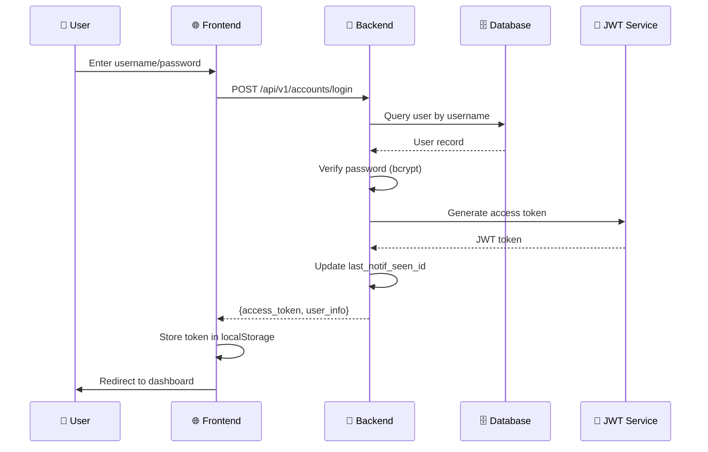
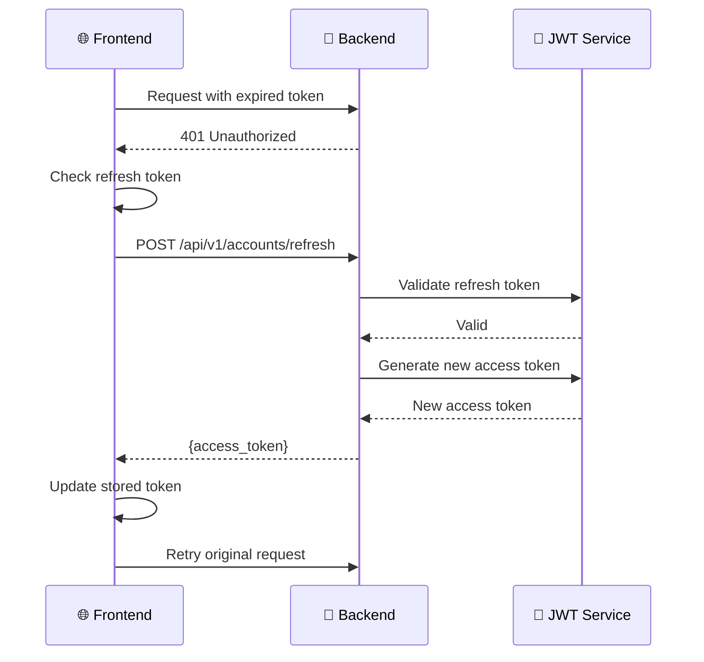
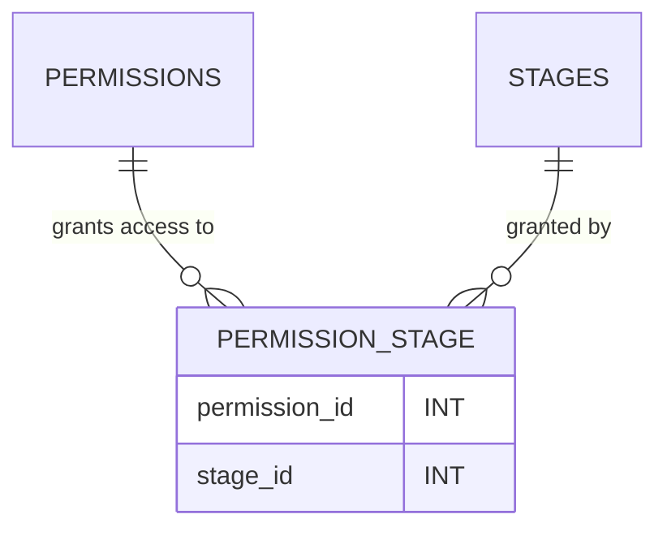

# 🔐 Authentication & Authorization System - SmartFlow v2

Tài liệu này mô tả chi tiết về hệ thống xác thực (Authentication) và phân quyền (Authorization) của SmartFlow v2, bao gồm JWT token, Role-Based Access Control (RBAC), và Stage-based permissions.

---

## 📋 Mục lục (Table of Contents)

1. [Tổng quan](#-tổng-quánverview)
2. [Authentication Flow](#-authentication-flow)
3. [JWT Token Structure](#-jwt-token-structure)
4. [Role-Based Access Control (RBAC)](#-role-based-access-control-rbac)
5. [Stage-Based Permissions](#-stage-based-permissions)
6. [Security Best Practices](#-security-best-practices)
7. [API Endpoints](#-api-endpoints)
8. [Testing Auth](#-testing-auth)

---

## 🎯 Tổng quan (Overview)

### Architecture

SmartFlow v2 sử dụng mô hình xác thực và phân quyền đa lớp:

1. **Authentication Layer** - Xác thực danh tính người dùng
   - JWT (JSON Web Token) với thuật toán HS256
   - Bcrypt cho password hashing
   - Token refresh mechanism

2. **Authorization Layer** - Phân quyền truy cập
   - Role-Based Access Control (RBAC)
   - Stage-based permissions (theo công đoạn sản xuất)
   - Fine-grained permissions

3. **Session Management** - Quản lý phiên làm việc
   - FCM token cho push notifications
   - Last notification tracking
   - Failed login attempt tracking

### Components

| Component | Description | Location |
|-----------|-------------|----------|
| `Account` | Model người dùng | `modules/auth/models/accounts.py` |
| `Role` | Model vai trò | `modules/auth/models/role.py` |
| `Permission` | Model quyền hạn | `modules/auth/models/permissions.py` |
| `Stage` | Model công đoạn | `modules/production/models/stages.py` |
| `auth_service` | Service xử lý auth | `modules/auth/services/auth_service.py` |
| `auth_controller` | Controller auth endpoints | `modules/auth/controllers/auth_controller.py` |
| `get_current_user` | Dependency injection | `app/dependencies.py` |

---

## 🔑 Authentication Flow

### 1. Login Flow Diagram



### 2. Token Refresh Flow



### 3. Password Hashing

```python
from passlib.context import CryptContext

pwd_context = CryptContext(schemes=["bcrypt"], deprecated="auto")

def hash_password(password: str) -> str:
    """Hash password using bcrypt"""
    return pwd_context.hash(password)

def verify_password(plain_password: str, hashed_password: str) -> bool:
    """Verify password against hash"""
    return pwd_context.verify(plain_password, hashed_password)
```

**Security Features:**
- Bcrypt với salt tự động
- Cost factor mặc định: 12
- Kháng brute-force attack

---

## 🎫 JWT Token Structure

### 1. Token Payload

```json
{
  "sub": "admin",
  "user_id": 1,
  "username": "admin",
  "role": "admin",
  "exp": 1713512345,
  "iat": 1713508745
}
```

**Fields:**
- `sub` (Subject): Username
- `user_id`: ID người dùng
- `username`: Tên đăng nhập
- `role`: Vai trò người dùng
- `exp` (Expiration): Thời gian hết hạn (Unix timestamp)
- `iat` (Issued At): Thời gian phát hành (Unix timestamp)

### 2. Token Configuration

```python
# config/settings.py
SECRET_KEY = os.getenv("SECRET_KEY", "your-secret-key-min-32-chars")
ALGORITHM = "HS256"
ACCESS_TOKEN_EXPIRE_MINUTES = 480  # 8 hours
```

**Environment Variables:**
```env
SECRET_KEY=your-secret-key-change-this-in-production-min-32-chars
ALGORITHM=HS256
ACCESS_TOKEN_EXPIRE_MINUTES=480
```

### 3. Token Generation

```python
from datetime import datetime, timedelta
from jose import JWTError, jwt

def create_access_token(data: dict, expires_delta: timedelta = None):
    to_encode = data.copy()
    if expires_delta:
        expire = datetime.utcnow() + expires_delta
    else:
        expire = datetime.utcnow() + timedelta(minutes=ACCESS_TOKEN_EXPIRE_MINUTES)
    
    to_encode.update({"exp": expire})
    encoded_jwt = jwt.encode(to_encode, SECRET_KEY, algorithm=ALGORITHM)
    return encoded_jwt
```

### 4. Token Validation

```python
def verify_token(token: str, credentials_exception):
    try:
        payload = jwt.decode(token, SECRET_KEY, algorithms=[ALGORITHM])
        username: str = payload.get("sub")
        if username is None:
            raise credentials_exception
        return username
    except JWTError:
        raise credentials_exception
```

### 5. Dependency Injection

```python
# app/dependencies.py
from fastapi import Depends, HTTPException, status
from fastapi.security import OAuth2PasswordBearer
from sqlalchemy.orm import Session

oauth2_scheme = OAuth2PasswordBearer(tokenUrl="api/v1/accounts/login")

async def get_current_user(
    token: str = Depends(oauth2_scheme),
    db: Session = Depends(get_db)
):
    credentials_exception = HTTPException(
        status_code=status.HTTP_401_UNAUTHORIZED,
        detail="Could not validate credentials",
        headers={"WWW-Authenticate": "Bearer"},
    )
    
    username = verify_token(token, credentials_exception)
    user = get_user_by_username(db, username=username)
    
    if user is None:
        raise credentials_exception
    
    if not user.is_active:
        raise HTTPException(
            status_code=status.HTTP_403_FORBIDDEN,
            detail="User account is inactive"
        )
    
    return user

async def get_current_active_user(
    current_user: Account = Depends(get_current_user)
):
    if not current_user.is_active:
        raise HTTPException(status_code=400, detail="Inactive user")
    return current_user
```

---

## 👥 Role-Based Access Control (RBAC)

### 1. Role Hierarchy

```
admin (Quản trị viên)
  ├── Full access to all features
  ├── Manage users and roles
  ├── System configuration
  └── View all reports

manager (Quản lý)
  ├── Manage orders and plans
  ├── View production reports
  ├── Manage team members
  └── Cannot modify system settings

qc (Kiểm tra chất lượng)
  ├── Perform QC inspections
  ├── View QC reports
  ├── Create return requests
  └── Cannot modify production plans

worker (Công nhân)
  ├── View assigned tasks
  ├── Create deliveries
  ├── View own progress
  └── Limited access to reports
```

### 2. Default Roles & Permissions

#### Admin Role
```json
{
  "name": "admin",
  "description": "Quản trị viên toàn quyền",
  "permissions": [
    "view_dashboard",
    "manage_users",
    "manage_roles",
    "manage_orders",
    "manage_plans",
    "create_delivery",
    "perform_qc",
    "view_reports",
    "system_config"
  ]
}
```

#### Manager Role
```json
{
  "name": "manager",
  "description": "Quản lý bộ phận",
  "permissions": [
    "view_dashboard",
    "manage_orders",
    "manage_plans",
    "view_team_progress",
    "view_reports"
  ]
}
```

#### QC Role
```json
{
  "name": "qc",
  "description": "Kiểm tra chất lượng",
  "permissions": [
    "view_dashboard",
    "perform_qc",
    "create_return",
    "view_qc_reports"
  ]
}
```

#### Worker Role
```json
{
  "name": "worker",
  "description": "Công nhân sản xuất",
  "permissions": [
    "view_dashboard",
    "view_assigned_tasks",
    "create_delivery",
    "view_own_progress"
  ]
}
```

### 3. Permission Check Implementation

```python
# modules/auth/services/permission_service.py
from sqlalchemy.orm import Session
from modules.auth.models import Account, Role, Permission

def has_permission(user: Account, permission_name: str) -> bool:
    """Check if user has specific permission"""
    for role in user.roles:
        for permission in role.permissions:
            if permission.name == permission_name:
                return True
    return False

def require_permission(permission_name: str):
    """Decorator to require specific permission"""
    def decorator(func):
        async def wrapper(*args, **kwargs):
            current_user = kwargs.get('current_user')
            if not current_user:
                raise HTTPException(status_code=401, detail="Not authenticated")
            
            if not has_permission(current_user, permission_name):
                raise HTTPException(
                    status_code=403, 
                    detail=f"Permission '{permission_name}' required"
                )
            
            return await func(*args, **kwargs)
        return wrapper
    return decorator
```

### 4. Usage in Endpoints

```python
from fastapi import Depends
from app.dependencies import get_current_user
from modules.auth.services.permission_service import require_permission

@router.post("/orders/")
@require_permission("manage_orders")
async def create_order(
    order_data: OrderCreate,
    current_user: Account = Depends(get_current_user)
):
    # Only users with 'manage_orders' permission can access
    return create_order_service(order_data, current_user)
```

---

## 🏭 Stage-Based Permissions

### 1. Concept

SmartFlow v2 sử dụng hệ thống phân quyền theo công đoạn sản xuất (Stage-based permissions). Điều này cho phép:

- Gán quyền truy cập cho từng công đoạn cụ thể
- Người dùng chỉ thấy dữ liệu của công đoạn họ được phép
- Tự động lọc dữ liệu theo công đoạn

### 2. Stage-Permission Mapping



### 3. Default Stages

| Stage Code | Stage Name | Description |
|------------|------------|-------------|
| `STAGE_1` | Định hình | Công đoạn định hình sản phẩm |
| `STAGE_2` | Lắp ráp | Công đoạn lắp ráp |
| `STAGE_3` | Sơn | Công đoạn sơn |
| `STAGE_4` | Đóng gói | Công đoạn đóng gói |

### 4. Multi-Stage Account

Một tài khoản có thể được gán nhiều công đoạn:

```python
# Example: User can access both Stage 1 and Stage 2
user_stages = [
    {"stage_code": "STAGE_1", "stage_name": "Định hình"},
    {"stage_code": "STAGE_2", "stage_name": "Lắp ráp"}
]
```

### 5. Stage Filter Implementation

```python
# modules/auth/services/stage_service.py
def get_user_stages(user: Account, db: Session) -> list:
    """Get list of stages user has access to"""
    stages = []
    for role in user.roles:
        for permission in role.permissions:
            for stage in permission.stages:
                stages.append({
                    "code": stage.code,
                    "name": stage.name
                })
    return stages

def filter_by_stage(query, user: Account, stage_column: str):
    """Filter query by user's accessible stages"""
    user_stages = get_user_stages(user)
    stage_codes = [s["code"] for s in user_stages]
    return query.filter(stage_column.in_(stage_codes))
```

### 6. Usage in Data Queries

```python
# Filter deliveries by user's stage
@router.get("/deliveries/")
async def get_deliveries(
    current_user: Account = Depends(get_current_user),
    db: Session = Depends(get_db)
):
    query = db.query(Delivery)
    
    # Filter by user's accessible stages
    query = filter_by_stage(query, current_user, Delivery.delivery_stage)
    
    return query.all()
```

---

## 🔒 Security Best Practices

### 1. Password Security

**Do:**
- Sử dụng bcrypt với cost factor >= 12
- Yêu cầu password tối thiểu 8 ký tự
- Yêu cầu password có chữ hoa, chữ thường, số, ký tự đặc biệt
- Implement rate limiting cho login attempts

**Don't:**
- Lưu password plain text
- Sử dụng MD5 hoặc SHA-1
- Reuse password hash

### 2. Token Security

**Do:**
- Sử dụng HTTPS trong production
- Set token expiration reasonable (8 hours)
- Implement token refresh mechanism
- Store token in httpOnly cookie (optional)

**Don't:**
- Lưu token in localStorage (vulnerable to XSS)
- Send token in URL
- Set expiration quá dài

### 3. API Security

**Do:**
- Validate tất cả input
- Implement rate limiting
- Use CORS properly
- Log all authentication attempts

**Don't:**
- Expose sensitive data in error messages
- Disable authentication in production
- Hardcode credentials

### 4. Database Security

**Do:**
- Sử dụng parameterized queries
- Encrypt sensitive data
- Implement row-level security
- Regular backup

**Don't:**
- Concatenate SQL strings
- Store passwords in database
- Expose database credentials

### 5. Failed Login Tracking

```python
# Track failed login attempts
MAX_FAILED_ATTEMPTS = 5
LOCKOUT_DURATION = 30  # minutes

async def track_failed_login(user: Account, db: Session):
    user.failed_login_attempts += 1
    
    if user.failed_login_attempts >= MAX_FAILED_ATTEMPTS:
        user.status = "Locked"
        # Send notification to admin
    
    db.commit()

async def reset_failed_login(user: Account, db: Session):
    user.failed_login_attempts = 0
    db.commit()
```

---

## 🌐 API Endpoints

### 1. Authentication Endpoints

#### POST /api/v1/accounts/login
**Description:** Đăng nhập hệ thống

**Request Body:**
```json
{
  "username": "admin",
  "password": "password123"
}
```

**Response (200 OK):**
```json
{
  "access_token": "eyJhbGciOiJIUzI1NiIsInR5cCI6IkpXVCJ9...",
  "token_type": "bearer",
  "user": {
    "id": 1,
    "username": "admin",
    "full_name": "Administrator",
    "role": "admin",
    "stages": [
      {"code": "STAGE_1", "name": "Định hình"},
      {"code": "STAGE_2", "name": "Lắp ráp"}
    ]
  }
}
```

**Error Responses:**
- `401 Unauthorized`: Username hoặc password sai
- `403 Forbidden`: Tài khoản bị khóa
- `429 Too Many Requests`: Quá nhiều lần đăng nhập sai

#### POST /api/v1/accounts/logout
**Description:** Đăng xuất

**Headers:**
```
Authorization: Bearer <token>
```

**Response (200 OK):**
```json
{
  "message": "Successfully logged out"
}
```

#### POST /api/v1/accounts/refresh
**Description:** Refresh access token

**Request Body:**
```json
{
  "refresh_token": "refresh_token_here"
}
```

**Response (200 OK):**
```json
{
  "access_token": "new_access_token_here",
  "token_type": "bearer"
}
```

### 2. User Management Endpoints

#### GET /api/v1/accounts/
**Description:** Lấy danh sách tài khoản

**Headers:**
```
Authorization: Bearer <token>
```

**Query Parameters:**
- `skip`: Số bản ghi bỏ qua (default: 0)
- `limit`: Số bản ghi lấy (default: 100)
- `search`: Tìm kiếm theo username/full_name

**Response (200 OK):**
```json
{
  "total": 100,
  "items": [
    {
      "id": 1,
      "username": "admin",
      "full_name": "Administrator",
      "email": "admin@smartflow.cloud",
      "status": "Đang sử dụng",
      "role": "admin"
    }
  ]
}
```

#### POST /api/v1/accounts/
**Description:** Tạo tài khoản mới

**Headers:**
```
Authorization: Bearer <token>
```

**Request Body:**
```json
{
  "username": "newuser",
  "password": "Password123!",
  "full_name": "New User",
  "email": "newuser@smartflow.cloud",
  "employee_id": "EMP001",
  "role_id": 2
}
```

**Response (201 Created):**
```json
{
  "id": 2,
  "username": "newuser",
  "full_name": "New User",
  "email": "newuser@smartflow.cloud",
  "status": "Đang sử dụng"
}
```

#### PUT /api/v1/accounts/{id}
**Description:** Cập nhật tài khoản

**Headers:**
```
Authorization: Bearer <token>
```

**Request Body:**
```json
{
  "full_name": "Updated Name",
  "email": "updated@smartflow.cloud",
  "status": "Đang sử dụng"
}
```

**Response (200 OK):**
```json
{
  "id": 2,
  "username": "newuser",
  "full_name": "Updated Name",
  "email": "updated@smartflow.cloud",
  "status": "Đang sử dụng"
}
```

#### DELETE /api/v1/accounts/{id}
**Description:** Xóa tài khoản

**Headers:**
```
Authorization: Bearer <token>
```

**Response (200 OK):**
```json
{
  "message": "Account deleted successfully"
}
```

### 3. Role Management Endpoints

#### GET /api/v1/roles/
**Description:** Lấy danh sách vai trò

**Headers:**
```
Authorization: Bearer <token>
```

**Response (200 OK):**
```json
{
  "items": [
    {
      "id": 1,
      "name": "admin",
      "description": "Quản trị viên toàn quyền",
      "permissions": [
        {"id": 1, "name": "view_dashboard"},
        {"id": 2, "name": "manage_users"}
      ]
    }
  ]
}
```

#### POST /api/v1/roles/
**Description:** Tạo vai trò mới

**Headers:**
```
Authorization: Bearer <token>
```

**Request Body:**
```json
{
  "name": "supervisor",
  "description": "Giám sát sản xuất",
  "permission_ids": [1, 2, 3, 4]
}
```

**Response (201 Created):**
```json
{
  "id": 4,
  "name": "supervisor",
  "description": "Giám sát sản xuất"
}
```

### 4. Permission Management Endpoints

#### GET /api/v1/permissions/
**Description:** Lấy danh sách quyền hạn

**Headers:**
```
Authorization: Bearer <token>
```

**Response (200 OK):**
```json
{
  "items": [
    {
      "id": 1,
      "name": "view_dashboard",
      "description": "Xem dashboard"
    },
    {
      "id": 2,
      "name": "manage_users",
      "description": "Quản lý người dùng"
    }
  ]
}
```

#### GET /api/v1/roles/{id}/permissions
**Description:** Lấy quyền hạn theo vai trò

**Headers:**
```
Authorization: Bearer <token>
```

**Response (200 OK):**
```json
{
  "role_id": 1,
  "role_name": "admin",
  "permissions": [
    {"id": 1, "name": "view_dashboard"},
    {"id": 2, "name": "manage_users"}
  ]
}
```

#### POST /api/v1/roles/{id}/permissions
**Description:** Gán quyền hạn cho vai trò

**Headers:**
```
Authorization: Bearer <token>
```

**Request Body:**
```json
{
  "permission_ids": [1, 2, 3, 4, 5]
}
```

**Response (200 OK):**
```json
{
  "message": "Permissions assigned successfully"
}
```

---

## 🧪 Testing Auth

### 1. Test Login

```bash
curl -X POST "http://localhost:8000/api/v1/accounts/login" \
  -H "Content-Type: application/json" \
  -d '{
    "username": "admin",
    "password": "admin123"
  }'
```

### 2. Test Protected Endpoint

```bash
# First, get token
TOKEN=$(curl -X POST "http://localhost:8000/api/v1/accounts/login" \
  -H "Content-Type: application/json" \
  -d '{"username": "admin", "password": "admin123"}' \
  | jq -r '.access_token')

# Use token to access protected endpoint
curl -X GET "http://localhost:8000/api/v1/accounts/" \
  -H "Authorization: Bearer $TOKEN"
```

### 3. Test Permission Check

```bash
# Try to access endpoint without permission
curl -X POST "http://localhost:8000/api/v1/orders/" \
  -H "Authorization: Bearer $TOKEN" \
  -H "Content-Type: application/json" \
  -d '{"order_code": "TEST001"}'

# Expected: 403 Forbidden if user doesn't have 'manage_orders' permission
```

### 4. Test Stage Filter

```bash
# Get deliveries filtered by user's stage
curl -X GET "http://localhost:8000/api/v1/deliveries/" \
  -H "Authorization: Bearer $TOKEN"

# Should only return deliveries for stages user has access to
```

---

## 📞 Hỗ trợ (Support)

Nếu bạn có câu hỏi về authentication & authorization:

1. Kiểm tra **FastAPI Security Docs**: https://fastapi.tiangolo.com/tutorial/security/
2. Kiểm tra **JWT Docs**: https://jwt.io/
3. Liên hệ **Security Team**: security@smartflowg7.cloud

---

**Last Updated:** 2026-06-03
**Version:** 2.0
**Branch:** test_v1
