# 🗄️ Database Schema Documentation - SmartFlow v2

Tài liệu này mô tả chi tiết về cấu trúc cơ sở dữ liệu SQL Server của hệ thống SmartFlow v2, bao gồm các bảng, quan hệ, và các truy vấn thường dùng.

---

## 📋 Mục lục (Table of Contents)

1. [Tổng quan Database](#-tổng-quánatabase-overview)
2. [Sơ đồ ERD](#-sơ-đọer-entity-relationship-diagram)
3. [Các bảng chính](#-các-bảng-chính-main-tables)
4. [Quan hệ giữa các bảng](#-quan-hệ-giữa-các-bảng-table-relationships)
5. [Indexes và Performance](#-indexes-và-performance)
6. [Truy vấn thường dùng](#-truy-vấn-thường-dùng-common-queries)
7. [Backup và Restore](#-backup-và-restore)
8. [Migration Guide](#-migration-guide)

---

## 🎯 Tổng quan Database (Database Overview)

### Thông tin cơ bản

| Thuộc tính | Giá trị |
|-----------|---------|
| **Database Name** | SmartFlowDB |
| **Database Type** | Microsoft SQL Server (2019+) |
| **Collation** | Vietnamese_CI_AS |
| **Character Set** | Unicode (NVARCHAR) |
| **Connection Driver** | ODBC Driver 17 for SQL Server |

### Các nhóm bảng chính

1. **Authentication & Authorization** - Quản lý người dùng, vai trò, quyền hạn
2. **Production Management** - Quản lý đơn hàng, kế hoạch, sản phẩm
3. **Delivery & Logistics** - Quản lý phiếu giao, bàn giao, QC
4. **Quality Control** - Quản lý kiểm tra chất lượng
5. **Equipment & Assets** - Quản lý thiết bị, tài sản
6. **KPI & Evaluation** - Quản lý KPI, đánh giá nhân sự
7. **CAPA** - Quản lý hành động khắc phục
8. **System Configuration** - Cấu hình hệ thống, màn hình

---

## 📊 Sơ đồ ERD (Entity Relationship Diagram)

```mermaid
erDiagram
    %% Authentication & Authorization
    ACCOUNTS ||--o{ ROLES : "has"
    ROLES ||--o{ ROLE_PERMISSION : "has"
    PERMISSIONS ||--o{ ROLE_PERMISSION : "associated with"
    PERMISSIONS ||--o{ PERMISSION_STAGE : "controls"
    STAGES ||--o{ PERMISSION_STAGE : "associated with"
    DEPARTMENTS ||--o{ ACCOUNTS : "contains"
    
    %% Production Management
    PRODUCT_PLANS ||--o{ ORDERS : "includes"
    ORDERS ||--o{ ORDER_ITEMS : "contains"
    ORDERS ||--o{ PRODUCTS : "produces"
    PRODUCTS ||--o{ BOM_DETAILS : "has"
    CATEGORIES ||--o{ PRODUCTS : "categorizes"
    MASTER_PRODUCTS ||--o{ MASTER_BOM_DETAILS : "has"
    
    %% Delivery & Logistics
    PRODUCT_PLANS ||--o{ DELIVERIES : "tracks"
    DELIVERIES ||--o{ DELIVERY_DETAILS : "has"
    DELIVERIES ||--o{ DELIVERY_IMAGES : "proves"
    DELIVERIES ||--o{ DELIVERY_QC : "inspected by"
    DELIVERIES ||--o{ DELIVERY_RETURNS : "returned from"
    ORDERS ||--o{ DELIVERY_DETAILS : "linked to"
    PALLET_CARDS ||--o{ DELIVERIES : "assigned to"
    
    %% Quality Control
    DELIVERIES ||--o{ INPUT_INSPECTION : "inspected"
    DELIVERIES ||--o{ STAGE_INSPECTION : "inspected"
    DELIVERIES ||--o{ DAILY_INSPECTION : "inspected"
    CHECKLISTS ||--o{ INPUT_INSPECTION : "used in"
    CHECKLISTS ||--o{ STAGE_INSPECTION : "used in"
    DEFECT_TYPES ||--o{ INPUT_INSPECTION : "categorized"
    DEFECT_TYPES ||--o{ STAGE_INSPECTION : "categorized"
    
    %% Equipment
    EQUIPMENT ||--o{ EQUIPMENT_MAINTENANCE : "maintained"
    
    %% KPI & Evaluation
    ACCOUNTS ||--o{ STAFF_EVALUATION : "evaluated"
    ACCOUNTS ||--o{ AWARD_DISCIPLINE : "awarded/disciplined"
    ACCOUNTS ||--o{ KPI : "tracked"
    
    %% CAPA
    ACCOUNTS ||--o{ CAPA_OCCURRENCES : "reported"
    CAPA_OCCURRENCES ||--o{ CAPA : "resolved"
    CAPA ||--o{ CAPA_EVALUATION : "evaluated"
    
    %% System
    SYSTEM_SCREENS ||--o{ SYSTEM_COMPONENTS : "contains"
    BACKUP_QR ||--o{ DELIVERIES : "backup for"
```



---

## 📑 Các bảng chính (Main Tables)

### 1. Authentication & Authorization

#### 1.1 `accounts` - Tài khoản người dùng

| Column | Type | Constraints | Description |
|--------|------|-------------|-------------|
| `id` | `INT` | PK, Identity | ID tự tăng |
| `username` | `NVARCHAR(50)` | Unique, Not Null, Index | Tên đăng nhập |
| `email` | `NVARCHAR(100)` | Unique, Index | Email |
| `hashed_password` | `NVARCHAR(255)` | Not Null | Mật khẩu đã băm (Bcrypt) |
| `full_name` | `NVARCHAR(100)` | | Họ tên đầy đủ |
| `employee_id` | `NVARCHAR(20)` | Unique, Index | Mã nhân viên |
| `status` | `NVARCHAR(50)` | Default: "Đang sử dụng" | Trạng thái tài khoản |
| `created_at` | `NVARCHAR(50)` | | Ngày tạo |
| `fcm_token` | `NVARCHAR(MAX)` | Nullable | Firebase Cloud Messaging token |
| `last_notif_seen_id` | `INT` | Default: 0 | ID thông báo đã xem gần nhất |
| `failed_login_attempts` | `INT` | Default: 0 | Số lần đăng nhập sai liên tiếp |
| `is_active` | `BOOLEAN` | Default: True | Tài khoản có hoạt động không |

**Indexes:**
- `ix_accounts_id` (Primary Key)
- `ix_accounts_username` (Unique)
- `ix_accounts_email` (Unique)
- `ix_accounts_employee_id` (Unique)

#### 1.2 `roles` - Vai trò người dùng

| Column | Type | Constraints | Description |
|--------|------|-------------|-------------|
| `id` | `INT` | PK, Identity | ID vai trò |
| `name` | `NVARCHAR(50)` | Unique, Not Null | Tên vai trò (Admin, Manager, User...) |
| `description` | `NVARCHAR(255)` | | Mô tả vai trò |

**Default Roles:**
- `admin` - Quản trị viên toàn quyền
- `manager` - Quản lý bộ phận
- `qc` - Kiểm tra chất lượng
- `worker` - Công nhân sản xuất

#### 1.3 `permissions` - Quyền hạn

| Column | Type | Constraints | Description |
|--------|------|-------------|-------------|
| `id` | `INT` | PK, Identity | ID quyền |
| `name` | `NVARCHAR(100)` | Not Null | Tên quyền (view, create, edit, delete...) |
| `description` | `NVARCHAR(255)` | | Mô tả quyền |

**Default Permissions:**
- `view_dashboard` - Xem dashboard
- `manage_orders` - Quản lý đơn hàng
- `manage_plans` - Quản lý kế hoạch
- `create_delivery` - Tạo phiếu giao
- `perform_qc` - Thực hiện QC
- `manage_users` - Quản lý người dùng

#### 1.4 `departments` - Phòng ban

| Column | Type | Constraints | Description |
|--------|------|-------------|-------------|
| `id` | `INT` | PK, Identity | ID phòng ban |
| `name` | `NVARCHAR(100)` | Not Null | Tên phòng ban |
| `code` | `NVARCHAR(50)` | Unique | Mã phòng ban |

#### 1.5 `stages` - Công đoạn sản xuất

| Column | Type | Constraints | Description |
|--------|------|-------------|-------------|
| `id` | `INT` | PK, Identity | ID công đoạn |
| `name` | `NVARCHAR(50)` | Not Null | Tên công đoạn |
| `code` | `NVARCHAR(50)` | Unique | Mã công đoạn |
| `order` | `INT` | Default: 0 | Thứ tự công đoạn |

**Default Stages:**
- `Định hình` - Stage 1
- `Lắp ráp` - Stage 2
- `Sơn` - Stage 3
- `Đóng gói` - Stage 4

---

### 2. Production Management

#### 2.1 `product_plans` - Kế hoạch sản xuất

| Column | Type | Constraints | Description |
|--------|------|-------------|-------------|
| `id` | `INT` | PK, Identity | ID kế hoạch |
| `code` | `NVARCHAR(100)` | Unique, Index | Mã kế hoạch (KHSX_04_2026) |
| `name` | `NVARCHAR(255)` | | Tên kế hoạch |
| `month` | `INT` | | Tháng kế hoạch |
| `year` | `INT` | | Năm kế hoạch |
| `created_at` | `DATETIME` | Default: GETDATE() | Ngày lập kế hoạch |
| `updated_at` | `DATETIME` | Default: GETDATE() | Ngày cập nhật |
| `estimated_date` | `DATETIME` | | Ngày dự kiến hoàn thành |
| `finished_date` | `DATETIME` | | Ngày thực tế hoàn thành |
| `status` | `INT` | Default: 0 | Trạng thái (0: Mới, 1: Đang làm, 2: Xong) |
| `account_id` | `INT` | FK(accounts.id) | ID người lập kế hoạch |

**Status Values:**
- `0` - Mới lập
- `1` - Đang thực hiện
- `2` - Hoàn thành
- `3` - Tạm dừng

#### 2.2 `orders` - Đơn hàng

| Column | Type | Constraints | Description |
|--------|------|-------------|-------------|
| `id` | `INT` | PK, Identity | ID đơn hàng |
| `order_code` | `NVARCHAR(50)` | Index, Not Null | Mã đơn hàng |
| `production_code` | `NVARCHAR(50)` | Index | Lệnh sản xuất |
| `partner_po` | `NVARCHAR(100)` | | Số PO đối tác |
| `customer_code` | `NVARCHAR(100)` | | Mã khách hàng |
| `customer` | `NVARCHAR(255)` | | Tên khách hàng |
| `account_id` | `INT` | FK(accounts.id) | ID người tạo đơn |
| `create_date` | `DATETIME` | Default: GETDATE() | Ngày tạo |
| `voucher_date` | `DATETIME` | | Ngày chứng từ |
| `delivery_date` | `DATETIME` | | Ngày giao hàng |
| `start_date` | `DATETIME` | | Ngày bắt đầu |
| `end_white_date` | `DATETIME` | | Ngày kết thúc trắng |
| `finished_date` | `DATETIME` | | Ngày hoàn thành thực tế |
| `estimated_date` | `DATETIME` | | Ngày dự kiến hoàn thành |
| `order_status` | `INT` | Default: 0 | Trạng thái đơn hàng |
| `note` | `NVARCHAR(MAX)` | | Ghi chú |
| `plan_id` | `INT` | FK(product_plans.id) | ID kế hoạch sản xuất |
| `product_id` | `INT` | FK(products.id) | ID sản phẩm |
| `is_priority` | `INT` | Default: 0 | Đánh dấu ưu tiên (1: Ưu tiên) |
| `priority_score` | `INT` | Default: 0 | Điểm ưu tiên để sắp xếp |

**Unique Constraint:**
- `ix_orders_order_code_plan` (order_code + plan_id)

#### 2.3 `order_items` - Chi tiết đơn hàng

| Column | Type | Constraints | Description |
|--------|------|-------------|-------------|
| `id` | `INT` | PK, Identity | ID chi tiết |
| `order_id` | `INT` | FK(orders.id) | ID đơn hàng |
| `product_id` | `INT` | FK(products.id) | ID sản phẩm |
| `quantity` | `FLOAT` | Default: 0 | Số lượng |
| `unit_price` | `FLOAT` | Default: 0 | Đơn giá |
| `total_price` | `FLOAT` | Default: 0 | Tổng giá |

#### 2.4 `products` - Sản phẩm thực tế

| Column | Type | Constraints | Description |
|--------|------|-------------|-------------|
| `id` | `INT` | PK, Identity | ID sản phẩm |
| `sku` | `NVARCHAR(50)` | Index | Mã SKU |
| `name` | `NVARCHAR(255)` | Not Null | Tên sản phẩm |
| `order_id` | `INT` | FK(orders.id) | ID đơn hàng |
| `category_id` | `INT` | FK(categories.id) | ID danh mục |
| `price` | `FLOAT` | Default: 0.0 | Giá bán |
| `material` | `NVARCHAR(255)` | | Chất liệu |
| `color` | `NVARCHAR(100)` | | Màu sắc |
| `length` | `FLOAT` | Default: 0.0 | Chiều dài (cm) |
| `width` | `FLOAT` | Default: 0.0 | Chiều rộng (cm) |
| `height` | `FLOAT` | Default: 0.0 | Chiều cao (cm) |
| `weight` | `FLOAT` | Default: 0.0 | Trọng lượng (kg) |
| `status` | `NVARCHAR(50)` | Default: "Active" | Trạng thái |
| `quantity` | `FLOAT` | Default: 0.0 | Số lượng thực tế |
| `order_qty` | `FLOAT` | Default: 0.0 | Số lượng đơn hàng |
| `production_qty` | `FLOAT` | Default: 0.0 | Số lượng vào lệnh |
| `loss_qty` | `FLOAT` | Default: 0.0 | Số lượng bù hao |
| `total_qty` | `FLOAT` | Default: 0.0 | Tổng số lượng |
| `net_weight` | `FLOAT` | Default: 0.0 | Tổng trọng lượng tinh |
| `total_foreign_currency` | `FLOAT` | Default: 0.0 | Tổng tiền ngoại tệ |
| `total_vnd` | `FLOAT` | Default: 0.0 | Tổng tiền VNĐ |
| `unit` | `NVARCHAR(50)` | Default: "Bộ" | Đơn vị tính |
| `specification` | `NVARCHAR(255)` | | Quy cách |
| `description` | `NVARCHAR(500)` | | Mô tả |
| `created_at` | `DATETIME` | Default: GETDATE() | Ngày tạo |

#### 2.5 `categories` - Danh mục sản phẩm

| Column | Type | Constraints | Description |
|--------|------|-------------|-------------|
| `id` | `INT` | PK, Identity | ID danh mục |
| `name` | `NVARCHAR(100)` | Not Null | Tên danh mục |
| `code` | `NVARCHAR(50)` | Unique | Mã danh mục |
| `parent_id` | `INT` | FK(categories.id) | ID danh mục cha |

#### 2.6 `bom_details` - Chi tiết BOM (Bill of Materials)

| Column | Type | Constraints | Description |
|--------|------|-------------|-------------|
| `id` | `INT` | PK, Identity | ID chi tiết BOM |
| `product_id` | `INT` | FK(products.id) | ID sản phẩm |
| `part_name` | `NVARCHAR(100)` | | Tên linh kiện |
| `quantity` | `FLOAT` | Default: 0 | Số lượng |
| `unit` | `NVARCHAR(50)` | | Đơn vị |
| `input_stage` | `NVARCHAR(50)` | | Công đoạn đầu vào |
| `output_stage` | `NVARCHAR(50)` | | Công đoạn đầu ra |

---

### 3. Delivery & Logistics

#### 3.1 `deliveries` - Phiếu bàn giao

| Column | Type | Constraints | Description |
|--------|------|-------------|-------------|
| `id` | `INT` | PK, Identity | ID phiếu giao |
| `delivery_stage` | `NVARCHAR(50)` | | Công đoạn giao |
| `receiving_stage` | `NVARCHAR(50)` | | Công đoạn nhận |
| `note` | `NVARCHAR(500)` | | Ghi chú phiếu giao |
| `created_at` | `DATETIME` | Default: GETDATE() | Thời gian tạo |
| `residual` | `INT` | Default: 0 | Số lượng còn dư |
| `status` | `NVARCHAR(50)` | | Trạng thái (Chờ xác nhận, Đã nhận...) |
| `plan_id` | `INT` | FK(product_plans.id) | ID kế hoạch sản xuất |
| `sx_delivery` | `INT` | FK(accounts.id) | ID người giao |
| `qc_receipt` | `INT` | FK(accounts.id) | ID người QC xác nhận |
| `sx_receipt` | `INT` | FK(accounts.id) | ID người công đoạn nhận |
| `part_name` | `NVARCHAR(250)` | Nullable | Tên chi tiết được giao |
| `specification` | `NVARCHAR(250)` | Nullable | Quy cách |
| `order_id` | `INT` | FK(orders.id) | Nullable | ID đơn hàng |
| `backup_qr` | `NVARCHAR(100)` | Nullable | Mã QR dự phòng |
| `quantity_total` | `INT` | Default: 0 | Số lượng giao tổng |
| `quantity_received` | `INT` | Default: 0 | Số lượng thực nhận |
| `quantity_error` | `INT` | Default: 0 | Số lượng lỗi |
| `quantity_returned` | `INT` | Default: 0 | Số lượng trả |
| `quantity_inspection` | `INT` | Default: 0 | Số lượng thực kiểm |
| `moisture_min` | `FLOAT` | Nullable | Độ ẩm tối thiểu |
| `moisture_max` | `FLOAT` | Nullable | Độ ẩm tối đa |

**Status Values:**
- `Chờ xác nhận` - Mới tạo, chờ công đoạn nhận xác nhận
- `Đã nhận` - Đã được công đoạn nhận
- `Đang kiểm tra` - QC đang kiểm tra
- `Hoàn thành` - QC hoàn thành kiểm tra
- `Trả hàng` - Có hàng bị trả về

#### 3.2 `delivery_details` - Chi tiết bàn giao

| Column | Type | Constraints | Description |
|--------|------|-------------|-------------|
| `id` | `INT` | PK, Identity | ID chi tiết |
| `delivery_id` | `INT` | FK(deliveries.id) | ID phiếu giao |
| `part_name` | `NVARCHAR(50)` | | Tên linh kiện |
| `quantity` | `INT` | Default: 0 | Số lượng |
| `order_id` | `INT` | FK(orders.id) | Nullable | ID đơn hàng |
| `element_name` | `NVARCHAR(100)` | Nullable | Tên bộ phận |

#### 3.3 `delivery_images` - Ảnh minh chứng phiếu giao

| Column | Type | Constraints | Description |
|--------|------|-------------|-------------|
| `id` | `INT` | PK, Identity | ID ảnh |
| `delivery_id` | `INT` | FK(deliveries.id) | ID phiếu giao |
| `image_url` | `NVARCHAR(500)` | | Đường dẫn ảnh |
| `created_at` | `DATETIME` | Default: GETDATE() | Ngày tải lên |

#### 3.4 `delivery_qc` - Kết quả QC phiếu giao

| Column | Type | Constraints | Description |
|--------|------|-------------|-------------|
| `id` | `INT` | PK, Identity | ID kết quả QC |
| `delivery_id` | `INT` | FK(deliveries.id) | ID phiếu giao |
| `qc_user_id` | `INT` | FK(accounts.id) | ID người QC |
| `result` | `NVARCHAR(50)` | | Kết quả (Đạt, Lỗi) |
| `note` | `NVARCHAR(500)` | | Ghi chú QC |
| `checked_at` | `DATETIME` | Default: GETDATE() | Thời gian kiểm tra |

#### 3.5 `delivery_returns` - Phiếu trả hàng

| Column | Type | Constraints | Description |
|--------|------|-------------|-------------|
| `id` | `INT` | PK, Identity | ID phiếu trả |
| `delivery_id` | `INT` | FK(deliveries.id) | ID phiếu giao gốc |
| `quantity` | `INT` | Default: 0 | Số lượng trả |
| `reason` | `NVARCHAR(500)` | | Lý do trả |
| `created_at` | `DATETIME` | Default: GETDATE() | Ngày trả |
| `created_by` | `INT` | FK(accounts.id) | ID người tạo |

#### 3.6 `pallet_cards` - Thẻ Pallet

| Column | Type | Constraints | Description |
|--------|------|-------------|-------------|
| `id` | `INT` | PK, Identity | ID thẻ |
| `qr_code` | `NVARCHAR(100)` | Unique | Mã QR |
| `delivery_id` | `INT` | FK(deliveries.id) | Nullable | ID phiếu giao |
| `status` | `NVARCHAR(50)` | Default: "Active" | Trạng thái |
| `created_at` | `DATETIME` | Default: GETDATE() | Ngày tạo |

---

### 4. Quality Control

#### 4.1 `input_inspection` - Kiểm tra đầu vào

| Column | Type | Constraints | Description |
|--------|------|-------------|-------------|
| `id` | `INT` | PK, Identity | ID kiểm tra |
| `delivery_id` | `INT` | FK(deliveries.id) | ID phiếu giao |
| `checklist_id` | `INT` | FK(checklists.id) | ID checklist |
| `defect_type_id` | `INT` | FK(defect_types.id) | Nullable | ID loại lỗi |
| `quantity_checked` | `INT` | Default: 0 | Số lượng kiểm |
| `quantity_error` | `INT` | Default: 0 | Số lượng lỗi |
| `result` | `NVARCHAR(50)` | | Kết quả |
| `note` | `NVARCHAR(500)` | | Ghi chú |
| `inspector_id` | `INT` | FK(accounts.id) | ID người kiểm |
| `inspected_at` | `DATETIME` | Default: GETDATE() | Thời gian kiểm |

#### 4.2 `stage_inspection` - Kiểm tra công đoạn

| Column | Type | Constraints | Description |
|--------|------|-------------|-------------|
| `id` | `INT` | PK, Identity | ID kiểm tra |
| `delivery_id` | `INT` | FK(deliveries.id) | ID phiếu giao |
| `stage` | `NVARCHAR(50)` | | Công đoạn kiểm |
| `checklist_id` | `INT` | FK(checklists.id) | ID checklist |
| `defect_type_id` | `INT` | FK(defect_types.id) | Nullable | ID loại lỗi |
| `quantity_checked` | `INT` | Default: 0 | Số lượng kiểm |
| `quantity_error` | `INT` | Default: 0 | Số lượng lỗi |
| `result` | `NVARCHAR(50)` | | Kết quả |
| `note` | `NVARCHAR(500)` | | Ghi chú |
| `inspector_id` | `INT` | FK(accounts.id) | ID người kiểm |
| `inspected_at` | `DATETIME` | Default: GETDATE() | Thời gian kiểm |

#### 4.3 `daily_inspection` - Kiểm tra hàng ngày

| Column | Type | Constraints | Description |
|--------|------|-------------|-------------|
| `id` | `INT` | PK, Identity | ID kiểm tra |
| `delivery_id` | `INT` | FK(deliveries.id) | ID phiếu giao |
| `date` | `DATETIME` | Default: GETDATE() | Ngày kiểm |
| `quantity_checked` | `INT` | Default: 0 | Số lượng kiểm |
| `quantity_error` | `INT` | Default: 0 | Số lượng lỗi |
| `result` | `NVARCHAR(50)` | | Kết quả |
| `note` | `NVARCHAR(500)` | | Ghi chú |
| `inspector_id` | `INT` | FK(accounts.id) | ID người kiểm |

#### 4.4 `checklists` - Checklist kiểm tra

| Column | Type | Constraints | Description |
|--------|------|-------------|-------------|
| `id` | `INT` | PK, Identity | ID checklist |
| `name` | `NVARCHAR(100)` | Not Null | Tên checklist |
| `type` | `NVARCHAR(50)` | | Loại checklist (Input, Stage, Daily) |
| `items` | `NVARCHAR(MAX)` | | Danh sách items (JSON) |

#### 4.5 `defect_types` - Loại lỗi

| Column | Type | Constraints | Description |
|--------|------|-------------|-------------|
| `id` | `INT` | PK, Identity | ID loại lỗi |
| `name` | `NVARCHAR(100)` | Not Null | Tên loại lỗi |
| `code` | `NVARCHAR(50)` | Unique | Mã loại lỗi |
| `description` | `NVARCHAR(500)` | | Mô tả |

---

### 5. Equipment & Assets

#### 5.1 `equipment` - Thiết bị

| Column | Type | Constraints | Description |
|--------|------|-------------|-------------|
| `id` | `INT` | PK, Identity | ID thiết bị |
| `name` | `NVARCHAR(100)` | Not Null | Tên thiết bị |
| `code` | `NVARCHAR(50)` | Unique | Mã thiết bị |
| `type` | `NVARCHAR(50)` | | Loại thiết bị |
| `status` | `NVARCHAR(50)` | Default: "Active" | Trạng thái |
| `location` | `NVARCHAR(100)` | | Vị trí |
| `purchase_date` | `DATETIME` | | Ngày mua |
| `last_maintenance` | `DATETIME` | | Ngày bảo trì gần nhất |

---

### 6. KPI & Evaluation

#### 6.1 `kpi` - KPI nhân sự

| Column | Type | Constraints | Description |
|--------|------|-------------|-------------|
| `id` | `INT` | PK, Identity | ID KPI |
| `account_id` | `INT` | FK(accounts.id) | ID nhân viên |
| `month` | `INT` | | Tháng |
| `year` | `INT` | | Năm |
| `score` | `FLOAT` | Default: 0 | Điểm KPI |
| `target` | `FLOAT` | Default: 0 | Mục tiêu |
| `achievement` | `FLOAT` | Default: 0 | Mức đạt được |

#### 6.2 `staff_evaluation` - Đánh giá nhân sự

| Column | Type | Constraints | Description |
|--------|------|-------------|-------------|
| `id` | `INT` | PK, Identity | ID đánh giá |
| `account_id` | `INT` | FK(accounts.id) | ID nhân viên |
| `evaluator_id` | `INT` | FK(accounts.id) | ID người đánh giá |
| `date` | `DATETIME` | Default: GETDATE() | Ngày đánh giá |
| `score` | `FLOAT` | Default: 0 | Điểm đánh giá |
| `comment` | `NVARCHAR(500)` | | Nhận xét |

#### 6.3 `award_discipline` - Khen thưởng/Kỷ luật

| Column | Type | Constraints | Description |
|--------|------|-------------|-------------|
| `id` | `INT` | PK, Identity | ID |
| `account_id` | `INT` | FK(accounts.id) | ID nhân viên |
| `type` | `NVARCHAR(50)` | | Loại (Award, Discipline) |
| `reason` | `NVARCHAR(500)` | | Lý do |
| `date` | `DATETIME` | Default: GETDATE() | Ngày |
| `amount` | `FLOAT` | Default: 0 | Số tiền (nếu có) |

---

### 7. CAPA (Corrective and Preventive Actions)

#### 7.1 `capa_occurrences` - Sự cố CAPA

| Column | Type | Constraints | Description |
|--------|------|-------------|-------------|
| `id` | `INT` | PK, Identity | ID sự cố |
| `reported_by` | `INT` | FK(accounts.id) | ID người báo |
| `date` | `DATETIME` | Default: GETDATE() | Ngày xảy ra |
| `description` | `NVARCHAR(MAX)` | | Mô tả sự cố |
| `severity` | `NVARCHAR(50)` | | Mức độ nghiêm trọng |
| `status` | `NVARCHAR(50)` | Default: "Open" | Trạng thái |

#### 7.2 `capa` - Hành động khắc phục

| Column | Type | Constraints | Description |
|--------|------|-------------|-------------|
| `id` | `INT` | PK, Identity | ID CAPA |
| `occurrence_id` | `INT` | FK(capa_occurrences.id) | ID sự cố |
| `action` | `NVARCHAR(MAX)` | | Hành động khắc phục |
| `responsible` | `INT` | FK(accounts.id) | ID người chịu trách nhiệm |
| `due_date` | `DATETIME` | | Hạn chót |
| `status` | `NVARCHAR(50)` | Default: "Open" | Trạng thái |

#### 7.3 `capa_evaluation` - Đánh giá CAPA

| Column | Type | Constraints | Description |
|--------|------|-------------|-------------|
| `id` | `INT` | PK, Identity | ID đánh giá |
| `capa_id` | `INT` | FK(capa.id) | ID CAPA |
| `evaluator_id` | `INT` | FK(accounts.id) | ID người đánh giá |
| `effectiveness` | `NVARCHAR(50)` | | Hiệu quả |
| `note` | `NVARCHAR(500)` | | Ghi chú |

---

### 8. System Configuration

#### 8.1 `system_screens` - Màn hình hệ thống

| Column | Type | Constraints | Description |
|--------|------|-------------|-------------|
| `id` | `INT` | PK, Identity | ID màn hình |
| `name` | `NVARCHAR(100)` | Not Null | Tên màn hình |
| `code` | `NVARCHAR(50)` | Unique | Mã màn hình |
| `route` | `NVARCHAR(200)` | | Route URL |
| `icon` | `NVARCHAR(100)` | | Icon |
| `order` | `INT` | Default: 0 | Thứ tự hiển thị |

#### 8.2 `system_components` - Component hệ thống

| Column | Type | Constraints | Description |
|--------|------|-------------|-------------|
| `id` | `INT` | PK, Identity | ID component |
| `screen_id` | `INT` | FK(system_screens.id) | ID màn hình |
| `name` | `NVARCHAR(100)` | Not Null | Tên component |
| `type` | `NVARCHAR(50)` | | Loại component |

#### 8.3 `backup_qr` - Mã QR dự phòng

| Column | Type | Constraints | Description |
|--------|------|-------------|-------------|
| `id` | `INT` | PK, Identity | ID QR |
| `qr_code` | `NVARCHAR(100)` | Unique | Mã QR |
| `status` | `NVARCHAR(50)` | Default: "Available" | Trạng thái |
| `assigned_delivery_id` | `INT` | FK(deliveries.id) | Nullable | ID phiếu giao được gán |
| `created_at` | `DATETIME` | Default: GETDATE() | Ngày tạo |

---

## 🔗 Quan hệ giữa các bảng (Table Relationships)

### Many-to-Many Relationships

#### Roles ↔ Permissions
- **Table trung gian:** `role_permission`
- **Columns:** `role_id`, `permission_id`

#### Permissions ↔ Stages
- **Table trung gian:** `permission_stage`
- **Columns:** `permission_id`, `stage_id`

### One-to-Many Relationships

#### ProductPlan → Orders
- Một kế hoạch có nhiều đơn hàng
- **FK:** `orders.plan_id` → `product_plans.id`

#### Order → Products
- Một đơn hàng có nhiều sản phẩm
- **FK:** `products.order_id` → `orders.id`

#### Order → OrderItems
- Một đơn hàng có nhiều chi tiết
- **FK:** `order_items.order_id` → `orders.id`

#### ProductPlan → Deliveries
- Một kế hoạch có nhiều phiếu giao
- **FK:** `deliveries.plan_id` → `product_plans.id`

#### Delivery → DeliveryDetails
- Một phiếu giao có nhiều chi tiết
- **FK:** `delivery_details.delivery_id` → `deliveries.id`

#### Delivery → DeliveryImages
- Một phiếu giao có nhiều ảnh
- **FK:** `delivery_images.delivery_id` → `deliveries.id`

#### Account → Deliveries (sx_delivery)
- Một tài khoản có thể tạo nhiều phiếu giao
- **FK:** `deliveries.sx_delivery` → `accounts.id`

---

## ⚡ Indexes và Performance

### Indexes quan trọng

```sql
-- Accounts
CREATE INDEX ix_accounts_username ON accounts(username);
CREATE INDEX ix_accounts_employee_id ON accounts(employee_id);

-- Orders
CREATE INDEX ix_orders_order_code ON orders(order_code);
CREATE INDEX ix_orders_plan_id ON orders(plan_id);
CREATE INDEX ix_orders_customer ON orders(customer);

-- Product Plans
CREATE INDEX ix_product_plans_code ON product_plans(code);
CREATE INDEX ix_product_plans_status ON product_plans(status);

-- Deliveries
CREATE INDEX ix_deliveries_plan_id ON deliveries(plan_id);
CREATE INDEX ix_deliveries_status ON deliveries(status);
CREATE INDEX ix_deliveries_delivery_stage ON deliveries(delivery_stage);
CREATE INDEX ix_deliveries_receiving_stage ON deliveries(receiving_stage);
CREATE INDEX ix_deliveries_created_at ON deliveries(created_at);

-- Products
CREATE INDEX ix_products_sku ON products(sku);
CREATE INDEX ix_products_order_id ON products(order_id);
```

### Performance Tips

1. **Sử dụng Index cho các cột thường dùng trong WHERE clause**
2. **Tránh SELECT * khi chỉ cần một số cột**
3. **Sử dụng JOIN thay vì subquery khi có thể**
4. **Partition bảng lớn theo thời gian (ví dụ: deliveries theo tháng)**
5. **Thường xuyên rebuild indexes**

---

## 🔍 Truy vấn thường dùng (Common Queries)

### 1. Lấy danh sách đơn hàng theo kế hoạch

```sql
SELECT 
    o.id,
    o.order_code,
    o.customer,
    o.delivery_date,
    o.order_status,
    p.name as plan_name
FROM orders o
INNER JOIN product_plans p ON o.plan_id = p.id
WHERE p.id = @plan_id
ORDER BY o.delivery_date;
```

### 2. Lấy tiến độ sản xuất theo công đoạn

```sql
SELECT 
    d.delivery_stage,
    d.receiving_stage,
    COUNT(*) as total_deliveries,
    SUM(d.quantity_total) as total_quantity,
    SUM(d.quantity_received) as received_quantity,
    SUM(d.quantity_error) as error_quantity
FROM deliveries d
WHERE d.plan_id = @plan_id
GROUP BY d.delivery_stage, d.receiving_stage
ORDER BY d.delivery_stage;
```

### 3. Lấy danh sách phiếu giao chờ xác nhận

```sql
SELECT 
    d.id,
    d.part_name,
    d.quantity_total,
    d.delivery_stage,
    d.receiving_stage,
    d.created_at,
    a.full_name as delivery_person
FROM deliveries d
LEFT JOIN accounts a ON d.sx_delivery = a.id
WHERE d.status = 'Chờ xác nhận'
ORDER BY d.created_at DESC;
```

### 4. Lấy kết quả QC theo đơn hàng

```sql
SELECT 
    o.order_code,
    d.id as delivery_id,
    d.part_name,
    dq.result,
    dq.note,
    dq.checked_at,
    a.full_name as qc_person
FROM deliveries d
INNER JOIN orders o ON d.order_id = o.id
LEFT JOIN delivery_qc dq ON d.id = dq.delivery_id
LEFT JOIN accounts a ON dq.qc_user_id = a.id
WHERE o.id = @order_id
ORDER BY dq.checked_at DESC;
```

### 5. Lấy KPI nhân sự theo tháng

```sql
SELECT 
    a.full_name,
    a.employee_id,
    k.month,
    k.year,
    k.score,
    k.target,
    k.achievement,
    (k.score / k.target * 100) as achievement_percentage
FROM kpi k
INNER JOIN accounts a ON k.account_id = a.id
WHERE k.month = @month AND k.year = @year
ORDER BY k.score DESC;
```

### 6. Lấy thống kê lỗi theo loại

```sql
SELECT 
    dt.name as defect_type,
    COUNT(*) as occurrence_count,
    SUM(ii.quantity_error) as total_error_quantity
FROM input_inspection ii
INNER JOIN defect_types dt ON ii.defect_type_id = dt.id
WHERE ii.inspected_at >= DATEADD(month, -1, GETDATE())
GROUP BY dt.name
ORDER BY occurrence_count DESC;
```

### 7. Lấy danh sách CAPA mở

```sql
SELECT 
    co.id,
    co.description,
    co.severity,
    co.date as occurrence_date,
    c.action,
    c.due_date,
    c.status,
    a.full_name as responsible_person
FROM capa_occurrences co
LEFT JOIN capa c ON co.id = c.occurrence_id
LEFT JOIN accounts a ON c.responsible = a.id
WHERE co.status = 'Open' OR c.status = 'Open'
ORDER BY co.date DESC;
```

---

## 💾 Backup và Restore (Backup and Restore)

### Backup Database

```sql
-- Full backup
BACKUP DATABASE SmartFlowDB 
TO DISK = 'C:\Backups\SmartFlowDB_Full.bak'
WITH FORMAT,
MEDIANAME = 'SmartFlowDB_Backup',
NAME = 'Full Backup of SmartFlowDB';

-- Differential backup
BACKUP DATABASE SmartFlowDB 
TO DISK = 'C:\Backups\SmartFlowDB_Diff.bak'
WITH DIFFERENTIAL;

-- Transaction log backup
BACKUP LOG SmartFlowDB 
TO DISK = 'C:\Backups\SmartFlowDB_Log.bak';
```

### Restore Database

```sql
-- Restore from full backup
RESTORE DATABASE SmartFlowDB 
FROM DISK = 'C:\Backups\SmartFlowDB_Full.bak'
WITH REPLACE,
MOVE 'SmartFlowDB_Data' TO 'C:\Data\SmartFlowDB.mdf',
MOVE 'SmartFlowDB_Log' TO 'C:\Data\SmartFlowDB.ldf';

-- Restore with differential
RESTORE DATABASE SmartFlowDB 
FROM DISK = 'C:\Backups\SmartFlowDB_Full.bak'
WITH NORECOVERY;

RESTORE DATABASE SmartFlowDB 
FROM DISK = 'C:\Backups\SmartFlowDB_Diff.bak'
WITH RECOVERY;
```

### Automated Backup Script (PowerShell)

```powershell
# Backup script
$backupPath = "C:\Backups\"
$database = "SmartFlowDB"
$timestamp = Get-Date -Format "yyyyMMdd_HHmmss"
$backupFile = "$backupPath${database}_$timestamp.bak"

$sql = "BACKUP DATABASE $database TO DISK = '$backupFile' WITH FORMAT"
sqlcmd -S localhost\SQLEXPRESS -E -Q $sql

# Keep only last 7 days
Get-ChildItem $backupPath -Filter "*.bak" | 
Where-Object {$_.LastWriteTime -lt (Get-Date).AddDays(-7)} | 
Remove-Item
```

---

## 🔄 Migration Guide

### Tạo migration mới

```python
# file: database/migrations/migration_001_add_new_column.py
from sqlalchemy import text
from config.database import engine

def upgrade():
    with engine.connect() as conn:
        conn.execute(text("""
            ALTER TABLE deliveries 
            ADD new_column NVARCHAR(100) NULL
        """))
        conn.commit()

def downgrade():
    with engine.connect() as conn:
        conn.execute(text("""
            ALTER TABLE deliveries 
            DROP COLUMN new_column
        """))
        conn.commit()
```

### Chạy migration

```bash
cd BackEnd
python database/migrations/run_migrations.py
```

### Auto-migration trong main.py

```python
# Trong app/main.py
@app.on_event("startup")
async def startup_event():
    # Auto-add missing columns
    with engine.connect() as conn:
        try:
            conn.execute(text("""
                IF NOT EXISTS (
                    SELECT * FROM sys.columns 
                    WHERE object_id = OBJECT_ID('deliveries') 
                    AND name = 'part_name'
                )
                ALTER TABLE deliveries ADD part_name NVARCHAR(250) NULL
            """))
            conn.commit()
        except Exception as e:
            print(f"Migration error: {e}")
```

---

## 📞 Hỗ trợ (Support)

Nếu bạn có câu hỏi về database:

1. Kiểm tra **SQL Server Documentation**: https://docs.microsoft.com/en-us/sql/
2. Kiểm tra **FastAPI SQLAlchemy Docs**: https://docs.sqlalchemy.org/
3. Liên hệ **DBA Team**: dba@smartflowg7.cloud

---

**Last Updated:** 2026-06-03
**Version:** 2.0
**Database Version:** SQL Server 2019+
