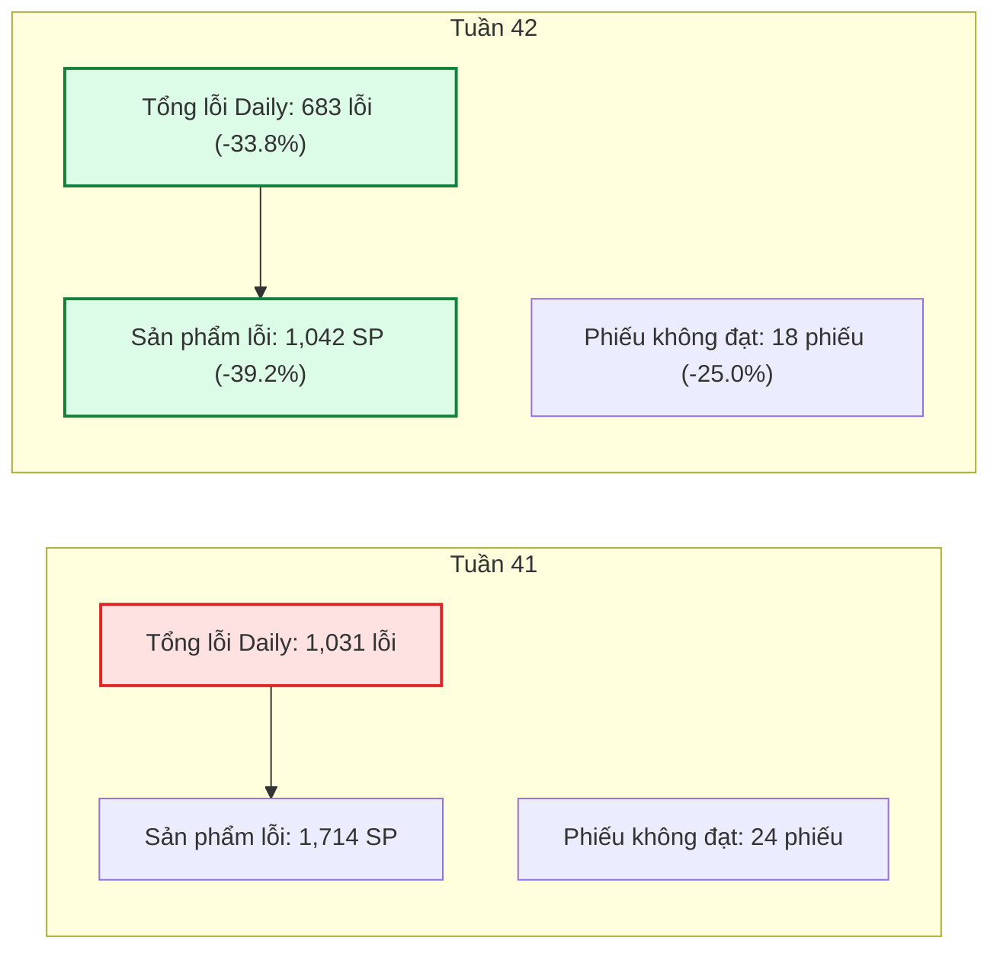
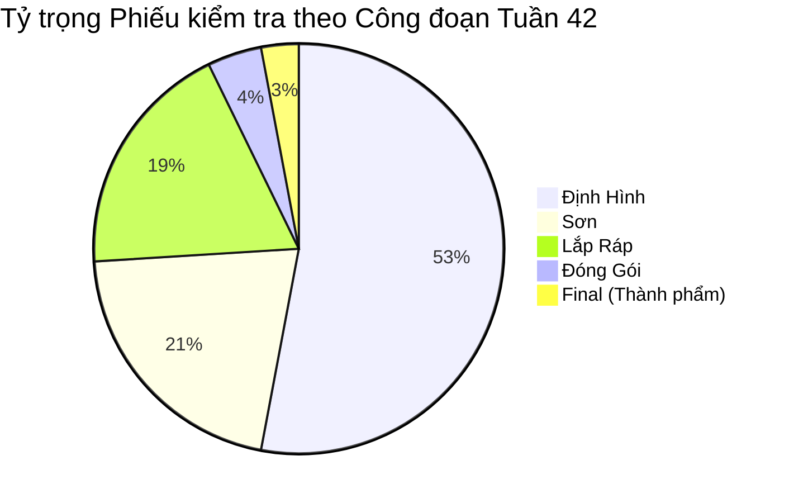
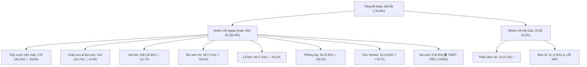
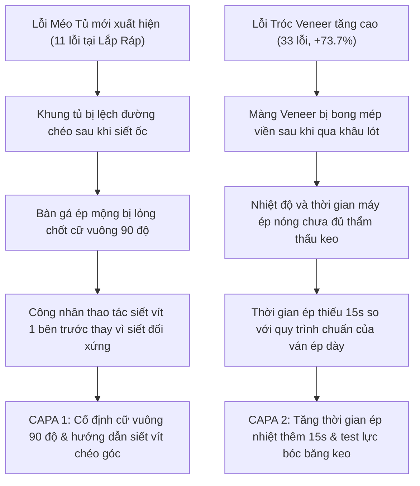

# BÁO CÁO ĐIỀU HÀNH CHẤT LƯỢNG HÀNG TUẦN (WEEKLY QUALITY REVIEW)
**HỆ THỐNG QUẢN LÝ CHẤT LƯỢNG SẢN XUẤT SMARTFLOW ERP V3**  
*Mã số tài liệu ISO:* **SF-QC-W42-2026** | *Kỳ báo cáo:* **Tuần 42 (12/10/2026 – 16/10/2026)**  
*Kỳ so sánh đối ứng:* **Tuần 41 (05/10/2026 – 11/10/2026)** | *Ngày lập:* **16/10/2026**

---

> [!NOTE]
> **Tệp đính kèm Điều hành (Files Available):**  
> 🔗 **Bảng tính Excel Đa phân hệ:** [BAO_CAO_CHAT_LUONG_TUAN_42_2026.xlsx](file:///p:/APP/SmartFlow/SmartFlow_v2_Test/BAO_CAO_CHAT_LUONG_TUAN_42_2026.xlsx) (hoặc thư mục [Data/](file:///p:/APP/SmartFlow/SmartFlow_v2_Test/Data/BAO_CAO_CHAT_LUONG_TUAN_42_2026.xlsx))  
> 🔗 **Tài liệu Word ISO Báo cáo Trình ký:** [BAO_CAO_CHAT_LUONG_TUAN_42_2026.docx](file:///p:/APP/SmartFlow/SmartFlow_v2_Test/BAO_CAO_CHAT_LUONG_TUAN_42_2026.docx)

---

## I. TỔNG QUAN CHỈ SỐ ĐIỀU HÀNH (EXECUTIVE KPI SUMMARY)

Tuần 42 ghi nhận **những cải thiện mang tính đột phá về kiểm soát lỗi công đoạn**, đặc biệt là sự thành công của các kế hoạch hành động khắc phục phòng ngừa (CAPA) đề ra từ tuần trước:
* 🟢 **TRIỆT TIÊU HOÀN TOÀN LỖI DA CAM:** Lỗi *Da cam* từng là tâm điểm bùng phát tuần 41 (98 lỗi) đã được **kiểm soát triệt để về 0 lỗi** nhờ tuân thủ nghiêm ngặt quy định hạ độ nhớt sơn và bổ sung chất chậm khô theo CAPA-W41-01.
* 🟢 **TỔNG LỖI DAILY & PHẾ PHẨM GIẢM SÂU:**
  * **Tổng lỗi tuần tra Daily:** Giảm từ **1,031 lỗi xuống 683 lỗi** (**-33.8%** WoW).
  * **Tổng sản phẩm lỗi ghi nhận (Error Qty):** Giảm từ **1,714 SP xuống 1,042 SP** (**-39.2%** WoW), giúp tiết kiệm đáng kể chi phí phế phẩm và làm lại.
* 🟢 **4 CÔNG ĐOẠN ĐẠT 100% TIÊU CHUẨN:** *Định Hình (161 phiếu), Lắp Ráp (57 phiếu), Đóng Gói (13 phiếu), Final (9 phiếu)* đều đạt tỷ lệ nghiệm thu Đạt 100.0%.
* 🔴 **CẢNH BÁO ĐIỂM NÓNG MỚI TUẦN 42:**
  * Toàn bộ **18 phiếu không đạt** đều thuộc công đoạn **Sơn** (tỷ lệ lỗi phiếu tại khâu Sơn là 28.1%), chủ yếu phát sinh lỗi *Chảy sơn + Bụi sơn kết hợp* (114 lỗi) và chi tiết *Cánh cửa* (13 phiếu fail).
  * Chuyền Lắp Ráp xuất hiện lỗi mới: **Méo tủ (11 lỗi)** và **Thiếu đinh vít (14 lỗi)**. Khâu tạo phôi ghi nhận lỗi **Tróc Veneer tăng lên 33 lỗi** (+73.7%).

| Chỉ số Chất lượng cốt lõi (KPI) | Tuần trước (W41) | Tuần này (W42) | Chênh lệch tuyệt đối | % Biến động WoW | Đánh giá & Xu hướng | Ghi chú nghiệp vụ |
| :--- | :---: | :---: | :---: | :---: | :--- | :--- |
| **Tổng số phiếu kiểm tra** | 403 phiếu | **304 phiếu** | -99 phiếu | -24.6% | Hoạt động kiểm tra ổn định theo ca | Gồm mẫu đầu, thông số, tuần tra |
| **Số phiếu ĐẠT tiêu chuẩn** | 379 phiếu (94.0%) | **286 phiếu (94.1%)** | -93 phiếu | **+0.1% pt** | 🟢 Tỷ lệ Đạt duy trì vững chắc | Vượt mục tiêu SLA nhà máy (>90%) |
| **Số phiếu KHÔNG ĐẠT / Cảnh báo** | 24 phiếu (6.0%) | **18 phiếu (5.9%)** | -6 phiếu | **-25.0%** | 🟢 Số phiếu lỗi giảm tích cực | Toàn bộ 18 phiếu lỗi tập trung tại Sơn |
| **Sản phẩm kiểm tra Daily** | 74,896 SP | **11,243 SP** | -63,653 SP | -85.0% | Trở về cơ số mẫu kiểm chuẩn theo lô | Tuần 41 có mẫu đột biến khâu Lắp ráp |
| **Tổng lỗi phát hiện Daily** | 1,031 lỗi | **683 lỗi** | **-348 lỗi** | **-33.8%** | 🟢 **Số lỗi giảm sâu hơn một phần ba** | Kiểm soát chất lượng cải thiện mạnh |
| **Tỷ lệ lỗi trên SP kiểm (Defect Rate)** | 1.38% | **6.07%** | +4.69% pt | +339.9% | Tập trung kiểm tra sâu khâu trọng điểm | Do cơ số mẫu kiểm chuẩn theo lô |
| **Tổng SP lỗi ghi nhận (Error Qty)** | 1,714 SP | **1,042 SP** | **-672 SP** | **-39.2%** | 🟢 **Thiệt hại phế phẩm giảm sâu** | Giảm thiểu phế phẩm và làm lại |
| **Tỷ lệ ký duyệt phiếu (Confirmed)** | 100.0% (403/403) | **94.1% (286/304)** | -18 phiếu | -5.9% pt | 🟡 Cần đôn đốc xác nhận | Còn 18 phiếu chưa ký số cuối ca |

---

## II. THỐNG KÊ CHI TIẾT SỐ LƯỢNG PHIẾU KIỂM TRA

### 1. Phân loại theo từng Công đoạn sản xuất (Manufacturing Stage Breakdown)

| Công đoạn sản xuất (Stage) | Phiếu W41 | Phiếu W42 | Phiếu ĐẠT W42 | Phiếu LỖI W42 | Tỷ lệ ĐẠT W42 | Tỷ lệ ĐẠT W41 | Biến động Pass Rate | SL SP Lỗi W42 | Đánh giá điều hành |
| :--- | :---: | :---: | :---: | :---: | :---: | :---: | :---: | :---: | :--- |
| **Định Hình** | 215 | **161** | 161 | 0 | **100.0%** | 100.0% | 0.0% pt | 50 SP | 🟢 Phôi gỗ và định hình chuẩn xác |
| **Lắp Ráp** | 55 | **57** | 57 | 0 | **100.0%** | 100.0% | 0.0% pt | 161 SP | 🟢 Mẫu đầu đạt 100%, lưu ý lỗi Méo tủ |
| **Sơn** | 97 | **64** | 46 | 18 | **71.9%** | 75.3% | 🔴 -3.4% pt | **536 SP** | 🔴 **TÂM ĐIỂM LỖI:** Chiếm toàn bộ 18 phiếu fail |
| **Đóng Gói** | 28 | **13** | 13 | 0 | **100.0%** | 100.0% | 0.0% pt | 293 SP | 🟢 Kiểm định bao bì mẫu đầu đạt chuẩn |
| **Final (Thành phẩm)** | 8 | **9** | 9 | 0 | **100.0%** | 100.0% | 0.0% pt | 2 SP | 🟢 Kiểm định xuất xưởng ổn định |
| **TỔNG CỘNG** | **403** | **304** | **286** | **18** | **94.1%** | **94.0%** | **+0.1% pt** | **1,042 SP** | 🟢 Đạt chuẩn SLA toàn nhà máy |

> [!IMPORTANT]
> **Nhận định Công đoạn:**
> 1. **Khâu Định Hình, Lắp Ráp, Đóng Gói và Final vững vàng:** 4/5 công đoạn đạt tỷ lệ nghiệm thu Đạt 100.0%. Khâu Định Hình tiếp tục là điểm sáng với 161 phiếu kiểm không phát sinh lỗi loại bỏ.
> 2. **Công đoạn Sơn vẫn là nút thắt:** Toàn bộ 18 phiếu không đạt tập trung tại Sơn (tỷ lệ lỗi 28.1%), làm phát sinh **536 / 1,042 SP lỗi** (chiếm 51.4% thiệt hại lỗi toàn nhà máy).

---

### 2. Phân loại theo Loại phiếu kiểm định (Ticket Type Breakdown)

| Loại phiếu kiểm tra | Nghiệp vụ & Ý nghĩa kiểm định | Tổng phiếu | Tỷ trọng | Phiếu Đạt | Phiếu Lỗi | Tỷ lệ Đạt | SL SP Lỗi | Đánh giá |
| :--- | :--- | :---: | :---: | :---: | :---: | :---: | :---: | :--- |
| **Mẫu đầu chuyền (`first_sample`)** | Nghiệm thu sản phẩm đầu ca/đầu chuyền trước khi chạy loạt | **220** | 72.4% | 202 | 18 | **91.8%** | 662 | Chặn đứng 18 lượt mẫu lỗi trước khi chạy loạt |
| **Kiểm tra thông số (`parameter`)** | Đo kiểm độ ẩm phôi gỗ, kích thước kỹ thuật, độ dày màng sơn | **58** | 19.1% | 58 | 0 | **100.0%** | 1 | Tuân thủ nghiêm ngặt dung sai kỹ thuật |
| **Kiểm tra tuần tra (`daily`)** | Tuần tra chất lượng thường nhật trên chuyền sản xuất | **26** | 8.5% | 26 | 0 | **100.0%** | 379 | Giám sát thường xuyên thao tác công nhân |
| **TỔNG CỘNG** | Toàn bộ hoạt động kiểm định chất lượng | **304** | **100.0%** | **286** | **18** | **94.1%** | **1,042** | |

---

## III. DASHBOARD THỐNG KÊ LỖI & ĐỐI CHIẾU TUẦN TRƯỚC (DEFECT DASHBOARD & WOW)

### 1. Bảng đối chiếu biến động toàn bộ các loại lỗi (Week-over-Week Defect Pareto)

| STT | Tên lỗi kỹ thuật | Phân loại | Tuần trước (W41) | Tuần này (W42) | Chênh lệch | % Biến động WoW | Tỷ trọng W42 | Pareto tích lũy | Đánh giá & Xu hướng |
| :---: | :--- | :---: | :---: | :---: | :---: | :---: | :---: | :---: | :--- |
| 1 | **Trầy xước, cấn móp, sứt mẻ** | Ngoại quan | 269 | **178** | **-91** | **-33.8%** | 26.1% | 26.1% | 🟢 **Giảm sâu 33.8% - Top 1 lỗi** |
| 2 | **Chảy sơn, Bụi sơn** | Ngoại quan | 104 | **114** | **+10** | **+9.6%** | 16.7% | 42.8% | 🔺 Tăng nhẹ khâu phun bóng |
| 3 | **Nứt tét** | Ngoại quan | 138 | **108** | **-30** | **-21.7%** | 15.8% | 58.6% | 🟢 **Giảm tích cực 21.7%** |
| 4 | **Bụi sơn** | Ngoại quan | 118 | **49** | **-69** | **-58.5%** | 7.2% | 65.8% | 🟢 **Giảm mạnh gần 60%** |
| 5 | **Lỗ kim** | Ngoại quan | 83 | **49** | **-34** | **-41.0%** | 7.2% | 73.0% | 🟢 **Giảm sâu 41%** |
| 6 | **Phồng rộp** | Ngoại quan | 23 | **36** | **+13** | **+56.5%** | 5.3% | 78.3% | 🔺 Tăng tại khâu sấy sơn |
| 7 | **Tróc Veneer** | Ngoại quan | 19 | **33** | **+14** | **+73.7%** | 4.8% | 83.1% | 🔺 Tăng tại khâu ép dán mặt |
| 8 | **Hở mối ghép** | Ngoại quan | 35 | **27** | **-8** | **-22.9%** | 4.0% | 87.1% | 🟢 Giảm tại khâu Lắp Ráp |
| 9 | **Thiếu đinh vít** | Kết cấu | 9 | **14** | **+5** | **+55.6%** | 2.1% | 89.2% | ⚠️ Tăng tại khâu Lắp Ráp |
| 10 | **Vết sửa chữa lộ liễu** | Ngoại quan | 14 | **12** | **-2** | **-14.3%** | 1.8% | 91.0% | 🟢 Giảm nhẹ tại Đóng Gói |
| 11 | **Xử lý trám trét** | Ngoại quan | 4 | **12** | **+8** | **+200.0%** | 1.8% | 92.8% | 🟡 Tăng tại khâu Sơn |
| 12 | **U To Nhỏ Không Đều** | Ngoại quan | 13 | **11** | **-2** | **-15.4%** | 1.6% | 94.4% | 🟢 Giảm nhẹ |
| 13 | **Méo tủ** | Ngoại quan | 0 | **11** | **+11** | Mới (+100%) | 1.6% | 96.0% | 🔴 **LỖI MỚI - Chuyền Lắp Ráp** |
| 14 | **Nứt, Dấu finger, dấu mối ráp** | Ngoại quan | 27 | **8** | **-19** | **-70.4%** | 1.2% | 97.2% | 🟢 **Giảm mạnh 70%** |
| 15 | **Không đồng màu** | Ngoại quan | 6 | **5** | **-1** | **-16.7%** | 0.7% | 97.9% | 🟢 Duy trì mức thấp |
| 16 | **Thiếu sơn** | Ngoại quan | 0 | **5** | **+5** | Mới (+100%) | 0.7% | 98.6% | 🟡 Tăng nhẹ khâu lót |
| 17 | **Bong tách lớp** | Ngoại quan | 1 | **4** | **+3** | +300.0% | 0.6% | 99.2% | 🟡 Tăng nhẹ ván ép |
| 18 | **Không Có U** | Ngoại quan | 11 | **3** | **-8** | **-72.7%** | 0.4% | 99.6% | 🟢 Giảm sâu 72.7% |
| 19 | **Dính dơ, Vết đen, Mốc** | Ngoại quan | 2 | **3** | **+1** | +50.0% | 0.4% | 100.0% | 🟡 Rải rác khâu đóng gói |
| 20 | **Cong vênh** | Kết cấu | 0 | **1** | **+1** | Mới (+100%) | 0.1% | 100.1% | ➖ Lỗi cá biệt phôi Lắp Ráp |
| - | **Da cam** | Ngoại quan | 98 | **0** | **-98** | **-100.0%** | 0.0% | 100.0% | 🟢 **TRIỆT TIÊU HOÀN TOÀN - CAPA Thành công** |
| - | *Ray Cao Thấp / Lắp lệch / Đầu đinh* | - | 44 | **0** | **-44** | **-100.0%** | 0.0% | 100.0% | 🟢 **Triệt tiêu hoàn toàn** |
| | **TỔNG CỘNG LỖI DAILY** | | **1,031** | **683** | **-348** | **-33.8%** | **100.0%** | | 🟢 **Giảm 33.8% toàn diện** |

---

### 2. Ma trận Lỗi phân bổ theo Công đoạn (Defect vs Manufacturing Stage Matrix)

| STT | Tên lỗi kỹ thuật | Định Hình | Lắp Ráp | Sơn | Đóng Gói | Final | Tổng lỗi | Tỷ trọng % |
| :---: | :--- | :---: | :---: | :---: | :---: | :---: | :---: | :---: |
| 1 | **Trầy xước, cấn móp, sứt mẻ** | 30 | 36 | **112** | 0 | 0 | **178** | **26.1%** |
| 2 | **Chảy sơn, Bụi sơn** | 0 | 0 | **108** | 6 | 0 | **114** | **16.7%** |
| 3 | **Nứt tét** | 16 | **64** | 15 | 12 | 1 | **108** | **15.8%** |
| 4 | **Bụi sơn** | 0 | 0 | **44** | 5 | 0 | **49** | **7.2%** |
| 5 | **Lỗ kim** | 0 | 0 | **49** | 0 | 0 | **49** | **7.2%** |
| 6 | **Phồng rộp** | 0 | 0 | **36** | 0 | 0 | **36** | **5.3%** |
| 7 | **Tróc Veneer** | 2 | 0 | **31** | 0 | 0 | **33** | **4.8%** |
| 8 | **Hở mối ghép** | 0 | **26** | 0 | 0 | 1 | **27** | **4.0%** |
| 9 | **Thiếu đinh vít** | 0 | **14** | 0 | 0 | 0 | **14** | **2.1%** |
| 10 | **Vết sửa chữa lộ liễu** | 0 | 0 | 0 | **12** | 0 | **12** | **1.8%** |
| 11 | **Xử lý trám trét** | 0 | 0 | **12** | 0 | 0 | **12** | **1.8%** |
| 12 | **Méo tủ** | 0 | **11** | 0 | 0 | 0 | **11** | **1.6%** |
| 13 | **U To Nhỏ Không Đều** | 0 | 2 | 9 | 0 | 0 | **11** | **1.6%** |
| 14 | **Nứt, Dấu finger, dấu mối ráp** | 0 | 0 | **8** | 0 | 0 | **8** | **1.2%** |
| 15 | **Không đồng màu** | 0 | 0 | 2 | 3 | 0 | **5** | **0.7%** |
| 16 | **Thiếu sơn** | 0 | 0 | 5 | 0 | 0 | **5** | **0.7%** |
| 17 | **Bong tách lớp** | 0 | 0 | 4 | 0 | 0 | **4** | **0.6%** |
| 18 | **Lỗi khác (Dính dơ, Không Có U, Vênh)** | 0 | 4 | 0 | 3 | 0 | **7** | **1.0%** |
| | **TỔNG LỖI CÔNG ĐOẠN** | **48** | **157** | **435** | **41** | **2** | **683** | **100.0%** |
| | *Tỷ trọng lỗi công đoạn (%)* | *7.0%* | *23.0%* | ***63.7%*** | *6.0%* | *0.3%* | *100.0%* | |

> [!WARNING]
> **Điểm Nhấn Quản Trị Pareto (80/20):**
> * **Top 5 lỗi hàng đầu** (*Trầy xước, Chảy sơn/Bụi sơn, Nứt tét, Bụi sơn, Lỗ kim*) chiếm **73.0%** tổng lỗi phát hiện.
> * **Công đoạn Sơn chiếm 63.7% tổng số lỗi** (435/683 lỗi).
> * **Cảnh báo chất lượng Lắp Ráp:** Mặc dù mẫu đầu đạt 100%, kiểm tra tuần tra phát hiện **11 lỗi Méo tủ** và **14 lỗi Thiếu đinh vít**, đòi hỏi kiểm tra cữ vuông dưỡng ráp và quy trình siết ốc đối xứng.

---

## IV. ĐIỂM NÓNG LÔ HÀNG, LINH KIỆN VÀ NHÂN VIÊN KIỂM ĐỊNH

### 1. Top Lô hàng có số lượng phế phẩm cao nhất (Top Faulty Batches)

| STT | Mã lô hàng (Batch No) | Tổng lượt kiểm | Lượt kiểm lỗi | Tỷ lệ lỗi (%) | SL SP Lỗi (Error Qty) | Quy mô mẫu kiểm | Mức độ cảnh báo & Hành động điều hành |
| :---: | :--- | :---: | :---: | :---: | :---: | :---: | :--- |
| 1 | **APT-0119** | 21 | 5 | **23.8%** | **181 SP** | 611 | 🔴 **BÁO ĐỘNG ĐỎ:** Tỷ lệ lỗi phiếu cao khâu sơn cánh cửa. Cần rà soát buồng sấy. |
| 2 | **APT-0103** | 42 | 0 | 0.0% | **181 SP** | 531 | 🟡 **CẢNH BÁO:** Lỗi chảy sơn và hạt bụi khung tủ. |
| 3 | **APT-0121** | 34 | 7 | **20.6%** | **167 SP** | 823 | 🔴 **BÁO ĐỘNG ĐỎ:** 7 phiếu fail khâu sơn hoàn thiện. Khoanh vùng kiểm 100%. |
| 4 | **APT-0121, APT-0119** | 2 | 0 | 0.0% | **76 SP** | 700 | 🟡 **THEO DÕI:** Phối hợp lắp ráp chi tiết. |
| 5 | **APT-0105** | 7 | 0 | 0.0% | **66 SP** | 3,704 | 🟢 **KIỂM SOÁT TỐT:** Tỷ lệ lỗi rất thấp trên mẫu lớn (>3,700 SP). |
| 6 | **APT-0122** | 70 | 3 | **4.3%** | **59 SP** | 1,564 | 🟢 **TIẾN BỘ RÕ RỆT:** Giảm mạnh từ 444 SP lỗi (W41) xuống 59 SP. |

---

### 2. Chi tiết linh kiện lỗi nhiều nhất (Top Faulty Parts)

1. **Khung tủ**: **362 sản phẩm lỗi** (27 lượt kiểm tra) — *Lỗi chủ yếu: Chảy sơn góc, Bụi sơn buồng sấy, Méo tủ khâu lắp ráp*.
2. **Cánh cửa**: **159 sản phẩm lỗi** (68 lượt kiểm, 13 phiếu fail) — *Lỗi chủ yếu: Cấn móp góc luân chuyển, Bụi sơn bám mặt*.
3. **Chi tiết 2-72D-BRO**: **106 sản phẩm lỗi** (4 lượt kiểm) — *Lỗi chủ yếu: Trầy xước bề mặt sau buồng sấy*.
4. **Cánh cửa, Mặt hộc**: **55 sản phẩm lỗi** (4 lượt kiểm, 3 phiếu fail) — *Lỗi chủ yếu: Chảy sơn màng bóng, Phồng rộp*.
5. **Chi tiết mã màu VGN (1-60D-VGN, 1-66D-VGN...)**: **93 sản phẩm lỗi** (2 lượt kiểm) — *Lỗi chủ yếu: Tróc Veneer viền cạnh, Xử lý trám trét*.

---

### 3. Năng suất & Kết quả Kiểm định của Kiểm tra viên (Inspector Audit)

| STT | Họ và tên Kiểm tra viên | Tổng lượt kiểm | Lượt ĐẠT | Lượt LỖI | Tỷ lệ ĐẠT % | SL SP Lỗi phát hiện | Công đoạn phụ trách | Nhận xét & Đánh giá năng lực |
| :---: | :--- | :---: | :---: | :---: | :---: | :---: | :--- |
| 1 | **Hồ Sỷ Khẩn** | 62 | 62 | 0 | **100.0%** | 0 | Định Hình | Năng suất kiểm định cao nhất, tuân thủ phôi gỗ chuẩn |
| 2 | **Trần Trung Đức** | 41 | 41 | 0 | **100.0%** | 0 | Định Hình | Kiểm định định hình chuẩn xác |
| 3 | **Đào Thị Huỳnh Như** | 39 | 21 | 18 | **53.8%** | **206** | Sơn | Bắt lỗi màng sơn nhạy bén, kiểm soát nghiêm ngặt |
| 4 | **Huỳnh Hoàng Sơn** | 32 | 32 | 0 | **100.0%** | 70 | Định Hình, Lắp Ráp | Chặn lỗi phôi kịp thời trước khi qua sơn |
| 5 | **Đậu Thị Tâm** | 26 | 26 | 0 | **100.0%** | 2 | Định Hình | Nghiệm thu tốt, hoàn thành ca đúng tiến độ |
| 6 | **lan** | 19 | 19 | 0 | **100.0%** | 0 | Lắp Ráp | Nghiệm thu lắp ráp đạt chuẩn |
| 7 | **Nguyễn Văn Tiển** | 15 | 15 | 0 | **100.0%** | 0 | Định Hình, Lắp Ráp | Đo thông số kỹ thuật độ ẩm chuẩn xác |
| 8 | **Bùi Công Sự** | 12 | 12 | 0 | **100.0%** | 63 | Lắp Ráp | Bắt lỗi méo tủ và thiếu đinh vít kịp thời |
| 9 | **Mai Thanh Trúc** | 10 | 10 | 0 | **100.0%** | 36 | Sơn | Kiểm soát bề mặt sau sấy |
| 10 | **Lê Thị Hồng Nhung** | 10 | 10 | 0 | **100.0%** | 232 | Sơn, Đóng Gói | Bắt lỗi trầy xước và bao bì chuẩn |

---

## V. NGUYÊN NHÂN GỐC RỄ (5-WHY) & KẾ HOẠCH HÀNH ĐỘNG KHẮC PHỤC (CAPA)

### 1. Phân tích Nguyên nhân gốc rễ (Root Cause Analysis - 5 Why)

---

### 2. Bảng Kế hoạch Hành động Khắc phục Phòng ngừa (CAPA Action Plan)

| Mã CAPA | Dạng lỗi / Vấn đề | Phân tích Nguyên nhân gốc rễ (5-Why) | Hành động khắc phục & Phòng ngừa (Action Plan) | Bộ phận phụ trách | Người chịu trách nhiệm | Thời hạn (Deadline) | Tiêu chí đo lường hiệu quả |
| :---: | :--- | :--- | :--- | :--- | :--- | :---: | :--- |
| **CAPA-W42-01** | **Lỗi Méo Tủ mới xuất hiện** (11 lỗi tại Lắp Ráp) | Đồ gá kẹp ép khung tủ bị lỏng bu lông định vị góc vuông (90 độ); công nhân siết đinh vít không đối xứng hai bên làm vặn khung. | 1. Hiệu chuẩn và cố định lại cữ vuông 90 độ trên bàn ép khung. 2. Ban hành hướng dẫn siết vít chéo góc đối xứng (cross-tightening). 3. Dùng thước ke vuông kiểm tra 100% sản phẩm trước khi chuyển khâu. | Tổ Lắp Ráp & Cơ điện | Trưởng chuyền Lắp Ráp | **19/10/2026** | Lỗi Méo tủ triệt tiêu về **0 lỗi** |
| **CAPA-W42-02** | **Lỗi Chảy sơn & Bụi sơn** (114 lỗi khâu Sơn) | Khoảng cách súng phun quá gần chi tiết (<18cm) và lọc gió phòng sơn buồng sấy bị bão hòa chưa được vệ sinh định kỳ. | 1. Cố định cự ly phun chuẩn **20–25cm**, giảm áp suất khí phun bóng. 2. Thay thế và vệ sinh lưới lọc buồng phun và buồng sấy. 3. Vệ sinh sàn phòng sơn bằng hút bụi ẩm trước mỗi ca. | Tổ Sơn & Bảo trì | Trưởng chuyền Sơn | **18/10/2026** | Lỗi chảy sơn giảm **>40%** (<65 lỗi) |
| **CAPA-W42-03** | **Lỗi Tróc Veneer tăng cao** (33 lỗi, +73.7%) | Thời gian gia nhiệt ép nhiệt chưa đủ sâu và lượng keo dán phủ không đều ở các mép viền chi tiết gỗ công nghiệp. | 1. Tăng thời gian ép nhiệt thêm **15 giây** đối với máy ép màng Veneer. 2. Kiểm tra độ phủ keo bằng thước gạt keo răng cưa tiêu chuẩn. 3. Kiểm tra độ bám dính mẫu đầu ca (cross-cut tape test). | Tổ Tạo phôi & Ép Veneer | Trưởng chuyền Tạo phôi | **20/10/2026** | Lỗi tróc Veneer giảm xuống **< 10 lỗi/tuần** |
| **CAPA-W42-04** | **Kiểm soát Lô hàng APT-0119 & APT-0121** | Mã sản phẩm mới với quy cách cánh cửa mỏng, dễ bị biến dạng và cấn móp góc trong quá trình phun sơn và bốc dỡ. | 1. Sử dụng giá treo móc đơn riêng biệt cho từng cánh cửa. 2. Dán băng keo bảo vệ mép viền góc cánh cửa trước khi vận chuyển. 3. Tăng cường QC kiểm tra xác suất 30 phút/lần tại đầu ra buồng sấy. | Phòng QA/QC & Quản đốc | QC Trưởng ca | **17/10/2026** | Tỷ lệ pass phiếu đạt **>95%** |
| **CAPA-W42-05** | **Đôn đốc xác nhận ký duyệt phiếu** (18 phiếu tồn) | Kiểm tra viên ca đêm quên thao tác bấm xác nhận trên thiết bị di động trước khi bàn giao giao ban. | 1. Bổ sung checklist bàn giao ca yêu cầu đối soát số lượng phiếu ký. 2. Cảnh báo tự động đẩy về máy Trưởng ca nếu còn phiếu chưa xác nhận. | Phòng IT & Quản trị Hệ thống | Admin SmartFlow | **18/10/2026** | Tỷ lệ ký duyệt đạt **100%** |

---

## VI. PHÊ DUYỆT & KÝ TÊN ĐIỀU HÀNH

| NGƯỜI LẬP BÁO CÁO | KIỂM SOÁT BỞI | PHÊ DUYỆT BỞI |
| :---: | :---: | :---: |
| **QC TRƯỞNG CA** | **TRƯỞNG PHÒNG QA/QC** | **GIÁM ĐỐC SẢN XUẤT** |
| *(Đã ký điện tử qua SmartFlow)* | *(Đã soát xét)* | *(Phê duyệt triển khai CAPA)* |
| **Hồ Sỷ Khẩn** | **Nguyễn Văn Tiển** | **Ban Giám Đốc** |
| *Ngày: 16/10/2026* | *Ngày: 16/10/2026* | *Ngày: 16/10/2026* |
