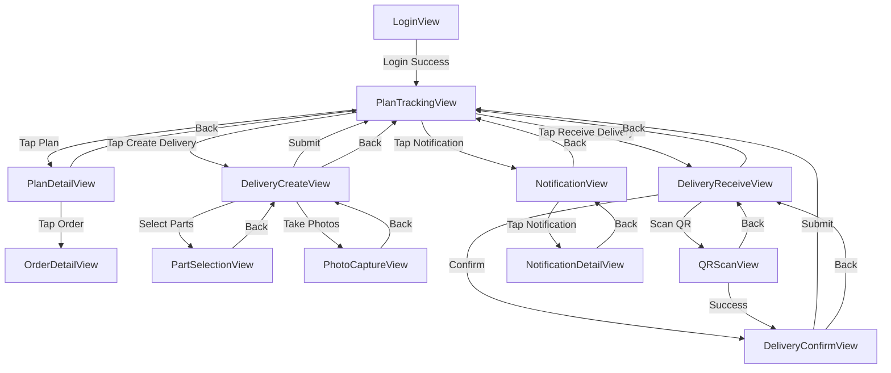
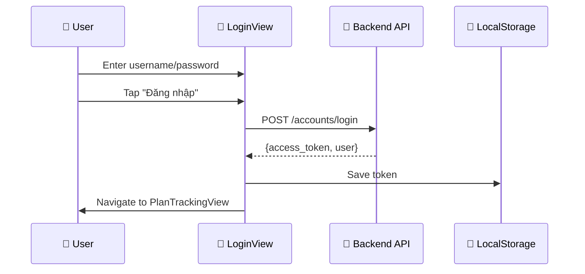
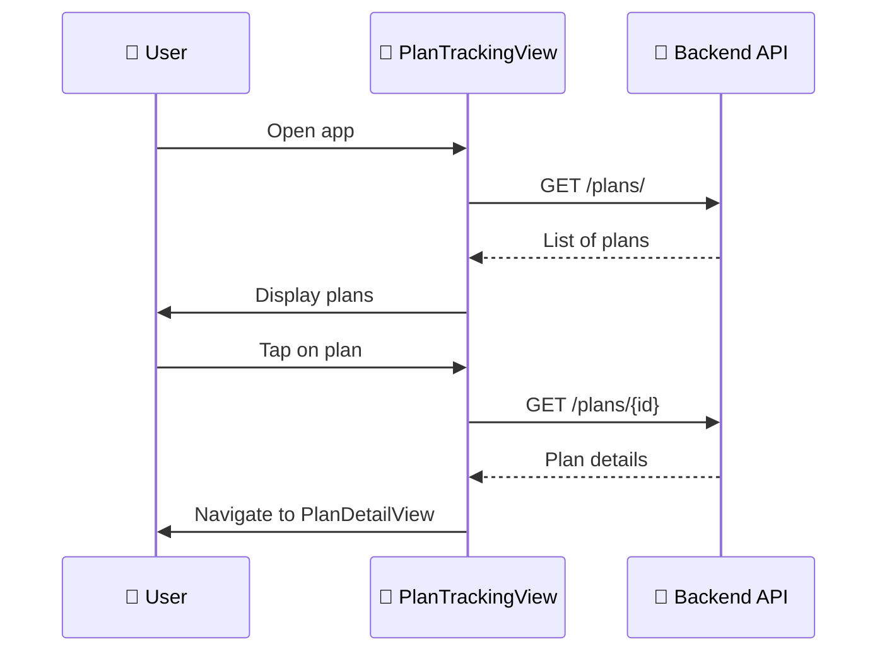
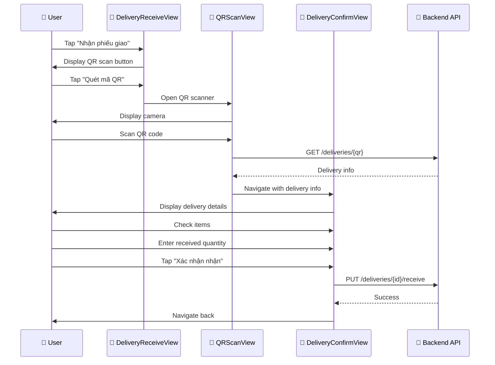
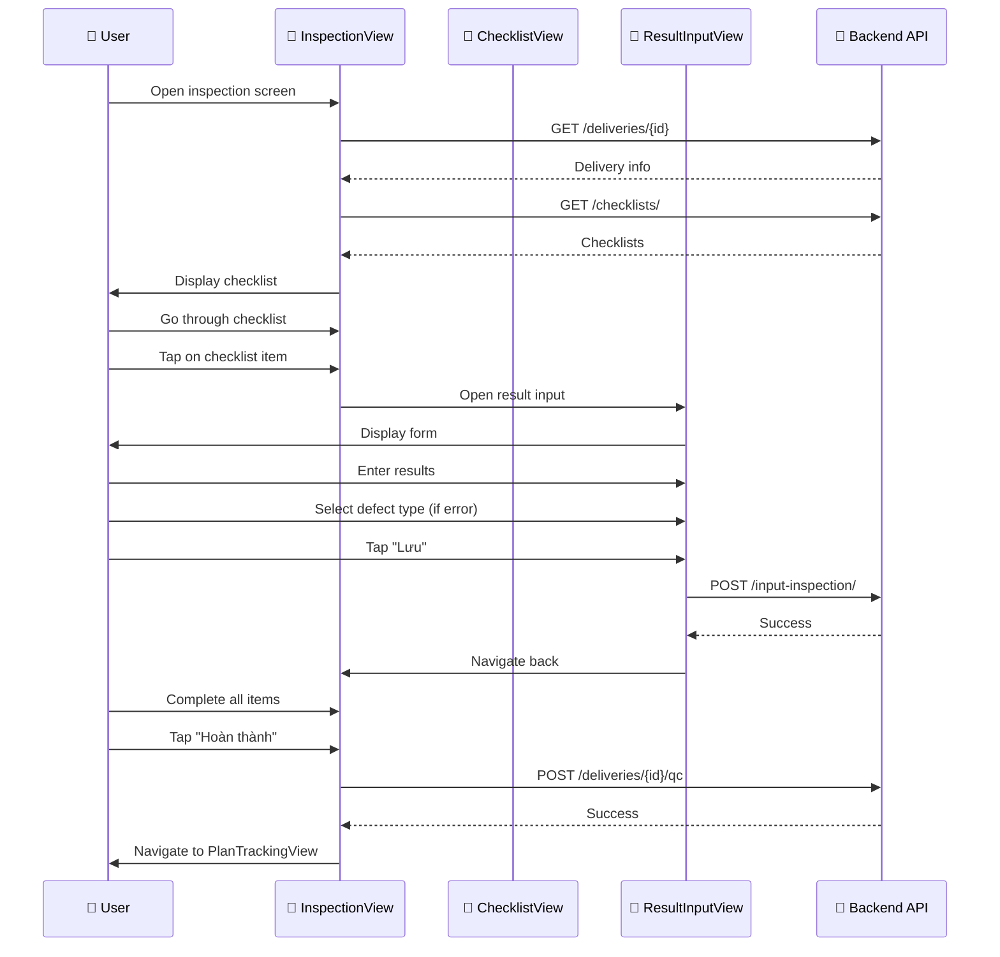
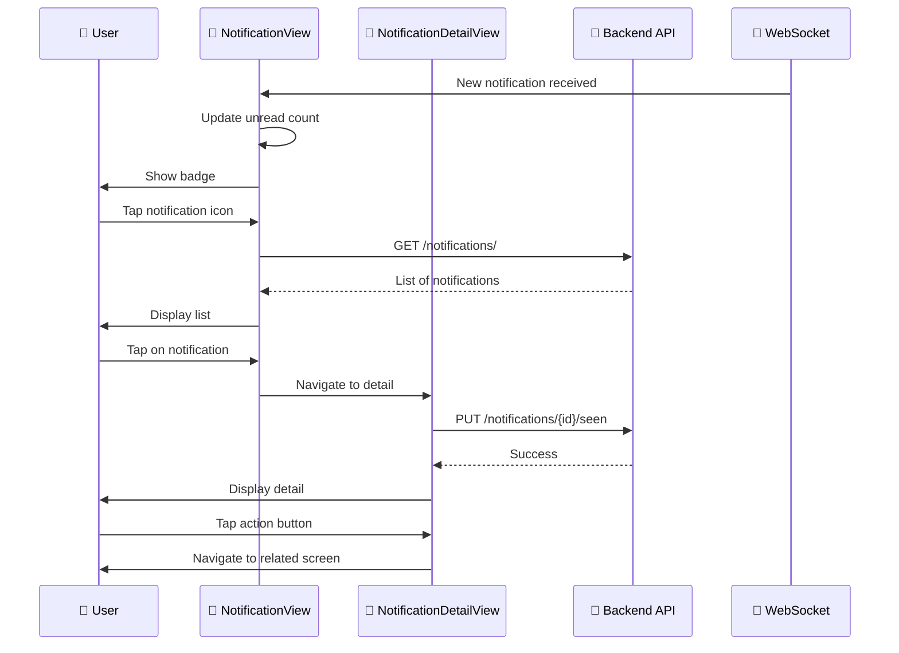

# 📱 Screen Workflows - SmartFlow Mobile

Tài liệu này mô tả chi tiết về các luồng màn hình (screen flows) trong SmartFlow Mobile App, bao gồm navigation map, user flow diagrams, và state transitions.

---

## 📋 Mục lục (Table of Contents)

1. [Tổng quan](#-tổng-quánverview)
2. [Screen Navigation Map](#-screen-navigation-map)
3. [User Flow Diagrams](#-user-flow-diagrams)
4. [Screen Descriptions](#-screen-descriptions)
5. [State Transitions](#-state-transitions)
6. [Data Loading Patterns](#-data-loading-patterns)
7. [Error Handling](#-error-handling)

---

## 🎯 Tổng quan (Overview)

### Screen Categories

SmartFlow Mobile có 5 nhóm màn hình chính:

1. **Authentication Screens** - Đăng nhập, đăng xuất
2. **Plan Tracking Screens** - Theo dõi kế hoạch sản xuất
3. **Delivery Screens** - Tạo và nhận phiếu giao
4. **Inspection Screens** - Kiểm tra chất lượng
5. **Notification Screens** - Quản lý thông báo

### Screen Hierarchy

```
LoginView
├── PlanTrackingView (Main)
│   ├── PlanDetailView
│   └── OrderDetailView
│
├── DeliveryCreateView
│   ├── PartSelectionView
│   └── PhotoCaptureView
│
├── DeliveryReceiveView
│   ├── QRScanView
│   └── DeliveryConfirmView
│
├── InspectionView
│   ├── ChecklistView
│   └── ResultInputView
│
└── NotificationView
    ├── NotificationListView
    └── NotificationDetailView
```

---

## 🗺️ Screen Navigation Map

### Navigation Flow Diagram



### Route Configuration

```javascript
// Mobile/app/App.jsx
const routes = [
  {
    path: "/login",
    element: <LoginView />,
    public: true
  },
  {
    path: "/",
    element: <MobileLayout />,
    children: [
      { path: "", element: <PlanTrackingView /> },
      { path: "plan-tracking", element: <PlanTrackingView /> },
      { path: "plan/:id", element: <PlanDetailView /> },
      { path: "order/:id", element: <OrderDetailView /> },
      { path: "delivery-create", element: <DeliveryCreateView /> },
      { path: "delivery-receive", element: <DeliveryReceiveView /> },
      { path: "inspection/:deliveryId", element: <InspectionView /> },
      { path: "notifications", element: <NotificationView /> },
      { path: "notification/:id", element: <NotificationDetailView /> }
    ]
  }
];
```

---

## 🔄 User Flow Diagrams

### 1. Login Flow



**Screens:**
- `LoginView` - Form đăng nhập

**State:**
```javascript
const [formData, setFormData] = useState({
  username: '',
  password: ''
});
const [loading, setLoading] = useState(false);
const [error, setError] = useState('');
```

### 2. Plan Tracking Flow



**Screens:**
- `PlanTrackingView` - Danh sách kế hoạch
- `PlanDetailView` - Chi tiết kế hoạch
- `OrderDetailView` - Chi tiết đơn hàng

**State:**
```javascript
const [plans, setPlans] = useState([]);
const [loading, setLoading] = useState(true);
const [selectedStage, setSelectedStage] = useState('all');
```

### 3. Delivery Create Flow

```mermaid
sequenceDiagram
    participant User as 👤 User
    participant Create as 📱 DeliveryCreateView
    participant Part as 📱 PartSelectionView
    participant Photo as 📱 PhotoCaptureView
    participant API as 🚀 Backend API

    User->>Create: Tap "Tạo phiếu giao"
    Create->>User: Display form
    User->>Create: Select plan
    Create->>API: GET /plans/{id}/parts
    API-->>Create: List of parts
    Create->>User: Display parts
    
    User->>Create: Select parts
    User->>Create: Enter quantity
    User->>Create: Tap "Chụp ảnh"
    Create->>Photo: Open camera
    Photo->>User: Display camera
    User->>Photo: Take photos
    Photo->>Create: Return photos
    
    User->>Create: Tap "Gửi"
    Create->>API: POST /deliveries/ (multipart)
    API-->>Create: QR code
    Create->>User: Display QR code
```

**Screens:**
- `DeliveryCreateView` - Form tạo phiếu giao
- `PartSelectionView` - Chọn linh kiện
- `PhotoCaptureView` - Chụp ảnh minh chứng

**State:**
```javascript
const [selectedPlan, setSelectedPlan] = useState(null);
const [selectedParts, setSelectedParts] = useState([]);
const [photos, setPhotos] = useState([]);
const [formData, setFormData] = useState({
  delivery_stage: '',
  receiving_stage: '',
  note: ''
});
```

### 4. Delivery Receive Flow



**Screens:**
- `DeliveryReceiveView` - Màn hình nhận phiếu
- `QRScanView` - Quét mã QR
- `DeliveryConfirmView` - Xác nhận nhận hàng

**State:**
```javascript
const [qrCode, setQrCode] = useState('');
const [delivery, setDelivery] = useState(null);
const [receivedQuantity, setReceivedQuantity] = useState(0);
const [note, setNote] = useState('');
```

### 5. Inspection Flow



**Screens:**
- `InspectionView` - Màn hình kiểm tra
- `ChecklistView` - Danh sách kiểm tra
- `ResultInputView` - Nhập kết quả

**State:**
```javascript
const [delivery, setDelivery] = useState(null);
const [checklist, setChecklist] = useState([]);
const [results, setResults] = useState({});
const [currentItem, setCurrentItem] = useState(0);
```

### 6. Notification Flow



**Screens:**
- `NotificationView` - Danh sách thông báo
- `NotificationDetailView` - Chi tiết thông báo

**State:**
```javascript
const [notifications, setNotifications] = useState([]);
const [unreadCount, setUnreadCount] = useState(0);
const [filter, setFilter] = useState('all'); // all, unread
```

---

## 📄 Screen Descriptions

### 1. LoginView

**Purpose:** Đăng nhập vào hệ thống

**Components:**
- Logo
- Username input
- Password input
- Login button
- Error message display

**Validation:**
- Username required
- Password required (min 6 characters)
- Show error on failed login

**Navigation:**
- Success → PlanTrackingView
- Failed → Show error message

### 2. PlanTrackingView

**Purpose:** Hiển thị danh sách kế hoạch sản xuất

**Components:**
- Stage selector (dropdown)
- Plan list (card-based)
- Search bar
- Filter options
- Refresh button
- Create delivery button

**Data:**
- List of plans filtered by user's stage
- Progress indicators
- Status badges

**Actions:**
- Tap plan → PlanDetailView
- Tap create delivery → DeliveryCreateView
- Pull to refresh

### 3. PlanDetailView

**Purpose:** Hiển thị chi tiết kế hoạch sản xuất

**Components:**
- Plan header (code, name, dates)
- Progress bar
- Order list
- Stage progress chart
- Back button

**Data:**
- Plan details
- Order list
- Stage progress
- Delivery history

**Actions:**
- Tap order → OrderDetailView
- Back → PlanTrackingView

### 4. DeliveryCreateView

**Purpose:** Tạo phiếu giao mới

**Components:**
- Plan selector
- Stage selector (delivery/receiving)
- Part list with checkboxes
- Quantity input
- Note input
- Photo capture button
- Submit button

**Data:**
- Selected plan
- Available parts
- Selected parts
- Captured photos

**Actions:**
- Select plan → Load parts
- Tap photo → PhotoCaptureView
- Submit → Create delivery, show QR

### 5. DeliveryReceiveView

**Purpose:** Nhận phiếu giao

**Components:**
- QR scan button
- Manual input option
- Recent deliveries list

**Data:**
- Recent deliveries for user's stage
- QR scan result

**Actions:**
- Tap QR scan → QRScanView
- Scan success → DeliveryConfirmView

### 6. InspectionView

**Purpose:** Kiểm tra chất lượng

**Components:**
- Delivery info header
- Checklist items
- Progress indicator
- Complete button
- Return button (if errors)

**Data:**
- Delivery details
- Checklist
- Inspection results

**Actions:**
- Tap checklist item → ResultInputView
- Complete → Submit QC results

### 7. NotificationView

**Purpose:** Quản lý thông báo

**Components:**
- Notification list
- Filter tabs (all, unread)
- Mark all read button
- Badge count

**Data:**
- Notification list
- Unread count

**Actions:**
- Tap notification → NotificationDetailView
- Swipe to delete
- Pull to refresh

---

## 🔄 State Transitions

### 1. Login State Machine

```
[Idle] → [Loading] → [Success] → [PlanTrackingView]
                    ↓
                  [Error] → [Idle]
```

### 2. Delivery Create State Machine

```
[Idle] → [SelectPlan] → [SelectParts] → [CapturePhotos] → [Submit] → [Success] → [PlanTrackingView]
                    ↓              ↓              ↓            ↓
                  [Error]         [Error]         [Error]      [Error]
```

### 3. Inspection State Machine

```
[Idle] → [LoadChecklist] → [InspectItems] → [Complete] → [Success] → [PlanTrackingView]
                          ↓                  ↓            ↓
                        [Error]            [Error]       [Error]
```

---

## 📡 Data Loading Patterns

### 1. On Mount Loading

```javascript
useEffect(() => {
  const loadData = async () => {
    setLoading(true);
    try {
      const data = await api.get('/plans/');
      setPlans(data);
    } catch (error) {
      setError(error.message);
    } finally {
      setLoading(false);
    }
  };

  loadData();
}, []);
```

### 2. Pull to Refresh

```javascript
const [refreshing, setRefreshing] = useState(false);

const onRefresh = async () => {
  setRefreshing(true);
  try {
    const data = await api.get('/plans/');
    setPlans(data);
  } catch (error) {
    setError(error.message);
  } finally {
    setRefreshing(false);
  }
};

<RefreshControl refreshing={refreshing} onRefresh={onRefresh}>
  {/* Content */}
</RefreshControl>
```

### 3. Infinite Scroll

```javascript
const [page, setPage] = useState(1);
const [hasMore, setHasMore] = useState(true);

const loadMore = async () => {
  if (!hasMore) return;
  
  const newPage = page + 1;
  const data = await api.get('/notifications/', { params: { page: newPage } });
  
  setNotifications([...notifications, ...data.items]);
  setPage(newPage);
  setHasMore(data.items.length > 0);
};

<InfiniteScroll
  dataLength={notifications.length}
  next={loadMore}
  hasMore={hasMore}
  loader={<LoadingSpinner />}
>
  {/* Content */}
</InfiniteScroll>
```

---

## ⚠️ Error Handling

### 1. Network Error

```javascript
const handleError = (error) => {
  if (error.response?.status === 401) {
    // Unauthorized - redirect to login
    navigate('/login');
  } else if (error.response?.status === 403) {
    // Forbidden - show permission error
    showError('Bạn không có quyền truy cập');
  } else if (!error.response) {
    // Network error
    showError('Mất kết nối mạng');
  } else {
    // Other errors
    showError(error.response?.data?.message || 'Có lỗi xảy ra');
  }
};
```

### 2. Validation Error

```javascript
const validateForm = (data) => {
  const errors = {};
  
  if (!data.quantity || data.quantity <= 0) {
    errors.quantity = 'Số lượng phải lớn hơn 0';
  }
  
  if (!data.delivery_stage) {
    errors.delivery_stage = 'Vui lòng chọn công đoạn giao';
  }
  
  if (!data.receiving_stage) {
    errors.receiving_stage = 'Vui lòng chọn công đoạn nhận';
  }
  
  return errors;
};
```

### 3. Camera Error

```javascript
const handleCameraError = (error) => {
  if (error.message.includes('User denied')) {
    showError('Bạn đã từ chối quyền truy cập camera');
  } else if (error.message.includes('No camera')) {
    showError('Thiết bị không có camera');
  } else {
    showError('Không thể mở camera');
  }
};
```

---

## 📞 Hỗ trợ (Support)

Nếu bạn có câu hỏi về screen workflows:

1. Kiểm tra **React Router Docs**: https://reactrouter.com/
2. Kiểm tra **Capacitor Docs**: https://capacitorjs.com/docs
3. Liên hệ **Mobile Team**: mobile@smartflowg7.cloud

---

**Last Updated:** 2026-06-03
**Version:** 2.0
**Branch:** test_v1
