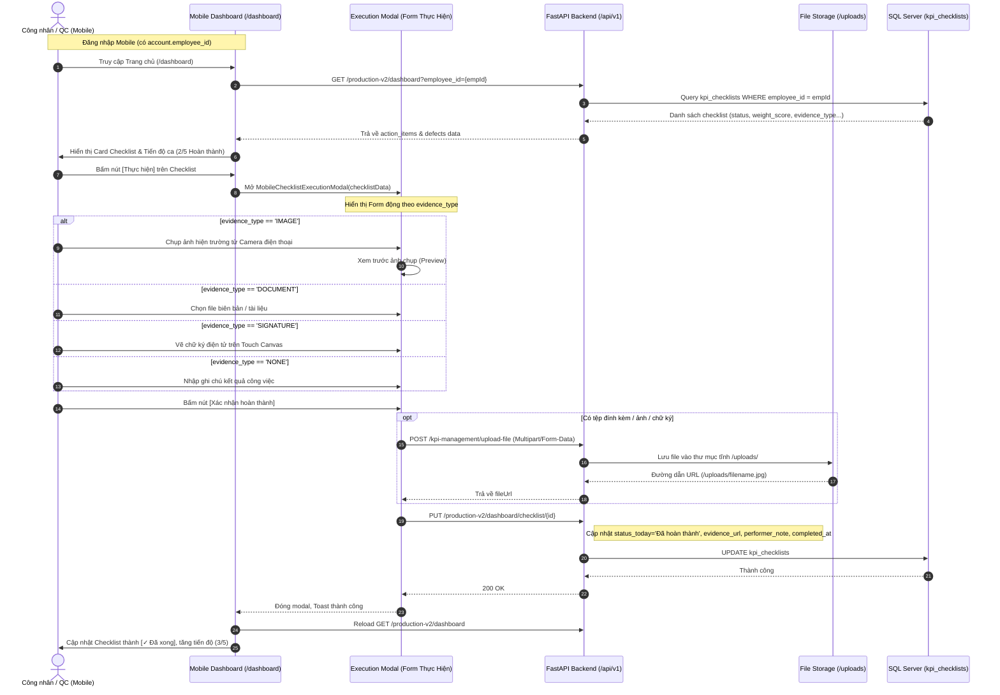

# 📋 KẾ HOẠCH TOÀN DIỆN: THỰC THI CHECKLIST CÔNG VIỆC TRÊN MOBILE DASHBOARD (`/dashboard`)
**Dự án:** SmartFlow ERP v3 | **Phân hệ:** Mobile PWA (Port 5174/5175) & Production/KPI Backend

---

## 1. 🎯 BỐI CẢNH & MỤC TIÊU NGHIỆP VỤ

### 1.1. Hiện trạng
- **Web Quản trị** (`/admin/kpi/dashboard` Tab 3 và `/admin/kpi/quality-employees`):
  - Người quản lý đã thiết lập kho Thư viện Checklist mẫu (Cố định / Thời hạn, Trọng số điểm, Loại bằng chứng).
  - Phân bổ Checklist cho từng nhân viên QC / Công nhân cụ thể.
- **Mobile** (`/dashboard` - Màn hình `MB02 | Trang chủ & Menu Mobile`):
  - Khối **CheckList công việc** hiện tại đang hiển thị giao diện placeholder tĩnh với nhãn `"Đang phát triển"`.
  - Công nhân và kiểm tra viên tại hiện trường chưa có nơi để xem các nhiệm vụ hàng ngày của mình và chưa thể bấm hoàn thành kèm bằng chứng.

### 1.2. Mục tiêu đạt được
1. **Hiển thị danh sách CheckList cá nhân hóa**: Khi nhân viên đăng nhập trên Mobile, trang `/dashboard` sẽ hiển thị chính xác danh sách các đầu việc Checklist được giao cho nhân viên đó trong ngày/ca làm việc (kèm bộ đếm tiến độ `X/Y Đã hoàn thành` và thanh progress bar).
2. **Nút "Thực hiện" bên phải mỗi Checklist**: Mỗi mục công việc chưa làm sẽ có nút **"Thực hiện"** nổi bật.
3. **Form Thực hiện Động (Dynamic Execution Form)**: Khi bấm "Thực hiện", hệ thống mở Modal tương tác thích ứng chính xác theo cấu hình yêu cầu bằng chứng (`evidence_type`):
   - 📸 **Bắt buộc chụp ảnh hiện trường (`IMAGE` / `PHOTO`)**: Mở Camera điện thoại hoặc chọn ảnh hiện trường, có khung preview trực tiếp.
   - 📄 **Bắt buộc đính kèm biên bản/file (`DOCUMENT` / `FILE`)**: Chọn file tài liệu/biên bản (.pdf, .xlsx, .docx, ảnh).
   - ✍️ **Chữ ký xác nhận (`SIGNATURE`)**: Bảng vẽ cảm ứng ký tay trực tiếp trên màn hình điện thoại (Touch Canvas).
   - 📝 **Không bắt buộc (`NONE`)**: Nhập kết quả / ghi chú kiểm tra hoàn thành.
4. **Đồng bộ dữ liệu thời gian thực (Real-time Sync)**: Nộp bằng chứng -> Backend lưu trữ -> Cập nhật trạng thái `Đã hoàn thành` -> Ghi nhận điểm số Checklist vào tổng điểm KPI của nhân viên.

---

## 2. 🏗️ KIẾN TRÚC HỆ THỐNG & LUỒNG DỮ LIỆU (SYSTEM ARCHITECTURE & DATA FLOW)

---

## 3. 🗄️ CƠ SỞ DỮ LIỆU & NÂNG CẤP BẢNG `kpi_checklists`

### 3.1. Cấu trúc hiện tại của bảng `kpi_checklists`
- `id`: Khóa chính
- `employee_id`: Mã nhân sự thực hiện (`ALL` hoặc mã riêng `NV001`, `SF01`...)
- `task_code`: Mã checklist (VD: `CL-IQC-01`)
- `content`: Tên nội dung công việc
- `frequency`: Tần suất (`Hàng ngày`, `Hàng tuần`, `Hàng tháng`...)
- `checklist_type`: `FIXED` (Cố định) hoặc `DEADLINE` (Thời hạn)
- `weight_score`: Trọng số điểm Checklist (VD: 10đ, 20đ)
- `evidence_type`: Loại bằng chứng (`NONE`, `IMAGE`, `DOCUMENT`, `SIGNATURE`)
- `result`: Tiêu chuẩn nghiệm thu mẫu
- `status_today`: Trạng thái (`Chưa làm`, `Đang thực hiện`, `Đã hoàn thành`)
- `perform_count`: Số lần đã thực hiện
- `last_performed`: Ngày thực hiện gần nhất

### 3.2. Cột cần bổ sung (Migration)
Để lưu trữ bằng chứng thực tế mà người dùng nộp từ Mobile:
1. `evidence_url` (NVARCHAR(1000) NULL): Đường link ảnh chụp hiện trường, file biên bản, hoặc ảnh chữ ký đã upload.
2. `performer_note` (NVARCHAR(1000) NULL): Ghi chú / số liệu đo đạc thực tế của nhân viên khi thực hiện.
3. `completed_at` (NVARCHAR(50) NULL): Thời điểm hoàn thành chính xác (`2026-10-05 14:32:00`).

---

## 4. 🎨 THIẾT KẾ GIAO DIỆN MOBILE (UI/UX SPECIFICATION)

### 4.1. Card "CheckList công việc" trên `/dashboard`
Thay thế khối "Đang phát triển" hiện tại bằng card hoàn chỉnh chuẩn phong cách **Gold Design System**:
- **Khối Tiêu đề (Header)**:
  - Icon `ClipboardCheck` màu cam đất `#7B5233` trong nền bo tròn `#F5EBE1`.
  - Tiêu đề: **CheckList công việc** (Font đậm, màu `#432818`).
  - Badge tiến độ: `X/Y Đã xong` (Màu xanh lá đậm `#15803D`, nền `#DCFCE7`).
- **Thanh Tiến độ (Progress Bar)**:
  - Dải thanh bar mỏng (6px), góc bo tròn, nền `#E2E8F0`, phần trăm hoàn thành tô màu `#16A34A`.
- **Danh sách công việc (Checklist Items)**:
  - Mỗi mục là một thẻ bo tròn `#FFFFFF` viền `#E2E8F0`:
    - **Cột thông tin**:
      - Mã công việc (ví dụ `CL-01`) & Tên việc in đậm rõ ràng.
      - Hàng tags meta:
        - Tag Tần suất: `Hàng ngày` (xám)
        - Tag Trọng số: `+10 điểm` (cam đất)
        - Tag Bằng chứng:
          - 📷 `Cần chụp ảnh` (nền xanh mint `#ECFDF5`, chữ xanh `#047857`)
          - 📄 `Cần gửi file` (nền xanh dương `#EFF6FF`, chữ xanh `#1D4ED8`)
          - ✍️ `Cần chữ ký` (nền tím nhạt `#F5F3FF`, chữ tím `#6D28D9`)
    - **Cột hành động bên phải**:
      - Nếu **Chưa làm**: Nút **"Thực hiện"** (Màu nâu thương hiệu `#7B5233`, chữ trắng, bo góc 8px, padding 6px 12px, font 0.78rem bold).
      - Nếu **Đã hoàn thành**: Badge tick xanh `✓ Đã xong` (Màu xanh lá, có thể bấm để xem lại bằng chứng đã nộp).

---

### 4.2. Modal Form Thực Hiện (`MobileChecklistExecutionModal`)
Modal dạng Bottom Sheet (hoặc Centered Dialog trên tablet) hiển thị:
1. **Tiêu đề Modal**:
   - Tên công việc & Mã việc.
   - Badge điểm thưởng: `+10 điểm Checklist khi hoàn thành`.
   - Nút `X` để đóng.
2. **Khu vực Tiêu chuẩn nghiệm thu (Guideline Box)**:
   - Khung màu vàng kem nhạt `#FFFBEB` viền `#FDE68A`:
   - *"Tiêu chuẩn nghiệm thu: Kiểm tra 100% linh kiện theo dưỡng, không có ba via, bề mặt sạch bụi..."*
3. **Khu vực Nộp bằng chứng động (Dynamic Evidence Input)**:
   - **TH1 - Chụp ảnh hiện trường (`IMAGE`)**:
     - Nút lớn: `📷 Chụp ảnh hiện trường / Chọn ảnh` (kích hoạt camera thiết bị qua input file).
     - Khung hiển thị ảnh Preview (thumbnail 120px, bo góc, có nút gỡ ảnh ❌).
   - **TH2 - Đính kèm file biên bản (`DOCUMENT`)**:
     - Vùng kéo thả / bấm chọn file: Hỗ trợ PDF, Excel, Word, Hình ảnh.
     - Hiển thị tên file và dung lượng file đã chọn.
   - **TH3 - Chữ ký xác nhận (`SIGNATURE`)**:
     - Khung Canvas vẽ chữ ký (260px x 120px) với đường nét màu mực xanh đen `#1E293B`.
     - Hỗ trợ vuốt chạm (Touch on Mobile) và chuột (Desktop).
     - Nút phụ: `Xóa ký lại` (Clear signature).
   - **TH4 - Không bắt buộc (`NONE`)**:
     - Hiển thị thông báo: *"Công việc này không yêu cầu bằng chứng đính kèm."*
4. **Khu vực Ghi chú thực tế (Performer Note)**:
   - Ô `textarea` cho nhân viên ghi nhận xét hoặc kết quả thực tế (ví dụ: *"Đã kiểm tra 50 cái, không phát hiện lỗi cong vênh"*).
5. **Nút Thao tác (Footer)**:
   - Nút `Hủy bỏ` (nền xám).
   - Nút `Xác nhận hoàn thành` (nền nâu thương hiệu `#7B5233`, disabled nếu bắt buộc ảnh/file/chữ ký mà chưa có).

---

## 5. 🛠️ LỘ TRÌNH THỰC HIỆN TỪNG BƯỚC (IMPLEMENTATION ROADMAP)

### Bước 1: Mở rộng CSDL & Nâng cấp Backend Router
- Tạo file migration `add_evidence_fields_to_kpi_checklists.py`:
  - Thêm 3 cột: `evidence_url` (NVARCHAR(1000)), `performer_note` (NVARCHAR(1000)), `completed_at` (NVARCHAR(50)).
- Cập nhật model SQLAlchemy `KPIChecklist` trong `kpi_management.py`.
- Nâng cấp endpoint `GET /api/v1/production-v2/dashboard`:
  - Trả về đầy đủ các trường của `action_items`: `id`, `task_code`, `task_name`, `frequency`, `weight_score`, `evidence_type`, `result`, `status`, `evidence_url`, `performer_note`, `completed_at`.
- Nâng cấp endpoint `PUT /api/v1/production-v2/dashboard/checklist/{checklist_id}`:
  - Cho phép cập nhật `status`, `notes` (lưu vào `performer_note`), `evidence_url`, `completed_at`.
  - Tự động đánh dấu ngày `last_performed = today` và tăng `perform_count += 1`.

### Bước 2: Xây dựng Component Modal Thực Hiện Checklist trên Mobile
- Tạo component `MobileChecklistExecutionModal.jsx`:
  - Xử lý chụp ảnh camera (`navigator.mediaDevices` hoặc input `accept="image/*" capture="environment"`).
  - Xử lý upload tài liệu.
  - Xử lý bảng vẽ chữ ký cảm ứng HTML5 Canvas siêu nhẹ.
  - Gọi API upload file `/api/v1/kpi-management/upload-file` để lấy file URL.
  - Gọi API lưu kết quả `PUT /api/v1/production-v2/dashboard/checklist/{id}`.

### Bước 3: Tích hợp Card Checklist vào Mobile Dashboard
- Cập nhật file `ProductionDashboardView.jsx`:
  - Bỏ khối placeholder "Đang phát triển".
  - Render danh sách các `action_items` nhận từ API.
  - Hiển thị badge tiến độ ngày của nhân viên.
  - Nút **"Thực hiện"** mở `MobileChecklistExecutionModal`.
  - Nút xem lại bằng chứng đối với các công việc đã hoàn thành.

### Bước 4: Kiểm thử & Đóng gói hoàn thiện
- Test upload ảnh chụp hiện trường, gửi file biên bản, ký chữ ký.
- Kiểm tra tính tương thích trên trình duyệt Mobile giả lập (Touch events) và Desktop.
- Chạy `npm run build` trên FrontEnd Mobile để đảm bảo không có lỗi cú pháp hay import.
