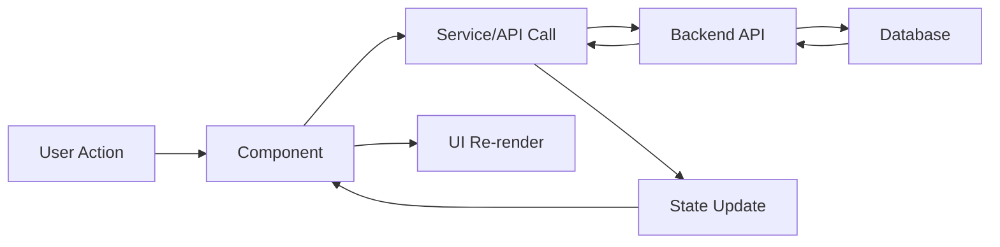

# 🏗️ Frontend Architecture - SmartFlow v2

Tài liệu này mô tả kiến trúc Frontend của SmartFlow v2, bao gồm Web Admin và Mobile App, component hierarchy, routing, và các best practices.

---

## 📋 Mục lục (Table of Contents)

1. [Tổng quan](#-tổng-quánverview)
2. [Kiến trúc tổng thể](#-kiến-trúc-tổng-thể-overall-architecture)
3. [Cấu trúc thư mục](#-cấu-trúc-thư-mục-directory-structure)
4. [Component Hierarchy](#-component-hierarchy)
5. [Routing Structure](#-routing-structure)
6. [API Service Layer](#-api-service-layer)
7. [Shared vs Platform-Specific](#-shared-vs-platform-specific)
8. [Build Process](#-build-process)
9. [Performance Optimization](#-performance-optimization)

---

## 🎯 Tổng quan (Overview)

### Technology Stack

| Technology | Version | Purpose |
|------------|---------|---------|
| **React** | 18+ | UI Framework |
| **Vite** | 5+ | Build Tool |
| **React Router** | 6+ | Routing |
| **Axios** | 1.6+ | HTTP Client |
| **Zustand** | 4+ | State Management |
| **Capacitor** | 6+ | Mobile Build (Mobile only) |

### Platform Separation

SmartFlow v2 Frontend được chia thành 2 platform:

1. **Web Admin** - Quản trị cho khối văn phòng
   - Desktop-first design
   - Rich dashboard và reports
   - Complex forms và tables

2. **Mobile App** - Ứng dụng cho công nhân tại xưởng
   - Mobile-first design
   - Touch-optimized UI
   - Camera integration, QR scanning

---

## 🏛️ Kiến trúc tổng thể (Overall Architecture)

### 1. Layer Architecture

```
┌─────────────────────────────────────────────────────────────┐
│                    PRESENTATION LAYER                        │
│  ┌─────────────────┐          ┌─────────────────┐          │
│  │   Web Admin     │          │   Mobile App     │          │
│  │  (React + Vite) │          │ (React + Capacitor)│         │
│  └─────────────────┘          └─────────────────┘          │
└─────────────────────────────────────────────────────────────┘
                              │
                              ▼
┌─────────────────────────────────────────────────────────────┐
│                    SHARED LAYER                               │
│  ┌──────────────────────────────────────────────────────┐  │
│  │  Shared Components, Hooks, Services, Store, Styles  │  │
│  └──────────────────────────────────────────────────────┘  │
└─────────────────────────────────────────────────────────────┘
                              │
                              ▼
┌─────────────────────────────────────────────────────────────┐
│                    DATA LAYER                                 │
│  ┌─────────────────┐          ┌─────────────────┐          │
│  │  API Service     │          │  WebSocket Hook  │          │
│  │  (Axios)         │          │  (useWebSocket)  │          │
│  └─────────────────┘          └─────────────────┘          │
└─────────────────────────────────────────────────────────────┘
                              │
                              ▼
┌─────────────────────────────────────────────────────────────┐
│                    BACKEND API                                │
│              FastAPI (http://localhost:8000)                  │
└─────────────────────────────────────────────────────────────┘
```

### 2. Data Flow



---

## 📁 Cấu trúc thư mục (Directory Structure)

### FrontEnd Root Structure

```
FrontEnd/
├── package.json                  # Root dependencies
├── vite.config.js                # Vite config with aliases
├── index.html                    # Entry HTML
├── shared/                       # Shared resources
│   ├── assets/                   # Images, icons
│   ├── styles/                   # Global styles
│   ├── services/                 # API services
│   ├── hooks/                    # Custom hooks
│   ├── store/                    # Zustand stores
│   └── constants/                # App constants
│
├── Web/                          # Web Admin Platform
│   ├── app/                      # App entry
│   │   ├── App.jsx               # Root component
│   │   └── bootstrap.jsx         # Bootstrap logic
│   ├── assets/                   # Web-specific assets
│   ├── styles/                   # Web-specific styles
│   ├── Shared/                   # Web shared components
│   │   ├── Views/                # Shared views
│   │   ├── Services/             # Web services
│   │   ├── Store/                # Web store
│   │   └── Hooks/                # Web hooks
│   │
│   └── [Domain Modules]/          # Business modules
│       ├── Auth/                 # Authentication
│       ├── Dashboard/            # Dashboard
│       ├── Plan/                 # Production plans
│       ├── Order/                # Orders
│       ├── Delivery/             # Deliveries
│       ├── Product/              # Products
│       └── System/               # System settings
│
└── Mobile/                       # Mobile Platform
    ├── app/                      # App entry
    │   ├── App.jsx               # Root component
    │   └── bootstrap.jsx         # Bootstrap logic
    ├── assets/                   # Mobile-specific assets
    ├── styles/                   # Mobile-specific styles
    ├── Shared/                   # Mobile shared components
    │   ├── Views/                # Shared views
    │   ├── Services/             # Mobile services
    │   ├── Store/                # Mobile store
    │   └── Hooks/                # Mobile hooks
    │
    └── [Domain Modules]/          # Business modules
        ├── Auth/                 # Authentication
        ├── Delivery/             # Deliveries
        ├── Production/           # Production
        └── Notification/         # Notifications
```

### Domain Module Structure

Mỗi domain module tuân theo pattern MVC:

```
[Module]/
├── Views/                        # UI Components
│   ├── [Module]View.jsx          # Main view
│   ├── [Module]ListView.jsx      # List view
│   ├── [Module]DetailView.jsx    # Detail view
│   └── components/               # Module-specific components
│
├── Models/                       # Data Models
│   └── [module].service.js       # API service
│
└── Styles/                       # Module styles
    └── [module].css
```

---

## 🧩 Component Hierarchy

### 1. Web Admin Component Tree

```
App (Root)
├── AuthProvider
│   └── LoginView
│
├── MainLayout
│   ├── Sidebar
│   │   ├── SidebarItem
│   │   └── SidebarHeader
│   ├── Header
│   │   ├── UserMenu
│   │   └── NotificationBell
│   └── Content
│       ├── DashboardView
│       ├── PlanView
│       │   ├── PlanListView
│       │   └── PlanDetailView
│       ├── OrderView
│       ├── DeliveryView
│       ├── ProductView
│       └── SystemView
│
└── NotificationListener
```

### 2. Mobile App Component Tree

```
App (Root)
├── AuthProvider
│   └── LoginView
│
├── MobileLayout
│   ├── MobileHeader
│   │   ├── StageSelector
│   │   └── UserMenu
│   ├── MobileContent
│   │   ├── PlanTrackingView
│   │   ├── DeliveryCreateView
│   │   ├── DeliveryReceiveView
│   │   ├── InspectionView
│   │   └── NotificationView
│   └── MobileBottomNav
│
└── NotificationListener
```

### 3. Component Types

#### Layout Components
- `MainLayout` - Main layout for Web Admin
- `MobileLayout` - Main layout for Mobile App
- `ManufactureLayout` - Layout for manufacture module
- `ManufactureSidebar` - Sidebar for manufacture module

#### Shared Components
- `Button` - Reusable button
- `Input` - Reusable input
- `Card` - Reusable card
- `Modal` - Reusable modal
- `Table` - Reusable table
- `Select` - Reusable select dropdown

#### Business Components
- `PlanCard` - Card for production plan
- `DeliveryCard` - Card for delivery
- `OrderRow` - Row for order
- `ProductCard` - Card for product

---

## 🛣️ Routing Structure

### 1. Web Admin Routes

```javascript
// Web/app/App.jsx
const routes = [
  {
    path: "/login",
    element: <LoginView />,
    public: true
  },
  {
    path: "/",
    element: <MainLayout />,
    children: [
      { path: "", element: <DashboardView /> },
      { path: "dashboard", element: <DashboardView /> },
      { path: "plans", element: <PlanView /> },
      { path: "plans/:id", element: <PlanDetailView /> },
      { path: "orders", element: <OrderView /> },
      { path: "orders/:id", element: <OrderDetailView /> },
      { path: "deliveries", element: <DeliveryView /> },
      { path: "products", element: <ProductView /> },
      { path: "system", element: <SystemView /> }
    ]
  }
];
```

### 2. Mobile App Routes

```javascript
// Mobile/app/App.jsx
const routes = [
  {
    path: "/login",
    element: <LoginView />,
    public: true
  },
  {
    path: "/",
    element: <MobileLayout />,
    children: [
      { path: "", element: <PlanTrackingView /> },
      { path: "plan-tracking", element: <PlanTrackingView /> },
      { path: "delivery-create", element: <DeliveryCreateView /> },
      { path: "delivery-receive", element: <DeliveryReceiveView /> },
      { path: "inspection", element: <InspectionView /> },
      { path: "notifications", element: <NotificationView /> }
    ]
  }
];
```

### 3. Route Protection

```javascript
// shared/components/ProtectedRoute.jsx
const ProtectedRoute = ({ children, public: isPublic }) => {
  const { user, loading } = useAuth();
  
  if (loading) return <LoadingSpinner />;
  
  if (!user && !isPublic) {
    return <Navigate to="/login" replace />;
  }
  
  if (user && isPublic) {
    return <Navigate to="/" replace />;
  }
  
  return children;
};
```

---

## 🔌 API Service Layer

### 1. API Service Structure

```javascript
// shared/services/api.js
import axios from 'axios';

const API_URL = getBaseURL();

const api = axios.create({
  baseURL: API_URL,
  timeout: 30000,
  headers: {
    'Content-Type': 'application/json'
  }
});

// Request interceptor
api.interceptors.request.use(
  (config) => {
    const token = localStorage.getItem('access_token');
    if (token) {
      config.headers.Authorization = `Bearer ${token}`;
    }
    return config;
  },
  (error) => Promise.reject(error)
);

// Response interceptor
api.interceptors.response.use(
  (response) => response,
  async (error) => {
    if (error.response?.status === 401) {
      // Token expired, try refresh
      const newToken = await refreshToken();
      if (newToken) {
        error.config.headers.Authorization = `Bearer ${newToken}`;
        return api.request(error.config);
      }
    }
    return Promise.reject(error);
  }
);

export default api;
```

### 2. Module Service Pattern

```javascript
// Web/Plan/Models/plan.service.js
import api from '../../../shared/services/api';

export const planService = {
  getPlans: async (params) => {
    return await api.get('/plans/', { params });
  },

  getPlanById: async (id) => {
    return await api.get(`/plans/${id}`);
  },

  createPlan: async (planData) => {
    return await api.post('/plans/', planData);
  },

  updatePlan: async (id, planData) => {
    return await api.put(`/plans/${id}`, planData);
  },

  deletePlan: async (id) => {
    return await api.delete(`/plans/${id}`);
  },

  getPlanProgress: async (id) => {
    return await api.get(`/plans/${id}/progress`);
  }
};
```

### 3. Multipart/Form-Data Upload

```javascript
// Web/Delivery/Models/delivery.service.js
export const deliveryService = {
  createDelivery: async (deliveryData, files) => {
    const formData = new FormData();
    
    // Add form fields
    Object.keys(deliveryData).forEach(key => {
      formData.append(key, deliveryData[key]);
    });
    
    // Add files
    files.forEach(file => {
      formData.append('files', file);
    });
    
    return await api.post('/deliveries/', formData, {
      headers: {
        'Content-Type': 'multipart/form-data'
      }
    });
  }
};
```

---

## 🔄 Shared vs Platform-Specific

### 1. Shared Layer

**Location:** `FrontEnd/shared/`

**Contains:**
- **Services** - API services dùng chung
- **Hooks** - Custom hooks dùng chung
- **Store** - Zustand stores dùng chung
- **Constants** - App constants dùng chung
- **Styles** - Global styles
- **Assets** - Shared images, icons

**Examples:**
```javascript
// shared/hooks/useAuth.js
export const useAuth = () => {
  // Auth logic shared between Web and Mobile
};

// shared/services/api.js
export const api = axios.create({
  // API configuration shared between Web and Mobile
});

// shared/store/notificationStore.js
export const useNotificationStore = create((set) => ({
  // Notification state shared between Web and Mobile
}));
```

### 2. Platform-Specific Layer

**Web Platform:** `FrontEnd/Web/`
- Desktop-optimized components
- Complex tables and charts
- Rich forms with validation
- Admin-specific features

**Mobile Platform:** `FrontEnd/Mobile/`
- Touch-optimized components
- Camera integration
- QR scanning
- Mobile-specific features

### 3. Import Aliases

```javascript
// vite.config.js
export default defineConfig({
  resolve: {
    alias: {
      '@shared': path.resolve(__dirname, './shared'),
      '@web': path.resolve(__dirname, './Web'),
      '@mobile': path.resolve(__dirname, './Mobile')
    }
  }
});
```

**Usage:**
```javascript
// In Web components
import { useAuth } from '@shared/hooks/useAuth';
import { Button } from '@web/Shared/components/ui/Button';

// In Mobile components
import { useAuth } from '@shared/hooks/useAuth';
import { Button } from '@mobile/Shared/components/ui/Button';
```

---

## 🔨 Build Process

### 1. Web Build Process

```bash
# Development
cd FrontEnd/Web
npm run dev

# Production Build
npm run build

# Preview Production Build
npm run preview
```

**Build Output:** `Web/dist/`

### 2. Mobile Build Process

```bash
# Development
cd FrontEnd/Mobile
npm run dev

# Production Build
npm run build

# Sync to Native
npx cap sync android
npx cap sync ios

# Open Native IDE
npx cap open android
npx cap open ios
```

**Build Output:** `Mobile/dist/`

### 3. Vite Configuration

```javascript
// vite.config.js
import { defineConfig } from 'vite';
import react from '@vitejs/plugin-react';
import path from 'path';

export default defineConfig({
  plugins: [react()],
  resolve: {
    alias: {
      '@shared': path.resolve(__dirname, './shared'),
      '@web': path.resolve(__dirname, './Web'),
      '@mobile': path.resolve(__dirname, './Mobile')
    }
  },
  server: {
    port: 5173,
    host: true
  },
  build: {
    outDir: 'dist',
    sourcemap: true,
    rollupOptions: {
      output: {
        manualChunks: {
          vendor: ['react', 'react-dom', 'react-router-dom'],
          ui: ['@headlessui/react', '@heroicons/react']
        }
      }
    }
  }
});
```

---

## ⚡ Performance Optimization

### 1. Code Splitting

```javascript
// Lazy load routes
const DashboardView = lazy(() => import('./Dashboard/Views/DashboardView'));
const PlanView = lazy(() => import('./Plan/Views/PlanView'));

// Use Suspense
<Suspense fallback={<LoadingSpinner />}>
  <Routes>
    <Route path="/dashboard" element={<DashboardView />} />
    <Route path="/plans" element={<PlanView />} />
  </Routes>
</Suspense>
```

### 2. Memoization

```javascript
import { memo, useMemo, useCallback } from 'react';

// Memo component
const PlanCard = memo(({ plan }) => {
  return <div>{plan.name}</div>;
});

// Memo expensive computation
const filteredPlans = useMemo(() => {
  return plans.filter(plan => plan.status === 'active');
}, [plans]);

// Memo callback
const handlePlanClick = useCallback((planId) => {
  navigate(`/plans/${planId}`);
}, [navigate]);
```

### 3. Virtual Scrolling

```javascript
// For large lists
import { FixedSizeList } from 'react-window';

const PlanList = ({ plans }) => (
  <FixedSizeList
    height={600}
    itemCount={plans.length}
    itemSize={80}
    width="100%"
  >
    {({ index, style }) => (
      <div style={style}>
        <PlanCard plan={plans[index]} />
      </div>
    )}
  </FixedSizeList>
);
```

### 4. Image Optimization

```javascript
// Lazy load images
import { LazyLoadImage } from 'react-lazy-load-image-component';

<LazyLoadImage
  src={plan.image}
  alt={plan.name}
  effect="blur"
  threshold={100}
/>

// Use WebP format when possible

```

### 5. Bundle Size Optimization

```javascript
// vite.config.js
build: {
  rollupOptions: {
    output: {
      manualChunks: {
        vendor: ['react', 'react-dom', 'react-router-dom'],
        ui: ['@headlessui/react', '@heroicons/react'],
        charts: ['recharts', 'chart.js']
      }
    }
  }
}
```

---

## 📞 Hỗ trợ (Support)

Nếu bạn có câu hỏi về Frontend architecture:

1. Kiểm tra **React Docs**: https://react.dev/
2. Kiểm tra **Vite Docs**: https://vitejs.dev/
3. Liên hệ **Frontend Team**: frontend@smartflowg7.cloud

---

**Last Updated:** 2026-06-03
**Version:** 2.0
**Branch:** test_v1
