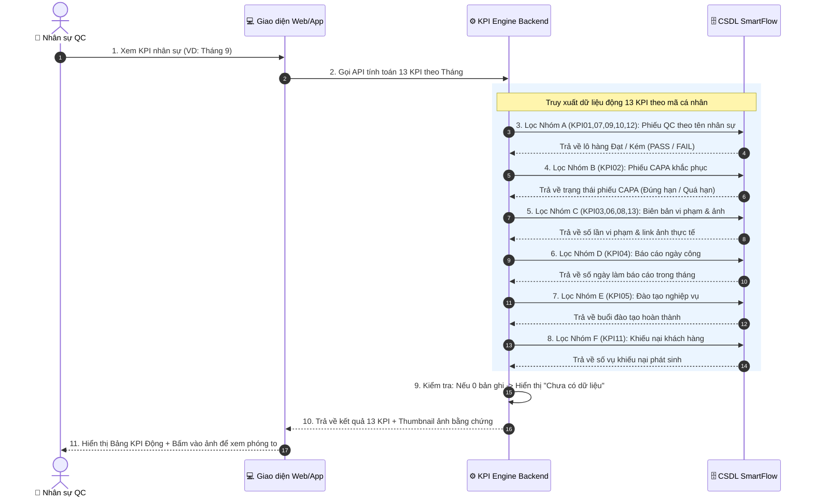

# HƯỚNG DẪN CHI TIẾT CÁCH TÍNH & PHƯƠNG PHÁP ĐẠT KPI SMARTFLOW

> **Lưu ý:** Hệ thống KPI của SmartFlow vận hành theo cơ chế **Tự động hóa & Động 100%**. Mọi chỉ số KPI đều được truy xuất trực tiếp từ dữ liệu nghiệp vụ thực tế trong CSDL (Phiếu kiểm tra QC, CAPA, Biên bản vi phạm, Đào tạo, Khiếu nại), loại bỏ hoàn toàn việc nhập liệu thủ công hoặc gán giá trị giả định.

---

## 1. CÔNG THỨC TÍNH ĐIỂM TỔNG & MA TRẬN XẾP LOẠI

### 📐 Công thức tính Điểm Tổng KPI Tháng:

**Điểm Tổng = (30% x Điểm Checklist) + (70% x Điểm KPI Trọng Số) + Điểm Quản Lý - Điểm Vi Phạm**

*Giải thích thành phần:*
1. **Điểm Checklist (Trọng số 30%)**: Điểm trung bình hoàn thành các đầu việc hàng ngày/hàng tuần của nhân sự.
2. **Điểm KPI Trọng số (Trọng số 70%)**: Điểm trung bình trọng số của 6 nhóm KPI (Nhóm A đến F).
   - *Cách tính*: **Điểm KPI = Tổng (Kết quả từng mục KPI x Trọng số mục đó) / Tổng trọng số**
3. **Điểm Đánh giá từ Quản lý**: Điểm thưởng/cộng trực tiếp từ quản lý cấp trên.
4. **Điểm Trừ Vi phạm**: Tổng điểm trừ phát sinh từ các biên bản vi phạm/sai sót quy trình trong tháng.

---

### 🏆 Ma trận Xếp loại KPI:

| Xếp loại | Điểm số đạt được | Nhãn hiển thị | Màu sắc | Ý nghĩa |
| :--- | :--- | :--- | :--- | :--- |
| **A+** | **Từ 105 điểm trở lên** | **A+ (Xuất sắc)** | 🟢 Xanh lá đậm | Hoàn thành vượt mức mục tiêu |
| **A** | **Từ 90 đến 104.9 điểm** | **A (Tốt)** | 🟢 Xanh lá tươi | Hoàn thành tốt toàn bộ KPI được giao |
| **B** | **Từ 75 đến 89.9 điểm** | **B (Khá)** | 🔵 Xanh dương | Đạt chuẩn cơ bản, cần phát huy |
| **C** | **Từ 60 đến 74.9 điểm** | **C (Cần cải thiện)** | 🟠 Màu cam | Chưa đạt một số mục tiêu quan trọng |
| **D** | **Dưới 60 điểm** | **D (Không đạt)** | 🔴 Màu đỏ | Vi phạm nhiều hoặc kết quả làm việc kém |

---

## 2. HƯỚNG DẪN THAO TÁC THEO MÀN HÌNH ĐỂ ĐẠT 13 MỤC KPI (KPI01 - KPI13)

> **Nguyên tắc riêng biệt cho từng người:** Mỗi nhân sự chỉ cần dùng tài khoản của mình đăng nhập vào các trang/module tương ứng dưới đây để làm việc. Hệ thống sẽ tự động lọc đúng mã/tên nhân sự (`inspector_name`, `handler_name`, `employee_id`) để cộng điểm KPI cá nhân.

| STT | Mã KPI | Mục tiêu KPI | Nhóm | Màn hình / Module thực hiện | Thao tác nhân sự cần làm trên Web/App | Công thức tự động từ CSDL (Mới - Tính Trọng số Mẫu & Lỗi) |
| :--- | :--- | :--- | :---: | :--- | :--- | :--- |
| **01** | **KPI01** | Tỷ lệ lỗi lọt lưới do vật tư đầu vào | **A** | `Quản lý Chất lượng` ➔ `Kiểm tra Đầu vào (IQC)` | Đăng nhập tài khoản QC, kiểm tra lô nguyên vật liệu nhập kho, điền đúng mẫu kiểm & số lỗi phát sinh. | `Trung bình cộng các phiếu: [(Mẫu kiểm - Số lỗi) / Mẫu kiểm] x 100%` |
| **02** | **KPI02** | Tỷ lệ hoàn thành CAPA đúng hạn | **B** | `Quản lý Chất lượng` ➔ `Hành động Khắc phục (CAPA)` | Vào danh sách CAPA được giao cho mình, cập nhật biện pháp khắc phục và bấm **Hoàn thành** trước hạn chót (`due_date`). | `[(Tổng CAPA - Số quá hạn) / Tổng CAPA] x 100%` |
| **03** | **KPI03** | Số lần sai sót nghiệp vụ | **C** | `Nhân sự & Kỷ luật` ➔ `Biên bản Vi phạm` | Làm đúng quy trình báo cáo & kiểm tra, tuyệt đối **không để QA/Quản lý lập biên bản vi phạm** gắn tên mình. | `100% - (Số biên bản vi phạm x 2%)` |
| **04** | **KPI04** | Tỷ lệ ngày công làm việc | **D** | `SmartFlow Mobile App` ➔ `Báo cáo QC Hàng ngày` | Mỗi ngày đi làm đều tạo và gửi ít nhất 1 Báo cáo QC trên App/Web để tích lũy đủ 26 ngày công làm báo cáo/tháng. | `(Số ngày có báo cáo thực tế / 26 công) x 100%` |
| **05** | **KPI05** | Tỷ lệ tham gia đào tạo | **E** | `Quản lý Đào tạo` ➔ `Lớp học của tôi` | Tham gia đầy đủ các lớp đào tạo chuyên môn được phân công, điểm danh bằng QR và hoàn thành bài đánh giá Đạt. | `(Buổi đào tạo đã tham gia / Tổng kế hoạch) x 100%` |
| **06** | **KPI06** | Tỷ lệ tuần tra mẫu (30p/lần) | **C** | `Quản lý QC` ➔ `Tuần tra Sản xuất (Patrol)` | Thực hiện tuần tra công đoạn đúng chu kỳ 30 phút/lần, cập nhật nhật ký tuần tra để không bị QA phạt sai sót. | `100% - (Số lần bỏ/sai tuần tra x 2%)` |
| **07** | **KPI07** | Tỷ lệ lọt pass hàng (Pallet) | **A** | `Quản lý Kho / QC` ➔ `Kiểm tra Pallet bàn giao` | Kiểm tra kỹ ngoại quan & số lượng Pallet trước khi đóng dấu Pass bàn giao sang kho thành phẩm. | `Trung bình cộng các phiếu: [(Mẫu kiểm - Số lỗi) / Mẫu kiểm] x 100%` |
| **08** | **KPI08** | Tuần tra mẫu đầu tiên (First Article) | **C** | `Quản lý QC` ➔ `Kiểm tra Sản phẩm đầu tiên` | Trước khi cho chạy máy/lô mới, bắt buộc lập Báo cáo kiểm tra sản phẩm đầu tiên (First Article Inspection). | `100% - (Số lần bỏ tuần tra mẫu đầu x 2%)` |
| **09** | **KPI09** | Tỷ lệ pass hàng (Sản phẩm) | **A** | `Quản lý QC` ➔ `Kiểm tra Công đoạn (PQC)` | Kiểm tra kích thước, ngoại quan sản phẩm tại công đoạn sản xuất, ghi nhận số lượng mẫu và lỗi thực tế. | `Trung bình cộng các phiếu: [(Mẫu kiểm - Số lỗi) / Mẫu kiểm] x 100%` |
| **10** | **KPI10** | Tỷ lệ hàng đạt Final Inspection | **A** | `Quản lý QC` ➔ `Kiểm tra Xuất hàng (OQC/Final)` | Kiểm tra Container/Lô hàng Final. Tính điểm theo tỷ lệ mẫu đạt chất lượng trên từng phiếu kiểm tra. | `Trung bình cộng các phiếu: [(Mẫu kiểm - Số lỗi) / Mẫu kiểm] x 100%` |
| **11** | **KPI11** | Tỷ lệ khiếu nại khách hàng | **F** | `Quản lý Chất lượng` ➔ `Customer Claims` | Kiểm soát chặt chẽ lô hàng xuất đi, tuyệt đối không để phát sinh vụ Khiếu nại Claim nào thuộc đơn hàng mình phụ trách. | `100% - (Số vụ khiếu nại phát sinh x 5%)` |
| **12** | **KPI12** | Tỷ lệ pass hàng thành công (Max) | **A** | `Quản lý QC` ➔ `Tổng hợp QC Sản phẩm` | Duy trì tỷ lệ chất lượng sản phẩm tối đa trên tất cả các phiếu kiểm tra của cá nhân. | `Trung bình cộng các phiếu: [(Mẫu kiểm - Số lỗi) / Mẫu kiểm] x 100%` |
| **13** | **KPI13** | Tỷ lệ tuần tra mẫu (Max) | **C** | `Quản lý QC` ➔ `Nhật ký Tuần tra Sản xuất` | Duy trì tuân thủ 100% kế hoạch tuần tra mẫu tại công đoạn sản xuất mà không có bất kỳ lỗi vi phạm nào. | `100% - (Số lần vi phạm tuần tra x 2%)` |

---

## 3. LÀM SAO ĐỂ NHÂN VIÊN TỰ KIỂM TRA & ĐẠT LOẠI A / A+?

### 📱 Các bước kiểm tra kết quả cá nhân hàng ngày:

```
[BƯỚC 1] Đăng nhập Web/App SmartFlow bằng Tài khoản cá nhân
   │
   ▼
[BƯỚC 2] Vào Menu "Quản lý KPI" ──► Chọn "Bảng KPI Cá nhân" (Xem Tháng hiện tại)
   │
   ▼
[BƯỚC 3] Xem Kết quả 13 Mục KPI:
   ├─► Nếu thấy nhãn 🟢 Xanh lá (A/A+): Tiếp tục duy trì chất lượng công việc.
   ├─► Nếu thấy nhãn 🟠 Cam hoặc 🔴 Đỏ: Click biểu tượng 🔍 (Kính kính) bên cạnh.
   └─► Nếu thấy nhãn ⚪ Xám ("Chưa có dữ liệu"): Bổ sung làm phiếu/báo cáo trên phần mềm.
   │
   ▼
[BƯỚC 4] Bấm 🔍 mở Cửa sổ Bằng chứng (Audit Trail):
   ├─► Xem danh sách các Phiếu/Báo cáo bị FAIL hoặc bị lập Biên bản.
   └─► Bấm trực tiếp vào ảnh Thumbnail nhỏ để xem phóng to bằng chứng vi phạm.
```

---

## 4. SEQUENCE DIAGRAM QUY TRÌNH TÍNH TOÁN (TỰ ĐỘNG 100%)

Sơ đồ thể hiện luồng xử lý dữ liệu từ Giao diện → Backend Engine → CSDL SmartFlow:



---
*Tài liệu được cập nhật tự động theo Engine tính toán KPI SmartFlow v2.0.*
