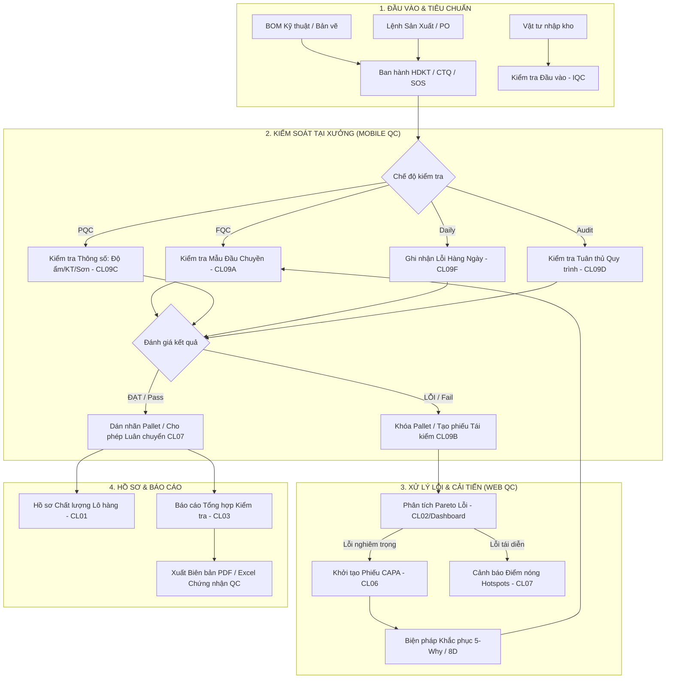

# HỆ THỐNG QUẢN LÝ CHẤT LƯỢNG (QLCL / QC-QA) & CÁC PHÂN HỆ LIÊN QUAN
> **Dự án**: SmartFlow ERP - Phân hệ Quản Lý Chất Lượng Toàn Diện  
> **Phiên bản**: V2.0 / V3.0 Universal  
> **Ngày cập nhật**: 15/09/2026  

---

## MỤC LỤC
1. [Tổng quan Triết lý Vận hành QLCL](#1-tổng-quan-triết-lý-vận-hành-qlcl)
2. [Sơ đồ Luồng Nghiệp vụ Chất lượng (Quality Workflow)](#2-sơ-đồ-luồng-nghiệp-vụ-chất-lượng-quality-workflow)
3. [Danh mục Toàn bộ Chức năng Cốt lõi QLCL](#3-danh-mục-toàn-bộ-chức-năng-cốt-lõi-qlcl)
   - [3.1. Kiểm tra Hiện trường (Mobile QC)](#31-kiểm-tra-hiện-trường-mobile-qc)
   - [3.2. Báo cáo & Hồ sơ Kiểm tra Chất lượng (Web Reports)](#32-báo-cáo--hồ-sơ-kiểm-tra-chất-lượng-web-reports)
   - [3.3. Phân tích Chỉ số & Dashboard Lỗi (Analytics & KPIs)](#33-phân-tích-chỉ-số--dashboard-lỗi-analytics--kpis)
   - [3.4. Danh mục Chuẩn hóa & Tiêu chuẩn Kiểm tra (Standards & Guides)](#34-danh-mục-chuẩn-hóa--tiêu-chuẩn-kiểm-tra-standards--guides)
   - [3.5. Hành động Khắc phục Phòng ngừa & Khiếu nại (CAPA & Claims)](#35-hành-động-khắc-phục-phòng-ngừa--khiếu-nại-capa--claims)
4. [Các Phân hệ Liên quan Mật thiết (Cross-functional Modules)](#4-các-phân-hệ-liên-quan-mật-thiết-cross-functional-modules)
   - [4.1. Sản xuất & Luân chuyển Công đoạn (Production & Transfer)](#41-sản-xuất--luân-chuyển-công-đoạn-production--transfer)
   - [4.2. Kỹ thuật & Cấu trúc BOM (Engineering & BOM)](#42-kỹ-thuật--cấu-trúc-bom-engineering--bom)
   - [4.3. Quản lý Thiết bị Đo & Kiểm định (Equipment & Metrology)](#43-quản-lý-thiết-bị-đo--kiểm-định-equipment--metrology)
   - [4.4. Đánh giá Nhân sự & KPI Thưởng Phạt (HR & KPI)](#44-đánh-giá-nhân-sự--kpi-thưởng-phạt-hr--kpi)
   - [4.5. Báo cáo Nhanh Sự cố & Trợ lý Trí tuệ Nhân tạo (AI Assistant)](#45-báo-cáo-nhanh-sự-cố--trợ-lý-trí-tuệ-nhân-tạo-ai-assistant)
5. [Bảng Ma trận Màn hình, Route Path & Mã Chức năng](#5-bảng-ma-trận-màn-hình-route-path--mã-chức-năng)
6. [Mô hình Dữ liệu Cốt lõi (Core Database Models)](#6-mô-hình-dữ-liệu-cốt-lõi-core-database-models)

---

## 1. TỔNG QUAN TRIẾT LÝ VẬN HÀNH QLCL

Phân hệ Quản Lý Chất Lượng (QLCL) trong SmartFlow được xây dựng theo tiêu chuẩn **TQM (Total Quality Management)** và **ISO 9001**, kết hợp chặt chẽ giữa 2 nền tảng:
- **Mobile QC (Dành cho Giám sát / Kiểm tra viên hiện trường)**: Nhập liệu tức thời, thao tác chạm nhanh bằng một tay, quét QR Pallet, chụp ảnh lỗi hiện trường, cảnh báo vượt ngưỡng dung sai và lưu kết quả thời gian thực.
- **Web Portal QC (Dành cho Trưởng phòng QC, Quản đốc, Ban Giám đốc)**: Theo dõi Dashboard tỷ lệ lỗi (Pareto), duyệt biên bản kiểm tra, quản lý tiêu chuẩn CTQ/SOP/HDKT, xử lý sự cố CAPA, giải quyết khiếu nại khách hàng (Claims) và xuất báo cáo PDF/Excel phục vụ kiểm toán chất lượng.

### Quy trình kiểm soát 4 tầng khép kín:
1. **IQC (Incoming Quality Control)**: Kiểm soát nguyên vật liệu, phụ kiện, sơn và gỗ thô nhập kho trước khi đưa vào chuyền.
2. **PQC / IPQC (In-Process Quality Control)**: Kiểm tra thông số gia công (độ ẩm, kích thước, độ bám dính) và giám sát tuân thủ quy trình tại từng công đoạn sản xuất.
3. **FQC / FAI (First Article Inspection)**: Kiểm tra và phê duyệt mẫu đầu chuyền trước khi cho phép gia công hàng loạt.
4. **OQC (Outgoing Quality Control)**: Kiểm tra sau đóng gói, kiểm tra trước khi xếp cont xuất kho giao khách hàng.

---

## 2. SƠ ĐỒ LUỒNG NGHIỆP VỤ CHẤT LƯỢNG (QUALITY WORKFLOW)

---

## 3. DANH MỤC TOÀN BỘ CHỨC NĂNG CỐT LÕI QLCL

### 3.1. Kiểm tra Hiện trường (Mobile QC)
Tập trung tại các module [FrontEnd/Mobile/modules/production_v2](file:///d:/SmartFlow/SmartFlow_v2_Test/FrontEnd/Mobile/modules/production_v2/):

1. **Kiểm tra Mẫu Đầu Tiên (First Sample / FAI - `CL09A`)**:
   - Áp dụng khi bắt đầu ca sản xuất hoặc đổi mã hàng mới.
   - Kiểm tra ngoại quan, khớp nối, quy cách kỹ thuật theo tiêu chuẩn mẫu đối chứng.
   - Tự động sinh mã Pallet định danh (`DAxxxxx`) khi nghiệm thu đạt.
   - Bắt buộc chụp ảnh mẫu thực tế làm bằng chứng lưu trữ.

2. **Kiểm tra Lại / Tái thẩm định (Re-inspect - `CL09B`)**:
   - Dành cho các pallet hoặc kiện hàng bị đánh rớt ở lần kiểm tra trước sau khi xưởng đã sửa chữa (rework).
   - Tra cứu lại lịch sử lỗi cũ, đối chiếu hạng mục khắc phục và cập nhật trạng thái mới.

3. **Kiểm tra Thông số Kỹ thuật Chuyên biệt (Parameter Inspection - `CL09C`)**:
   - **Đo Độ ẩm gỗ (Moisture)**: Lấy mẫu đa điểm trên phôi gỗ, tính giá trị trung bình, tự động so sánh với ngưỡng tiêu chuẩn (vd: 8% - 12%).
   - **Đo Kích thước chi tiết (Dimensions)**: Kiểm tra Dài x Rộng x Dày, cảnh báo sai số vượt dung sai ±0.5mm.
   - **Thử bám dính màng sơn (Cross-Cut Tape Test)**: Đánh giá độ bền sơn theo tiêu chuẩn ISO/ASTM (cấp độ 0B - 5B).
   - **Sau đóng gói (OQC)**: Kiểm tra quy cách thùng carton, nhãn barcode, phụ kiện đi kèm.

4. **Kiểm tra Quy trình Công đoạn (Process Audit - `CL09D`)**:
   - Kiểm tra định kỳ sự tuân thủ các bước thao tác chuẩn của công nhân theo tài liệu SOP/SOS.
   - Chụp ảnh bằng chứng thao tác chuẩn/lệch chuẩn.

5. **Kiểm tra QA / Đánh giá Checklist (`CL09E`)**:
   - Bộ câu hỏi kiểm tra tích hợp có trọng số điểm.
   - Đánh giá mức độ hoàn thiện sản phẩm trước khi bàn giao kho.

6. **Ghi nhận Lỗi Hàng Ngày (Daily Inspection - `CL09F`)**:
   - Đếm số lượng sản phẩm kiểm tra và ghi nhận số lượng từng mã lỗi phát sinh trong ca.
   - Tự động tính toán tỷ lệ lỗi `% Defect Rate = (Tổng lỗi / Tổng SP) * 100`.
   - Đồng bộ tự động vào cơ sở dữ liệu phân tích Pareto.

7. **Danh sách & Lịch sử Kiểm tra Mobile (`CL08_InspectionListView` - `MB10.1`)**:
   - Lọc nhanh các phiếu trong ngày, theo công đoạn hoặc theo trạng thái Đạt/Lỗi.
   - Xem chi tiết biên bản, hình ảnh và mã phiếu trực tiếp trên điện thoại.

---

### 3.2. Báo cáo & Hồ sơ Kiểm tra Chất lượng (Web Reports)
Tập trung tại module [FrontEnd/Web/modules/Inspection](file:///d:/SmartFlow/SmartFlow_v2_Test/FrontEnd/Web/modules/Inspection/):

1. **Báo cáo Kiểm tra QC (`CL03` - `/admin/reports`)**:
   - **4 Tab quản lý chuyên biệt**:
     - *Kiểm tra công đoạn (Stage Inspections)*: Bao gồm mẫu đầu chuyền, tái kiểm tra, kiểm tra thông số.
     - *Kiểm tra đầu vào (IQC)*: Nhật ký kiểm nghiệm nguyên vật liệu nhập kho.
     - *Ghi nhận lỗi hàng ngày (Daily)*: Bảng thống kê chi tiết số lượng lỗi theo ca/ngày.
     - *Kiểm tra quy trình (Process)*: Kết quả đánh giá audit quy trình.
   - **Bộ lọc đa chiều**: Lọc theo PO, Chi tiết sản phẩm, Công đoạn xưởng, Người kiểm tra (Inspector), Kết quả (Đạt/Lỗi/Chờ xác nhận), Ngày bắt đầu - Ngày kết thúc.
   - **Bộ lọc đặc biệt**: Lọc các phiếu **Chờ xác nhận trong 24h** để lãnh đạo QC phê duyệt kịp thời.
   - **Thư viện ảnh minh chứng (Image Gallery & Lightbox)**: Hiển thị đầy đủ ảnh hiện trường lưu trữ từ máy chủ `/static/uploads/inspections/`, hỗ trợ zoom phóng to xem chi tiết lỗi.
   - **Xuất dữ liệu chuyên nghiệp**:
     - *Xuất Excel (ExcelJS)*: Đầy đủ định dạng tiêu đề, màu sắc kết quả Đạt (Xanh)/Lỗi (Đỏ), viền bảng và công thức tính.
     - *In / Xuất PDF*: Định dạng chuẩn biên bản kiểm tra chất lượng G7 SmartFlow, tự động nhúng thư viện ảnh và khung chữ ký xác nhận của Trưởng bộ phận QC.

2. **Hồ sơ Chất lượng Theo Lô Hàng (`CL01` - `/admin/quality-records`)**:
   - Gom toàn bộ biên bản kiểm tra (IQC -> PQC -> OQC) theo từng mã đơn hàng / Lô sản xuất (PO).
   - Truy xuất nguồn gốc chất lượng (Traceability) xuyên suốt từ phôi gỗ thô đến khi đóng thùng xuất khẩu.

3. **Chi tiết Phiếu Kiểm tra (`/admin/reports/detail/:type/:id`)**:
   - Trang xem chi tiết chuyên sâu từng biên bản kiểm tra, danh sách các chi tiết trong pallet, giá trị đo từng mẫu và lịch sử thao tác.

---

### 3.3. Phân tích Chỉ số & Dashboard Lỗi (Analytics & KPIs)

1. **Bảng Tổng Quan Chất Lượng (`/admin/quality-overview`)**:
   - **Chỉ số FPY (First Pass Yield)**: Tỷ lệ sản phẩm đạt chuẩn ngay lần kiểm tra đầu tiên.
   - **Tỷ lệ phế phẩm (Scrap / Defect Rate)**: Tỷ lệ % lỗi tính trên tổng sản lượng kiểm tra.
   - **Tỷ lệ hoàn thành xác nhận biên bản**: Đo lường tốc độ phản hồi và ký duyệt của đội ngũ QC.
   - **Biểu đồ xu hướng chất lượng**: Biểu đồ đường biến thiên chất lượng theo ngày/tuần/tháng.

2. **Dashboard Phân Tích Lỗi (`/admin/defect-dashboard`)**:
   - **Biểu đồ Pareto (Nguyên tắc 80/20)**: Chỉ ra 20% nhóm nguyên nhân lỗi chiếm 80% tổng số lượng phế phẩm để ưu tiên xử lý trước.
   - **Cơ cấu lỗi theo công đoạn**: Phân bố tỷ trọng lỗi tại Sơ chế, Định hình, Lắp ráp, Sơn lót, Sơn màu, Đóng gói.
   - **Top 5 lỗi phát sinh nhiều nhất**: Cảnh báo tức thì các lỗi có tần suất vượt ngưỡng kiểm soát (vd: Nứt tét, Cong vênh, Cam màng sơn, Lệch tim vít).

3. **Điểm Nóng Cần Chú Ý (`CL07` - `/admin/hotspots`)**:
   - Tự động quét dữ liệu và đưa ra cảnh báo đỏ đối với các máy móc hoặc tổ sản xuất có tỷ lệ hàng lỗi tăng bất thường trong ca.

4. **Mục Tiêu Chất Lượng (`/admin/quality-objectives`)**:
   - Thiết lập chỉ tiêu chất lượng (Target FPY, Target Scrap Rate) cho từng xưởng theo tháng/quý.
   - Theo dõi mức độ hoàn thành chỉ tiêu thực tế so với cam kết ISO.

---

### 3.4. Danh mục Chuẩn hóa & Tiêu chuẩn Kiểm tra (Standards & Guides)

1. **Danh Mục Bảng Mã Lỗi (`CL02` - `/admin/defects`)**:
   - Chuẩn hóa mã lỗi quốc tế/nội bộ (vd: `APP-001`: Nứt tét, `STR-001`: Cong vênh, `COL-002`: Lệch màu).
   - Phân nhóm lỗi: Lỗi Ngoại quan, Lỗi Kết cấu, Lỗi Kích thước, Lỗi Bề mặt/Sơn, Lỗi Đóng gói.
   - Phân loại mức độ nghiêm trọng: Nghiêm trọng (Critical), Nặng (Major), Nhẹ (Minor).
   - Gán công đoạn kiểm soát mặc định cho từng loại lỗi.

2. **Hướng Dẫn Kiểm Tra Chất Lượng (`HD01` - `/admin/inspection-guides`)**:
   - Ban hành tài liệu HDKT cho từng sản phẩm: Dụng cụ đo cần dùng, tần suất lấy mẫu (AQL), phương pháp đo và tiêu chí chấp nhận.
   - Cấu hình phân luồng form kiểm tra tương ứng trên thiết bị di động (`/production_v2/inspection/...`).

3. **Điểm Kiểm Soát Trọng Yếu (`HD03` - `/admin/ctq-guides`)**:
   - Quản lý danh sách các thông số **CTQ (Critical To Quality)** - những đặc tính ảnh hưởng trực tiếp đến an toàn và công năng sản phẩm.
   - Đính kèm hình ảnh mô tả lỗi mẫu và giới hạn sai lệch cho phép.

4. **Hướng Dẫn Thao Tác Chuẩn (`HD02` - `/admin/sos-guides`)**:
   - Bảng hướng dẫn công việc tiêu chuẩn (Standard Operating Sheets) đặt tại trạm gia công.

5. **Quản Lý Biểu Mẫu & Quy Trình ISO (`ISO01` / `ISO02`)**:
   - Quản lý cây tài liệu quy trình vận hành chuẩn (SOP), hướng dẫn công việc (WI) và biểu mẫu ISO 9001.

---

### 3.5. Hành động Khắc phục Phòng ngừa & Khiếu nại (CAPA & Claims)

1. **Quản Lý CAPA (`CL06` - `/admin/capa` & Mobile `MB34`)**:
   - Khởi tạo phiếu yêu cầu hành động khắc phục phòng ngừa khi phát hiện lỗi nghiêm trọng hoặc lỗi lặp lại.
   - Phân tích nguyên nhân gốc rễ (Root Cause Analysis) bằng phương pháp **5-Why** hoặc **Biểu đồ xương cá (Fishbone Diagram)**.
   - Lập kế hoạch hành động: Biện pháp ngắn hạn (chữa cháy) và biện pháp dài hạn (ngăn chặn tái diễn).
   - Phân công người chịu trách nhiệm, thời hạn hoàn thành (Deadline) và đánh giá hiệu quả sau khắc phục.

2. **Xử Lý Khiếu Nại Khách Hàng (`CL08` - `/admin/claims`)**:
   - Tiếp nhận thông tin khiếu nại chất lượng từ khách hàng/đối tác xuất khẩu.
   - Ghi nhận chi tiết: Mã hàng, số container, hình ảnh lỗi từ khách, chi phí bồi thường/phạt tiền.
   - Tự động liên kết và kích hoạt phiếu CAPA nội bộ để xử lý dứt điểm.

---

## 4. CÁC PHÂN HỆ LIÊN QUAN MẬT THIẾT (CROSS-FUNCTIONAL MODULES)

QLCL trong SmartFlow không hoạt động độc lập mà là mắt xích kiểm soát trung tâm của toàn bộ nhà máy:

### 4.1. Sản xuất & Luân chuyển Công đoạn (Production & Transfer)
- **Lệnh sản xuất (`SX02`) & Kế hoạch sản xuất (`SX04`)**:
  - Cung cấp thông tin Lô sản xuất (PO), Mã chi tiết/Sản phẩm, Số lượng kế hoạch làm căn cứ để QC tính cỡ mẫu kiểm tra theo bảng AQL.
- **Tạo & Tiếp nhận Luân chuyển (`MB07` / `MB08`)**:
  - Khi tổ trưởng chuyển hàng sang công đoạn kế tiếp, hệ thống kiểm tra trạng thái QC của Pallet. Nếu Pallet bị đánh dấu **"Không Đạt"** hoặc **"Chưa kiểm tra"**, hệ thống sẽ cảnh báo hoặc ngăn chặn việc nhận hàng.
- **Quản lý Thẻ Pallet & Mã QR Dự Phòng (`AD09` / `SX10`)**:
  - Mỗi phiếu kiểm tra gắn liền với Mã Pallet (`DAxxxxx`). Nhân viên QC có thể in thẻ Pallet kèm mã QR dán trực tiếp lên kiện gỗ để công đoạn sau quét nhận hàng.
- **Xử lý Ngoại lệ / Hàng Sửa Chữa (Rework - `SX10`)**:
  - Quản lý các lô hàng không đạt yêu cầu cần tách pallet, phân loại tái chế hoặc sửa chữa lại.

### 4.2. Kỹ thuật & Cấu trúc BOM (Engineering & BOM)
- **Cơ sở Dữ liệu Sản phẩm & Bản vẽ 2D/3D (`KT01`)**:
  - QC tra cứu trực tiếp bản vẽ kết cấu, mặt cắt và kích thước chi tiết ngay trên màn hình kiểm tra để đối chiếu với sản phẩm thực tế.
- **BOM Vật tư Chi tiết (`KT02`)**:
  - Cung cấp định mức nguyên vật liệu, chủng loại gỗ, mã màu sơn tiêu chuẩn để QC đối chiếu khi làm kiểm tra đầu vào (IQC).

### 4.3. Quản lý Thiết bị Đo & Kiểm định (Equipment & Metrology)
- **Danh mục Thiết bị Đo (`BT04`) & Nhóm Thiết bị (`BT05`)**:
  - Quản lý toàn bộ dụng cụ đo lường: Thước kẹp điện tử, Panme, Máy đo độ ẩm gỗ Delmhorst, Dao cắt thử bám dính, Thước góc.
- **Lịch sử Hiệu chuẩn & Kiểm định (`BT06`)**:
  - Cảnh báo khi dụng cụ đo đến hạn kiểm định định kỳ. Ngăn chặn việc sử dụng thiết bị đo đã hết hạn hiệu chuẩn để làm biên bản QC.
- **Đào tạo Sử dụng Dụng cụ Đo (`BT07`)**:
  - Hướng dẫn phương pháp thao tác đo chuẩn xác cho nhân viên QC mới.

### 4.4. Đánh giá Nhân sự & KPI Thưởng Phạt (HR & KPI)
- **Phân bổ Nhân sự QC (`KPI05` / Mobile `MB42`)**:
  - Phân công kiểm tra viên phụ trách theo từng phân xưởng, chuyền máy và ca làm việc.
- **Đánh giá Tay nghề & Tỷ lệ Lỗi Công nhân**:
  - Dữ liệu lỗi từ các phiếu kiểm tra `CL09` được tổng hợp để chấm điểm chất lượng của công nhân đứng máy, làm căn cứ tính thưởng năng suất hoặc phạt lỗi quy trình.
- **Biên bản Vi phạm Quy trình (`KPI10` - `/admin/violations`)**:
  - Ghi nhận các trường hợp cố tình bỏ qua bước kiểm tra hoặc làm sai quy trình công nghệ.

### 4.5. Báo cáo Nhanh Sự cố & Trợ lý Trí tuệ Nhân tạo (AI Assistant)
- **Báo cáo Nhanh Hiện trường (`MB37` / `MB38`)**:
  - Cho phép công nhân/QC phát tín hiệu khẩn cấp (Andon) khi phát hiện hàng loạt chi tiết bị lỗi trên chuyền, giúp quản đốc dừng chuyền kịp thời.
- **Chatbot Trí tuệ Nhân tạo (AI QC Assistant)**:
  - Tích hợp các mô hình AI (OpenAI, Gemini, Claude, Groq) giúp QC tra cứu nguyên nhân gây lỗi dựa trên dữ liệu lịch sử và gợi ý phương án khắc phục nhanh.

---

## 5. BẢNG MA TRẬN MÀN HÌNH, ROUTE PATH & MÃ CHỨC NĂNG

| Nền tảng | Mã Màn hình | Route Path | Tên Màn hình / Chức năng | Vai trò chính trong QLCL |
| :--- | :--- | :--- | :--- | :--- |
| **Mobile** | `MB10` | `/production_v2/inspection` | Tạo phiếu kiểm tra chất lượng | Màn hình cốt lõi tạo phiếu FQC, PQC, IQC, OQC, Daily |
| **Mobile** | `MB10.1`| `/production_v2/inspection-list` | Danh sách kiểm tra chất lượng | Tra cứu lịch sử biên bản QC trong ca làm việc |
| **Mobile** | `MB34` | `/capa-list` | Báo cáo CAPA Mobile | Cập nhật tiến độ hành động khắc phục tại hiện trường |
| **Mobile** | `MB37` | `/quick-report-create` | Tạo báo cáo sự cố nhanh | Báo cáo sự cố dừng chuyền / lỗi bất thường khẩn cấp |
| **Mobile** | `MB38` | `/quick-report-list` | Lịch sử báo cáo sự cố | Theo dõi phản hồi xử lý sự cố chất lượng |
| **Mobile** | `MB42` | `/kpi-quality-employees` | Nhân sự QC Mobile | Bảng phân công kiểm tra viên tại các công đoạn |
| **Web** | `CL01` | `/admin/quality-records` | Hồ sơ chất lượng | Quản lý toàn bộ biên bản QC theo Lô PO / Sản phẩm |
| **Web** | `CL02` | `/admin/defects` | Danh mục lỗi (Defects) | Chuẩn hóa bảng mã lỗi, nhóm lỗi và mức độ nghiêm trọng |
| **Web** | `CL03` | `/admin/reports` | Báo cáo kiểm tra QC | Báo cáo đa chiều, lọc 24h, xem ảnh, xuất Excel & in PDF |
| **Web** | `CL03.1`| `/admin/reports/detail/:type/:id`| Chi tiết biên bản kiểm tra | Xem chi tiết chuyên sâu từng phiếu kiểm định |
| **Web** | `CL06` | `/admin/capa` | Quản lý CAPA | Quy trình khắc phục phòng ngừa 5-Why / 8D |
| **Web** | `CL07` | `/admin/hotspots` | Điểm nóng chất lượng | Cảnh báo tự động tỷ lệ phế phẩm tăng đột biến |
| **Web** | `CL08` | `/admin/claims` | Khiếu nại khách hàng | Quản lý phản ánh lỗi từ đối tác & kích hoạt CAPA |
| **Web** | `HD01` | `/admin/inspection-guides` | Hướng dẫn kiểm tra (HDKT) | Ban hành tiêu chuẩn kiểm tra chất lượng cho sản phẩm |
| **Web** | `HD02` | `/admin/sos-guides` | Hướng dẫn thao tác (SOS) | Bảng chỉ dẫn thao tác chuẩn tại trạm làm việc |
| **Web** | `HD03` | `/admin/ctq-guides` | Điểm kiểm soát trọng yếu (CTQ) | Cảnh báo các tiêu chí chất lượng sống còn của chi tiết |
| **Web** | `ISO01` | `/admin/iso-documents` | Quản lý biểu mẫu ISO | Kho lưu trữ biểu mẫu kiểm tra chuẩn ISO 9001 |
| **Web** | `ISO02` | `/admin/iso-processes` | Quy trình nghiệp vụ ISO | Sơ đồ lưu đồ quy trình kiểm soát chất lượng |
| **Web** | `KPI05` | `/admin/kpi/quality-employees` | Nhân sự Quản lý Chất lượng | Phân bổ và đánh giá năng lực đội ngũ QC/QA |
| **Web** | `KPI10` | `/admin/violations` | Lịch sử vi phạm quy trình | Xử lý kỷ luật lỗi vi phạm chất lượng nghiêm trọng |
| **Web** | `BT04` | `/admin/equipment` | Danh mục thiết bị đo | Quản lý dụng cụ đo lường và lịch hiệu chuẩn |
| **Web** | `AD09` | `/admin/backup-qrs` | Quản lý mã QR tạm | Sinh mã tem QR cho Pallet phục vụ kiểm tra/luân chuyển |

---

## 6. MÔ HÌNH DỮ LIỆU CỐT LÕI (CORE DATABASE MODELS)

1. **`input_inspections`** (Bảng biên bản kiểm tra công đoạn & đầu vào):
   - `id`, `ticket_code` (Mã DAxxxxx), `pallet_code`, `batch_no` (PO), `product_sku`, `part_name`, `specification`.
   - `inspection_type` (`first_sample`, `daily`, `re_inspect`, `parameter`, `process`, `qa`, `nhap-kho`).
   - `stage` (Tên công đoạn: Sơ chế, Định hình, Lắp ráp, Sơn lót, Sơn màu, Đóng gói...).
   - `required_qty`, `sample_qty`, `error_qty`, `conclusion` (`pass` / `fail`), `result` (`Đạt` / `Không đạt`).
   - `inspector_name`, `created_at`, `is_confirmed`.
   - `image_path_1`, `image_path_2`, `image_path_3`: Đường dẫn hình ảnh minh chứng lưu trên máy chủ.
   - `images_json`: Mảng JSON chứa toàn bộ danh sách ảnh tải lên.
   - `data_json`: Toàn bộ cấu trúc chi tiết: danh sách lỗi (`errors`), danh sách chi tiết kiểm tra (`parts_details`), thông số đo (`moisture`, `dimensions`, `cross-cut`), các câu trả lời checklist (`answers`, `steps`).

2. **`daily_inspection_records` & `daily_inspection_defects`** (Bảng thống kê lỗi hàng ngày):
   - Ghi nhận tổng sản lượng kiểm tra và tổng số lỗi phát sinh trong ngày theo công đoạn.
   - Liên kết 1-N với bảng chi tiết lỗi để tính toán tỷ lệ lỗi và vẽ biểu đồ Pareto.

3. **`defect_types` & `defect_categories`** (Bảng danh mục mã lỗi):
   - Định nghĩa mã lỗi (`code`), tên lỗi (`name`), nhóm lỗi (`category`), mức độ nghiêm trọng (`severity`), công đoạn kiểm soát.

4. **`capa_records`** (Bảng hành động khắc phục phòng ngừa):
   - Theo dõi sự cố chất lượng, phân tích nguyên nhân gốc rễ, kế hoạch hành động và trạng thái hoàn thành.

5. **`inspection_guides`** (Bảng hướng dẫn kiểm tra & tiêu chuẩn CTQ):
   - Lưu trữ tiêu chuẩn kích thước, tiêu chí đánh giá ngoại quan và hình ảnh mẫu đạt chuẩn.

---

> **Ghi chú**: Toàn bộ hệ thống được xây dựng đồng bộ thời gian thực; khi có bất kỳ phiếu kiểm tra nào được tạo từ điện thoại di động, dữ liệu và hình ảnh sẽ ngay lập tức được cập nhật lên hệ thống Báo cáo Web (`/admin/reports`) và các Dashboard phân tích.
