# Báo Cáo Danh Sách Lỗi (Bugs Report)

Tổng số bug ghi nhận: **97**
Tổng số hình ảnh đính kèm đã xuất: **199**

### Thống kê trạng thái:
- **Verified**: 16 bugs
- **Resolved**: 73 bugs
- **New**: 4 bugs
- **In Progress**: 4 bugs

### Thống kê mức độ nghiêm trọng:
- **Medium**: 79 bugs
- **Low**: 8 bugs
- **High**: 6 bugs
- **Critical**: 4 bugs

---

## Bảng Danh Sách Lỗi

| ID | Màn Hình | Mô Tả | Mức Độ | Trạng Thái | Người Xử Lý | Ngày Ghi Nhận | Ảnh |
| :--- | :--- | :--- | :--- | :--- | :--- | :--- | :--- |
| 1014 | COMMON (Shared) | Chưa show nội dung cho tài khoản người dùng, - ví dụ bộ phận IT thì mặc định show Quản lý hệ thống | Medium | Verified | Phucv1 | 2026-06-29 | [Ảnh 1](images/bf1a1001-ae0c-4077-aa21-58371609fb6e.png), [Ảnh 2](images/ba9a2a02-2e4b-4aec-9ca6-2e8217bfd4a5.png) |
| 1015 | MB4 (Mobile) | lỗi hiển thị | Low | Verified | Phucv1 | 2026-06-29 | [Ảnh 1](images/ec2e7c4c-48c5-4b3e-903e-6fd0ed11ea0f.png), [Ảnh 2](images/85a12467-ba9e-427c-80f7-5615e821759d.png), [Ảnh 3](images/134f82f7-b834-4af8-8a3c-3b0a51a225bb.png) |
| 1016 | COMMON (Shared) | Thanh nav mobile: chia thành 1 tab - Thông tin sản xuất     + Kế hoạch sản xuất     + Thông tin b... | High | Verified | Phucv1 | 2026-06-29 | [Ảnh 1](images/eb2d6403-d5f2-45a1-b2a6-a67487d1efcc.png), [Ảnh 2](images/ffdd61e9-6a5e-4f05-890a-4aea028a8464.png), [Ảnh 3](images/73040884-4269-485d-b979-3f9c020b4a26.png) |
| 1018 | MB4 (Mobile) | Xây dựng lại kế hoạch kiểm soát: - Tạo thêm màn hình kế hoạch sản xuất công đoạn - Lịch sử bản gi... | Medium | Resolved | Phucv1 | 2026-06-29 | [Ảnh 1](images/646faeb4-7aa0-45b4-980d-287f3d269546.png), [Ảnh 2](images/dab0ef3b-fd5b-4de4-9f66-35ed7c6a19be.png), [Ảnh 3](images/05af4ade-2be9-4a70-a838-f1e2602fd3e3.png), [Ảnh 4](images/ee055908-3105-4a37-9a23-92f030e9e0a6.png), [Ảnh 5](images/0de14732-9975-4de9-97be-80d0850262c0.png) |
| 1019 | MB6 (Mobile) | Các phiếu kiểm tra chưa có mã màn hình | Critical | Verified | Phucv1 | 2026-06-29 | [Ảnh 1](images/8ed4e65b-344a-4a60-946b-948a4b739b6e.png), [Ảnh 2](images/d3fd22e5-6fe8-4f04-9491-876222fc888b.png), [Ảnh 3](images/eb539104-bf9a-4eb4-b1ed-d74a4208f670.png) |
| 1020 | AD16 (Web) | mặc định lọc (lỗi bỏ các bug đã hoàn thành) | Low | Verified | Phucv1 | 2026-06-29 | [Ảnh 1](images/622c426d-0019-45ee-b59e-dd25be94dfa1.png), [Ảnh 2](images/03458209-fda4-459c-9c63-944735fc3c5e.png) |
| 1021 | AD16 (Web) | sửa tên ngày dự kiên thành ngày ghi nhận | Medium | Verified | Phucv1 | 2026-06-29 | [Ảnh 1](images/b39bda18-f05b-4757-8936-f96dec53a94e.png), [Ảnh 2](images/eceea147-ed45-4157-a049-8e3f8c36d42b.png) |
| 2014 | COMMON (Shared) | Chưa có thông tin tài khoản | Medium | Resolved | Phucv1 | 2026-06-30 | [Ảnh 1](images/ee453736-4c38-4740-9bcc-4cc2d24c5a74.png), [Ảnh 2](images/af4848a2-20fc-495c-bb8f-33365e96fab3.png) |
| 2015 | AD3.4 (Web) | Cho tất cả các tab mà có bảng thì làm theo cái bảng nhu  này AD3 · Danh sách người dùng đi cho đồ... | High | Resolved | Phucv1 | 2026-07-03 | [Ảnh 1](images/2e1790bf-766b-4ce4-b3fa-1b5cca4548b3.png), [Ảnh 2](images/79f1dcfd-e9e7-4b75-82d2-3eecb5662e91.png), [Ảnh 3](images/edfd5fd9-f0ac-429d-9791-2933a3943ddf.png) |
| 2016 | AD3.4 (Web) | Thiếu cái thanh bộ lọc tìm kiếm dữ liệu Có ô tìm kiếm nhưng giao diện chưa ok lắm Làm đồng bộ lại | Medium | Resolved | Phucv1 | 2026-07-03 | [Ảnh 1](images/ad9c0a7a-15bd-4098-9dfd-0f84ea4833be.png), [Ảnh 2](images/ee33e766-2110-4860-94ec-c3df66c5a261.png), [Ảnh 3](images/958023da-e5f5-4e73-b829-20596a944454.png) |
| 2017 | AD3 (Web) | Quản lý người dùng Bỏ hết các icon đi vì nhìn khá rối | Low | Verified | Phucv1 | 2026-07-03 | [Ảnh 1](images/330ea11e-0c40-454c-b0e7-a62d197d8c56.png), [Ảnh 2](images/957050c8-1416-4556-b3de-754f4c3e18ba.png) |
| 2018 | AD3.2 (Web) | Thiết kế lại cái giao diện chỗ Phạm vi phụ trách (Công đoạn sản xuất) là cho chọn nhà máy, từ đó ... | Medium | Verified | Phucv1 | 2026-07-03 | [Ảnh 1](images/092d5f39-70ad-4ab5-9512-a93fdec3911d.png), [Ảnh 2](images/d7b936ea-7a54-45d9-a766-4dca87e289a3.png), [Ảnh 3](images/f56f6aa0-e3d7-46da-a913-414d4e7e599e.png) |
| 2019 | AD3.2 (Web) | Có thể điều chỉnh cái Phân quyền chi tiết như hình đi Bớt nhiều cái màu. thêm 1 cái tất cả đi đỡ ... | Medium | Verified | Phucv1 | 2026-07-03 | [Ảnh 1](images/159773c9-6209-4a26-9802-72b9810c0282.png), [Ảnh 2](images/028b0f16-56b6-4e21-80b6-1db852950d90.png) |
| 2020 | AD3.2 (Web) | Nút lưu thay đổi bấm ko có thấy thông báo hay gì để bik, cho thêm thông báo pop up và 2 nút này c... | Medium | Verified | Phucv1 | 2026-07-03 | [Ảnh 1](images/f3424a9b-9228-4f2b-b0ad-752b054aa6d6.png), [Ảnh 2](images/a18af145-e812-4e88-8c1d-9f4aef15a1f3.png), [Ảnh 3](images/65791dfd-b8ac-426c-af86-fafb9ca3e864.png) |
| 2021 | AD3.4 (Web) | Đang sử dụng (Kích hoạt bộ phận này) thì chuyển thành toggle button đi cho dễ xài vs đọc chữ + mà... | Medium | Verified | Phucv1 | 2026-07-03 | [Ảnh 1](images/8fff1cac-0e9a-4928-81b0-2bbaa953a504.png), [Ảnh 2](images/361748b7-2149-4b2a-ae4e-bd346c5fadde.png), [Ảnh 3](images/d57c776e-e25f-401d-ae43-08cbe08e1f60.png) |
| 2022 | AD3 (Web) | Đồng bộ cái trạng thái của mác màn hình AD 3 hay 3.4 3.5 đi Xài cách kiểu 3.4 3.5 đi cho đồng bộ | Low | Resolved | Phucv1 | 2026-07-03 | [Ảnh 1](images/2470a3de-6426-4112-9ace-c6f1b9d7e615.png), [Ảnh 2](images/71c4a34c-5a8c-4330-8039-9647ec13eb91.png), [Ảnh 3](images/4457ea0d-3c0b-4652-b426-3ce5d1c00f63.png) |
| 2023 | AD3 (Web) | Dồn vào chữ khác đi Xong dropdown xuống cái nút khác nhu My vẽ đi Của các màn AD3 3.4 3.5 | Medium | Resolved | Phucv1 | 2026-07-03 | [Ảnh 1](images/771996df-cced-44c9-a031-80b0fd4f1cf5.png), [Ảnh 2](images/ef4aa4ef-128c-43b9-9140-1447e201dd6d.png), [Ảnh 3](images/7bf02884-4dec-4c89-af1a-04c0a52649ce.png) |
| 2024 | AD3.1 (Web) | Sửa lại giao diện như này nhìn cho gọn chứ ko cần tách ra làm 2 đâu số điện thoại chỉ đc nhập số ... | Medium | Resolved | Phucv1 | 2026-07-03 | [Ảnh 1](images/08ccd819-1a35-402f-b024-f3be5269ed51.png), [Ảnh 2](images/acdc02b3-d81b-4f5f-ae57-24d4221d7ca5.png), [Ảnh 3](images/766984ae-6b59-4777-bda6-fa365454a915.png) |
| 2025 | OTHER (Shared) | Chưa có mã màn hình Hồ sơ chất lượng (PO) bỏ icon cái title đi vì dư ko cần thiết  Sửa lại như hì... | Medium | Resolved | Phucv1 | 2026-07-03 | [Ảnh 1](images/c728eaac-e3f9-4dea-8a7a-a2a243e1ed6a.png), [Ảnh 2](images/7867a38c-bd74-4577-99a7-5d3d25a165e0.png) |
| 2026 | OTHER (Shared) | Hồ sơ chất lượng (PO) thì nút con mắt hơi thùa vì khi bấm xem card là xem đc Xem thử bỏ con mắt đi | Medium | Resolved | Phucv1 | 2026-07-03 | [Ảnh 1](images/8da8c3fe-2f95-4317-901e-1762fe77ec74.png), [Ảnh 2](images/9ce04d91-ffb3-4274-996d-0566fec8bcbb.png) |
| 2027 | AD16 (Web) | Sửa lại thanh tiềm kiếm như các màn hình khác đi, có thể xem vd tui vẽ thử (để hạn chế nó tách th... | Medium | Verified | Phucv1 | 2026-07-03 | [Ảnh 1](images/bef0385d-5ce3-4cdd-9e22-132db87c39fe.png), [Ảnh 2](images/88235a8b-a9d8-4efa-b128-b729a60ee56b.png), [Ảnh 3](images/81ddb614-386b-48ea-b2ca-84f2a83c1cbb.png) |
| 2028 | AD13 (Web) | Cái màn hình nào chỗ thao tác làm cái 3 chấm ní ơi | Low | Resolved | Phucv1 | 2026-07-03 | [Ảnh 1](images/54cf9efe-a868-4d5c-8c80-3419121e8217.png), [Ảnh 2](images/7bc1ec06-7a8d-4753-9639-4e83a978ab25.png) |
| 2029 | AD3 (Web) | Thôi sưa lại như cũ đi khoảng cách giữa các khung thu hẹp lại chứ để hơi thưa | Medium | Resolved | Phucv1 | 2026-07-03 | [Ảnh 1](images/159c50ed-1f22-441d-80f4-aec69fdd0762.png), [Ảnh 2](images/7fd691c8-6911-4ce2-99c2-e7bf3e18da6c.png), [Ảnh 3](images/ff2ad90b-a61d-4a8a-a22f-dde1f2747db2.png) |
| 2030 | AD3.5 (Web) | Sửa từ hình 1 như hình 2 đi cho đỡ lộn xộn | Medium | Resolved | Phucv1 | 2026-07-03 | [Ảnh 1](images/3ae8cbe1-77cf-426c-b34d-cd68a2026c38.png), [Ảnh 2](images/68a1be99-0e3f-48e0-85d6-5de2ea9abd07.png), [Ảnh 3](images/5911d28e-e2a4-4c54-a011-49f3630503ab.png) |
| 2031 | AD3.4 (Web) | Cái thông báo này hơi kì ấy ní, chỉnh sửa lại Là khi bấm dừng hoạt động thì có thông báo popup ấy... | Medium | Resolved | Phucv1 | 2026-07-03 | [Ảnh 1](images/71c5c067-b3ea-4345-83b1-98e945c488df.png), [Ảnh 2](images/1ac37d01-60e4-4587-8659-a0c6f23f10ca.png), [Ảnh 3](images/7ba022be-4bf0-40f6-b405-56eca36182a8.png) |
| 2032 | AD14 (Web) | Cái thanh về tìm kiế, bộ lọc, sắp xếp, xuất dữ liệu ní làm cho giống các trang kia nha  | Medium | Resolved | Phucv1 | 2026-07-03 | [Ảnh 1](images/2490963d-1e08-406e-bcd2-ec7027030572.png), [Ảnh 2](images/ed9d39fc-8636-4925-8db4-b62e531e8a59.png) |
| 2033 | AD14 (Web) | Cái nút bị vuông vức quá ko giống các bút ở cac pop khac, ní chỉnh lại nha  | Low | Resolved | Phucv1 | 2026-07-03 | [Ảnh 1](images/53b582f6-ee54-4648-820e-2afb332ad761.png), [Ảnh 2](images/c02b84b4-a4c5-47c2-8c6c-0c9bf5ab7de7.png) |
| 2034 | AD14 (Web) | có trường hợp bấm cái 3 chấm nó ẩn dưới mấy cái thanh thẻ nè  | Medium | Resolved | Phucv1 | 2026-07-03 | [Ảnh 1](images/a57021be-dc3a-4c78-8ded-dcacc44d7834.png), [Ảnh 2](images/c532cd78-2584-4afa-a971-84296042b2af.png) |
| 2035 | AD14 (Web) | Sửa tiếp thanh thìm kiếm cho đồng bộ như các trang khác | Low | Resolved | Phucv1 | 2026-07-03 | [Ảnh 1](images/9b01f4d1-ba12-4718-a8b5-88e67e04af1e.png), [Ảnh 2](images/233d2c47-f460-4716-a3ca-1f90a9343fae.png) |
| 2036 | MB6 (Mobile) | Nguyên tắt thêm dòng khi bấm kiểm tra nhập kho Đổi chữ tiết anh đi, Pass là đạt, Còn Fail là ghi ... | Medium | Resolved | Phucv1 | 2026-07-06 | [Ảnh 1](images/e858a99e-0d78-4920-b818-54e276ba823c.png), [Ảnh 2](images/803ce5bc-4923-4ab7-b792-091816cba14d.png) |
| 2037 | MB6 (Mobile) | Cái số lượng mẫu KT lại lớn hơn cần Kiểm tra  (40 vs 45) nên xem lại Cái Số lưỡng mẫu KT sao ko c... | Medium | Resolved | Phucv1 | 2026-07-06 | [Ảnh 1](images/c7b4a682-ffb2-46f5-864d-3e67614b6625.png), [Ảnh 2](images/600171df-420f-4989-9461-79ebd4524463.png), [Ảnh 3](images/3d8ba4ab-6068-432f-b38e-1b234cef38c7.png), [Ảnh 4](images/487e259c-313d-4cbc-8f19-1d265fdc3f6f.png) |
| 2038 | AD16 (Web) | Chưa căn đều nè 2 bên nè | Medium | Resolved | Phucv1 | 2026-07-06 | [Ảnh 1](images/ea75bba9-a405-4af8-bd97-510f1bfce1cb.png), [Ảnh 2](images/1827381e-2279-42a3-af3f-e72dec67cef6.png) |
| 2039 | MB6 (Mobile) | Cho nhập gợi ý để chọn đi vì tên lỗi nó dài ấy  | Medium | Resolved | Phucv1 | 2026-07-06 | [Ảnh 1](images/36feb220-1ccf-4eb8-b448-ebae2bc0f2b0.png), [Ảnh 2 (Remote)](/static/uploads/screen_bugs/874d7072-84f1-4f1a-a1a9-ee4e3b5b204c.png) |
| 2040 | MB6 (Mobile) | Cái này cho expand collapse đi  vì loiwx số lượng mãu KT lớn thì nó dài thì scroll dài lắm (Vd mà... | Medium | Resolved | Phucv1 | 2026-07-06 | [Ảnh 1](images/dbec334c-cb03-4a7f-a570-f81cd2bb3e80.png), [Ảnh 2 (Remote)](/static/uploads/screen_bugs/bacb8a80-5a39-4c82-9951-2072407a8c3a.png) |
| 2041 | MB6 (Mobile) | Cái này cx làm expand collapse đi nếu lỗi phát hiện quá nhiều (từ 2 3 cái trở lên) | Medium | Resolved | Phucv1 | 2026-07-06 | [Ảnh 1](images/8a84d72a-65a6-4692-bbcb-93c4624377f6.png), [Ảnh 2 (Remote)](/static/uploads/screen_bugs/cd74d2c3-0f3d-499a-838f-1d69ffda4fff.png) |
| 2042 | MB6 (Mobile) | Lỗi phát hiện thifcos cho cùng 1 tên lỗi ở 2 ô ko?? Xem logic chõ này | Medium | Resolved | Phucv1 | 2026-07-06 | [Ảnh 1](images/2cc5b0ff-823c-4a9f-9948-41d1526a0c0e.png), [Ảnh 2 (Remote)](/static/uploads/screen_bugs/60c0f7b8-c078-4d79-8943-e15c904f7adb.png) |
| 2043 | MB6 (Mobile) | Nếu trường hợp cách ly thì bắt buộc có ghi chú để bik được nguyên nhân của vụ cách ly đi | Medium | Resolved | Phucv1 | 2026-07-06 | [Ảnh 1](images/8655043b-5c20-4c5c-9e2b-e9bb997978c4.png), [Ảnh 2 (Remote)](/static/uploads/screen_bugs/7c18e299-9795-4b17-9986-7fe75c713910.png) |
| 2044 | MB6 (Mobile) | Sau khi chọn Không đạt và nhập lỗi phát hiện, nếu người dùng bấm Thêm lỗi khác thì trạng thái tự ... | Medium | Resolved | Phucv1 | 2026-07-06 | [Ảnh 1](images/99d48179-6e95-4643-bb97-f4af72d11b99.png) |
| 2045 | MB6 (Mobile) | Lỗi logic: Khi các hạng mục Chức năng và Ngoại quan đang có trạng thái Fail/Không đạt, hệ thống v... | Medium | Resolved | Phucv1 | 2026-07-06 | [Ảnh 1](images/db28fcb9-c93a-406d-921a-c183e324a53a.png), [Ảnh 2](images/dbb270b2-6d1e-47ea-adff-95e61f78b6a9.png) |
| 2046 | MB6 (Mobile) | Nút chụp ảnh ko xài đc vì nó xài ảnh chứ ko có cho chụp | Medium | Resolved | Phucv1 | 2026-07-06 | [Ảnh 1](images/6e114fd6-b22b-4456-95c0-ad81264ddc26.png) |
| 2047 | MB6 (Mobile) | Cái sai sót khi đọc thì AI vẫn còn nhiều ấy và cx lệch nhièu | Medium | Resolved | Phucv1 | 2026-07-06 | [Ảnh 1](images/a77b49bb-435a-46bd-830a-3badfa590943.png), [Ảnh 2](images/af378171-5c67-42ab-9026-bb8fb349649b.png) |
| 2048 | MB6 (Mobile) | Lỗi nhập liệu: Các ô số lượng hiện đang cho phép nhập số âm và số quá lớn/vô hạn. | Medium | Resolved | Phucv1 | 2026-07-06 | [Ảnh 1](images/04ca765d-7301-426a-93cc-22a681fdae81.png), [Ảnh 2](images/e6f785db-3b09-4abd-a9da-6151ae05fad0.png) |
| 2051 | AD18 (Web) | Cái chỗ thao tác thì nút này thành 3 chấm như các màn hình khác | Medium | Resolved | Phucv1 | 2026-07-08 | [Ảnh 1](images/386b6183-14dd-4c7c-a69f-c4f022114f92.png) |
| 2052 | AD17 (Web) | Làm lại thanh tìm kiếm này đồng bộ vs các màn hình khác về màu sắc với vố cục, còn thiếu cái sắp ... | Medium | Resolved | Phucv1 | 2026-07-08 | [Ảnh 1](images/752da9c3-02c3-4da7-835a-f3ce44552284.png), [Ảnh 2](images/f83bb47e-5462-4be7-9780-2c7dad1a5604.png) |
| 2053 | AD17 (Web) | Cái đính kèm có nút tải xuống là gì vậy, bấm nó ko hiệ tại liệu hay gì ấy Nếu làm thì hiển thị ic... | Medium | Resolved | Phucv1 | 2026-07-08 | [Ảnh 1](images/d3a47863-7515-45e9-a3bd-1a040b2c5f0e.png) |
| 2054 | AD17.1 (Web) | Nó có 2 nút quay lại Cái lưu mẫu ISO để 1 mình 1 hàng owe trên hơi kì nên để nó xuống dưới như hì... | Medium | Resolved | Phucv1 | 2026-07-08 | [Ảnh 1](images/786e9e65-cf7e-4e91-9318-e73cd5c32714.png), [Ảnh 2](images/271ee2a0-e4da-46f4-a46f-b6a8eeffa96a.png) |
| 2055 | AD17.1 (Web) | Cấu hình loại dữ liệu các đề mục khi tạo form mới chưa có để thêm nè | Medium | Resolved | Phucv1 | 2026-07-08 | [Ảnh 1](images/e707aa05-363e-471d-8c95-555f1605b1a7.png) |
| 2056 | AD17 (Web) | 1 Upload file Bấm vào có tùy chọn word or pdf  2 cái tiêu đề đổi lại theo tên màn hình chứ ko phả... | Medium | Resolved | Phucv1 | 2026-07-08 | [Ảnh 1](images/070cd9cd-ce05-4af6-808d-dc05b11b8788.png), [Ảnh 2](images/f93d7d59-f03e-4f28-a45d-778367fe0bd3.png) |
| 2057 | AD17 (Web) | Khi upload 1 file bất kì về word thì nó có báo lỗi  | Medium | Resolved | Phucv1 | 2026-07-08 | [Ảnh 1](images/9c0d9225-271f-4f2d-a797-b1e53ca48523.png) |
| 2058 | AD17 (Web) | Cái cấu hình loại dư mục các đề mục nó khác với  | Medium | Resolved | Phucv1 | 2026-07-08 | [Ảnh 1](images/eefadc77-b573-4c3f-8523-d95b2451d569.png), [Ảnh 2](images/999a6ec0-7c8d-4087-89f8-b1f25a1c12f7.png) |
| 2059 | AD18 (Web) | Chưa có pop up thong bao cái về thêm mới quy trình | Medium | Resolved | Phucv1 | 2026-07-08 | [Ảnh 1](images/c262a6fb-3889-4e5a-a942-719e35cfc466.png) |
| 2060 | OTHER (Shared) | Về vấn đề thời giam, thống nhất 1 cách hiện thị Giờ Mỹ hay Việt Nam (cách hiện thị) là năm tháng ... | Medium | Resolved | Phucv1 | 2026-07-08 | Không có |
| 2061 | MB6 (Mobile) | Ô Tên sản phẩm vượt ra ngoài vùng hiển thị của form, làm nội dung bị che/khuất ở mép phải màn hình. | Medium | Resolved | Phucv1 | 2026-07-10 | [Ảnh 1](images/203ca654-996c-4d9f-90b3-bd33c6e999d4.png), [Ảnh 2](images/0cabbdbc-52f6-4ab9-bf31-1895e2ae2caa.png) |
| 2062 | MB6 (Mobile) | Vd Số lượng mẫu KT là 2 thì khi dòng 2 khi tích chức năng hay ngoại quan (bên phụ kiện) hay ngoại... | Medium | Resolved | Phucv1 | 2026-07-10 | [Ảnh 1](images/99a2e1c2-2a31-4375-aa5a-efd28f9a88a1.png) |
| 2063 | MB6 (Mobile) | Các tiêu đề section như “Bảng mẫu kiểm tra”, “Lỗi phát hiện” hiện đang bị trôi mất khi người dùng... | Medium | Resolved | Phucv1 | 2026-07-10 | [Ảnh 1](images/c9187a8b-cb5d-449a-b7ea-8d89a30dfef9.png), [Ảnh 2](images/dea1f26f-5ce3-44df-a8d9-6a7be711f9cf.png) |
| 2064 | COMMON (Shared) | Thanh taskbar ko tự động show theo role người dùng | Medium | New | Phucv1 | 2026-07-11 | [Ảnh 1](images/260dcf37-c33d-46c5-a221-758e228e2295.png) |
| 2065 | COMMON (Shared) | Hồ sơ chất lượng nằm trong module chất lượng | Medium | Verified | Phucv1 | 2026-07-11 | [Ảnh 1](images/6e04a95e-acfe-4b85-ae0a-93d32b6e8b76.png), [Ảnh 2](images/cae33edf-5421-46d2-bc78-b1fdd052cc38.png), [Ảnh 3](images/8644e0ad-ef0b-4cb9-860a-be33bcadaa6a.png) |
| 2066 | COMMON (Shared) | đổi title mẩu ISO thành "Quản lý mẩu tài liệu" | Low | Verified | Phucv1 | 2026-07-11 | [Ảnh 1](images/dd1b9c7e-5ba4-4cd5-af8a-67f4bb512062.png), [Ảnh 2](images/4b3e7d28-cb04-4c64-b0f8-bbd8b3769c90.png), [Ảnh 3](images/156222dd-24ff-479a-88b3-63e10454f2c4.png) |
| 2067 | AD17 (Web) | nút nhập dữ liệu bị thừa | Medium | Verified | Phucv1 | 2026-07-11 | [Ảnh 1](images/333b2aed-0dc7-404e-b7ab-0f3283322976.png), [Ảnh 2](images/592137d1-06bf-44a1-bd19-7833556a2ccc.png), [Ảnh 3](images/e50b79ba-a0f2-48ea-b457-11fa53d1e5de.png) |
| 2068 | AD17.1 (Web) | thiết kế lại tham khảo các mẩu, mặc định điền vào các vị trí trong ô vuông, nội dung scan ko chín... | Critical | Resolved | Phucv1 | 2026-07-11 | [Ảnh 1](images/456eb117-0dd4-42b3-9007-fc4c16a65647.png), [Ảnh 2](images/a24a7cac-3f2d-46c8-99c0-cd320d421acc.png), [Ảnh 3](images/b6a31642-26bb-44d8-8835-3091eacd3e0f.png) |
| 2069 | AD17.1 (Web) | có 2 nút quay lại giống nhau  | Medium | Resolved | Phucv1 | 2026-07-11 | [Ảnh 1](images/5804aa64-32de-4781-a422-19b07f83a732.png), [Ảnh 2](images/b02c4f5a-161d-44a3-b8b6-cc38e6cf32da.png) |
| 2070 | AD17.1 (Web) | mã mẩu tự động sinh, ko được edit | Medium | Resolved | Phucv1 | 2026-07-11 | [Ảnh 1](images/4be900df-75e9-49ce-a571-b3539055a8b0.png), [Ảnh 2](images/4c67ff0f-3cf9-4752-a179-c93b3537c655.png) |
| 2071 | AD17.1 (Web) | mặc định trạng thái khi tạo mới là nháp. trạng thái không được chỉnh sửa | Medium | Resolved | Phucv1 | 2026-07-11 | [Ảnh 1](images/9de0eb93-7c59-436e-9945-a5f2e8b861da.png), [Ảnh 2](images/e76995b4-bc48-4f06-8c55-9a27d0031db3.png) |
| 2072 | AD17 (Web) | Nút tải xuống ko dùng được | Medium | Resolved | Phucv1 | 2026-07-11 | [Ảnh 1](images/241aa176-632f-43ec-8d40-86d01cb3ee7f.png) |
| 2073 | AD17 (Web) | Thiếu tên quy trình: chưa đồng nhất với các màn hình khác như tên tài liệu, tệp đính kèm, trạng t... | Medium | Resolved | Phucv1 | 2026-07-11 | [Ảnh 1](images/e46e697f-f0c7-4dca-b4c5-da2cf9674991.png), [Ảnh 2](images/66b7d478-dd0e-4162-ade7-72aa66b3bbfd.png) |
| 2074 | AD18 (Web) | Popup bị nhỏ, chưa fix theo màn hình - lỗi giao diện chưa đồng bộ | Medium | Resolved | Phucv1 | 2026-07-11 | [Ảnh 1](images/7f445dd6-8fc6-4cbc-85c5-294fcc4eaee7.png), [Ảnh 2](images/ffdb20eb-250c-42fa-a1d1-6969be6139cd.png) |
| 2075 | AD17.1 (Web) | bổ sung thêm ô để chứa ký hiệu | Medium | Resolved | Phucv1 | 2026-07-11 | [Ảnh 1](images/004c9a21-83c6-47b2-9dd1-c5471cdf94db.png), [Ảnh 2](images/afb0d931-623d-4d54-8412-83f4503ce96c.png) |
| 2076 | AD18 (Web) | mã quy trình sinh tự động theo cú pháp: G7.xx.yyzz với xx: là tên phòng ban yy: tên ký hiệu/ viết... | Medium | Verified | Phucv1 | 2026-07-11 | [Ảnh 1](images/36f0674a-3be0-4d58-b744-ab3b42a78679.png), [Ảnh 2](images/0798a253-25f4-4990-94b8-341165795ece.png), [Ảnh 3](images/1c15442a-cbc6-4fa1-a08c-e82072c06a5f.png) |
| 2077 | AD18 (Web) | mấy cột này nhìu quá, chỉ cần các thông tin sao: - Người biên soạn: "mặc định họ và tên của người... | Medium | Resolved | Phucv1 | 2026-07-11 | [Ảnh 1](images/279ec430-5644-471c-a2c4-79e3a6ed148f.png), [Ảnh 2](images/9a9249fd-37df-4518-b376-59a4a03d08ff.png) |
| 2078 | AD55 (Web) | Thông tin quy trình đổi thành thông tin chung - hiển thị lại các thông tin của popup khởi tạo - đ... | Medium | Resolved | Phucv1 | 2026-07-11 | [Ảnh 1](images/3739884b-2ea4-4b6f-9f22-58575bd91c40.png) |
| 2079 | AD16 (Web) | đổi cái đang sửa thành cần kiểm tra | Medium | Resolved | Phucv1 | 2026-07-13 | [Ảnh 1](images/cb90e03e-187c-446c-b82b-2a2b12c5a7b6.png), [Ảnh 2](images/ed9b7291-a575-4293-ae18-5fef6e8392b7.png) |
| 2080 | AD16 (Web) | popup báo lỗi chưa thân thiện | Medium | Resolved | Phucv1 | 2026-07-13 | [Ảnh 1](images/df0b9a8b-c3d6-4d69-8102-c7b6c8ba14c4.png) |
| 2081 | CL1 (Web) | popup xử lý kiếu nại chưa thân thiện mong muốn có 2 nút 2 bên để chuyển tiếp hoặc đi lùi để xem x... | Medium | In Progress | Phucv1 | 2026-07-13 | [Ảnh 1](images/754e2e2b-8891-4541-bb85-384634c77433.png) |
| 2082 | CL1 (Web) | popup danh sách ngoại lệ chưa thân thiện. muốn popup to hơn và có thể di chuyển để trang chỉnh sửa | Medium | In Progress | Phucv1 | 2026-07-13 | [Ảnh 1](images/6f49741b-3432-4ed1-bc68-b388a0b54c95.png) |
| 2083 | CL1 (Web) | popup xem trước file pdf ko thân thiện với người dùng,  mong muốn tỏ hơn ~~75-85% của màn hình | Medium | In Progress | Phucv1 | 2026-07-13 | [Ảnh 1](images/5652ab22-87cd-4d64-9b4c-6a2083a7a399.png) |
| 2084 | CL1 (Web) | có 2 nút tải về trong popup xem trước pdf | Medium | In Progress | Phucv1 | 2026-07-13 | [Ảnh 1](images/86797c20-83b6-4a93-a382-515a8fa4d5a7.png) |
| 2085 | AD16 (Web) | mỗi lần có sử chỉnh sửa tại màn hình bug đều bị xóa dữ liệu popup báo cáo lỗi quá bực mình, ko ti... | Critical | Resolved | Phucv1 | 2026-07-13 | [Ảnh 1](images/34dcc138-6ef0-4ce8-b0bf-ae83a23e54c9.png) |
| 2086 | AD16 (Web) | mong muốn màn hình lỗi mặc định chọn màn hình vừa nhập | Medium | Resolved | Phucv1 | 2026-07-13 | [Ảnh 1](images/b4b24b18-6a9e-4da8-9530-bb1a945f8437.png) |
| 2087 | CL1 (Web) | Nút xuất dữ liệu bị lỗi,  | Medium | New | Phucv1 | 2026-07-13 | [Ảnh 1](images/54d48c6a-eb41-4dee-bff1-ac4444e8494f.png) |
| 2088 | CL1 (Web) | thêm một cột "tên lỗi G7" lấy dựa theo mã lỗi G7 đổi field des thành "tên lỗi KH" cột "mã tham ch... | Medium | New | Phucv1 | 2026-07-13 | [Ảnh 1](images/2f7d757c-d235-4eac-b997-ea99b2b21a72.png) |
| 2090 | AD18 (Web) | Thêm bước up tài liệu về quy trình có sẵn để chỉnh sửa  | High | Resolved | Phucv1 | 2026-07-13 | [Ảnh 1](images/a1d39cf7-a0da-431a-9bd4-785048e18346.png), [Ảnh 2](images/23532d55-3840-418a-9396-3885a90b0e97.png) |
| 2091 | AD18 (Web) | sửa lại như ảnh với: - mã tài liệu: G7.XX.YYZZ (với XX là 2 ký tự cuối của phòng, yy là ký hiệu c... | High | Resolved | Phucv1 | 2026-07-13 | [Ảnh 1](images/4459b945-d211-48ef-8864-a45eacf60248.png), [Ảnh 2](images/306d604a-bd35-429b-b41d-46e87969eadf.png), [Ảnh 3](images/2efc538f-afa8-47be-8a32-093f0d07f258.png) |
| 2092 | AD18 (Web) | sửa lại quy trình như ảnh với các lưu ý sau: - mã tài liệu: kế thừa lại mã tài liệu của quy trình... | High | Resolved | Phucv1 | 2026-07-13 | [Ảnh 1](images/cfb3d2d3-3ad0-48d6-8715-8bd41b6f5834.png), [Ảnh 2](images/0b3669b4-cfd8-4973-9b81-9eb992ed4270.png), [Ảnh 3](images/42c9da16-9647-41ba-b88a-eceb5821fb99.png) |
| 2093 | AD18 (Web) | sửa lại quy trình như ảnh với các lưu ý sau: - mã tài liệu: kế thừa lại mã tài liệu của quy trình... | Medium | Resolved | Phucv1 | 2026-07-13 | [Ảnh 1](images/cfb3d2d3-3ad0-48d6-8715-8bd41b6f5834.png), [Ảnh 2](images/0b3669b4-cfd8-4973-9b81-9eb992ed4270.png), [Ảnh 3](images/6d04b672-f529-4933-9433-299e1283d886.png) |
| 2094 | AD18 (Web) | sửa lại quy trình như ảnh với các lưu ý sau: - mã tài liệu: kế thừa lại mã tài liệu của quy trình... | Medium | Resolved | Phucv1 | 2026-07-13 | [Ảnh 1](images/cfb3d2d3-3ad0-48d6-8715-8bd41b6f5834.png), [Ảnh 2](images/0b3669b4-cfd8-4973-9b81-9eb992ed4270.png) |
| 2095 | AD18 (Web) | sửa lại quy trình như ảnh với các lưu ý sau: - mã tài liệu: kế thừa lại mã tài liệu của quy trình... | Medium | Resolved | Phucv1 | 2026-07-13 | [Ảnh 1](images/cfb3d2d3-3ad0-48d6-8715-8bd41b6f5834.png), [Ảnh 2](images/0b3669b4-cfd8-4973-9b81-9eb992ed4270.png) |
| 2096 | AD18 (Web) | sửa lại quy trình như ảnh với các lưu ý sau: - mã tài liệu: kế thừa lại mã tài liệu của quy trình... | Medium | Resolved | Phucv1 | 2026-07-13 | [Ảnh 1](images/cfb3d2d3-3ad0-48d6-8715-8bd41b6f5834.png), [Ảnh 2](images/0b3669b4-cfd8-4973-9b81-9eb992ed4270.png) |
| 2097 | AD16 (Web) | cần kiểm tra hiển thị số bug đã sửa đã hoàn thành là số bug đang được test lại sau kiểm tra | Medium | Resolved | Phucv1 | 2026-07-13 | [Ảnh 1](images/f899d087-3bf2-490d-8832-555080bb3234.png), [Ảnh 2](images/c36097e8-ac82-4c40-8b13-45e146f209b2.png) |
| 2098 | AD18 (Web) | sửa giao diện biểu mẩu như anh với: - up file biểu mẩu từ máy - thêm biểu mẩu từ hệ thống thông q... | Medium | New | Phucv1 | 2026-07-13 | [Ảnh 1](images/189b208a-6cbe-4b7c-862d-60b46f350d6b.png), [Ảnh 2](images/11d3a962-e9ce-4604-8f8b-85e60e2ecb12.png) |
| 2099 | AD17.1 (Web) | Đổi tên màn hình thành: "Cập nhật mẫu tài liệu" Ràng dữ liệu: bắt buộc nhập thông tin với các ô K... | Medium | Resolved | Phucv1 | 2026-07-13 | [Ảnh 1](images/38291278-fe68-4f97-a1a1-a5920db5e5c8.png), [Ảnh 2](images/75462dcf-066a-4a12-92c4-9925e5c684a7.png) |
| 2100 | AD17.1 (Web) | Tạo thêm ô checkbox (mặc định ko check), - nếu ko check thì sẽ không cho lưu thông tin - nếu chec... | Medium | Resolved | Phucv1 | 2026-07-13 | [Ảnh 1](images/1a0495a1-5696-4b51-9dd7-2e41c68a64f9.png), [Ảnh 2](images/e6d094f3-1c8d-4967-91d1-fea15aa4c144.png) |
| 2101 | AD17.1 (Web) | khi click vào chỉnh sửa mẩu tài liệu, có 3 tab như bên dưới: - cấu hình tài liệu: như hiện tại (g... | Medium | Resolved | Phucv1 | 2026-07-13 | [Ảnh 1](images/0183888d-b070-4a09-8515-9a564512628c.png), [Ảnh 2](images/df14e726-1e14-44a8-90a6-5756f29dd1f9.png) |
| 2102 | AD18 (Web) | Tên quy trình mặc định trống, người duyệt cuối mặc định lấy theo cấp tài liệu: - cấp phòng: lấy t... | Medium | Resolved | Phucv1 | 2026-07-13 | [Ảnh 1](images/a6b90e48-8a8f-44f9-b680-a8ceeec239e2.png), [Ảnh 2](images/87d1dea5-3156-49b2-99c1-dd8d8d6077f4.png) |
| 2103 | AD18 (Web) | ở bảng dữ liệu:  - người duyệt để trống, khi nào hồ sơ chuyển sang trạng thái đã duyệt thì mới có... | Medium | Resolved | Phucv1 | 2026-07-13 | [Ảnh 1](images/61bda5da-a668-433a-bb3a-6c724d72a73f.png), [Ảnh 2](images/2e40ab34-12e8-4129-bc8b-206cfff75456.png) |
| 2104 | OTHER (Shared) | Thông tin title trang ko đồng nhất: lúc tiếng anh, lúc tiếng việt, lúc tên màn hình, lúc tên hệ t... | Medium | Resolved | Phucv1 | 2026-07-13 | [Ảnh 1](images/721985c3-331b-41dc-a204-66a5671ccaa2.png), [Ảnh 2](images/7dca5f83-1ae2-4477-a8cf-17bc21c2c686.png), [Ảnh 3](images/baaf74d3-86c0-4666-8f65-2c4165b2039d.png) |
| 2105 | AD55 (Web) | đỗi giao diện lại thành như ảnh: - Nội dung quy trình: như cái củ (theo dạng hint, hiển thị thông... | High | Resolved | Phucv1 | 2026-07-13 | [Ảnh 1](images/78467c38-cb01-44fd-800a-83827469f70c.png), [Ảnh 2](images/5ec1a57c-9495-474e-977d-5fcd996448a0.png), [Ảnh 3](images/e5386d45-79b1-4f9d-8bca-bd20fef164c9.png), [Ảnh 4](images/530433d1-8743-4d0b-ae30-4925a6fd03b6.png), [Ảnh 5](images/303dc086-778d-478e-88c8-0111603c42e3.png) |
| 2106 | MB6 (Mobile) | lỗi thông số về số lượng | Critical | Resolved | Phucv1 | 2026-07-14 | [Ảnh 1](images/65f700a9-c7ce-4c8a-aba9-09c526deadb9.png), [Ảnh 2](images/0d844452-e554-4e1f-9518-1ab2195f46ad.png) |

---

## Chi Tiết Lỗi & Hình Ảnh Đính Kèm

### Bug ID: 1014 - Màn hình: Toolbar / Thanh công cụ (COMMON)
- **Mô tả chi tiết:** Chưa show nội dung cho tài khoản người dùng,
- ví dụ bộ phận IT thì mặc định show Quản lý hệ thống
- **Trạng thái:** `Verified` | **Mức độ:** `Medium`
- **Người báo cáo:** Mytest | **Người chịu trách nhiệm:** Phucv1
- **Ghi chú:** Cập nhật nhanh sang Đã xác nhận
- **Lịch sử cập nhật:**
  - [2026-06-29 13:10:06.487000] `Trạng thái: Resolved` - Cập nhật bởi **Phucv1**: Cập nhật trạng thái sang Hoàn thành (Đã sửa) kèm ảnh chứng minh.
  - [2026-06-29 15:12:03] `Trạng thái: Verified` - Cập nhật bởi **Mytest**: Thay đổi thông tin: Trạng thái: Resolved -> Verified Cập nhật nhanh sang Đã xác nhận

**Hình ảnh đính kèm:**

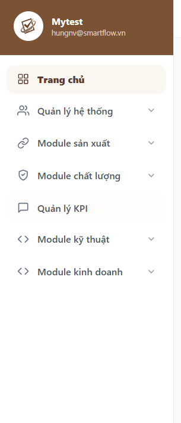

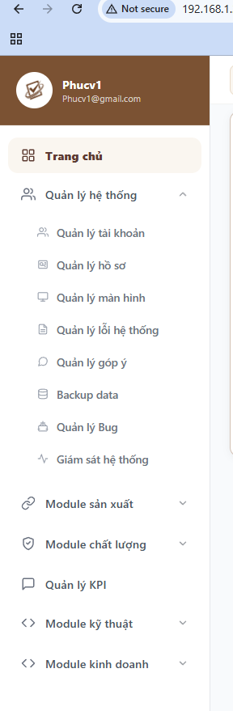

---

### Bug ID: 1015 - Màn hình: Theo dõi kế hoạch (MB4)
- **Mô tả chi tiết:** lỗi hiển thị
- **Trạng thái:** `Verified` | **Mức độ:** `Low`
- **Người báo cáo:** Mytest | **Người chịu trách nhiệm:** Phucv1
- **Ghi chú:** Cập nhật nhanh sang Chưa hoàn thành (Mới)
(Cập nhật nhanh -> Đã xác nhận)
(Cập nhật nhanh -> Đã xác nhận)
(Cập nhật nhanh -> Đã xác nhận)
- **Lịch sử cập nhật:**
  - [2026-06-29 12:46:23.520000] `Trạng thái: Resolved` - Cập nhật bởi **Mytest**: Thay đổi thông tin: Người xử lý: Chưa phân công -> Phucv1
  - [2026-06-29 12:56:28.423000] `Trạng thái: Resolved` - Cập nhật bởi **Phucv1**: Cập nhật trạng thái sang Hoàn thành (Đã sửa) kèm ảnh chứng minh.
  - [2026-06-29 15:15:26.363000] `Trạng thái: Resolved` - Cập nhật bởi **Mytest**: Thay đổi thông tin: Trạng thái: Resolved -> New Cập nhật nhanh sang Chưa hoàn thành (Mới)
  - [2026-06-29 15:15:27.413000] `Trạng thái: Resolved` - Cập nhật bởi **Mytest**: Chưa xử lý triệc để
  - [2026-06-29 16:11:21.053000] `Trạng thái: Verified` - Cập nhật bởi **Mytest**: Thay đổi thông tin: Trạng thái: New -> Verified Cập nhật nhanh sang Chưa hoàn thành (Mới) (Cập nhật nhanh -> Đã xác nhận)
  - [2026-06-29 16:14:11.033000] `Trạng thái: Verified` - Cập nhật bởi **Mytest**: Thay đổi thông tin: Trạng thái: Resolved -> Verified Cập nhật nhanh sang Chưa hoàn thành (Mới) (Cập nhật nhanh -> Đã xác nhận) (Cập nhật nhanh -> Đã xác nhận)
  - [2026-06-29 16:15:18.453000] `Trạng thái: Verified` - Cập nhật bởi **Mytest**: Thay đổi thông tin: Trạng thái: Resolved -> Verified Cập nhật nhanh sang Chưa hoàn thành (Mới) (Cập nhật nhanh -> Đã xác nhận) (Cập nhật nhanh -> Đã xác nhận) (Cập nhật nhanh -> Đã xác nhận)

**Hình ảnh đính kèm:**

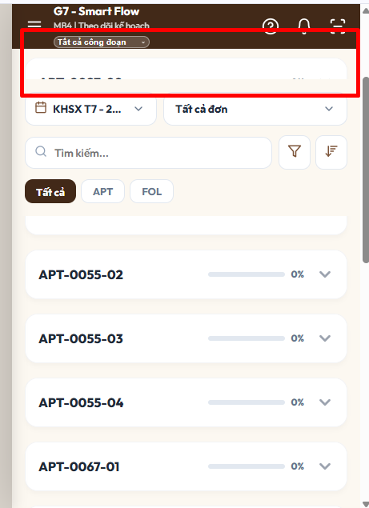

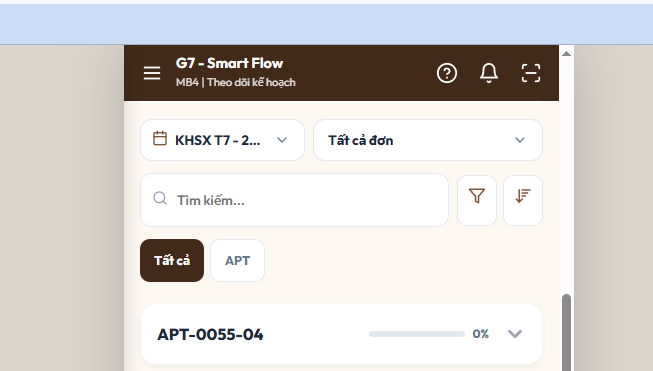

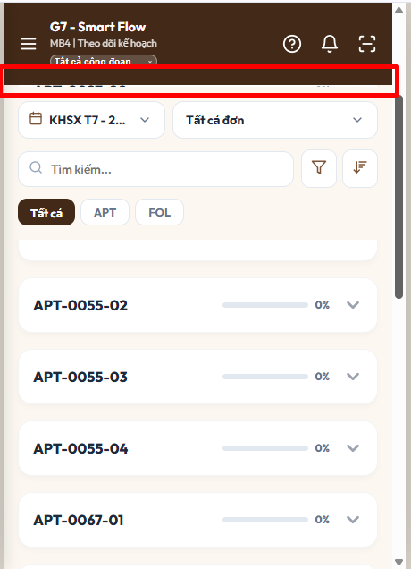

---

### Bug ID: 1016 - Màn hình: Toolbar / Thanh công cụ (COMMON)
- **Mô tả chi tiết:** Thanh nav mobile: chia thành 1 tab
- Thông tin sản xuất
    + Kế hoạch sản xuất
    + Thông tin bàn giao
    + Lịch sử bàn giao
- **Trạng thái:** `Verified` | **Mức độ:** `High`
- **Người báo cáo:** Mytest | **Người chịu trách nhiệm:** Phucv1
- **Ghi chú:** Cập nhật nhanh sang Đã xác nhận
- **Lịch sử cập nhật:**
  - [2026-06-29 13:26:59.887000] `Trạng thái: Resolved` - Cập nhật bởi **Phucv1**: Cập nhật trạng thái sang Hoàn thành (Đã sửa) kèm ảnh chứng minh.
  - [2026-06-29 15:17:16.623000] `Trạng thái: Verified` - Cập nhật bởi **Mytest**: Thay đổi thông tin: Trạng thái: Resolved -> Verified Cập nhật nhanh sang Đã xác nhận

**Hình ảnh đính kèm:**

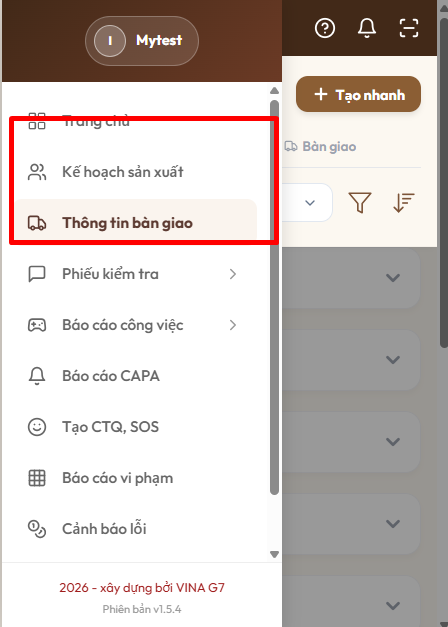

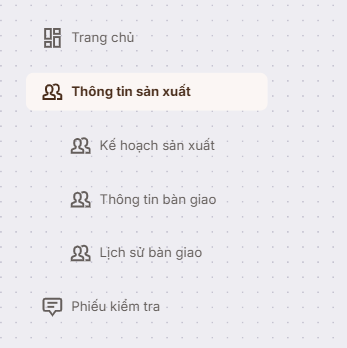

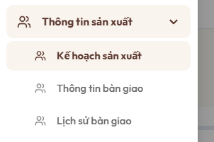

---

### Bug ID: 1018 - Màn hình: Theo dõi kế hoạch (MB4)
- **Mô tả chi tiết:** Xây dựng lại kế hoạch kiểm soát:
- Tạo thêm màn hình kế hoạch sản xuất công đoạn
- Lịch sử bản giao
- Sửa danh sách kế hoạch sản xuất
- **Trạng thái:** `Resolved` | **Mức độ:** `Medium`
- **Người báo cáo:** Mytest | **Người chịu trách nhiệm:** Phucv1
- **Lịch sử cập nhật:**
  - [2026-06-30 07:52:49.893000] `Trạng thái: New` - Cập nhật bởi **Phucv1**: tạo KHSX này là riêng cho Mobile đúng k
  - [2026-06-30 09:13:21.857000] `Trạng thái: Resolved` - Cập nhật bởi **Phucv1**: Cập nhật trạng thái sang Hoàn thành (Đã sửa) kèm ảnh chứng minh.

**Hình ảnh đính kèm:**

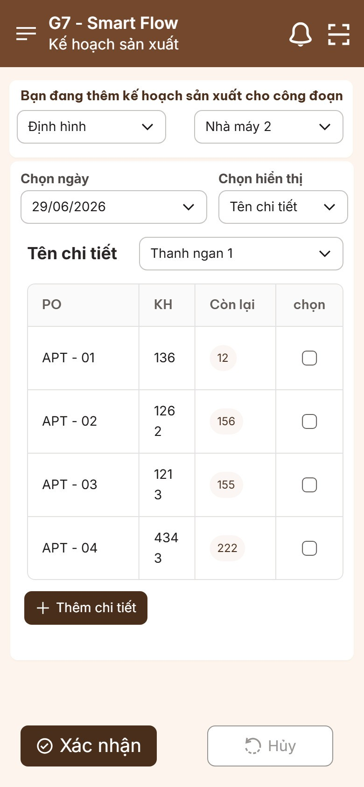

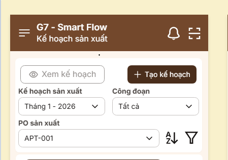

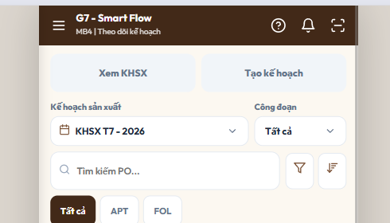

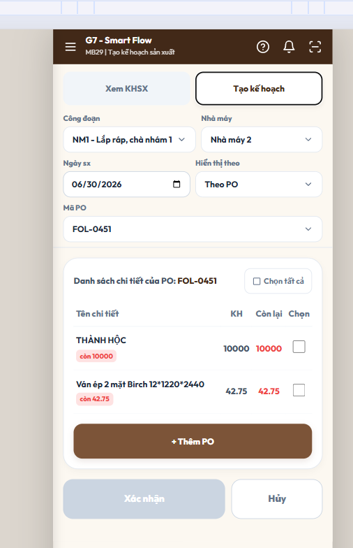

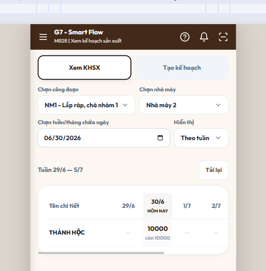

---

### Bug ID: 1019 - Màn hình: Kiểm tra nhập kho (MB6)
- **Mô tả chi tiết:** Các phiếu kiểm tra chưa có mã màn hình
- **Trạng thái:** `Verified` | **Mức độ:** `Critical`
- **Người báo cáo:** Mytest | **Người chịu trách nhiệm:** Phucv1
- **Ghi chú:** Cập nhật nhanh sang Đã xác nhận
- **Lịch sử cập nhật:**
  - [2026-06-29 15:30:18.980000] `Trạng thái: Resolved` - Cập nhật bởi **Phucv1**: Cập nhật trạng thái sang Hoàn thành (Đã sửa) kèm ảnh chứng minh.
  - [2026-06-29 15:32:53.103000] `Trạng thái: Resolved` - Cập nhật bởi **Mytest**: đỗi tên màn hình lại: từ kiểm tra công đoạn --> Kiểm tra nhập kho
  - [2026-06-29 16:20:12.650000] `Trạng thái: Verified` - Cập nhật bởi **Mytest**: Thay đổi thông tin: Trạng thái: Resolved -> Verified Cập nhật nhanh sang Đã xác nhận

**Hình ảnh đính kèm:**

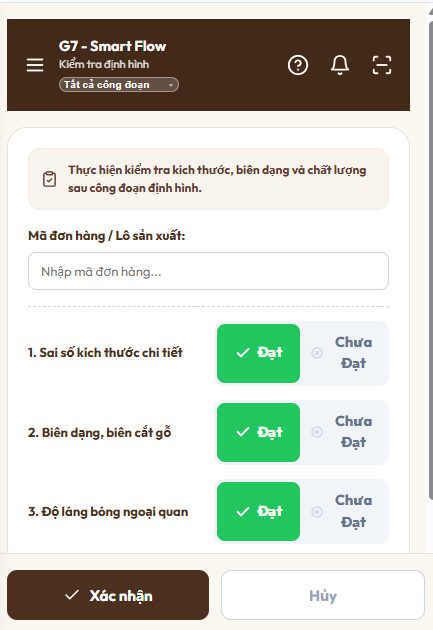

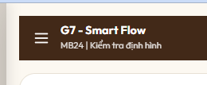

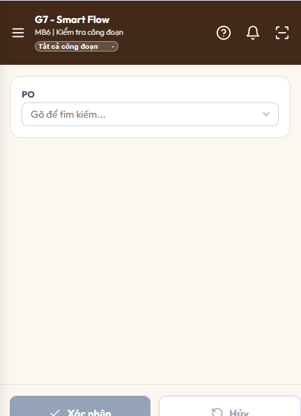

---

### Bug ID: 1020 - Màn hình: Quản lý Bug (AD16)
- **Mô tả chi tiết:** mặc định lọc (lỗi bỏ các bug đã hoàn thành)
- **Trạng thái:** `Verified` | **Mức độ:** `Low`
- **Người báo cáo:** Mytest | **Người chịu trách nhiệm:** Phucv1
- **Ghi chú:** Cập nhật nhanh sang Đã xác nhận
- **Lịch sử cập nhật:**
  - [2026-06-29 15:57:17.540000] `Trạng thái: Resolved` - Cập nhật bởi **Phucv1**: Cập nhật trạng thái sang Hoàn thành (Đã sửa) kèm ảnh chứng minh.
  - [2026-06-29 16:17:52.487000] `Trạng thái: Verified` - Cập nhật bởi **Mytest**: Thay đổi thông tin: Trạng thái: Resolved -> Verified Cập nhật nhanh sang Đã xác nhận

**Hình ảnh đính kèm:**

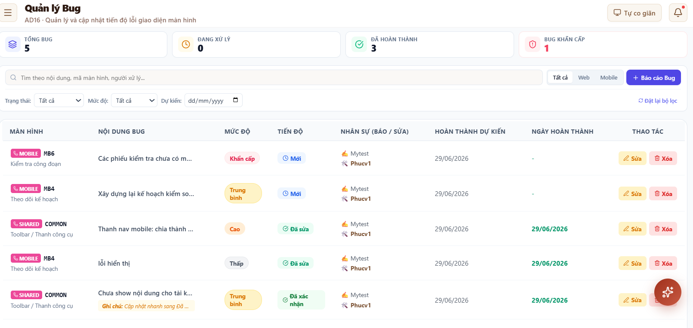

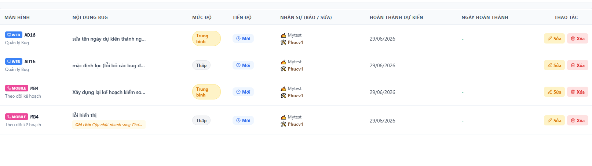

---

### Bug ID: 1021 - Màn hình: Quản lý Bug (AD16)
- **Mô tả chi tiết:** sửa tên ngày dự kiên thành ngày ghi nhận
- **Trạng thái:** `Verified` | **Mức độ:** `Medium`
- **Người báo cáo:** Mytest | **Người chịu trách nhiệm:** Phucv1
- **Lịch sử cập nhật:**
  - [2026-06-29 16:18:24.670000] `Trạng thái: Verified` - Cập nhật bởi **Mytest**: Thay đổi thông tin: Trạng thái: New -> Verified Cập nhật nhanh sang Đã xác nhận
  - [2026-06-29 16:18:50.193000] `Trạng thái: Verified` - Cập nhật bởi **Mytest**: Cập nhật thông tin bug
  - [2026-06-29 16:19:03.967000] `Trạng thái: New` - Cập nhật bởi **Mytest**: Thay đổi thông tin: Trạng thái: Verified -> New Cập nhật nhanh sang Chưa hoàn thành (Mới)
  - [2026-06-30 07:45:57.387000] `Trạng thái: Resolved` - Cập nhật bởi **Phucv1**: Cập nhật trạng thái sang Hoàn thành (Đã sửa) kèm ảnh chứng minh.
  - [2026-06-30 08:39:37.333000] `Trạng thái: Verified` - Cập nhật bởi **Mytest**: Thay đổi thông tin: Trạng thái: Resolved -> Verified

**Hình ảnh đính kèm:**

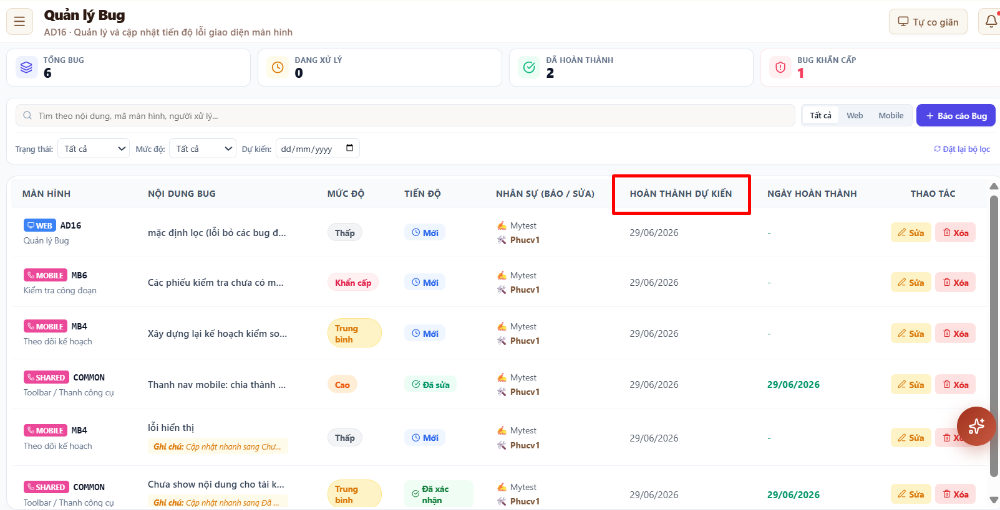

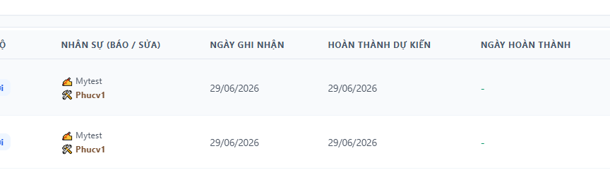

---

### Bug ID: 2014 - Màn hình: Toolbar / Thanh công cụ (COMMON)
- **Mô tả chi tiết:** Chưa có thông tin tài khoản
- **Trạng thái:** `Resolved` | **Mức độ:** `Medium`
- **Người báo cáo:** Mytest | **Người chịu trách nhiệm:** Phucv1
- **Lịch sử cập nhật:**
  - [2026-06-30 14:24:35.947000] `Trạng thái: Resolved` - Cập nhật bởi **Phucv1**: Cập nhật trạng thái sang Hoàn thành (Đã sửa) kèm ảnh chứng minh.

**Hình ảnh đính kèm:**

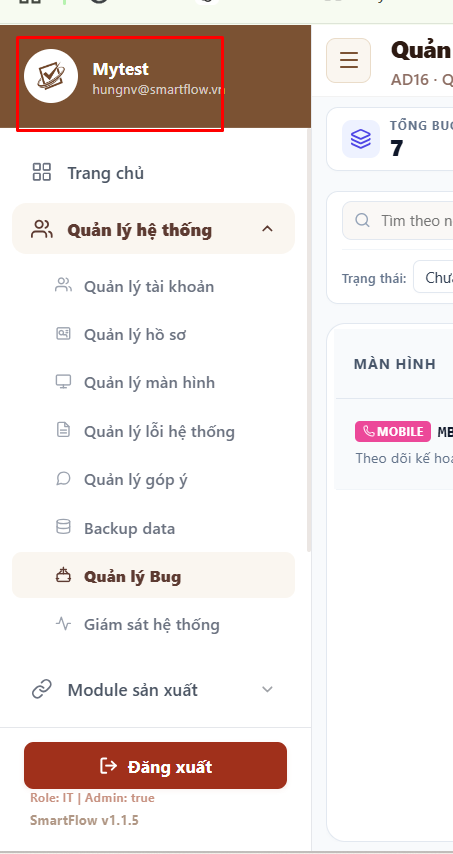

---

### Bug ID: 2015 - Màn hình: Quản lý bộ phận (AD3.4)
- **Mô tả chi tiết:** Cho tất cả các tab mà có bảng thì làm theo cái bảng nhu  này AD3 · Danh sách người dùng đi cho đồng bộ
- **Trạng thái:** `Resolved` | **Mức độ:** `High`
- **Người báo cáo:** test | **Người chịu trách nhiệm:** Phucv1
- **Lịch sử cập nhật:**
  - [2026-07-03 09:12:24.787000] `Trạng thái: Resolved` - Cập nhật bởi **Phucv1**: Cập nhật trạng thái sang Hoàn thành (Đã sửa) kèm ảnh chứng minh.
  - [2026-07-03 12:58:19.227000] `Trạng thái: Resolved` - Cập nhật bởi **test**: Thiếu bộ lọc, sắp xếp  của tôi gòi ní ơi

**Hình ảnh đính kèm:**

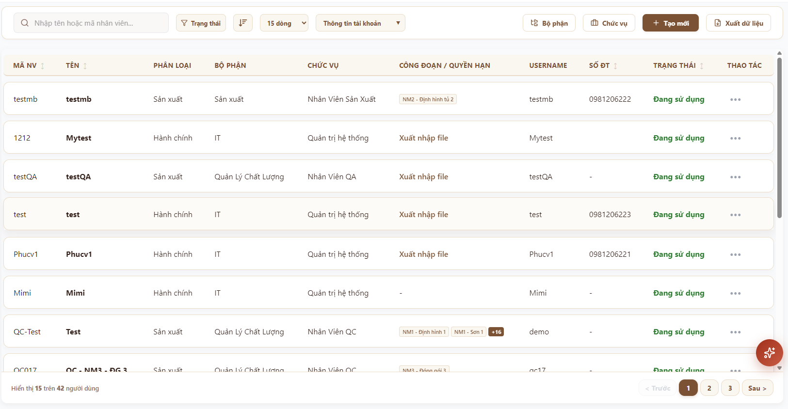

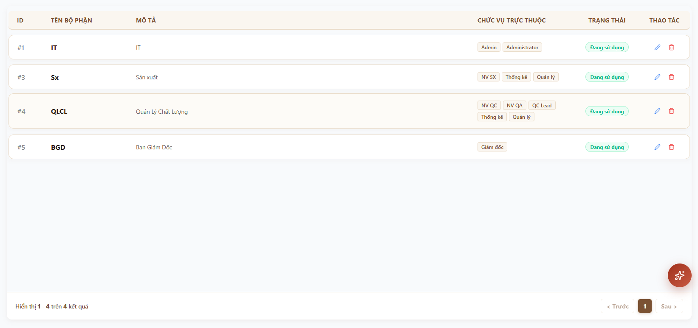

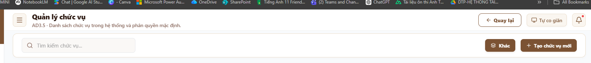

---

### Bug ID: 2016 - Màn hình: Quản lý bộ phận (AD3.4)
- **Mô tả chi tiết:** Thiếu cái thanh bộ lọc tìm kiếm dữ liệu
Có ô tìm kiếm nhưng giao diện chưa ok lắm
Làm đồng bộ lại
- **Trạng thái:** `Resolved` | **Mức độ:** `Medium`
- **Người báo cáo:** test | **Người chịu trách nhiệm:** Phucv1
- **Lịch sử cập nhật:**
  - [2026-07-03 09:26:15.497000] `Trạng thái: Resolved` - Cập nhật bởi **Phucv1**: Cập nhật trạng thái sang Hoàn thành (Đã sửa) kèm ảnh chứng minh.
  - [2026-07-03 12:59:47.210000] `Trạng thái: Resolved` - Cập nhật bởi **test**: Vẫn thiếu các nút bộ lọc, sắp xếp của tui ní ơi

**Hình ảnh đính kèm:**

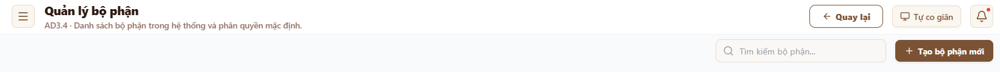

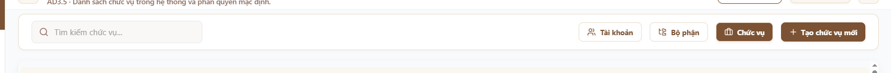

---

### Bug ID: 2017 - Màn hình: Quản lý người dùng (AD3)
- **Mô tả chi tiết:** Quản lý người dùng
Bỏ hết các icon đi vì nhìn khá rối
- **Trạng thái:** `Verified` | **Mức độ:** `Low`
- **Người báo cáo:** test | **Người chịu trách nhiệm:** Phucv1
- **Lịch sử cập nhật:**
  - [2026-07-03 09:27:32.090000] `Trạng thái: Resolved` - Cập nhật bởi **Phucv1**: Cập nhật trạng thái sang Hoàn thành (Đã sửa) kèm ảnh chứng minh.
  - [2026-07-03 12:58:54.450000] `Trạng thái: Verified` - Cập nhật bởi **test**: Cập nhật trạng thái sang Hoàn thành (Đã sửa) kèm ảnh chứng minh.

**Hình ảnh đính kèm:**

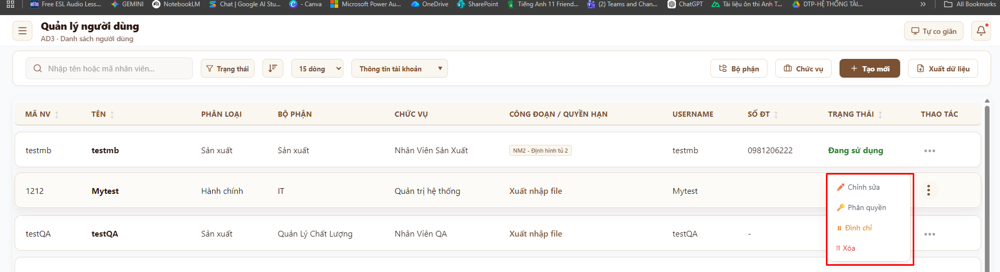

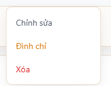

---

### Bug ID: 2018 - Màn hình: Chỉnh sửa người dùng (AD3.2)
- **Mô tả chi tiết:** Thiết kế lại cái giao diện chỗ Phạm vi phụ trách (Công đoạn sản xuất) là cho chọn nhà máy, từ đó sinh ra công đoạn, làm vậy nhìn cho chuyên nghiệp
- **Trạng thái:** `Verified` | **Mức độ:** `Medium`
- **Người báo cáo:** test | **Người chịu trách nhiệm:** Phucv1
- **Lịch sử cập nhật:**
  - [2026-07-03 09:32:09.800000] `Trạng thái: Resolved` - Cập nhật bởi **Phucv1**: Cập nhật trạng thái sang Hoàn thành (Đã sửa) kèm ảnh chứng minh.
  - [2026-07-03 13:01:04.457000] `Trạng thái: Verified` - Cập nhật bởi **test**: Cập nhật trạng thái sang Hoàn thành (Đã sửa) kèm ảnh chứng minh.

**Hình ảnh đính kèm:**

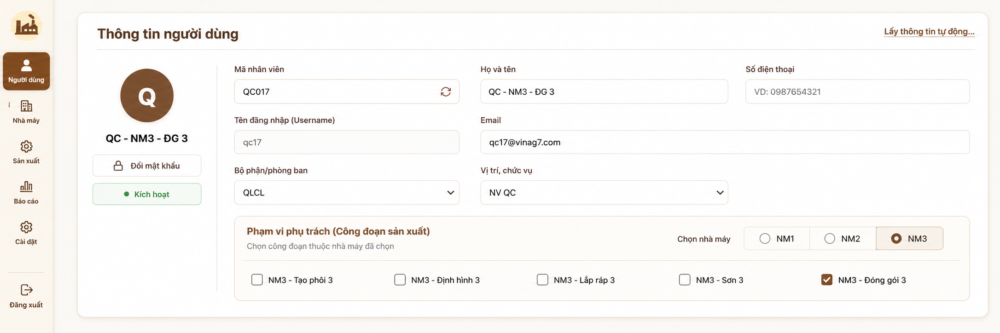

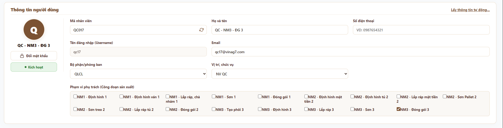

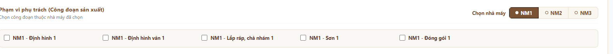

---

### Bug ID: 2019 - Màn hình: Chỉnh sửa người dùng (AD3.2)
- **Mô tả chi tiết:** Có thể điều chỉnh cái Phân quyền chi tiết như hình đi
Bớt nhiều cái màu. thêm 1 cái tất cả đi đỡ phải tích từng cái ấy
Nếu có gì ko đc tui đi combat vs My cho
- **Trạng thái:** `Verified` | **Mức độ:** `Medium`
- **Người báo cáo:** test | **Người chịu trách nhiệm:** Phucv1
- **Lịch sử cập nhật:**
  - [2026-07-03 09:38:51.860000] `Trạng thái: Resolved` - Cập nhật bởi **Phucv1**: Cập nhật trạng thái sang Hoàn thành (Đã sửa) kèm ảnh chứng minh.
  - [2026-07-03 13:00:48.893000] `Trạng thái: Verified` - Cập nhật bởi **test**: Cập nhật trạng thái sang Hoàn thành (Đã sửa) kèm ảnh chứng minh.

**Hình ảnh đính kèm:**

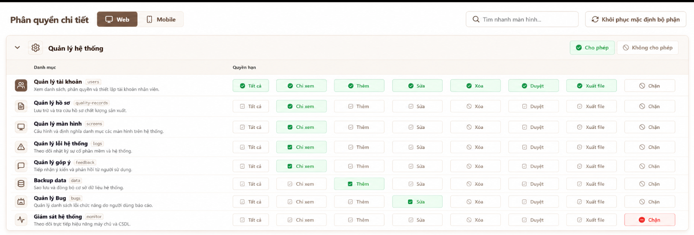

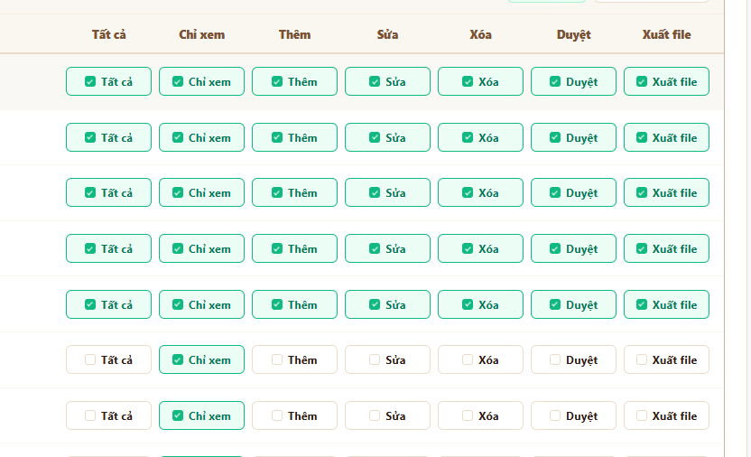

---

### Bug ID: 2020 - Màn hình: Chỉnh sửa người dùng (AD3.2)
- **Mô tả chi tiết:** Nút lưu thay đổi bấm ko có thấy thông báo hay gì để bik, cho thêm thông báo pop up và 2 nút này chỉ hiện khi thực hiện các tác vụ như phân quyền hay chọn phụ trách công việc
- **Trạng thái:** `Verified` | **Mức độ:** `Medium`
- **Người báo cáo:** test | **Người chịu trách nhiệm:** Phucv1
- **Lịch sử cập nhật:**
  - [2026-07-03 09:43:15.237000] `Trạng thái: Resolved` - Cập nhật bởi **Phucv1**: Cập nhật trạng thái sang Hoàn thành (Đã sửa) kèm ảnh chứng minh.
  - [2026-07-03 12:59:57.897000] `Trạng thái: Verified` - Cập nhật bởi **test**: Cập nhật trạng thái sang Hoàn thành (Đã sửa) kèm ảnh chứng minh.

**Hình ảnh đính kèm:**

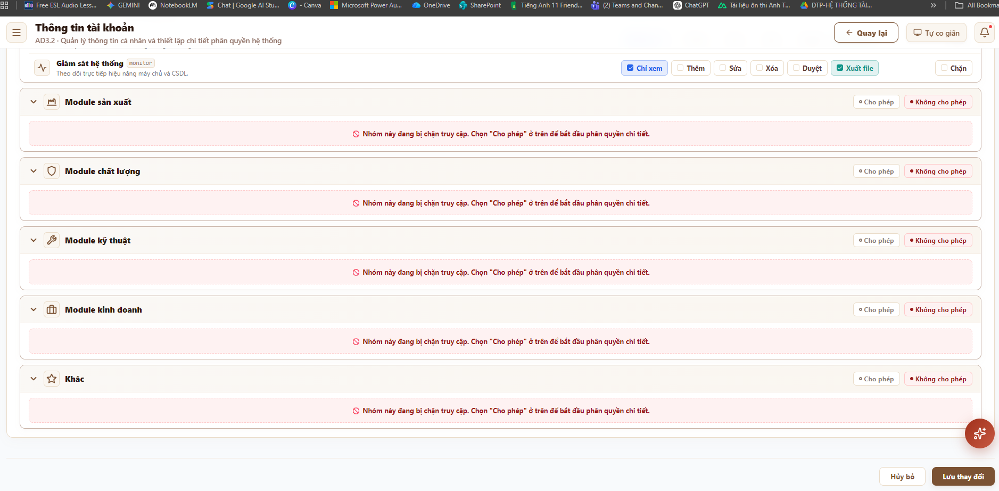

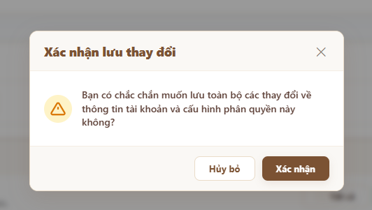

---

### Bug ID: 2021 - Màn hình: Quản lý bộ phận (AD3.4)
- **Mô tả chi tiết:** Đang sử dụng (Kích hoạt bộ phận này) thì chuyển thành toggle button đi cho dễ xài vs đọc chữ + màu xanh lá, đỏ hợp lí
- **Trạng thái:** `Verified` | **Mức độ:** `Medium`
- **Người báo cáo:** test | **Người chịu trách nhiệm:** Phucv1
- **Lịch sử cập nhật:**
  - [2026-07-03 09:48:56.620000] `Trạng thái: Resolved` - Cập nhật bởi **Phucv1**: Cập nhật trạng thái sang Hoàn thành (Đã sửa) kèm ảnh chứng minh.
  - [2026-07-03 13:00:38.433000] `Trạng thái: Verified` - Cập nhật bởi **test**: Cập nhật trạng thái sang Hoàn thành (Đã sửa) kèm ảnh chứng minh.

**Hình ảnh đính kèm:**

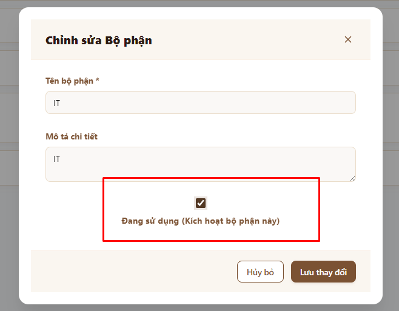

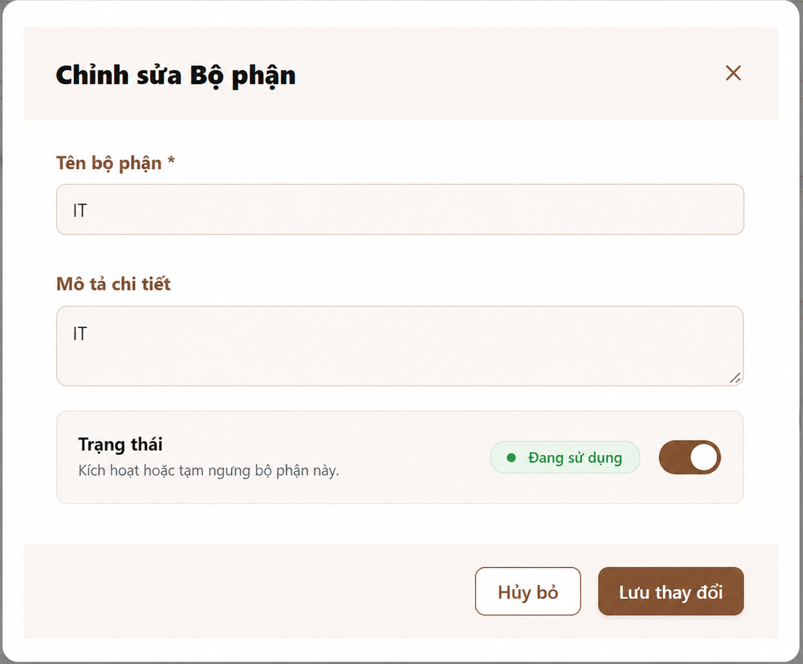

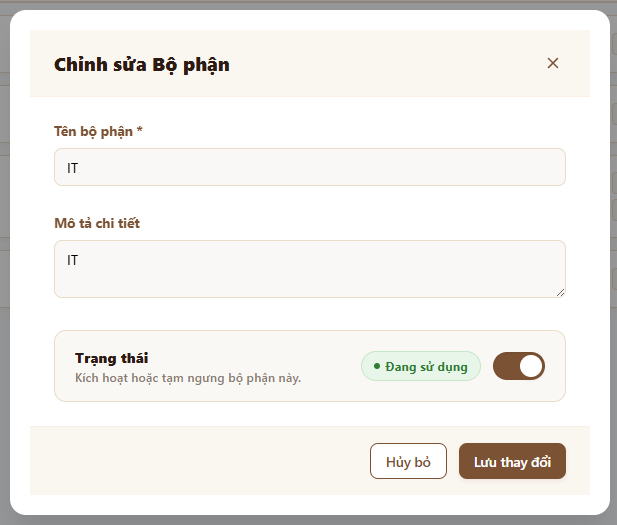

---

### Bug ID: 2022 - Màn hình: Quản lý người dùng (AD3)
- **Mô tả chi tiết:** Đồng bộ cái trạng thái của mác màn hình AD 3 hay 3.4 3.5 đi
Xài cách kiểu 3.4 3.5 đi cho đồng bộ
- **Trạng thái:** `Resolved` | **Mức độ:** `Low`
- **Người báo cáo:** test | **Người chịu trách nhiệm:** Phucv1
- **Lịch sử cập nhật:**
  - [2026-07-03 09:53:12.980000] `Trạng thái: Resolved` - Cập nhật bởi **Phucv1**: Cập nhật trạng thái sang Hoàn thành (Đã sửa) kèm ảnh chứng minh.

**Hình ảnh đính kèm:**

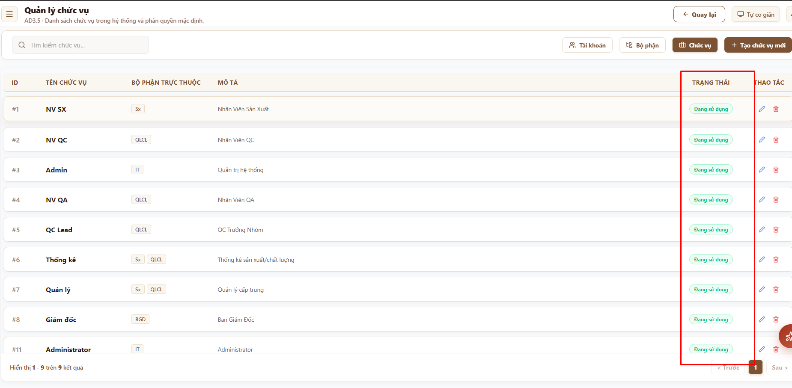

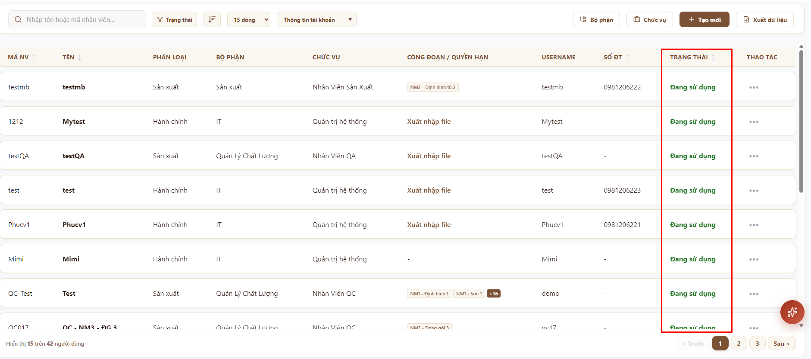

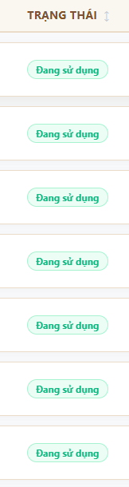

---

### Bug ID: 2023 - Màn hình: Quản lý người dùng (AD3)
- **Mô tả chi tiết:** Dồn vào chữ khác đi
Xong dropdown xuống cái nút khác nhu My vẽ đi
Của các màn AD3 3.4 3.5
- **Trạng thái:** `Resolved` | **Mức độ:** `Medium`
- **Người báo cáo:** test | **Người chịu trách nhiệm:** Phucv1
- **Lịch sử cập nhật:**
  - [2026-07-03 09:59:07.953000] `Trạng thái: Resolved` - Cập nhật bởi **Phucv1**: Cập nhật trạng thái sang Hoàn thành (Đã sửa) kèm ảnh chứng minh.

**Hình ảnh đính kèm:**

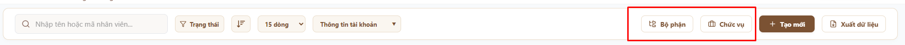

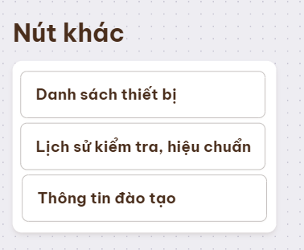

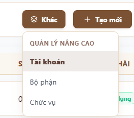

---

### Bug ID: 2024 - Màn hình: Tạo người dùng mới (AD3.1)
- **Mô tả chi tiết:** Sửa lại giao diện như này nhìn cho gọn chứ ko cần tách ra làm 2 đâu
số điện thoại chỉ đc nhập số or +84 nên người ta ghi. chứ ko có nhập chữ 
Lỗi popup thông báo (no ko hiện mà để ở dưới)
- **Trạng thái:** `Resolved` | **Mức độ:** `Medium`
- **Người báo cáo:** test | **Người chịu trách nhiệm:** Phucv1
- **Lịch sử cập nhật:**
  - [2026-07-03 11:09:18.950000] `Trạng thái: Resolved` - Cập nhật bởi **Phucv1**: Cập nhật trạng thái sang Hoàn thành (Đã sửa) kèm ảnh chứng minh.

**Hình ảnh đính kèm:**

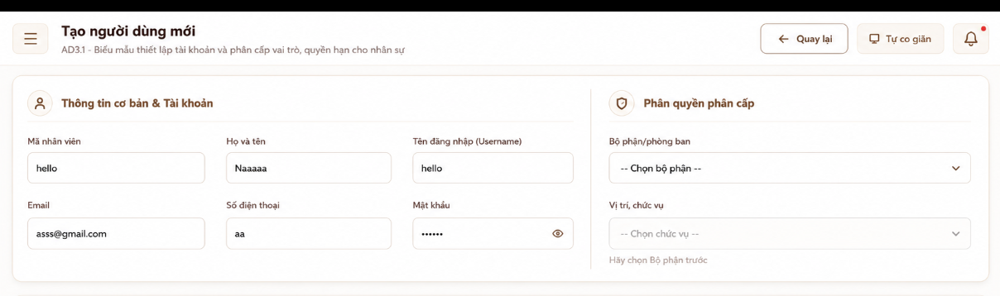

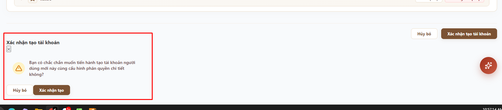

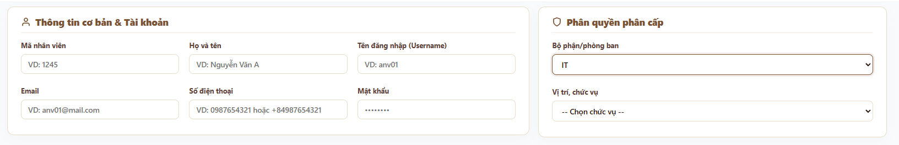

---

### Bug ID: 2025 - Màn hình: Khác (OTHER)
- **Mô tả chi tiết:** Chưa có mã màn hình Hồ sơ chất lượng (PO)
bỏ icon cái title đi vì dư ko cần thiết 
Sửa lại như hình (nút xuất báo cáo là thành xuất dữ liệu) cho đồng bộ
- **Trạng thái:** `Resolved` | **Mức độ:** `Medium`
- **Người báo cáo:** test | **Người chịu trách nhiệm:** Phucv1
- **Lịch sử cập nhật:**
  - [2026-07-03 11:44:31.693000] `Trạng thái: Resolved` - Cập nhật bởi **Phucv1**: Cập nhật trạng thái sang Hoàn thành (Đã sửa) kèm ảnh chứng minh.

**Hình ảnh đính kèm:**

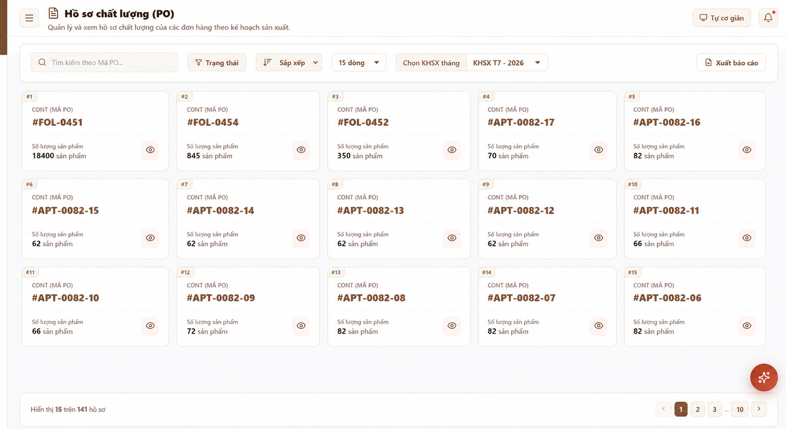

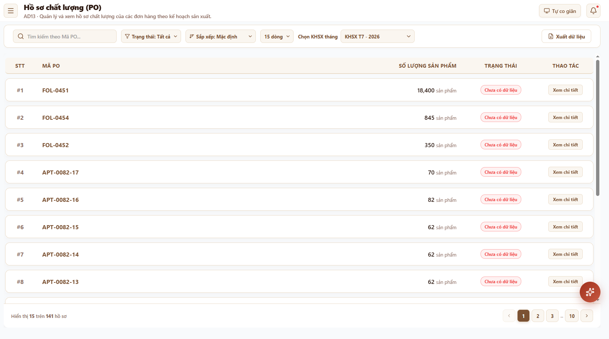

---

### Bug ID: 2026 - Màn hình: Khác (OTHER)
- **Mô tả chi tiết:** Hồ sơ chất lượng (PO)
thì nút con mắt hơi thùa vì khi bấm xem card là xem đc
Xem thử bỏ con mắt đi
- **Trạng thái:** `Resolved` | **Mức độ:** `Medium`
- **Người báo cáo:** test | **Người chịu trách nhiệm:** Phucv1
- **Lịch sử cập nhật:**
  - [2026-07-03 11:20:20.097000] `Trạng thái: Resolved` - Cập nhật bởi **Phucv1**: Cập nhật trạng thái sang Hoàn thành (Đã sửa) kèm ảnh chứng minh.

**Hình ảnh đính kèm:**

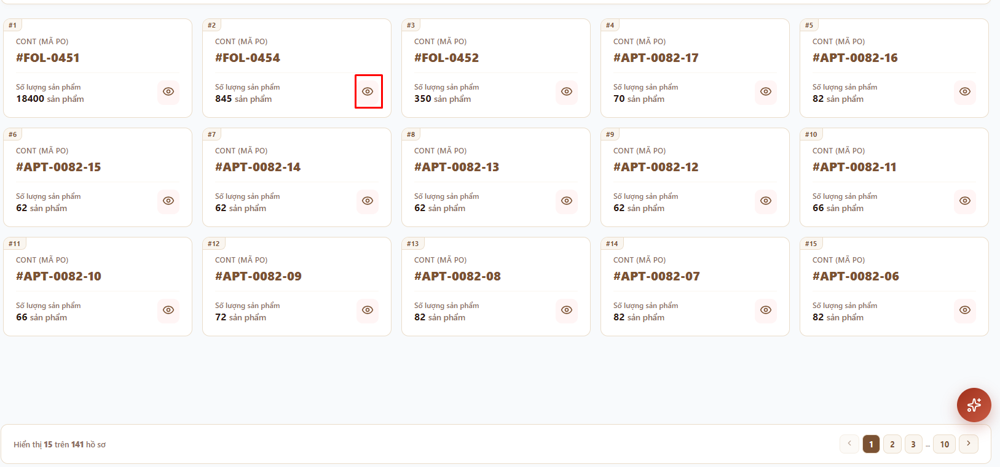

---

### Bug ID: 2027 - Màn hình: Quản lý Bug (AD16)
- **Mô tả chi tiết:** Sửa lại thanh tiềm kiếm như các màn hình khác đi, có thể xem vd tui vẽ thử (để hạn chế nó tách thành 2 dòng ấy
- **Trạng thái:** `Verified` | **Mức độ:** `Medium`
- **Người báo cáo:** test | **Người chịu trách nhiệm:** Phucv1
- **Lịch sử cập nhật:**
  - [2026-07-03 12:48:03.067000] `Trạng thái: Resolved` - Cập nhật bởi **Phucv1**: Cập nhật trạng thái sang Hoàn thành (Đã sửa) kèm ảnh chứng minh.
  - [2026-07-03 13:01:19.910000] `Trạng thái: Verified` - Cập nhật bởi **test**: Cập nhật trạng thái sang Hoàn thành (Đã sửa) kèm ảnh chứng minh.

**Hình ảnh đính kèm:**

---

### Bug ID: 2028 - Màn hình: Hồ sơ chất lượng (AD13)
- **Mô tả chi tiết:** Cái màn hình nào chỗ thao tác làm cái 3 chấm ní ơi
- **Trạng thái:** `Resolved` | **Mức độ:** `Low`
- **Người báo cáo:** test | **Người chịu trách nhiệm:** Phucv1
- **Lịch sử cập nhật:**
  - [2026-07-03 12:56:18.597000] `Trạng thái: Resolved` - Cập nhật bởi **Phucv1**: Cập nhật trạng thái sang Hoàn thành (Đã sửa) kèm ảnh chứng minh.

**Hình ảnh đính kèm:**

---

### Bug ID: 2029 - Màn hình: Quản lý người dùng (AD3)
- **Mô tả chi tiết:** Thôi sưa lại như cũ đi
khoảng cách giữa các khung thu hẹp lại chứ để hơi thưa
- **Trạng thái:** `Resolved` | **Mức độ:** `Medium`
- **Người báo cáo:** test | **Người chịu trách nhiệm:** Phucv1
- **Lịch sử cập nhật:**
  - [2026-07-03 13:55:21.730000] `Trạng thái: Resolved` - Cập nhật bởi **Phucv1**: Cập nhật trạng thái sang Hoàn thành (Đã sửa) kèm ảnh chứng minh.

**Hình ảnh đính kèm:**

---

### Bug ID: 2030 - Màn hình: Quản lý chức vụ (AD3.5)
- **Mô tả chi tiết:** Sửa từ hình 1 như hình 2 đi cho đỡ lộn xộn
- **Trạng thái:** `Resolved` | **Mức độ:** `Medium`
- **Người báo cáo:** test | **Người chịu trách nhiệm:** Phucv1
- **Lịch sử cập nhật:**
  - [2026-07-03 13:58:02.753000] `Trạng thái: Resolved` - Cập nhật bởi **Phucv1**: Cập nhật trạng thái sang Hoàn thành (Đã sửa) kèm ảnh chứng minh.

**Hình ảnh đính kèm:**

---

### Bug ID: 2031 - Màn hình: Quản lý bộ phận (AD3.4)
- **Mô tả chi tiết:** Cái thông báo này hơi kì ấy ní, chỉnh sửa lại
Là khi bấm dừng hoạt động thì có thông báo popup ấy
có trường hợp bấm cái 3 chấm nó ẩn dưới mấy cái thanh thẻ nè
Màn 3.5 cx bị nha
- **Trạng thái:** `Resolved` | **Mức độ:** `Medium`
- **Người báo cáo:** test | **Người chịu trách nhiệm:** Phucv1
- **Lịch sử cập nhật:**
  - [2026-07-03 13:06:44.820000] `Trạng thái: New` - Cập nhật bởi **test**: Thay đổi thông tin: Thay đổi mô tả lỗi
  - [2026-07-03 14:40:20.087000] `Trạng thái: Resolved` - Cập nhật bởi **Phucv1**: Cập nhật trạng thái sang Hoàn thành (Đã sửa) kèm ảnh chứng minh.

**Hình ảnh đính kèm:**

---

### Bug ID: 2032 - Màn hình: Quản lý Màn hình (AD14)
- **Mô tả chi tiết:** Cái thanh về tìm kiế, bộ lọc, sắp xếp, xuất dữ liệu ní làm cho giống các trang kia nha
- **Trạng thái:** `Resolved` | **Mức độ:** `Medium`
- **Người báo cáo:** test | **Người chịu trách nhiệm:** Phucv1
- **Lịch sử cập nhật:**
  - [2026-07-03 15:50:40.410000] `Trạng thái: Resolved` - Cập nhật bởi **Phucv1**: Cập nhật trạng thái sang Hoàn thành (Đã sửa) kèm ảnh chứng minh.

**Hình ảnh đính kèm:**

---

### Bug ID: 2033 - Màn hình: Quản lý Màn hình (AD14)
- **Mô tả chi tiết:** Cái nút bị vuông vức quá ko giống các bút ở cac pop khac, ní chỉnh lại nha
- **Trạng thái:** `Resolved` | **Mức độ:** `Low`
- **Người báo cáo:** test | **Người chịu trách nhiệm:** Phucv1
- **Lịch sử cập nhật:**
  - [2026-07-07 08:10:32.897000] `Trạng thái: Resolved` - Cập nhật bởi **Phucv1**: Cập nhật trạng thái sang Hoàn thành (Đã sửa) kèm ảnh chứng minh.

**Hình ảnh đính kèm:**

---

### Bug ID: 2034 - Màn hình: Quản lý Màn hình (AD14)
- **Mô tả chi tiết:** có trường hợp bấm cái 3 chấm nó ẩn dưới mấy cái thanh thẻ nè
- **Trạng thái:** `Resolved` | **Mức độ:** `Medium`
- **Người báo cáo:** test | **Người chịu trách nhiệm:** Phucv1
- **Lịch sử cập nhật:**
  - [2026-07-07 08:10:50.173000] `Trạng thái: Resolved` - Cập nhật bởi **Phucv1**: Cập nhật trạng thái sang Hoàn thành (Đã sửa) kèm ảnh chứng minh.

**Hình ảnh đính kèm:**

---

### Bug ID: 2035 - Màn hình: Quản lý Màn hình (AD14)
- **Mô tả chi tiết:** Sửa tiếp thanh thìm kiếm cho đồng bộ như các trang khác
- **Trạng thái:** `Resolved` | **Mức độ:** `Low`
- **Người báo cáo:** test | **Người chịu trách nhiệm:** Phucv1
- **Lịch sử cập nhật:**
  - [2026-07-07 08:11:13.003000] `Trạng thái: Resolved` - Cập nhật bởi **Phucv1**: Cập nhật trạng thái sang Hoàn thành (Đã sửa) kèm ảnh chứng minh.

**Hình ảnh đính kèm:**

---

### Bug ID: 2036 - Màn hình: Kiểm tra nhập kho (MB6)
- **Mô tả chi tiết:** Nguyên tắt thêm dòng khi bấm kiểm tra nhập kho
Đổi chữ tiết anh đi, Pass là đạt, Còn Fail là ghi K.Đạt (Hạn chế xài 2 3 ngôn ngữ trong phần mềm)
- **Trạng thái:** `Resolved` | **Mức độ:** `Medium`
- **Người báo cáo:** test | **Người chịu trách nhiệm:** Phucv1
- **Lịch sử cập nhật:**
  - [2026-07-07 08:15:42.777000] `Trạng thái: Resolved` - Cập nhật bởi **Phucv1**: Cập nhật trạng thái sang Hoàn thành (Đã sửa) kèm ảnh chứng minh.

**Hình ảnh đính kèm:**

---

### Bug ID: 2037 - Màn hình: Kiểm tra nhập kho (MB6)
- **Mô tả chi tiết:** Cái số lượng mẫu KT lại lớn hơn cần Kiểm tra  (40 vs 45) nên xem lại
Cái Số lưỡng mẫu KT sao ko cho nhập số mà bấm + - khá bất tiện ấy (tương tự cái số lượng)
- **Trạng thái:** `Resolved` | **Mức độ:** `Medium`
- **Người báo cáo:** test | **Người chịu trách nhiệm:** Phucv1
- **Lịch sử cập nhật:**
  - [2026-07-07 08:30:18.970000] `Trạng thái: Resolved` - Cập nhật bởi **Phucv1**: Cập nhật trạng thái sang Hoàn thành (Đã sửa) kèm ảnh chứng minh.

**Hình ảnh đính kèm:**

---

### Bug ID: 2038 - Màn hình: Quản lý Bug (AD16)
- **Mô tả chi tiết:** Chưa căn đều nè 2 bên nè
- **Trạng thái:** `Resolved` | **Mức độ:** `Medium`
- **Người báo cáo:** test | **Người chịu trách nhiệm:** Phucv1
- **Lịch sử cập nhật:**
  - [2026-07-07 08:32:20.347000] `Trạng thái: Resolved` - Cập nhật bởi **Phucv1**: Cập nhật trạng thái sang Hoàn thành (Đã sửa) kèm ảnh chứng minh.

**Hình ảnh đính kèm:**

---

### Bug ID: 2039 - Màn hình: Kiểm tra nhập kho (MB6)
- **Mô tả chi tiết:** Cho nhập gợi ý để chọn đi vì tên lỗi nó dài ấy
- **Trạng thái:** `Resolved` | **Mức độ:** `Medium`
- **Người báo cáo:** test | **Người chịu trách nhiệm:** Phucv1
- **Lịch sử cập nhật:**
  - [2026-07-07 08:35:35.587000] `Trạng thái: Resolved` - Cập nhật bởi **Phucv1**: Cập nhật trạng thái sang Hoàn thành (Đã sửa) kèm ảnh chứng minh.

**Hình ảnh đính kèm:**

*[Ảnh chưa được tải cục bộ: /static/uploads/screen_bugs/874d7072-84f1-4f1a-a1a9-ee4e3b5b204c.png]*

---

### Bug ID: 2040 - Màn hình: Kiểm tra nhập kho (MB6)
- **Mô tả chi tiết:** Cái này cho expand collapse đi  vì loiwx số lượng mãu KT lớn thì nó dài thì scroll dài lắm (Vd mà có 5 -7 hàng thì cho scroll trong cái này đi chứ vd 15 cái scoll xuống xem kết quả kiểm tra hơi lâu)
- **Trạng thái:** `Resolved` | **Mức độ:** `Medium`
- **Người báo cáo:** test | **Người chịu trách nhiệm:** Phucv1
- **Lịch sử cập nhật:**
  - [2026-07-07 08:37:15.080000] `Trạng thái: Resolved` - Cập nhật bởi **Phucv1**: Cập nhật trạng thái sang Hoàn thành (Đã sửa) kèm ảnh chứng minh.

**Hình ảnh đính kèm:**

*[Ảnh chưa được tải cục bộ: /static/uploads/screen_bugs/bacb8a80-5a39-4c82-9951-2072407a8c3a.png]*

---

### Bug ID: 2041 - Màn hình: Kiểm tra nhập kho (MB6)
- **Mô tả chi tiết:** Cái này cx làm expand collapse đi nếu lỗi phát hiện quá nhiều (từ 2 3 cái trở lên)
- **Trạng thái:** `Resolved` | **Mức độ:** `Medium`
- **Người báo cáo:** test | **Người chịu trách nhiệm:** Phucv1
- **Lịch sử cập nhật:**
  - [2026-07-07 08:43:06.407000] `Trạng thái: Resolved` - Cập nhật bởi **Phucv1**: Cập nhật trạng thái sang Hoàn thành (Đã sửa) kèm ảnh chứng minh.

**Hình ảnh đính kèm:**

*[Ảnh chưa được tải cục bộ: /static/uploads/screen_bugs/cd74d2c3-0f3d-499a-838f-1d69ffda4fff.png]*

---

### Bug ID: 2042 - Màn hình: Kiểm tra nhập kho (MB6)
- **Mô tả chi tiết:** Lỗi phát hiện thifcos cho cùng 1 tên lỗi ở 2 ô ko?? Xem logic chõ này
- **Trạng thái:** `Resolved` | **Mức độ:** `Medium`
- **Người báo cáo:** test | **Người chịu trách nhiệm:** Phucv1
- **Lịch sử cập nhật:**
  - [2026-07-07 08:44:55.063000] `Trạng thái: Resolved` - Cập nhật bởi **Phucv1**: Cập nhật trạng thái sang Hoàn thành (Đã sửa) kèm ảnh chứng minh.

**Hình ảnh đính kèm:**

*[Ảnh chưa được tải cục bộ: /static/uploads/screen_bugs/60c0f7b8-c078-4d79-8943-e15c904f7adb.png]*

---

### Bug ID: 2043 - Màn hình: Kiểm tra nhập kho (MB6)
- **Mô tả chi tiết:** Nếu trường hợp cách ly thì bắt buộc có ghi chú để bik được nguyên nhân của vụ cách ly đi
- **Trạng thái:** `Resolved` | **Mức độ:** `Medium`
- **Người báo cáo:** test | **Người chịu trách nhiệm:** Phucv1
- **Lịch sử cập nhật:**
  - [2026-07-07 08:47:08.253000] `Trạng thái: Resolved` - Cập nhật bởi **Phucv1**: Cập nhật trạng thái sang Hoàn thành (Đã sửa) kèm ảnh chứng minh.

**Hình ảnh đính kèm:**

*[Ảnh chưa được tải cục bộ: /static/uploads/screen_bugs/7c18e299-9795-4b17-9986-7fe75c713910.png]*

---

### Bug ID: 2044 - Màn hình: Kiểm tra nhập kho (MB6)
- **Mô tả chi tiết:** Sau khi chọn Không đạt và nhập lỗi phát hiện, nếu người dùng bấm Thêm lỗi khác thì trạng thái tự động chuyển lại thành Đạt. Người dùng phải chọn lại Không đạt mới tiếp tục nhập được lỗi. Đề xuất hệ thống giữ nguyên trạng thái Không đạt khi người dùng thêm lỗi khác.
- **Trạng thái:** `Resolved` | **Mức độ:** `Medium`
- **Người báo cáo:** test | **Người chịu trách nhiệm:** Phucv1
- **Lịch sử cập nhật:**
  - [2026-07-07 08:48:46.363000] `Trạng thái: Resolved` - Cập nhật bởi **Phucv1**: Cập nhật trạng thái sang Hoàn thành (Đã sửa) kèm ảnh chứng minh.

**Hình ảnh đính kèm:**

---

### Bug ID: 2045 - Màn hình: Kiểm tra nhập kho (MB6)
- **Mô tả chi tiết:** Lỗi logic: Khi các hạng mục Chức năng và Ngoại quan đang có trạng thái Fail/Không đạt, hệ thống vẫn cho phép chọn Kết quả kiểm tra = Đạt. Điều này chưa hợp lý, vì chỉ cần có một lỗi Fail thì kết quả tổng thể không nên được xem là Đạt nếu không có lý do xử lý rõ ràng.

Đề xuất: Trường hợp hệ thống vẫn cho phép chọn Đạt hoặc chọn hành động Nhập kho / Cách ly / Trả hàng khi vẫn còn lỗi Fail, người dùng bắt buộc phải nhập Ghi chú sản phẩm để nêu rõ lý do xử lý.

Ngoài ra, nếu Kết quả kiểm tra là Đạt nhưng danh sách kiểm tra vẫn còn lỗi Fail, hệ thống cần hiển thị cảnh báo và không cho lưu nếu chưa có ghi chú.
Còn gì thì hỏi thêm đại ca My
- **Trạng thái:** `Resolved` | **Mức độ:** `Medium`
- **Người báo cáo:** test | **Người chịu trách nhiệm:** Phucv1
- **Lịch sử cập nhật:**
  - [2026-07-07 09:20:19.027000] `Trạng thái: Resolved` - Cập nhật bởi **Phucv1**: Cập nhật trạng thái sang Hoàn thành (Đã sửa) kèm ảnh chứng minh.

**Hình ảnh đính kèm:**

---

### Bug ID: 2046 - Màn hình: Kiểm tra nhập kho (MB6)
- **Mô tả chi tiết:** Nút chụp ảnh ko xài đc vì nó xài ảnh chứ ko có cho chụp
- **Trạng thái:** `Resolved` | **Mức độ:** `Medium`
- **Người báo cáo:** test | **Người chịu trách nhiệm:** Phucv1
- **Lịch sử cập nhật:**
  - [2026-07-07 09:25:27.590000] `Trạng thái: Resolved` - Cập nhật bởi **Phucv1**: Cập nhật trạng thái sang Hoàn thành (Đã sửa) kèm ảnh chứng minh.

**Hình ảnh đính kèm:**

---

### Bug ID: 2047 - Màn hình: Kiểm tra nhập kho (MB6)
- **Mô tả chi tiết:** Cái sai sót khi đọc thì AI vẫn còn nhiều ấy và cx lệch nhièu
- **Trạng thái:** `Resolved` | **Mức độ:** `Medium`
- **Người báo cáo:** test | **Người chịu trách nhiệm:** Phucv1
- **Lịch sử cập nhật:**
  - [2026-07-07 09:26:19.363000] `Trạng thái: Resolved` - Cập nhật bởi **Phucv1**: Cập nhật trạng thái sang Hoàn thành (Đã sửa) kèm ảnh chứng minh.
  - [2026-07-07 09:26:31.593000] `Trạng thái: Resolved` - Cập nhật bởi **Phucv1**: nếu sai thì ng dùng có thể nhập lại

**Hình ảnh đính kèm:**

---

### Bug ID: 2048 - Màn hình: Kiểm tra nhập kho (MB6)
- **Mô tả chi tiết:** Lỗi nhập liệu: Các ô số lượng hiện đang cho phép nhập số âm và số quá lớn/vô hạn.
- **Trạng thái:** `Resolved` | **Mức độ:** `Medium`
- **Người báo cáo:** test | **Người chịu trách nhiệm:** Phucv1
- **Lịch sử cập nhật:**
  - [2026-07-07 09:30:53.360000] `Trạng thái: Resolved` - Cập nhật bởi **Phucv1**: Cập nhật trạng thái sang Hoàn thành (Đã sửa) kèm ảnh chứng minh.

**Hình ảnh đính kèm:**

---

### Bug ID: 2051 - Màn hình: Quản lý quy trình (AD18)
- **Mô tả chi tiết:** Cái chỗ thao tác thì nút này thành 3 chấm như các màn hình khác
- **Trạng thái:** `Resolved` | **Mức độ:** `Medium`
- **Người báo cáo:** test | **Người chịu trách nhiệm:** Phucv1
- **Lịch sử cập nhật:**
  - [2026-07-14 14:29:16.310000] `Trạng thái: Resolved` - Cập nhật bởi **Phucv1**: Cập nhật trạng thái sang Hoàn thành (Đã sửa) kèm ảnh chứng minh.

**Hình ảnh đính kèm:**

---

### Bug ID: 2052 - Màn hình: Quản lý hồ sơ ISO (AD17)
- **Mô tả chi tiết:** Làm lại thanh tìm kiếm này đồng bộ vs các màn hình khác về màu sắc với vố cục, còn thiếu cái sắp xếp vs số lượng hiển thị. Cái bảng thì thiếu cái hiển thị ... trên ... hồ sơ vs số lượng trang 

Cái AD18 cũng bị tương tự
- **Trạng thái:** `Resolved` | **Mức độ:** `Medium`
- **Người báo cáo:** test | **Người chịu trách nhiệm:** Phucv1
- **Lịch sử cập nhật:**
  - [2026-07-13 09:44:15.203000] `Trạng thái: Resolved` - Cập nhật bởi **Phucv1**: Cập nhật trạng thái sang Hoàn thành (Đã sửa) kèm ảnh chứng minh.

**Hình ảnh đính kèm:**

---

### Bug ID: 2053 - Màn hình: Quản lý hồ sơ ISO (AD17)
- **Mô tả chi tiết:** Cái đính kèm có nút tải xuống là gì vậy, bấm nó ko hiệ tại liệu hay gì ấy
Nếu làm thì hiển thị icon +tên file rút gọn đi chứ tải xuống đó thì nên bỏ vào trong thao tác ấy
Cái cột thư mục cũng bỏ luôn vì ko còn làm nữa
- **Trạng thái:** `Resolved` | **Mức độ:** `Medium`
- **Người báo cáo:** test | **Người chịu trách nhiệm:** Phucv1
- **Lịch sử cập nhật:**
  - [2026-07-08 11:09:26.613000] `Trạng thái: New` - Cập nhật bởi **test**: Thay đổi thông tin: Thay đổi mô tả lỗi
  - [2026-07-13 09:43:57.307000] `Trạng thái: Resolved` - Cập nhật bởi **Phucv1**: Cập nhật trạng thái sang Hoàn thành (Đã sửa) kèm ảnh chứng minh.

**Hình ảnh đính kèm:**

---

### Bug ID: 2054 - Màn hình: Cập nhật mẫu tài liệu (AD17.1)
- **Mô tả chi tiết:** Nó có 2 nút quay lại
Cái lưu mẫu ISO để 1 mình 1 hàng owe trên hơi kì
nên để nó xuống dưới như hình 2 thử xem oki ko
- **Trạng thái:** `Resolved` | **Mức độ:** `Medium`
- **Người báo cáo:** test | **Người chịu trách nhiệm:** Phucv1
- **Lịch sử cập nhật:**
  - [2026-07-13 09:44:27.387000] `Trạng thái: Resolved` - Cập nhật bởi **Phucv1**: Cập nhật trạng thái sang Hoàn thành (Đã sửa) kèm ảnh chứng minh.

**Hình ảnh đính kèm:**

---

### Bug ID: 2055 - Màn hình: Cập nhật mẫu tài liệu (AD17.1)
- **Mô tả chi tiết:** Cấu hình loại dữ liệu các đề mục khi tạo form mới chưa có để thêm nè
- **Trạng thái:** `Resolved` | **Mức độ:** `Medium`
- **Người báo cáo:** test | **Người chịu trách nhiệm:** Phucv1
- **Lịch sử cập nhật:**
  - [2026-07-13 09:43:50.373000] `Trạng thái: Resolved` - Cập nhật bởi **Phucv1**: Cập nhật trạng thái sang Hoàn thành (Đã sửa) kèm ảnh chứng minh.

**Hình ảnh đính kèm:**

---

### Bug ID: 2056 - Màn hình: Quản lý hồ sơ ISO (AD17)
- **Mô tả chi tiết:** 1 Upload file
Bấm vào có tùy chọn word or pdf

2 cái tiêu đề đổi lại theo tên màn hình chứ ko phải dự án
- **Trạng thái:** `Resolved` | **Mức độ:** `Medium`
- **Người báo cáo:** test | **Người chịu trách nhiệm:** Phucv1
- **Lịch sử cập nhật:**
  - [2026-07-13 09:43:34.693000] `Trạng thái: Resolved` - Cập nhật bởi **Phucv1**: Cập nhật trạng thái sang Hoàn thành (Đã sửa) kèm ảnh chứng minh.

**Hình ảnh đính kèm:**

---

### Bug ID: 2057 - Màn hình: Quản lý hồ sơ ISO (AD17)
- **Mô tả chi tiết:** Khi upload 1 file bất kì về word thì nó có báo lỗi
- **Trạng thái:** `Resolved` | **Mức độ:** `Medium`
- **Người báo cáo:** test | **Người chịu trách nhiệm:** Phucv1
- **Lịch sử cập nhật:**
  - [2026-07-13 09:42:46.160000] `Trạng thái: Resolved` - Cập nhật bởi **Phucv1**: Cập nhật trạng thái sang Hoàn thành (Đã sửa) kèm ảnh chứng minh.

**Hình ảnh đính kèm:**

---

### Bug ID: 2058 - Màn hình: Quản lý hồ sơ ISO (AD17)
- **Mô tả chi tiết:** Cái cấu hình loại dư mục các đề mục nó khác với
- **Trạng thái:** `Resolved` | **Mức độ:** `Medium`
- **Người báo cáo:** test | **Người chịu trách nhiệm:** Phucv1
- **Lịch sử cập nhật:**
  - [2026-07-13 09:42:34.083000] `Trạng thái: Resolved` - Cập nhật bởi **Phucv1**: Cập nhật trạng thái sang Hoàn thành (Đã sửa) kèm ảnh chứng minh.

**Hình ảnh đính kèm:**

---

### Bug ID: 2059 - Màn hình: Quản lý quy trình (AD18)
- **Mô tả chi tiết:** Chưa có pop up thong bao cái về thêm mới quy trình
- **Trạng thái:** `Resolved` | **Mức độ:** `Medium`
- **Người báo cáo:** test | **Người chịu trách nhiệm:** Phucv1
- **Lịch sử cập nhật:**
  - [2026-07-13 09:42:19.507000] `Trạng thái: Resolved` - Cập nhật bởi **Phucv1**: Cập nhật trạng thái sang Hoàn thành (Đã sửa) kèm ảnh chứng minh.

**Hình ảnh đính kèm:**

---

### Bug ID: 2061 - Màn hình: Kiểm tra nhập kho (MB6)
- **Mô tả chi tiết:** Ô Tên sản phẩm vượt ra ngoài vùng hiển thị của form, làm nội dung bị che/khuất ở mép phải màn hình.
- **Trạng thái:** `Resolved` | **Mức độ:** `Medium`
- **Người báo cáo:** test | **Người chịu trách nhiệm:** Phucv1
- **Lịch sử cập nhật:**
  - [2026-07-13 09:36:37.020000] `Trạng thái: Resolved` - Cập nhật bởi **Phucv1**: Cập nhật trạng thái sang Hoàn thành (Đã sửa) kèm ảnh chứng minh.

**Hình ảnh đính kèm:**

---

### Bug ID: 2062 - Màn hình: Kiểm tra nhập kho (MB6)
- **Mô tả chi tiết:** Vd Số lượng mẫu KT là 2
thì khi dòng 2 khi tích chức năng hay ngoại quan (bên phụ kiện) hay ngoại quan bên độ ẩm (là switch đổi trạng thái thì tự tăng thêm dòng)
- **Trạng thái:** `Resolved` | **Mức độ:** `Medium`
- **Người báo cáo:** test | **Người chịu trách nhiệm:** Phucv1
- **Lịch sử cập nhật:**
  - [2026-07-13 09:36:21.343000] `Trạng thái: Resolved` - Cập nhật bởi **Phucv1**: Cập nhật trạng thái sang Hoàn thành (Đã sửa) kèm ảnh chứng minh.

**Hình ảnh đính kèm:**

---

### Bug ID: 2063 - Màn hình: Kiểm tra nhập kho (MB6)
- **Mô tả chi tiết:** Các tiêu đề section như “Bảng mẫu kiểm tra”, “Lỗi phát hiện” hiện đang bị trôi mất khi người dùng scroll xuống dưới. Nếu danh sách dữ liệu dài, người dùng phải kéo lên lại khá lâu để biết đang xem phần nào.
- **Trạng thái:** `Resolved` | **Mức độ:** `Medium`
- **Người báo cáo:** test | **Người chịu trách nhiệm:** Phucv1
- **Lịch sử cập nhật:**
  - [2026-07-13 09:33:53.693000] `Trạng thái: Resolved` - Cập nhật bởi **Phucv1**: Cập nhật trạng thái sang Hoàn thành (Đã sửa) kèm ảnh chứng minh.

**Hình ảnh đính kèm:**

---

### Bug ID: 2064 - Màn hình: Toolbar / Thanh công cụ (COMMON)
- **Mô tả chi tiết:** Thanh taskbar ko tự động show theo role người dùng
- **Trạng thái:** `New` | **Mức độ:** `Medium`
- **Người báo cáo:** Mytest | **Người chịu trách nhiệm:** Phucv1

**Hình ảnh đính kèm:**

---

### Bug ID: 2065 - Màn hình: Toolbar / Thanh công cụ (COMMON)
- **Mô tả chi tiết:** Hồ sơ chất lượng nằm trong module chất lượng
- **Trạng thái:** `Verified` | **Mức độ:** `Medium`
- **Người báo cáo:** Mytest | **Người chịu trách nhiệm:** Phucv1
- **Lịch sử cập nhật:**
  - [2026-07-11 12:51:47.080000] `Trạng thái: Resolved` - Cập nhật bởi **Mytest**: Cập nhật trạng thái sang Hoàn thành (Đã sửa) kèm ảnh chứng minh.
  - [2026-07-14 08:10:43.093000] `Trạng thái: Verified` - Cập nhật bởi **test**: Cập nhật trạng thái sang Hoàn thành (Đã sửa) kèm ảnh chứng minh.

**Hình ảnh đính kèm:**

---

### Bug ID: 2066 - Màn hình: Toolbar / Thanh công cụ (COMMON)
- **Mô tả chi tiết:** đổi title mẩu ISO thành "Quản lý mẩu tài liệu"
- **Trạng thái:** `Verified` | **Mức độ:** `Low`
- **Người báo cáo:** Mytest | **Người chịu trách nhiệm:** Phucv1
- **Lịch sử cập nhật:**
  - [2026-07-11 12:48:52.020000] `Trạng thái: Resolved` - Cập nhật bởi **Mytest**: Cập nhật trạng thái sang Hoàn thành (Đã sửa) kèm ảnh chứng minh.
  - [2026-07-14 08:09:58.460000] `Trạng thái: Verified` - Cập nhật bởi **test**: Cập nhật trạng thái sang Hoàn thành (Đã sửa) kèm ảnh chứng minh.

**Hình ảnh đính kèm:**

---

### Bug ID: 2067 - Màn hình: Quản lý hồ sơ ISO (AD17)
- **Mô tả chi tiết:** nút nhập dữ liệu bị thừa
- **Trạng thái:** `Verified` | **Mức độ:** `Medium`
- **Người báo cáo:** Mytest | **Người chịu trách nhiệm:** Phucv1
- **Lịch sử cập nhật:**
  - [2026-07-11 12:47:22.793000] `Trạng thái: Resolved` - Cập nhật bởi **Mytest**: Cập nhật trạng thái sang Hoàn thành (Đã sửa) kèm ảnh chứng minh.
  - [2026-07-14 08:13:52.523000] `Trạng thái: Verified` - Cập nhật bởi **test**: Cập nhật trạng thái sang Hoàn thành (Đã sửa) kèm ảnh chứng minh.

**Hình ảnh đính kèm:**

---

### Bug ID: 2068 - Màn hình: Cập nhật mẫu tài liệu (AD17.1)
- **Mô tả chi tiết:** thiết kế lại tham khảo các mẩu, mặc định điền vào các vị trí trong ô vuông, nội dung scan ko chính sác
- **Trạng thái:** `Resolved` | **Mức độ:** `Critical`
- **Người báo cáo:** Mytest | **Người chịu trách nhiệm:** Phucv1
- **Lịch sử cập nhật:**
  - [2026-07-11 10:58:30.910000] `Trạng thái: New` - Cập nhật bởi **Mytest**: Thay đổi thông tin: Mức độ: Medium -> Critical
  - [2026-07-11 10:58:56.340000] `Trạng thái: New` - Cập nhật bởi **Mytest**: Thay đổi thông tin: Thay đổi mô tả lỗi
  - [2026-07-11 12:31:26.910000] `Trạng thái: Resolved` - Cập nhật bởi **Mytest**: Cập nhật trạng thái sang Hoàn thành (Đã sửa) kèm ảnh chứng minh.

**Hình ảnh đính kèm:**

---

### Bug ID: 2069 - Màn hình: Cập nhật mẫu tài liệu (AD17.1)
- **Mô tả chi tiết:** có 2 nút quay lại giống nhau
- **Trạng thái:** `Resolved` | **Mức độ:** `Medium`
- **Người báo cáo:** Mytest | **Người chịu trách nhiệm:** Phucv1
- **Lịch sử cập nhật:**
  - [2026-07-11 12:44:15.747000] `Trạng thái: Resolved` - Cập nhật bởi **Mytest**: Cập nhật trạng thái sang Hoàn thành (Đã sửa) kèm ảnh chứng minh.

**Hình ảnh đính kèm:**

---

### Bug ID: 2070 - Màn hình: Cập nhật mẫu tài liệu (AD17.1)
- **Mô tả chi tiết:** mã mẩu tự động sinh, ko được edit
- **Trạng thái:** `Resolved` | **Mức độ:** `Medium`
- **Người báo cáo:** Mytest | **Người chịu trách nhiệm:** Phucv1
- **Lịch sử cập nhật:**
  - [2026-07-11 12:40:56.353000] `Trạng thái: Resolved` - Cập nhật bởi **Mytest**: Cập nhật trạng thái sang Hoàn thành (Đã sửa) kèm ảnh chứng minh.

**Hình ảnh đính kèm:**

---

### Bug ID: 2071 - Màn hình: Cập nhật mẫu tài liệu (AD17.1)
- **Mô tả chi tiết:** mặc định trạng thái khi tạo mới là nháp. trạng thái không được chỉnh sửa
- **Trạng thái:** `Resolved` | **Mức độ:** `Medium`
- **Người báo cáo:** Mytest | **Người chịu trách nhiệm:** Phucv1
- **Lịch sử cập nhật:**
  - [2026-07-13 08:03:44.170000] `Trạng thái: Resolved` - Cập nhật bởi **Mytest**: Cập nhật trạng thái sang Hoàn thành (Đã sửa) kèm ảnh chứng minh.

**Hình ảnh đính kèm:**

---

### Bug ID: 2072 - Màn hình: Quản lý hồ sơ ISO (AD17)
- **Mô tả chi tiết:** Nút tải xuống ko dùng được
- **Trạng thái:** `Resolved` | **Mức độ:** `Medium`
- **Người báo cáo:** Mytest | **Người chịu trách nhiệm:** Phucv1
- **Lịch sử cập nhật:**
  - [2026-07-13 08:13:05.527000] `Trạng thái: Resolved` - Cập nhật bởi **Mytest**: Cập nhật trạng thái sang Hoàn thành (Đã sửa) kèm ảnh chứng minh.
  - [2026-07-13 08:13:11.790000] `Trạng thái: Resolved` - Cập nhật bởi **Mytest**: đã dùng được

**Hình ảnh đính kèm:**

---

### Bug ID: 2073 - Màn hình: Quản lý hồ sơ ISO (AD17)
- **Mô tả chi tiết:** Thiếu tên quy trình:
chưa đồng nhất với các màn hình khác như tên tài liệu, tệp đính kèm, trạng thái, thao tác, nút nhập xuất,...
- **Trạng thái:** `Resolved` | **Mức độ:** `Medium`
- **Người báo cáo:** Mytest | **Người chịu trách nhiệm:** Phucv1
- **Lịch sử cập nhật:**
  - [2026-07-13 08:21:56.060000] `Trạng thái: Resolved` - Cập nhật bởi **Phucv1**: Cập nhật trạng thái sang Hoàn thành (Đã sửa) kèm ảnh chứng minh.
  - [2026-07-13 08:22:04.483000] `Trạng thái: Resolved` - Cập nhật bởi **Phucv1**: đã thêm tên quy trình

**Hình ảnh đính kèm:**

---

### Bug ID: 2074 - Màn hình: Quản lý quy trình (AD18)
- **Mô tả chi tiết:** Popup bị nhỏ, chưa fix theo màn hình - lỗi giao diện chưa đồng bộ
- **Trạng thái:** `Resolved` | **Mức độ:** `Medium`
- **Người báo cáo:** Mytest | **Người chịu trách nhiệm:** Phucv1
- **Lịch sử cập nhật:**
  - [2026-07-11 15:01:36.543000] `Trạng thái: New` - Cập nhật bởi **Mytest**: Thay đổi thông tin: Thay đổi mô tả lỗi
  - [2026-07-13 08:26:03.383000] `Trạng thái: Resolved` - Cập nhật bởi **Phucv1**: Cập nhật trạng thái sang Hoàn thành (Đã sửa) kèm ảnh chứng minh.

**Hình ảnh đính kèm:**

---

### Bug ID: 2075 - Màn hình: Cập nhật mẫu tài liệu (AD17.1)
- **Mô tả chi tiết:** bổ sung thêm ô để chứa ký hiệu
- **Trạng thái:** `Resolved` | **Mức độ:** `Medium`
- **Người báo cáo:** Mytest | **Người chịu trách nhiệm:** Phucv1
- **Lịch sử cập nhật:**
  - [2026-07-13 08:34:10.427000] `Trạng thái: Resolved` - Cập nhật bởi **Phucv1**: Cập nhật trạng thái sang Hoàn thành (Đã sửa) kèm ảnh chứng minh.

**Hình ảnh đính kèm:**

---

### Bug ID: 2076 - Màn hình: Quản lý quy trình (AD18)
- **Mô tả chi tiết:** mã quy trình sinh tự động theo cú pháp:
G7.xx.yyzz với
xx: là tên phòng ban
yy: tên ký hiệu/ viết tắt của mẩu tài liệu
zz: là số thứ tự tự động của quy trình trên tất cả quy trình
- **Trạng thái:** `Verified` | **Mức độ:** `Medium`
- **Người báo cáo:** Mytest | **Người chịu trách nhiệm:** Phucv1
- **Lịch sử cập nhật:**
  - [2026-07-11 15:05:18.893000] `Trạng thái: New` - Cập nhật bởi **Mytest**: Thay đổi thông tin: Thay đổi mô tả lỗi
  - [2026-07-13 08:42:11.757000] `Trạng thái: Resolved` - Cập nhật bởi **Phucv1**: Cập nhật trạng thái sang Hoàn thành (Đã sửa) kèm ảnh chứng minh.
  - [2026-07-14 08:19:31.473000] `Trạng thái: Verified` - Cập nhật bởi **test**: Cập nhật trạng thái sang Hoàn thành (Đã sửa) kèm ảnh chứng minh.
  - [2026-07-14 08:19:51.700000] `Trạng thái: Verified` - Cập nhật bởi **test**: Thay đổi thông tin: Thay đổi mô tả lỗi là ở đâu zị bạn My

**Hình ảnh đính kèm:**

---

### Bug ID: 2077 - Màn hình: Quản lý quy trình (AD18)
- **Mô tả chi tiết:** mấy cột này nhìu quá, chỉ cần các thông tin sao:
- Người biên soạn: "mặc định họ và tên của người dùng"
- Cấp tài liệu: "cấp của mẩu tài liệu"
- Người phê duyệt: "người phê duyệt bước tiếp theo" 
- Vai trò: "vai trò của người phê duyệt"
trạng thái có 3 cái như mẩu tài liệu:
- Nháp (mới khởi tạo)
- Đang lưu hành (sau khi được duyệt lưu hành)
- Đang điều chỉnh (đang lưu hành sau khi được duyệt điều chỉnh)
- **Trạng thái:** `Resolved` | **Mức độ:** `Medium`
- **Người báo cáo:** Mytest | **Người chịu trách nhiệm:** Phucv1
- **Lịch sử cập nhật:**
  - [2026-07-13 08:49:27.570000] `Trạng thái: Resolved` - Cập nhật bởi **Phucv1**: Cập nhật trạng thái sang Hoàn thành (Đã sửa) kèm ảnh chứng minh.

**Hình ảnh đính kèm:**

---

### Bug ID: 2078 - Màn hình: Admin Edit Detail (AD55)
- **Mô tả chi tiết:** Thông tin quy trình đổi thành thông tin chung
- hiển thị lại các thông tin của popup khởi tạo
- đổi hiện thị tại thành phạm vi
- cấp tài liệu bị sai
- **Trạng thái:** `Resolved` | **Mức độ:** `Medium`
- **Người báo cáo:** Mytest | **Người chịu trách nhiệm:** Phucv1
- **Lịch sử cập nhật:**
  - [2026-07-13 08:58:42.017000] `Trạng thái: Resolved` - Cập nhật bởi **Phucv1**: Cập nhật trạng thái sang Hoàn thành (Đã sửa) kèm ảnh chứng minh.

**Hình ảnh đính kèm:**

---

### Bug ID: 2079 - Màn hình: Quản lý Bug (AD16)
- **Mô tả chi tiết:** đổi cái đang sửa thành cần kiểm tra
- **Trạng thái:** `Resolved` | **Mức độ:** `Medium`
- **Người báo cáo:** Mytest | **Người chịu trách nhiệm:** Phucv1
- **Lịch sử cập nhật:**
  - [2026-07-13 09:13:37.263000] `Trạng thái: Resolved` - Cập nhật bởi **Phucv1**: Cập nhật trạng thái sang Hoàn thành (Đã sửa) kèm ảnh chứng minh.

**Hình ảnh đính kèm:**

---

### Bug ID: 2080 - Màn hình: Quản lý Bug (AD16)
- **Mô tả chi tiết:** popup báo lỗi chưa thân thiện
- **Trạng thái:** `Resolved` | **Mức độ:** `Medium`
- **Người báo cáo:** Mytest | **Người chịu trách nhiệm:** Phucv1
- **Lịch sử cập nhật:**
  - [2026-07-13 09:09:02.040000] `Trạng thái: Resolved` - Cập nhật bởi **Phucv1**: Cập nhật trạng thái sang Hoàn thành (Đã sửa) kèm ảnh chứng minh.

**Hình ảnh đính kèm:**

---

### Bug ID: 2081 - Màn hình: Khiếu nại khách hàng (Claim) (CL1)
- **Mô tả chi tiết:** popup xử lý kiếu nại chưa thân thiện
mong muốn có 2 nút 2 bên để chuyển tiếp hoặc đi lùi để xem xét kiếu nại.
màn hình kiếu nại phải đủ to để xem
- **Trạng thái:** `In Progress` | **Mức độ:** `Medium`
- **Người báo cáo:** Mytest | **Người chịu trách nhiệm:** Phucv1
- **Ghi chú:** Cập nhật nhanh sang Cần kiểm tra
- **Lịch sử cập nhật:**
  - [2026-07-14 08:41:38.003000] `Trạng thái: In Progress` - Cập nhật bởi **test**: Thay đổi thông tin: Trạng thái: New -> In Progress Cập nhật nhanh sang Cần kiểm tra
  - [2026-07-14 08:41:45.063000] `Trạng thái: In Progress` - Cập nhật bởi **test**: Cái đó giao cho Bách và đã thực hiện và đưa lên github rồi. Nhờ Phúc Check lại

**Hình ảnh đính kèm:**

---

### Bug ID: 2082 - Màn hình: Khiếu nại khách hàng (Claim) (CL1)
- **Mô tả chi tiết:** popup danh sách ngoại lệ chưa thân thiện.
muốn popup to hơn và có thể di chuyển để trang chỉnh sửa
- **Trạng thái:** `In Progress` | **Mức độ:** `Medium`
- **Người báo cáo:** Mytest | **Người chịu trách nhiệm:** Phucv1
- **Ghi chú:** Cập nhật nhanh sang Cần kiểm tra
- **Lịch sử cập nhật:**
  - [2026-07-14 08:42:16.433000] `Trạng thái: New` - Cập nhật bởi **test**: Cái đó giao cho Bách và đã thực hiện và đưa lên github rồi. Nhờ Phúc Check lại
  - [2026-07-14 08:43:52.997000] `Trạng thái: In Progress` - Cập nhật bởi **test**: Thay đổi thông tin: Trạng thái: New -> In Progress Cập nhật nhanh sang Cần kiểm tra

**Hình ảnh đính kèm:**

---

### Bug ID: 2083 - Màn hình: Khiếu nại khách hàng (Claim) (CL1)
- **Mô tả chi tiết:** popup xem trước file pdf ko thân thiện với người dùng, 
mong muốn tỏ hơn ~~75-85% của màn hình
- **Trạng thái:** `In Progress` | **Mức độ:** `Medium`
- **Người báo cáo:** Mytest | **Người chịu trách nhiệm:** Phucv1
- **Ghi chú:** Cập nhật nhanh sang Cần kiểm tra
- **Lịch sử cập nhật:**
  - [2026-07-14 08:44:05.017000] `Trạng thái: In Progress` - Cập nhật bởi **test**: Thay đổi thông tin: Trạng thái: New -> In Progress Cập nhật nhanh sang Cần kiểm tra
  - [2026-07-14 08:44:06.037000] `Trạng thái: In Progress` - Cập nhật bởi **test**: Cái đó giao cho Bách và đã thực hiện và đưa lên github rồi. Nhờ Phúc Check lại

**Hình ảnh đính kèm:**

---

### Bug ID: 2084 - Màn hình: Khiếu nại khách hàng (Claim) (CL1)
- **Mô tả chi tiết:** có 2 nút tải về trong popup xem trước pdf
- **Trạng thái:** `In Progress` | **Mức độ:** `Medium`
- **Người báo cáo:** Mytest | **Người chịu trách nhiệm:** Phucv1
- **Ghi chú:** Cập nhật nhanh sang Cần kiểm tra
- **Lịch sử cập nhật:**
  - [2026-07-14 08:44:13.630000] `Trạng thái: In Progress` - Cập nhật bởi **test**: Thay đổi thông tin: Trạng thái: New -> In Progress Cập nhật nhanh sang Cần kiểm tra
  - [2026-07-14 08:44:14.567000] `Trạng thái: In Progress` - Cập nhật bởi **test**: Cái đó giao cho Bách và đã thực hiện và đưa lên github rồi. Nhờ Phúc Check lại

**Hình ảnh đính kèm:**

---

### Bug ID: 2085 - Màn hình: Quản lý Bug (AD16)
- **Mô tả chi tiết:** mỗi lần có sử chỉnh sửa tại màn hình bug đều bị xóa dữ liệu popup báo cáo lỗi
quá bực mình, ko tiện để log bug
- **Trạng thái:** `Resolved` | **Mức độ:** `Critical`
- **Người báo cáo:** Mytest | **Người chịu trách nhiệm:** Phucv1
- **Lịch sử cập nhật:**
  - [2026-07-13 08:57:49.623000] `Trạng thái: Resolved` - Cập nhật bởi **Phucv1**: Cập nhật trạng thái sang Hoàn thành (Đã sửa) kèm ảnh chứng minh.

**Hình ảnh đính kèm:**

---

### Bug ID: 2086 - Màn hình: Quản lý Bug (AD16)
- **Mô tả chi tiết:** mong muốn màn hình lỗi mặc định chọn màn hình vừa nhập
- **Trạng thái:** `Resolved` | **Mức độ:** `Medium`
- **Người báo cáo:** Mytest | **Người chịu trách nhiệm:** Phucv1
- **Lịch sử cập nhật:**
  - [2026-07-13 09:08:36.737000] `Trạng thái: Resolved` - Cập nhật bởi **Phucv1**: Cập nhật trạng thái sang Hoàn thành (Đã sửa) kèm ảnh chứng minh.

**Hình ảnh đính kèm:**

---

### Bug ID: 2087 - Màn hình: Khiếu nại khách hàng (Claim) (CL1)
- **Mô tả chi tiết:** Nút xuất dữ liệu bị lỗi,
- **Trạng thái:** `New` | **Mức độ:** `Medium`
- **Người báo cáo:** Mytest | **Người chịu trách nhiệm:** Phucv1
- **Ghi chú:** mong đợi:  có 2 trạng thái xuất là xuất theo màn hình và xuất toàn bộ dữ liệu

**Hình ảnh đính kèm:**

---

### Bug ID: 2088 - Màn hình: Khiếu nại khách hàng (Claim) (CL1)
- **Mô tả chi tiết:** thêm một cột "tên lỗi G7" lấy dựa theo mã lỗi G7
đổi field des thành "tên lỗi KH"
cột "mã tham chiếu: mong muốn ghi mã cửa kh, ví dụ cabinet#1, cabinet#2 (từ claim khách hành
- **Trạng thái:** `New` | **Mức độ:** `Medium`
- **Người báo cáo:** Mytest | **Người chịu trách nhiệm:** Phucv1

**Hình ảnh đính kèm:**

---

### Bug ID: 2090 - Màn hình: Quản lý quy trình (AD18)
- **Mô tả chi tiết:** Thêm bước up tài liệu về quy trình có sẵn để chỉnh sửa
- **Trạng thái:** `Resolved` | **Mức độ:** `High`
- **Người báo cáo:** Mytest | **Người chịu trách nhiệm:** Phucv1
- **Lịch sử cập nhật:**
  - [2026-07-13 12:48:59.687000] `Trạng thái: New` - Cập nhật bởi **Mytest**: Thêm chức năng up tài liệu
  - [2026-07-13 12:55:36.500000] `Trạng thái: New` - Cập nhật bởi **Mytest**: Thay đổi thông tin: Mức độ: High -> Medium
  - [2026-07-13 12:56:54.757000] `Trạng thái: New` - Cập nhật bởi **Mytest**: thêm mới: Up tài liệu
  - [2026-07-13 15:24:02.007000] `Trạng thái: New` - Cập nhật bởi **Mytest**: Thay đổi thông tin: Mức độ: Medium -> High
  - [2026-07-13 16:10:01.413000] `Trạng thái: Resolved` - Cập nhật bởi **Phucv1**: Cập nhật trạng thái sang Hoàn thành (Đã sửa) kèm ảnh chứng minh.

**Hình ảnh đính kèm:**

---

### Bug ID: 2091 - Màn hình: Quản lý quy trình (AD18)
- **Mô tả chi tiết:** sửa lại như ảnh với:
- mã tài liệu: G7.XX.YYZZ (với XX là 2 ký tự cuối của phòng, yy là ký hiệu của tài liệu, zz số tài liệu) (với zz: là lấy số tăng của yy thuộc phòng xx)
- Cấp tài liệu lấy thêm cấp tài liệu mẩu (ko được chỉnh sửa)
- Người biên soạn lấy theo Thông tin người dùng
- người duyệt cuối: lấy theo cấp. nếu cấp phòng thì lấy trưởng phòng, nếu cấp cty thì lấy giám đốc (không có thì mặc định trống
- Thời gian cập nhật. mặc định khi tạo mới lấy hôm nay, cập nhật lại thời gian lần thay đỗi gần nhất
- trạng thái, nếu tạo mới là nháp, nếu đã chuyển duyệt thì là "chờ duyệt", nếu đã duyệt thì là "đang lưu hành", nếu được yêu cầu chỉnh sửa thì đang điều chỉnh"
- **Trạng thái:** `Resolved` | **Mức độ:** `High`
- **Người báo cáo:** Mytest | **Người chịu trách nhiệm:** Phucv1
- **Ghi chú:** popup thêm mới quy trình
- **Lịch sử cập nhật:**
  - [2026-07-13 11:08:30.060000] `Trạng thái: New` - Cập nhật bởi **Mytest**: Thay đổi thông tin: Mức độ: Medium -> High, Thay đổi mô tả lỗi
  - [2026-07-13 11:09:58.387000] `Trạng thái: New` - Cập nhật bởi **Mytest**: Thay đổi thông tin: Thay đổi mô tả lỗi
  - [2026-07-13 12:57:43.937000] `Trạng thái: New` - Cập nhật bởi **Mytest**: popup thêm mới quy trình
  - [2026-07-13 13:08:12.577000] `Trạng thái: Resolved` - Cập nhật bởi **Phucv1**: Cập nhật trạng thái sang Hoàn thành (Đã sửa) kèm ảnh chứng minh.

**Hình ảnh đính kèm:**

---

### Bug ID: 2092 - Màn hình: Quản lý quy trình (AD18)
- **Mô tả chi tiết:** sửa lại quy trình như ảnh với các lưu ý sau:
- mã tài liệu: kế thừa lại mã tài liệu của quy trình đang chọn thêm phần phía sau (G7.xx.yyzz-HDaa - với aa là số tự động tăng.
- thêm popup thêm hướng dẫn, có thể thực hiện đổi bước để đôn bước lên
 (UPDATED BY SCRIPT)
- **Trạng thái:** `Resolved` | **Mức độ:** `High`
- **Người báo cáo:** Mytest | **Người chịu trách nhiệm:** Phucv1
- **Ghi chú:** Test note
- **Lịch sử cập nhật:**
  - [2026-07-13 12:56:04.400000] `Trạng thái: New` - Cập nhật bởi **Mytest**: Thay đổi thông tin: Mức độ: Medium -> High
  - [2026-07-13 12:56:30.470000] `Trạng thái: New` - Cập nhật bởi **Mytest**: Thêm hướng dẫn
  - [2026-07-13 13:58:41.307000] `Trạng thái: Resolved` - Cập nhật bởi **Phucv1**: Cập nhật trạng thái sang Hoàn thành (Đã sửa) kèm ảnh chứng minh.
  - [2026-07-13 14:09:10.097000] `Trạng thái: Resolved` - Cập nhật bởi **TestScript**: Thay đổi thông tin: Thay đổi mô tả lỗi Test note

**Hình ảnh đính kèm:**

---

### Bug ID: 2093 - Màn hình: Quản lý quy trình (AD18)
- **Mô tả chi tiết:** sửa lại quy trình như ảnh với các lưu ý sau:
- mã tài liệu: kế thừa lại mã tài liệu của quy trình đang chọn thêm phần phía sau (G7.xx.yyzz-HDaa - với aa là số tự động tăng.
- thêm popup thêm hướng dẫn, có thể thực hiện đổi bước để đôn bước lên
- **Trạng thái:** `Resolved` | **Mức độ:** `Medium`
- **Người báo cáo:** Mytest | **Người chịu trách nhiệm:** Phucv1
- **Lịch sử cập nhật:**
  - [2026-07-13 14:04:51.393000] `Trạng thái: Resolved` - Cập nhật bởi **Phucv1**: Cập nhật trạng thái sang Hoàn thành (Đã sửa) kèm ảnh chứng minh.

**Hình ảnh đính kèm:**

---

### Bug ID: 2094 - Màn hình: Quản lý quy trình (AD18)
- **Mô tả chi tiết:** sửa lại quy trình như ảnh với các lưu ý sau:
- mã tài liệu: kế thừa lại mã tài liệu của quy trình đang chọn thêm phần phía sau (G7.xx.yyzz-HDaa - với aa là số tự động tăng.
- thêm popup thêm hướng dẫn, có thể thực hiện đổi bước để đôn bước lên
- **Trạng thái:** `Resolved` | **Mức độ:** `Medium`
- **Người báo cáo:** Mytest | **Người chịu trách nhiệm:** Phucv1
- **Ghi chú:** popup thêm bước hướng dẫn
- **Lịch sử cập nhật:**
  - [2026-07-13 13:00:07.917000] `Trạng thái: New` - Cập nhật bởi **Mytest**: popup thêm bước hướng dẫn
  - [2026-07-13 14:05:00.550000] `Trạng thái: Resolved` - Cập nhật bởi **Phucv1**: Cập nhật trạng thái sang Hoàn thành (Đã sửa) kèm ảnh chứng minh.

**Hình ảnh đính kèm:**

---

### Bug ID: 2095 - Màn hình: Quản lý quy trình (AD18)
- **Mô tả chi tiết:** sửa lại quy trình như ảnh với các lưu ý sau:
- mã tài liệu: kế thừa lại mã tài liệu của quy trình đang chọn thêm phần phía sau (G7.xx.yyzz-HDaa - với aa là số tự động tăng.
- thêm popup thêm hướng dẫn, có thể thực hiện đổi bước để đôn bước lên
- **Trạng thái:** `Resolved` | **Mức độ:** `Medium`
- **Người báo cáo:** Mytest | **Người chịu trách nhiệm:** Phucv1
- **Ghi chú:** Thêm hướng dẫn
- **Lịch sử cập nhật:**
  - [2026-07-13 12:59:08.100000] `Trạng thái: New` - Cập nhật bởi **Mytest**: Thêm hướng dẫn
  - [2026-07-13 14:05:06.653000] `Trạng thái: Resolved` - Cập nhật bởi **Phucv1**: Cập nhật trạng thái sang Hoàn thành (Đã sửa) kèm ảnh chứng minh.

**Hình ảnh đính kèm:**

---

### Bug ID: 2096 - Màn hình: Quản lý quy trình (AD18)
- **Mô tả chi tiết:** sửa lại quy trình như ảnh với các lưu ý sau:
- mã tài liệu: kế thừa lại mã tài liệu của quy trình đang chọn thêm phần phía sau (G7.xx.yyzz-HDaa - với aa là số tự động tăng.
- thêm popup thêm hướng dẫn, có thể thực hiện đổi bước để đôn bước lên
- **Trạng thái:** `Resolved` | **Mức độ:** `Medium`
- **Người báo cáo:** Mytest | **Người chịu trách nhiệm:** Phucv1
- **Ghi chú:** tab hướng dẫn kiểm tra
(Cập nhật nhanh -> Cần kiểm tra)
- **Lịch sử cập nhật:**
  - [2026-07-13 12:58:35.473000] `Trạng thái: New` - Cập nhật bởi **Mytest**: tab hướng dẫn kiểm tra
  - [2026-07-13 14:05:14.953000] `Trạng thái: In Progress` - Cập nhật bởi **Phucv1**: Thay đổi thông tin: Trạng thái: New -> In Progress tab hướng dẫn kiểm tra (Cập nhật nhanh -> Cần kiểm tra)
  - [2026-07-13 14:05:18.173000] `Trạng thái: Resolved` - Cập nhật bởi **Phucv1**: Cập nhật trạng thái sang Hoàn thành (Đã sửa) kèm ảnh chứng minh.

**Hình ảnh đính kèm:**

---

### Bug ID: 2097 - Màn hình: Quản lý Bug (AD16)
- **Mô tả chi tiết:** cần kiểm tra hiển thị số bug đã sửa
đã hoàn thành là số bug đang được test lại sau kiểm tra
- **Trạng thái:** `Resolved` | **Mức độ:** `Medium`
- **Người báo cáo:** Mytest | **Người chịu trách nhiệm:** Phucv1
- **Lịch sử cập nhật:**
  - [2026-07-13 15:43:22.800000] `Trạng thái: Resolved` - Cập nhật bởi **Phucv1**: Cập nhật trạng thái sang Hoàn thành (Đã sửa) kèm ảnh chứng minh.

**Hình ảnh đính kèm:**

---

### Bug ID: 2098 - Màn hình: Quản lý quy trình (AD18)
- **Mô tả chi tiết:** sửa giao diện biểu mẩu như anh với:
- up file biểu mẩu từ máy
- thêm biểu mẩu từ hệ thống thông qua mã tài liệu, mặc định ko có dữ liệu chưa chọn (chỉ hiển thị dữ liệu đã được chọn), khi nào tìm hoặc lọc mới hiển thị.
- **Trạng thái:** `New` | **Mức độ:** `Medium`
- **Người báo cáo:** Mytest | **Người chịu trách nhiệm:** Phucv1
- **Ghi chú:** thêm biểu mẩu

**Hình ảnh đính kèm:**

---

### Bug ID: 2099 - Màn hình: Cập nhật mẫu tài liệu (AD17.1)
- **Mô tả chi tiết:** Đổi tên màn hình thành: "Cập nhật mẫu tài liệu"
Ràng dữ liệu: bắt buộc nhập thông tin với các ô Ký hiệu, Tên tài liệu
- **Trạng thái:** `Resolved` | **Mức độ:** `Medium`
- **Người báo cáo:** Mytest | **Người chịu trách nhiệm:** Phucv1
- **Ghi chú:** màn hình tùy chỉnh biểu mẫu
- **Lịch sử cập nhật:**
  - [2026-07-13 15:41:44.493000] `Trạng thái: Resolved` - Cập nhật bởi **Phucv1**: Cập nhật trạng thái sang Hoàn thành (Đã sửa) kèm ảnh chứng minh.

**Hình ảnh đính kèm:**

---

### Bug ID: 2100 - Màn hình: Cập nhật mẫu tài liệu (AD17.1)
- **Mô tả chi tiết:** Tạo thêm ô checkbox (mặc định ko check),
- nếu ko check thì sẽ không cho lưu thông tin
- nếu check mới được lưu thông tin
- **Trạng thái:** `Resolved` | **Mức độ:** `Medium`
- **Người báo cáo:** Mytest | **Người chịu trách nhiệm:** Phucv1
- **Ghi chú:** Bổ xung checkbox xác nhận
- **Lịch sử cập nhật:**
  - [2026-07-13 16:15:23.607000] `Trạng thái: Resolved` - Cập nhật bởi **Phucv1**: Cập nhật trạng thái sang Hoàn thành (Đã sửa) kèm ảnh chứng minh.

**Hình ảnh đính kèm:**

---

### Bug ID: 2101 - Màn hình: Cập nhật mẫu tài liệu (AD17.1)
- **Mô tả chi tiết:** khi click vào chỉnh sửa mẩu tài liệu, có 3 tab như bên dưới:
- cấu hình tài liệu: như hiện tại (giữ nguyên)
- xem mẩu: xem file được up lên
- danh sách tài liệu: ds các tài liệu đang dùng mẩu này, bao gồm 3 tính năng chính, tìm tài liệu (theo mã/tên tài liệu), lọc (theo phòng ban, ngày ban hành, trạng thái), thao tác (xem/tải xuống dưới dạng PDF)
- **Trạng thái:** `Resolved` | **Mức độ:** `Medium`
- **Người báo cáo:** Mytest | **Người chịu trách nhiệm:** Phucv1
- **Ghi chú:** chỉnh sửa mẩu tài liệu
- **Lịch sử cập nhật:**
  - [2026-07-13 15:39:17.657000] `Trạng thái: Resolved` - Cập nhật bởi **Phucv1**: Cập nhật trạng thái sang Hoàn thành (Đã sửa) kèm ảnh chứng minh.

**Hình ảnh đính kèm:**

---

### Bug ID: 2102 - Màn hình: Quản lý quy trình (AD18)
- **Mô tả chi tiết:** Tên quy trình mặc định trống, người duyệt cuối mặc định lấy theo cấp tài liệu:
- cấp phòng: lấy trưởng phòng
- cấp cty: lấy ban giám đốc
nếu có nhìu có thể được chọn 1.
* tạo thêm 2 tài khoản:
+ Trưởng phòng QLCL: Đặng Văn Nam (TP QLCL)
+ Phó tổng giám đốc: Nguyễn Hòa ( Phó TGD)
- **Trạng thái:** `Resolved` | **Mức độ:** `Medium`
- **Người báo cáo:** Mytest | **Người chịu trách nhiệm:** Phucv1
- **Ghi chú:** Người duyệt cuối
- **Lịch sử cập nhật:**
  - [2026-07-13 16:20:55.957000] `Trạng thái: Resolved` - Cập nhật bởi **Phucv1**: Cập nhật trạng thái sang Hoàn thành (Đã sửa) kèm ảnh chứng minh.

**Hình ảnh đính kèm:**

---

### Bug ID: 2103 - Màn hình: Quản lý quy trình (AD18)
- **Mô tả chi tiết:** ở bảng dữ liệu: 
- người duyệt để trống, khi nào hồ sơ chuyển sang trạng thái đã duyệt thì mới có tên
- bỏ vai trò, thêm cột thời gian ban hành (là thời gian được duyệt)
- **Trạng thái:** `Resolved` | **Mức độ:** `Medium`
- **Người báo cáo:** Mytest | **Người chịu trách nhiệm:** Phucv1
- **Ghi chú:** bảng dữ liệu
- **Lịch sử cập nhật:**
  - [2026-07-13 16:22:45.990000] `Trạng thái: Resolved` - Cập nhật bởi **Phucv1**: Cập nhật trạng thái sang Hoàn thành (Đã sửa) kèm ảnh chứng minh.

**Hình ảnh đính kèm:**

---

### Bug ID: 2104 - Màn hình: Khác (OTHER)
- **Mô tả chi tiết:** Thông tin title trang ko đồng nhất:
lúc tiếng anh, lúc tiếng việt, lúc tên màn hình, lúc tên hệ thống
mong muốn tên module 
ở dưới là mã  - tên màn hình
- **Trạng thái:** `Resolved` | **Mức độ:** `Medium`
- **Người báo cáo:** Mytest | **Người chịu trách nhiệm:** Phucv1
- **Ghi chú:** Tiêu đề trang
- **Lịch sử cập nhật:**
  - [2026-07-13 16:25:39.260000] `Trạng thái: Resolved` - Cập nhật bởi **Phucv1**: Cập nhật trạng thái sang Hoàn thành (Đã sửa) kèm ảnh chứng minh.

**Hình ảnh đính kèm:**

---

### Bug ID: 2105 - Màn hình: Admin Edit Detail (AD55)
- **Mô tả chi tiết:** đỗi giao diện lại thành như ảnh:
- Nội dung quy trình: như cái củ (theo dạng hint, hiển thị thông tin ghi chú từ mẩu)
- Hướng dẫn thực hiện đưa ra các hướng dẫn thực hiện quy trình
- **Trạng thái:** `Resolved` | **Mức độ:** `High`
- **Người báo cáo:** Mytest | **Người chịu trách nhiệm:** Phucv1
- **Lịch sử cập nhật:**
  - [2026-07-14 14:16:31.937000] `Trạng thái: Resolved` - Cập nhật bởi **Phucv1**: Cập nhật trạng thái sang Hoàn thành (Đã sửa) kèm ảnh chứng minh.

**Hình ảnh đính kèm:**

---

### Bug ID: 2106 - Màn hình: Kiểm tra nhập kho (MB6)
- **Mô tả chi tiết:** lỗi thông số về số lượng
- **Trạng thái:** `Resolved` | **Mức độ:** `Critical`
- **Người báo cáo:** Mytest | **Người chịu trách nhiệm:** Phucv1
- **Lịch sử cập nhật:**
  - [2026-07-14 13:09:54.120000] `Trạng thái: Resolved` - Cập nhật bởi **Phucv1**: Cập nhật trạng thái sang Hoàn thành (Đã sửa) kèm ảnh chứng minh.

**Hình ảnh đính kèm:**

---

