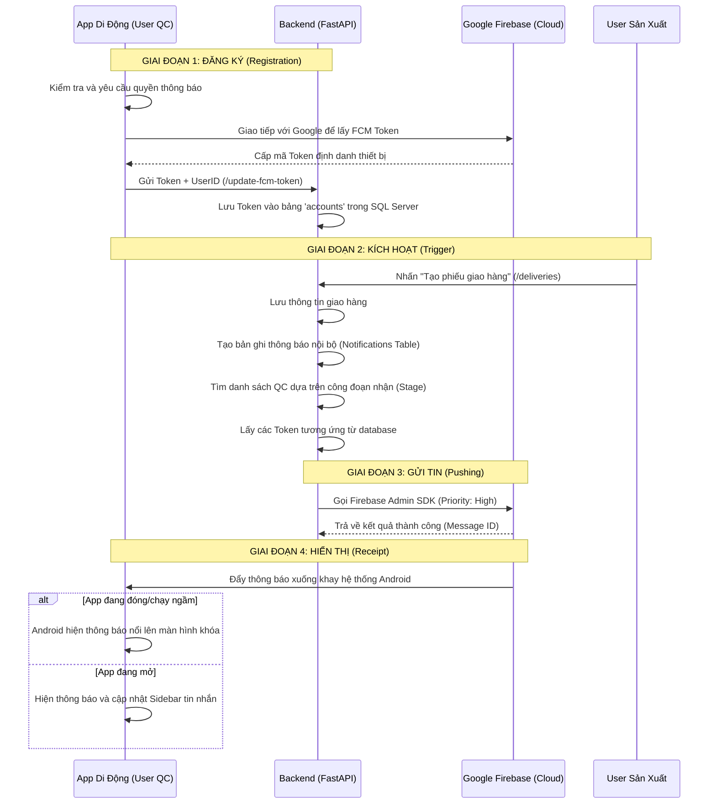

# Luồng Hoạt động Hệ thống Thông báo Đẩy (Detailed Workflow)

Tài liệu này mô tả chi tiết cách thức vận hành của tính năng Thông báo đẩy (Push Notifications) từ lúc thiết bị đăng ký cho đến khi người dùng nhận được tin nhắn trên màn hình khóa.

## sơ đồ quy trình (Sequence Diagram)

## Giải thích chi tiết các pha xử lý

### 1. Pha Đăng ký (Registration Phase)
Ngay khi người dùng QC đăng nhập, ứng dụng thực hiện lấy mã Token từ Google Firebase. Mã Token này là "địa chỉ duy nhất" của app trên thiết bị đó. Server lưu địa chỉ này vào cột `fcm_token` của người dùng. Việc này đảm bảo thông báo luôn được gửi đến đúng thiết bị của đúng người dùng.

### 2. Pha Kích hoạt (Trigger Phase)
Khi một phiếu giao hàng được tạo, hệ thống Backend sẽ tự động phân tích:
- **Người gửi là ai?** (Để lấy tên hiển thị).
- **Hàng đi đến đâu?** (Ví dụ: Công đoạn Lắp ráp).
- **Ai là người cần biết?** (Tìm QC của công đoạn Lắp ráp).

### 3. Pha Đẩy tin (Pushing Phase)
Server ERP gửi yêu cầu đến máy chủ Google. Thông tin gửi đi bao gồm:
- **Payload:** Tiêu đề và nội dung tin nhắn.
- **Priority (Ưu tiên):** Thiết lập mức `high` để thông báo có thể vượt qua các trình quản lý pin nghiêm ngặt của Android (giúp hiện tin nhắn kể cả khi đã thoát app).
- **Channel ID:** Sử dụng kênh `default` đã được định nghĩa trong mã nguồn Android để điện thoại nhận diện đúng loại thông báo.

### 4. Pha Nhận tin (Reception Phase)
Đây là bước cuối cùng trên tay người dùng. 
- Nếu điện thoại đang khóa: Thông báo sẽ sáng màn hình và hiển thị cùng âm thanh.
- Nếu người dùng nhấn vào thông báo: App sẽ được kích hoạt để mở ra màn hình chính, giúp người dùng xử lý công việc ngay lập tức.

---
> [!TIP]
> Hệ thống này giúp giảm thiểu thời gian chờ đợi giữa các công đoạn sản xuất, giúp QC luôn nắm bắt được dòng chảy hàng hóa trong nhà máy theo thời gian thực.
