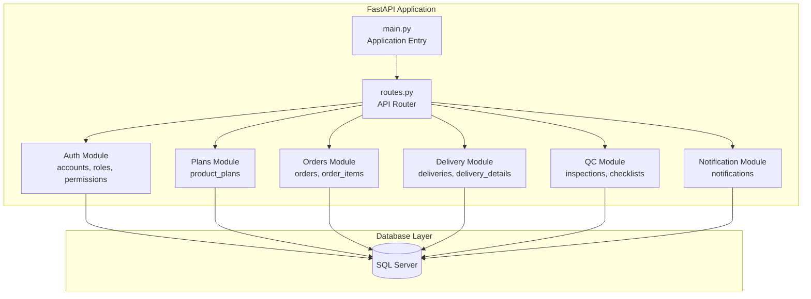
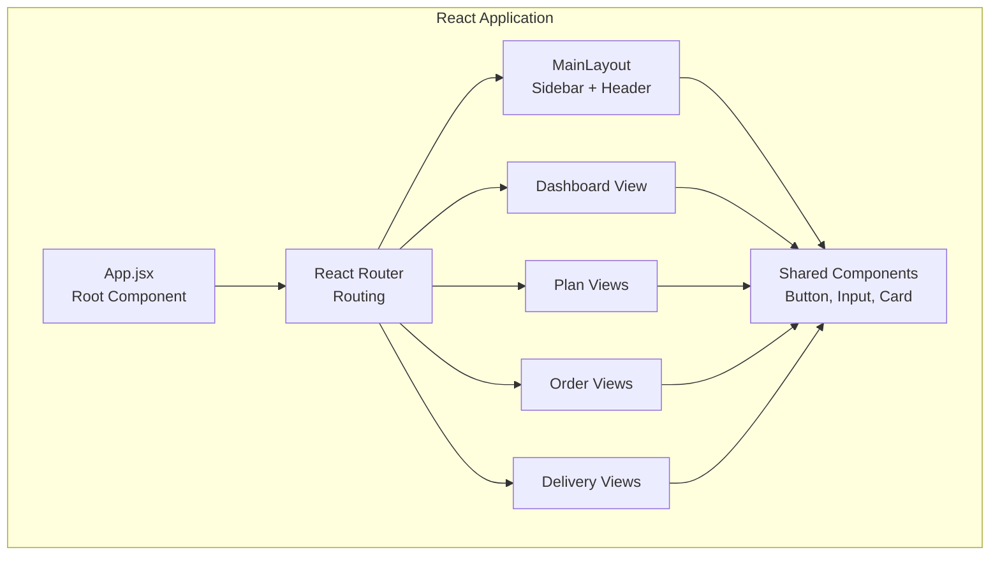
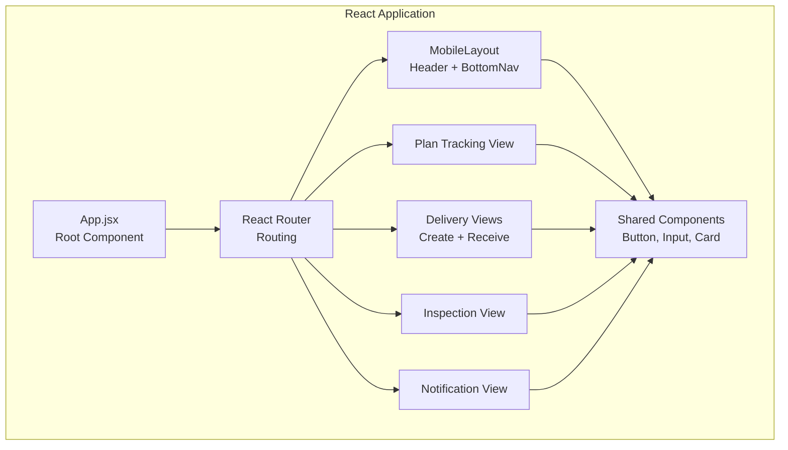

# Component Diagram

Sơ đồ chi tiết các component trong hệ thống SmartFlow v2.

---

## Backend Components



---

## Frontend Web Components



---

## Frontend Mobile Components



---

## Component Relationships

### Backend Module Structure

```
app/
├── main.py              # Application entry point
├── routes.py            # API router aggregation
├── dependencies.py      # Dependency injection
└── modules/
    ├── auth/            # Authentication & Authorization
    │   ├── models/      # SQLAlchemy models
    │   ├── schemas/     # Pydantic schemas
    │   ├── services/    # Business logic
    │   └── routes/      # API endpoints
    ├── plans/           # Production Plans
    ├── orders/          # Orders
    ├── delivery/        # Deliveries
    ├── inspection/      # QC Inspections
    └── notification/    # Notifications
```

### Frontend Web Module Structure

```
Web/
├── app/
│   ├── App.jsx          # Root component
│   └── bootstrap.jsx    # Bootstrap logic
├── Shared/              # Shared components
│   ├── Views/           # Shared views
│   ├── Services/        # API services
│   └── components/      # UI components
└── [Modules]/           # Business modules
    ├── Auth/
    ├── Dashboard/
    ├── Plan/
    ├── Order/
    └── Delivery/
```

### Frontend Mobile Module Structure

```
Mobile/
├── app/
│   ├── App.jsx          # Root component
│   └── bootstrap.jsx    # Bootstrap logic
├── Shared/              # Shared components
│   ├── Views/           # Shared views
│   ├── Services/        # API services
│   └── components/      # UI components
└── [Modules]/           # Business modules
    ├── Auth/
    ├── Delivery/
    ├── Production/
    └── Notification/
```

---

**Last Updated:** 2026-06-03
