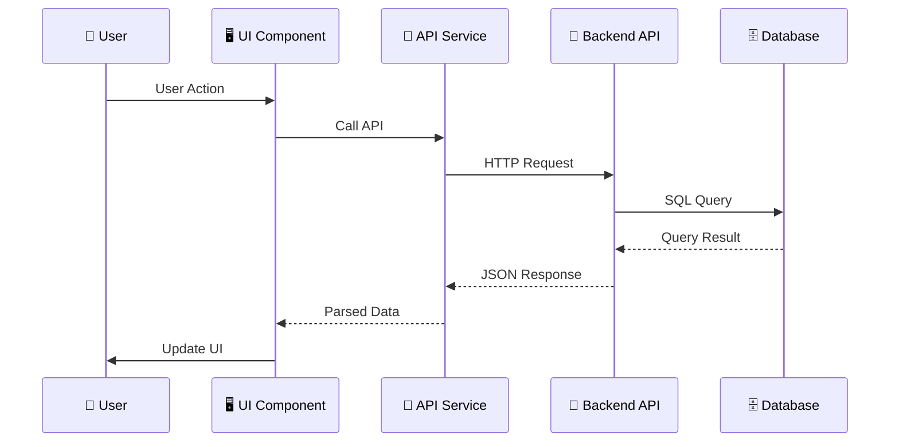
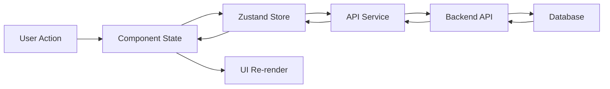
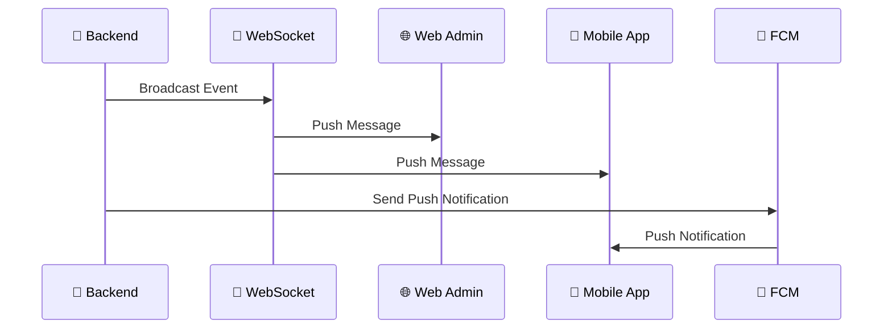
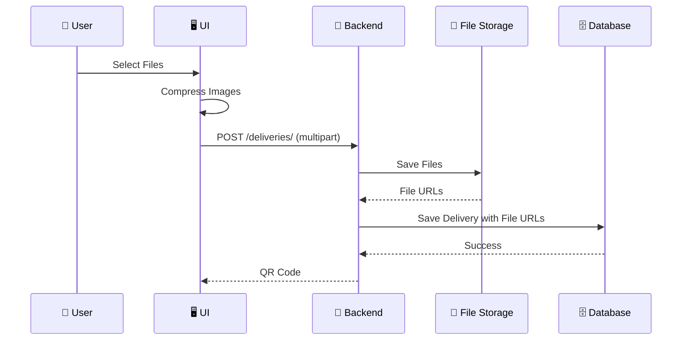
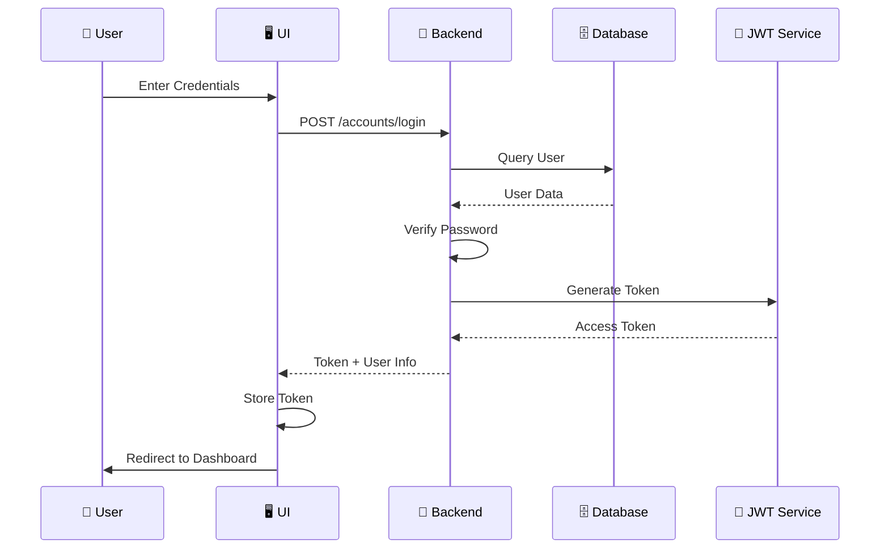
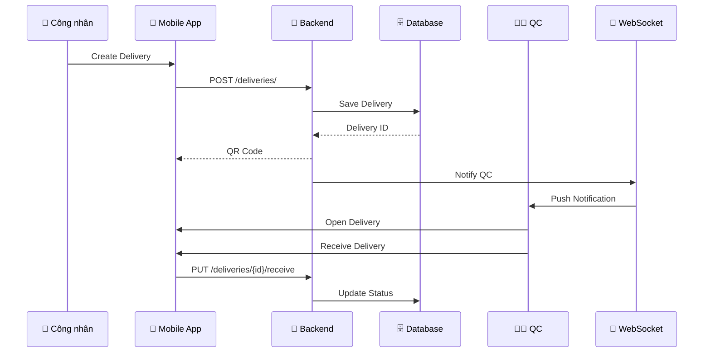

# Data Flow

Tài liệu này mô tả luồng dữ liệu trong hệ thống SmartFlow v2.

---

## Request Flow

---

## State Management Flow

---

## WebSocket Data Flow

---

## File Upload Flow

---

## Authentication Flow

---

## Delivery Creation Flow

---

**Last Updated:** 2026-06-03
