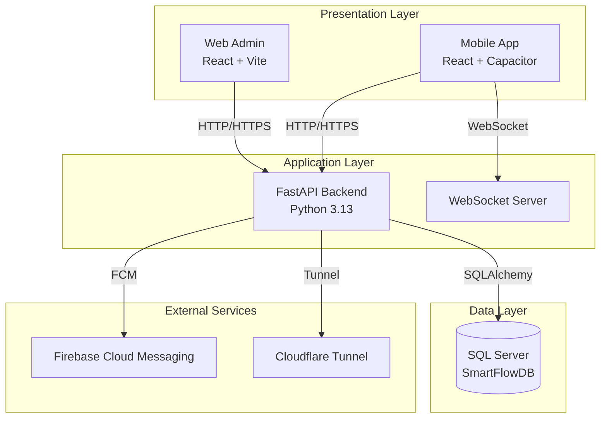
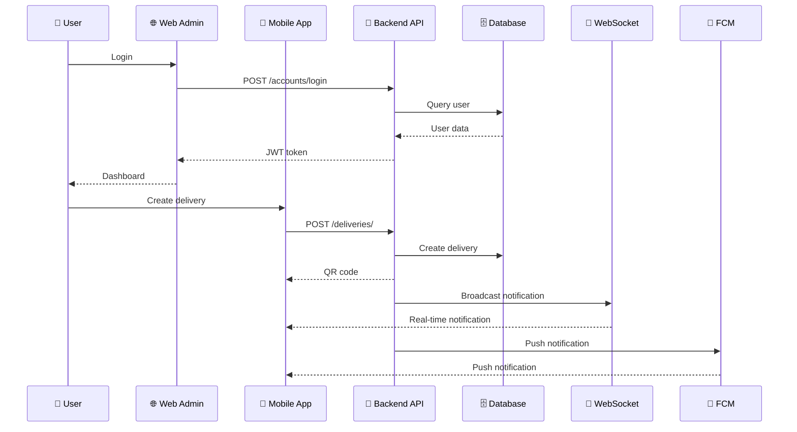
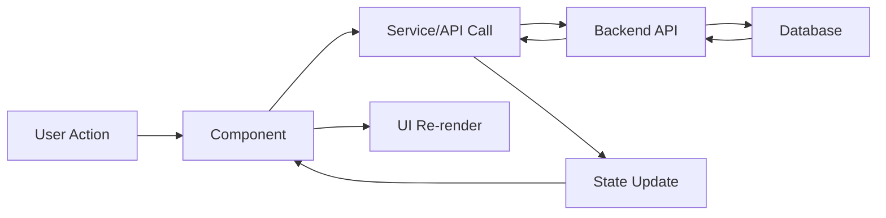
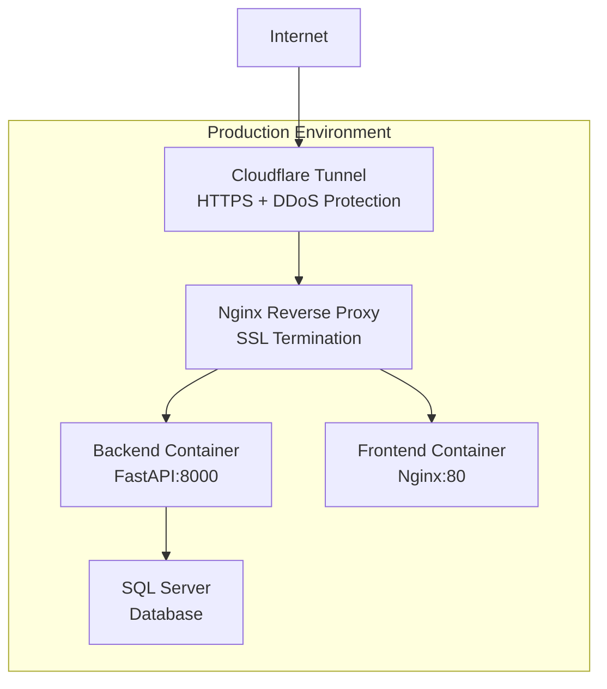

# System Diagram

Sơ đồ chi tiết hệ thống SmartFlow v2.

---

## High-Level Architecture

---

## Component Interaction

---

## Data Flow

---

## Deployment Architecture

---

**Last Updated:** 2026-06-03
