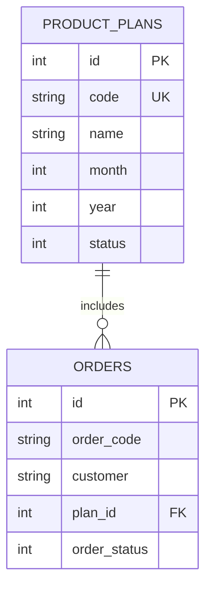
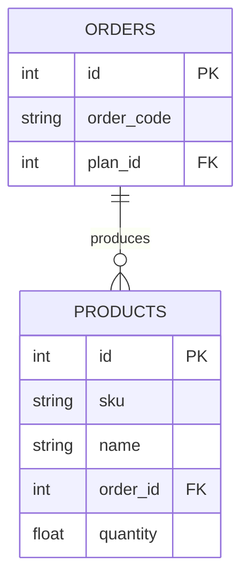
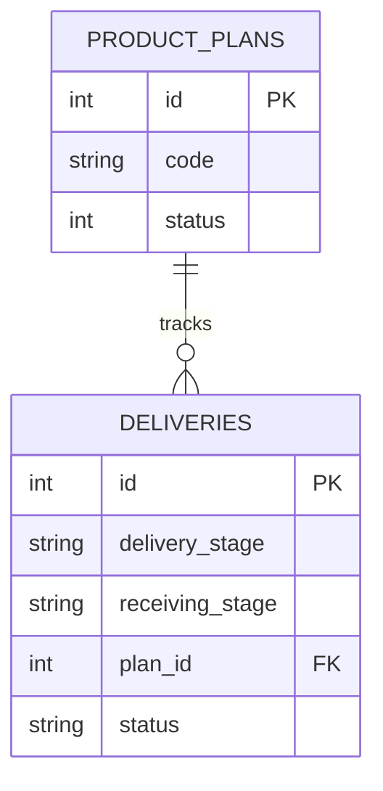
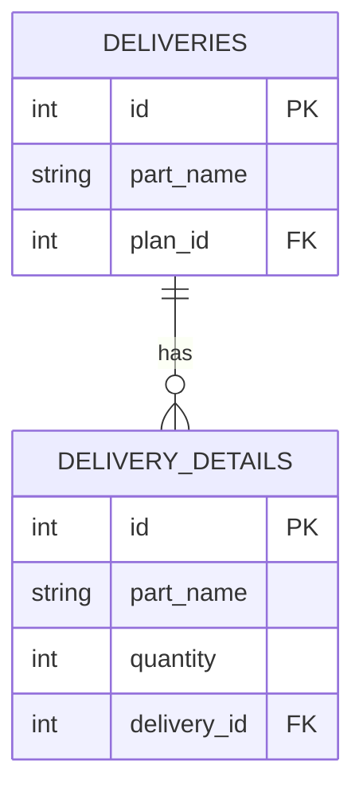
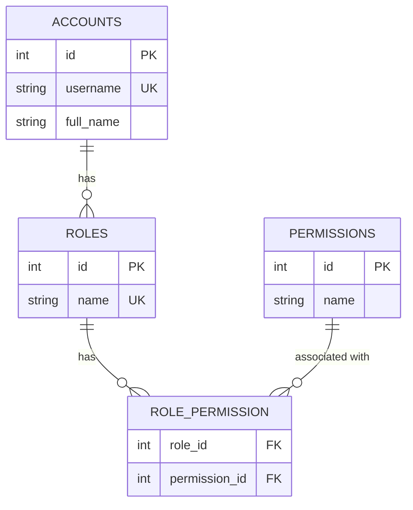
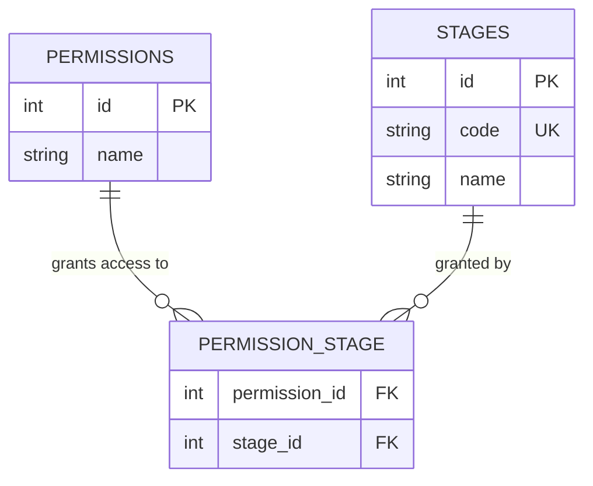
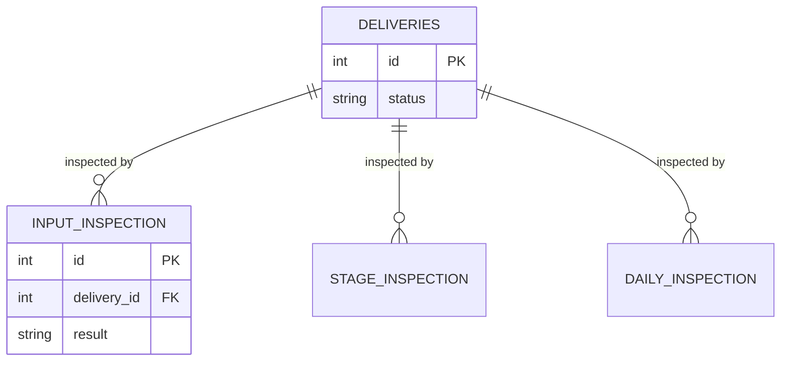

# Entity Relationship Diagram (ERD)

Sơ đồ quan hệ giữa các bảng trong database SmartFlow v2.

---

## 📋 Mục lục (Table of Contents)

1. [ERD Overview](#-erd-overview)
2. [Key Relationships](#-key-relationships)
3. [Relationship Diagram](#-relationship-diagram)

---

## 🎯 ERD Overview

SmartFlow v2 database có các quan hệ chính:

- **One-to-Many**: Plan → Orders, Order → Products, Delivery → DeliveryDetails
- **Many-to-Many**: Role ↔ Permission, Permission ↔ Stage
- **Self-Referencing**: Plan → Plan (nếu có kế hoạch con)

---

## 🔗 Key Relationships

### 1. ProductPlan → Orders

### 2. Order → Products

### 3. ProductPlan → Deliveries

### 4. Delivery → DeliveryDetails

### 5. Account → Role (Many-to-Many)

### 6. Permission → Stage (Many-to-Many)

### 7. Delivery → Inspection

---

## 📊 Complete ERD

```mermaid
erDiagram
    %% Authentication
    ACCOUNTS ||--o{ ROLES : "has"
    ROLES ||--o{ ROLE_PERMISSION : "has"
    PERMISSIONS ||--o{ ROLE_PERMISSION : "associated with"
    PERMISSIONS ||--o{ PERMISSION_STAGE : "controls"
    STAGES ||--o{ PERMISSION_STAGE : "associated with"
    DEPARTMENTS ||--o{ ACCOUNTS : "contains"
    
    %% Production
    PRODUCT_PLANS ||--o{ ORDERS : "includes"
    ORDERS ||--o{ ORDER_ITEMS : "contains"
    ORDERS ||--o{ PRODUCTS : "produces"
    PRODUCTS ||--o{ BOM_DETAILS : "has"
    CATEGORIES ||--o{ PRODUCTS : "categorizes"
    
    %% Delivery
    PRODUCT_PLANS ||--o{ DELIVERIES : "tracks"
    DELIVERIES ||--o{ DELIVERY_DETAILS : "has"
    DELIVERIES ||--o{ DELIVERY_IMAGES : "proves"
    DELIVERIES ||--o{ DELIVERY_QC : "inspected by"
    DELIVERIES ||--o{ DELIVERY_RETURNS : "returned from"
    ORDERS ||--o{ DELIVERY_DETAILS : "linked to"
    PALLET_CARDS ||--o{ DELIVERIES : "assigned to"
    
    %% QC
    DELIVERIES ||--o{ INPUT_INSPECTION : "inspected"
    DELIVERIES ||--o{ STAGE_INSPECTION : "inspected"
    DELIVERIES ||--o{ DAILY_INSPECTION : "inspected"
    CHECKLISTS ||--o{ INPUT_INSPECTION : "used in"
    CHECKLISTS ||--o{ STAGE_INSPECTION : "used in"
    DEFECT_TYPES ||--o{ INPUT_INSPECTION : "categorized"
    DEFECT_TYPES ||--o{ STAGE_INSPECTION : "categorized"
    
    %% Equipment
    EQUIPMENT ||--o{ EQUIPMENT_MAINTENANCE : "maintained"
    
    %% KPI
    ACCOUNTS ||--o{ STAFF_EVALUATION : "evaluated"
    ACCOUNTS ||--o{ AWARD_DISCIPLINE : "awarded/disciplined"
    ACCOUNTS ||--o{ KPI : "tracked"
    
    %% CAPA
    ACCOUNTS ||--o{ CAPA_OCCURRENCES : "reported"
    CAPA_OCCURRENCES ||--o{ CAPA : "resolved"
    CAPA ||--o{ CAPA_EVALUATION : "evaluated"
    
    %% System
    SYSTEM_SCREENS ||--o{ SYSTEM_COMPONENTS : "contains"
    BACKUP_QR ||--o{ DELIVERIES : "backup for"
```

---

## 📝 Relationship Descriptions

### Primary Relationships

| Table A | Table B | Relationship | Description |
|---------|---------|-------------|-------------|
| `product_plans` | `orders` | One-to-Many | Một kế hoạch có nhiều đơn hàng |
| `orders` | `products` | One-to-Many | Một đơn hàng có nhiều sản phẩm |
| `deliveries` | `delivery_details` | One-to-Many | Một phiếu giao có nhiều chi tiết |
| `accounts` | `roles` | Many-to-Many | Một tài khoản có nhiều vai trò |
| `permissions` | `stages` | Many-to-Many | Một quyền áp dụng cho nhiều công đoạn |

### Foreign Keys

| Table | Column | References |
|-------|--------|------------|
| `orders` | `plan_id` | `product_plans.id` |
| `products` | `order_id` | `orders.id` |
| `deliveries` | `plan_id` | `product_plans.id` |
| `deliveries` | `order_id` | `orders.id` |
| `delivery_details` | `delivery_id` | `deliveries.id` |
| `delivery_details` | `order_id` | `orders.id` |

---

**Last Updated:** 2026-06-03
