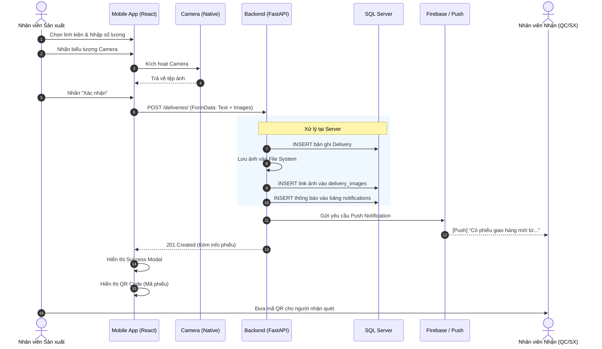

# Hướng dẫn Người dùng & Luồng Xử lý: Tạo Phiếu giao (Delivery Create)

Tài liệu này mô tả chi tiết chức năng **Tạo Phiếu giao** hàng giữa các công đoạn trong nhà máy trên ứng dụng SmartFlow.

---

## 1. Hướng dẫn Người dùng

Chức năng "Tạo Phiếu giao" giúp nhân viên sản xuất ghi nhận và bàn giao sản phẩm/linh kiện cho công đoạn tiếp theo hoặc bộ phận QC.

### Các bước thực hiện:
1.  **Truy cập:** Từ màn hình "Thông tin kế hoạch", chọn một lệnh sản xuất đang thực hiện và nhấn **"Tạo phiếu giao"**.
2.  **Chọn linh kiện/chi tiết:** Hệ thống tự động lọc danh sách linh kiện thuộc công đoạn của bạn. Chọn đúng tên linh kiện cần giao.
3.  **Nhập số lượng:**
    *   **Tổng giao:** Nhập số lượng thực tế bạn bàn giao.
    *   *Lưu ý:* Công đoạn nhận sẽ tự động hiển thị dựa trên cấu hình quy trình.
4.  **Chụp ảnh minh chứng:** 
    *   Nhấn biểu tượng Camera để chụp ảnh sản phẩm (tối đa 3 ảnh).
    *   Ảnh chụp giúp minh chứng tình trạng hàng hóa lúc bàn giao, tránh tranh chấp sau này.
5.  **Ghi chú:** Nhập thêm thông tin lưu ý (nếu có).
6.  **Xác nhận:** Nhấn "Xác nhận". Hệ thống sẽ kiểm tra dữ liệu và lưu phiếu.
7.  **Mã QR:** Sau khi thành công, một mã **QR Giao Nhận** sẽ hiện ra. Nhân viên công đoạn sau có thể quét mã này để nhận hàng nhanh chóng.

---

## 2. Luồng Xử lý Kỹ thuật (Technical Logic)

Chức năng này kết hợp xử lý dữ liệu phức tạp và tích hợp phần cứng (Camera).

### A. Phía Mobile (Frontend)
1.  **Lọc linh kiện (Smart Filtering):**
    *   Dựa vào `user.stage_name`, hệ thống duyệt qua Kế hoạch sản xuất để tìm các thành phần (Component) hoặc linh kiện (Part) có `input_stage` khớp với công đoạn người dùng đang đứng.
    *   Phân loại: Khối "Lắp ráp" lọc theo Component, khối "Định hình" lọc theo Part.
2.  **Tự động xác định Công đoạn nhận:** 
    *   Lấy giá trị `output_stage` từ dữ liệu linh kiện để điền vào ô "Công đoạn nhận".
3.  **Xử lý hình ảnh:** 
    *   Sử dụng `input type="file" capture="environment"` để kích hoạt Camera native của Android/iOS.
    *   Ảnh được lưu tạm dưới dạng `Blob/URL` để hiển thị preview trước khi gửi.
4.  **Gửi dữ liệu (Multipart Form Data):**
    *   Vì có chứa tệp tin (ảnh), dữ liệu được gửi qua đối tượng `FormData`.
    *   Endpoint: `POST /deliveries/`.

### B. Phía Backend
1.  **Lưu trữ dữ liệu:** 
    *   Lưu thông tin phiếu vào bảng `deliveries`.
    *   Lưu tệp ảnh vào thư mục `static/uploads/deliveries` và ghi log đường dẫn vào bảng `delivery_images`.
2.  **Tạo thông báo (Notification Logic):**
    *   Hệ thống tự động tạo một bản ghi thông báo trong Database cho nhóm QC hoặc nhân viên công đoạn nhận.
3.  **Thông báo đẩy (Firebase Cloud Messaging):**
    *   Backend gọi hàm `notify_qc_stage` để gửi tin nhắn Push đến thiết bị của những người thuộc công đoạn nhận.

---

## 3. Biểu đồ Sequence Diagram

---

## 4. Các quy tắc Nghiệp vụ quan trọng (Business Rules)

*   **Tính nhất quán:** Chỉ hiển thị linh kiện thuộc công đoạn của người dùng để tránh bàn giao nhầm.
*   **Trạng thái mặc định:** Phiếu mới tạo luôn ở trạng thái `Chờ Xác Nhận`.
*   **Ràng buộc nội dung:** 
    *   Bắt buộc chọn linh kiện và nhập số lượng giao.
    *   Số lượng giao phải lớn hơn 0.
*   **Thông báo thời gian thực:** Đảm bảo người nhận biết có hàng đến ngay lập tức mà không cần kiểm tra thủ công.

---

> [!IMPORTANT]
> Ảnh chụp minh chứng là vô cùng quan trọng cho việc truy vết chất lượng (Traceability). Vui lòng hướng dẫn nhân viên chụp rõ nét tem nhãn hoặc ngoại quan sản phẩm.
