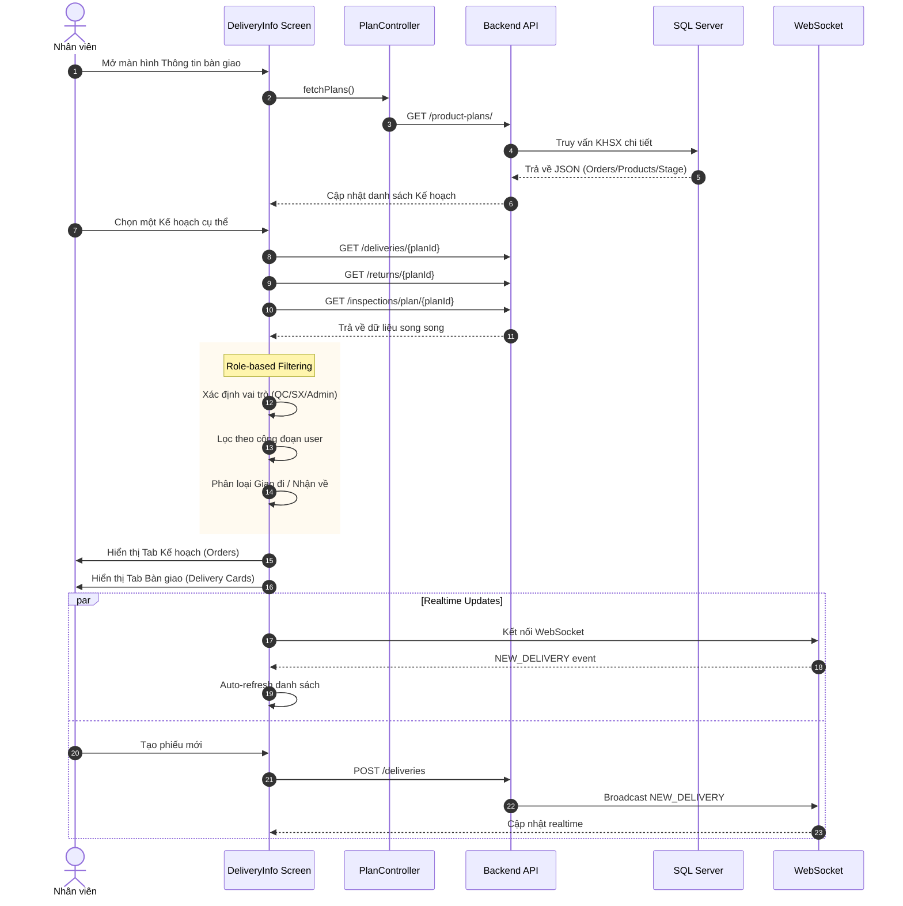

# Hướng dẫn Người dùng & Luồng Xử lý: Thông tin bàn giao (Delivery Info)

Màn hình **Thông tin bàn giao** (MB2) là trung tâm quản lý (Dashboard) của nhân viên tại mỗi chặng trong quy trình sản xuất. Tại đây, bạn có thể theo dõi tiến độ công việc của mình dựa trên kế hoạch sản xuất (KHSX).

---

## 1. Hướng dẫn Người dùng

Màn hình này cung cấp cái nhìn tổng thể về những gì bạn cần làm trong ngày/ca làm việc.

### Các thành phần chính:

#### A. Header & Điều hướng
1.  **Chọn kế hoạch:** Sử dụng dropdown phía trên để chuyển đổi giữa các Kế hoạch sản xuất khác nhau đang chạy. Kế hoạch được sắp xếp theo tháng mới nhất.
2.  **Chỉ báo kết nối:** Điểm màu xanh/đỏ/vàng ở góc trên cùng cho biết trạng thái kết nối WebSocket (realtime).
3.  **Nút "Tạo nhanh":** Lối tắt để tạo phiếu bàn giao mới cho kế hoạch đang chọn (chỉ hiển thị với vai trò Sản xuất, không hiển thị cho QC).

#### B. Hai Tab chính

**Tab "Kế hoạch"** - Theo dõi tiến độ sản xuất:
- Hiển thị danh sách **Đơn hàng (Orders)** với các sản phẩm bên trong
- Mỗi đơn hàng có thể mở rộng để xem chi tiết các sản phẩm
- Hiển thị tiến độ hoàn thành của từng sản phẩm (%)
- Có tìm kiếm theo tên đơn hàng, tên sản phẩm, SKU
- Có bộ lọc theo trạng thái: Chờ giao, Đang giao, Hoàn thành
- Có sắp xếp theo tên hoặc số lượng

**Tab "Bàn giao"** - Quản lý phiếu giao/nhận:
- Hiển thị danh sách các phiếu bàn giao dưới dạng thẻ (cards)
- **Badge báo đỏ:** Số phiếu cần xử lý sẽ hiển thị trên tab này
- Mỗi thẻ phiếu hiển thị:
  - Mã phiếu (DLV-XXX)
  - Tên chi tiết và quy cách
  - Số lượng thực nhận
  - Trạng thái phiếu (màu sắc khác nhau)
  - Thông tin trả hàng (nếu có)
- **Bộ lọc phân loại:**
  - **Tất cả:** Hiển thị tất cả phiếu liên quan
  - **Giao đi:** Phiếu mà công đoạn của bạn là người giao
  - **Nhận về:** Phiếu mà công đoạn của bạn là người nhận
- **Tìm kiếm nhanh:** Tìm theo mã phiếu, tên chi tiết, quy cách, tên công đoạn
- **Lọc trạng thái:** Chờ Xác Nhận, Chờ QC Kiểm Tra, Chờ Nhận Hàng, Hoàn thành
- **Sắp xếp:** Theo ngày tạo hoặc số lượng

#### C. Tương tác với phiếu bàn giao

**Nhấn đơn (1 click):** Mở chi tiết phiếu để xem thông tin đầy đủ và thực hiện các hành động:
- Xác nhận nhận hàng (nếu là người nhận)
- Xem kết quả QC (nếu đã kiểm tra)
- Xử lý trả hàng (nếu có)

**Nhấn đôi (double click):** Mở **Thẻ Pallet** nhanh để xem thông tin thẻ pallet của phiếu đó

**Nút "Thẻ Pallet":** Nhấn nút này ở góc dưới mỗi thẻ phiếu để mở thẻ pallet

#### D. Trạng thái phiếu và màu sắc

- **Chờ Xác Nhận** (Màu đỏ): Phiếu vừa tạo, chờ người giao xác nhận
- **Chờ QC Kiểm Tra** (Màu xanh): Đã giao, chờ QC kiểm tra chất lượng
- **Chờ Nhận Hàng** (Màu cam): Đã qua QC, chờ bộ phận nhận xác nhận
- **Hoàn thành / Đã Nhận** (Màu xanh lá): Đã hoàn tất quy trình

#### E. Tính năng đặc biệt

**Thông báo trả hàng:**
- Nếu phiếu có trả hàng, sẽ hiển thị badge "Trả hàng (X)" với icon mũi tên hai chiều
- Màu vàng để cảnh báo

**Realtime cập nhật:**
- Dữ liệu tự động làm mới khi có phiếu mới được tạo
- Tự động cập nhật khi QC xác nhận kết quả
- Tự động cập nhật khi người nhận xác nhận nhận hàng

**Phân quyền:**
- **QC:** Không thấy nút "Tạo nhanh", chỉ xem và kiểm tra
- **Sản xuất:** Có thể tạo phiếu, xem kết quả KT (chế độ xem only)
- **Admin:** Xem tất cả phiếu của mọi công đoạn

---

## 2. Luồng Xử lý Kỹ thuật (Technical Logic)

Màn hình này thực hiện việc "tổng hợp dữ liệu" (Data Aggregation) từ nhiều nguồn để hiển thị thông tin trực quan nhất.

### A. Phía Mobile (Frontend)

#### 1. Lấy dữ liệu
- Gọi API đồng thời để lấy:
  - `plans`: Danh sách kế hoạch sản xuất
  - `deliveries`: Danh sách phiếu giao thực tế theo plan_id
  - `returns`: Danh sách phiếu trả hàng liên quan
  - `inspections`: Kết quả kiểm tra chất lượng

#### 2. Logic lọc theo vai trò (Role-based Filtering)
- **Xác định vai trò:** Kiểm tra role/permission của user (QC, Sản xuất, Admin)
- **Lọc theo công đoạn:** 
  - Sử dụng `isMatchStage()` để so khớp công đoạn user với công đoạn phiếu
  - Hỗ trợ viết tắt và so khớp mờ (fuzzy matching)
  - Bỏ tiền tố "QC" khi so khớp với stage sản xuất
- **Lọc theo phân loại phiếu:**
  - `Giao đi`: Phiếu có `delivery_stage` khớp với công đoạn user
  - `Nhận về`: Phiếu có `receiving_stage` khớp với công đoạn user
  - `Tất cả`: Hiển thị cả hai loại

#### 3. Logic tổng hợp (Aggregation Logic)

**Tab Kế hoạch:**
- Duyệt qua Orders -> Products -> BOM tree
- Lọc sản phẩm có `input_stage` hoặc `output_stage` khớp với user
- Hiển thị tiến độ % hoàn thành của từng sản phẩm
- Hỗ trợ tìm kiếm theo tên đơn hàng, sản phẩm, SKU
- Phân trang (load thêm khi cuộn)

**Tab Bàn giao:**
- Hiển thị danh sách phiếu dưới dạng cards
- Lọc theo trạng thái, tìm kiếm, phân loại
- Tính badge báo đỏ: Đếm phiếu cần xử lý
- Hiển thị thông tin trả hàng nếu có

#### 4. Realtime Updates
- Sử dụng WebSocket để lắng nghe sự kiện:
  - `NEW_DELIVERY`: Phiếu mới được tạo
  - `QC_CONFIRMED`: QC xác nhận kết quả
  - `DELIVERY_RECEIVED`: Người nhận xác nhận
  - `UPDATE_DELIVERY`: Cập nhật phiếu
- Fallback mechanism: Dùng `useUiStore` để refresh khi WS lỗi
- Auto-refresh khi nhận notification mới

#### 5. Trạng thái (Status)
- `Chờ Xác Nhận`: Phiếu vừa tạo
- `Chờ QC Kiểm Tra`: Đã giao, chờ QC
- `Chờ Nhận Hàng`: Đã qua QC, chờ nhận
- `Hoàn thành / Đã Nhận`: Hoàn tất

### B. Phía Backend
- `GET /product-plans/`: Lấy danh sách kế hoạch sản xuất chi tiết
- `GET /deliveries/{plan_id}`: Lấy danh sách phiếu giao theo kế hoạch
- `GET /returns/{plan_id}`: Lấy danh sách phiếu trả hàng
- `GET /inspections/plan/{plan_id}?stage=...`: Lấy kết quả kiểm tra
- WebSocket endpoint: Realtime notifications

---

## 3. Biểu đồ Sequence Diagram

Dưới đây là luồng xử lý từ khi mở màn hình đến khi hiển thị dữ liệu:

---

## 4. Tầm quan trọng của dữ liệu

- **Độ chính xác:** Giúp nhân viên biết chính xác mình còn nợ bao nhiêu hàng cho các công đoạn sau.
- **Điều phối:** Trưởng ca có thể nhìn vào bảng này để biết công đoạn nào đang chậm tiến độ so với kế hoạch chung.
- **Truy xuất nguồn gốc:** Thẻ Pallet giúp truy xuất thông tin chi tiết của từng lô hàng.
- **Xử lý trả hàng:** Badge trả hàng giúp nhanh chóng nhận diện các phiếu có vấn đề cần xử lý.

---

## 5. Mẹo sử dụng

> [!TIP]
> - **Kiểm tra thường xuyên Tab Bàn giao:** Badge báo đỏ sẽ cho bạn biết số phiếu cần xử lý ngay lập tức.
> - **Sử dụng bộ lọc phân loại:** Chuyển giữa "Giao đi" và "Nhận về" để tập trung vào nhiệm vụ hiện tại.
> - **Double-click nhanh:** Nhấn đôi vào thẻ phiếu để mở Thẻ Pallet ngay lập tức.
> - **Tìm kiếm thông minh:** Có thể tìm theo mã phiếu (DLV-XXX), tên chi tiết, quy cách, hoặc tên công đoạn.
> - **Realtime:** Không cần refresh trang, dữ liệu sẽ tự động cập nhật khi có thay đổi.
