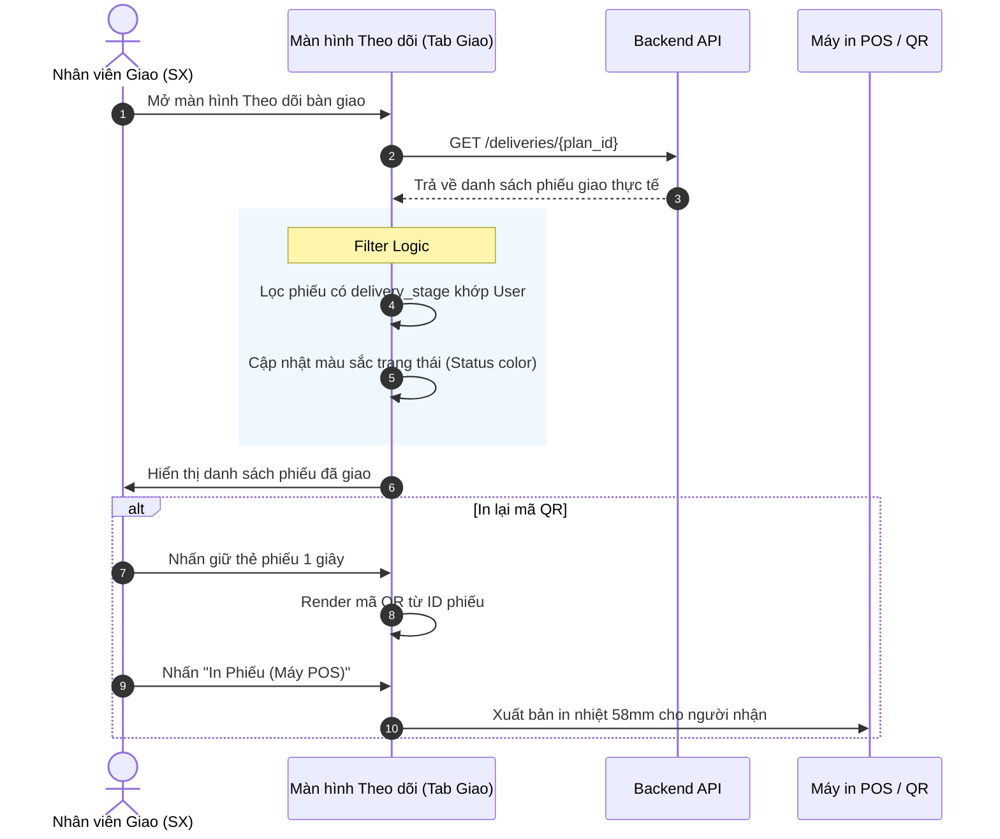

# Hướng dẫn Người dùng & Luồng Xử lý: Theo dõi bàn giao (Handover Tracking)

Tính năng **Theo dõi bàn giao** cho phép nhân viên tại mỗi công đoạn quản lý toàn bộ các phiếu hàng mà mình đã chuyển đi cho các bộ phận khác, từ đó nắm bắt được tình trạng hàng hóa đã được nhận hay chưa.

---

## 1. Hướng dẫn Người dùng

Màn hình này là sổ nhật ký điện tử ghi lại mọi hoạt động "xuất hàng" của công đoạn bạn.

### Các tính năng chính:
1.  **Lọc theo Kế hoạch:** Luôn chọn đúng Kế hoạch sản xuất (KHSX) hiện tại để xem danh sách phiếu tương ứng.
2.  **Tab "Phiếu Giao":** Hiển thị tất cả các phiếu mà công đoạn của bạn là **nơi giao đi**.
3.  **Theo dõi trạng thái xác nhận:**
    *   **Màu đỏ (Chờ Xác Nhận):** Bạn đã tạo phiếu nhưng công đoạn nhận vẫn chưa quét mã để xác nhận. Bạn có thể cần nhắc nhở họ kiểm tra.
    *   **Màu xanh dương (Chờ Kiểm Tra):** Công đoạn nhận đã xác nhận nhận hàng, phiếu đang chờ QC kiểm tra chất lượng.
    *   **Màu xanh lá (Hoàn thành):** QC đã kiểm tra xong và hàng đã được nhập kho công đoạn sau thành công.
4.  **Xem chi tiết và In lại (Nhấn giữ):**
    *   Nhấn vào thẻ để xem thông tin chi tiết.
    *   **Nhấn và Giữ thẻ (Long Press):** Nếu người nhận làm mất mã QR hoặc cần in lại phiếu để dán vào lô hàng, hãy nhấn giữ để mở Modal QR và chọn "In Phiếu (Máy POS)".

---

## 2. Luồng Xử lý Kỹ thuật (Technical Logic)

### A. Phía Mobile (Frontend)
1.  **Phân vùng dữ liệu:**
    *   Sử dụng `user.stage` làm bộ lọc chính: `delivery.delivery_stage === user.stage`.
    *   Dữ liệu được sắp xếp theo thời gian mới nhất lên đầu để dễ theo dõi.
2.  **Logic hiển thị mã QR:**
    *   Mã QR được sinh tự động ngay tại Client bằng thư viện `qrcode.react`.
    *   Nội dung mã QR là mã định danh duy nhất của phiếu (Ví dụ: `DLV-150`).
3.  **Xử lý In nhiệt (Thermal Printing):**
    *   Xây dựng đoạn mã HTML chuyên biệt cho khổ giấy 58mm.
    *   Sử dụng JavaScript interface để gọi lệnh in của hệ điều hành Android trên các máy POS cầm tay.

### B. Phía Backend
*   Cung cấp dữ liệu qua API: `GET /deliveries/{plan_id}`.
*   Backend cập nhật trạng thái phiếu (`status`) theo thời gian thực mỗi khi có bất kỳ thay đổi nào từ phía người nhận hoặc QC, giúp người giao luôn thấy được trạng thái mới nhất của lô hàng mình đã gửi đi.

---

## 3. Biểu đồ Sequence Diagram

---

## 4. Các lưu ý khi theo dõi bàn giao

*   **Nhắc nhở nhận hàng:** Nếu phiếu nằm ở trạng thái "Chờ Xác Nhận" quá lâu, người giao có nhiệm vụ nhắc nhở người nhận quét mã để tránh làm gián đoạn dòng dữ liệu và tiến độ chung.
*   **Tính minh bạch:** Mọi phiếu giao đều có ID duy nhất, ảnh minh chứng và thời gian tạo cụ thể, giúp giải quyết các vấn đề thất lạc hàng hóa giữa các công đoạn.

---

> [!TIP]
> Bạn có thể nhấn giữ và chọn **"Tải về Ảnh"** để gửi mã QR cho đồng nghiệp qua Zalo/Tin nhắn nếu họ không thể có mặt trực tiếp để quét mã.
