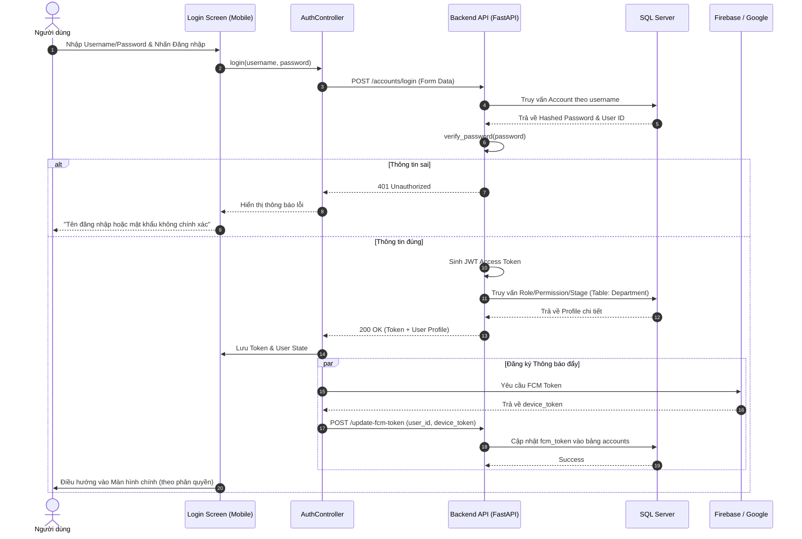
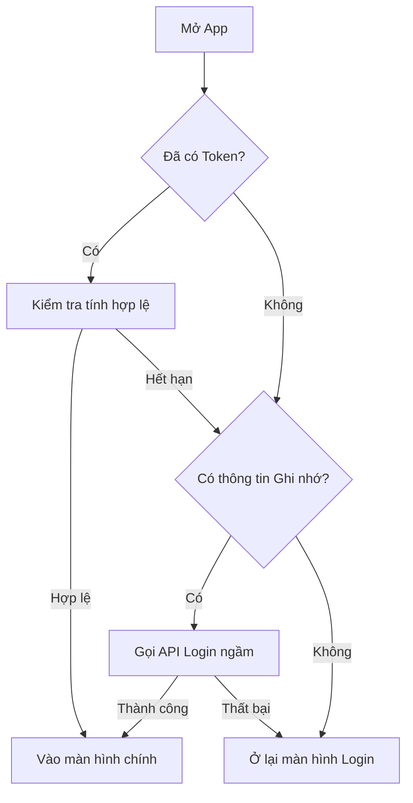

# Hướng dẫn Người dùng & Luồng Xử lý: Chức năng Đăng nhập (Login)

Tài liệu này mô tả chi tiết chức năng Đăng nhập của hệ thống **SmartFlow**, bao gồm trải nghiệm người dùng và quy trình kỹ thuật phía dưới.

---

## 1. Hướng dẫn Người dùng

Chức năng Đăng nhập là cửa ngõ duy nhất để truy cập vào hệ thống. Giao diện được thiết kế tối ưu cho thiết bị di động (Mobile).

### Các bước thực hiện:
1.  **Tên đăng nhập:** Nhập mã nhân viên hoặc tên tài khoản được cấp.
2.  **Mật khẩu:** Nhập mật khẩu bảo mật (có thể nhấn biểu tượng "con mắt" để ẩn/hiện mật khẩu).
3.  **Ghi nhớ đăng nhập:** 
    *   Nếu chọn: Hệ thống sẽ lưu thông tin để bạn không phải nhập lại ở lần sau.
    *   Lần mở ứng dụng tiếp theo, hệ thống sẽ tự động đăng nhập (Silent Login) đưa bạn vào thẳng màn hình chính.
4.  **Nhấn nút "Đăng nhập":** Hệ thống kiểm tra thông tin và điều hướng bạn đến màn hình phù hợp với vai trò (Sản xuất hoặc Kiểm tra chất lượng).

### Xử lý lỗi thường gặp:
*   **"Tên đăng nhập hoặc mật khẩu không chính xác":** Vui lòng kiểm tra lại thông tin, lưu ý tắt Caps Lock hoặc kiểm tra khoảng trắng dư thừa.
*   **"Không thể kết nối đến máy chủ":** Kiểm tra lại kết nối Wi-Fi hoặc 4G/5G của thiết bị.

---

## 2. Luồng Xử lý Kỹ thuật (Technical Logic)

Hệ thống sử dụng cơ chế xác thực **OAuth2 với JWT (JSON Web Token)**.

### A. Phía Mobile (Frontend)
1.  **Thu thập dữ liệu:** Form login thu thập `username` và `password`, thực hiện `trim()` để xóa khoảng trắng thừa.
2.  **Gửi yêu cầu:** Dữ liệu được đóng gói dưới dạng `x-www-form-urlencoded` và gửi tới endpoint `/accounts/login`.
3.  **Lưu trữ:** 
    *   Lưu `access_token` vào `localStorage`.
    *   Cập nhật trạng thái người dùng vào `authStore` (Zustand).
    *   Lưu thông tin đăng nhập vào `localStorage` nếu người dùng chọn "Ghi nhớ".
4.  **Thông báo đẩy (Push Notifications):** Ngay sau khi login thành công, hệ thống khởi tạo `PushNotificationService` để lấy FCM Token từ Google và gửi lên Server đồng bộ dữ liệu.
5.  **Điều hướng (Navigation):**
    *   Nếu người dùng thuộc "Nhân Viên Sản Xuất" -> Chuyển đến `/delivery-info`.
    *   Các vai trò khác -> Chuyển đến `/delivery`.

### B. Phía Backend
1.  **Xác thực:** Kiểm tra `hashed_password` trong cơ sở dữ liệu SQL Server.
2.  **Khởi tạo Token:** Tạo JWT token chứa `username` và thời gian hết hạn (thông thường 30 phút hoặc theo cấu hình).
3.  **Truy vấn Profile:** Tìm kiếm thông tin Phòng ban, Vai trò (Role), Quyền (Permission) và Công đoạn (Stage) liên kết với tài khoản.
4.  **Phản hồi:** Trả về đầy đủ profile người dùng để Mobile thực hiện điều hướng chính xác.

---

## 3. Biểu đồ Sequence Diagram

Dưới đây là sơ đồ tương tác giữa các thành phần khi thực hiện đăng nhập:

---

## 4. Cơ chế Đăng nhập ngầm (Silent Login)

Để tối ưu trải nghiệm, hệ thống thực hiện Logic sau khi khởi chạy App:

---

> [!TIP]
> Hệ thống sử dụng `localStorage` để duy trì phiên làm việc. Khi người dùng thực hiện "Đăng xuất", hệ thống sẽ xóa toàn bộ Token và thông tin ghi nhớ để đảm bảo tính bảo mật.
