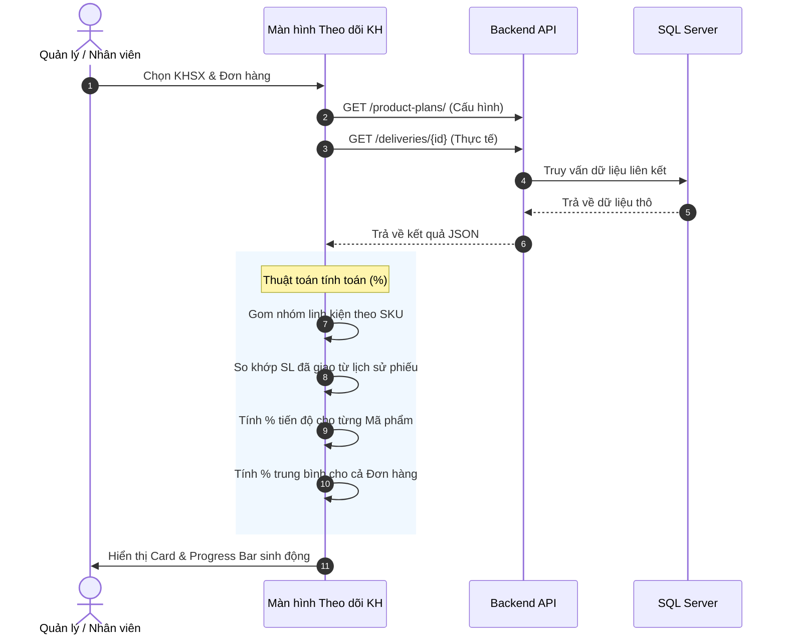

# Hướng dẫn Người dùng & Luồng Xử lý: Theo dõi kế hoạch (Plan Tracking)

Màn hình **Theo dõi kế hoạch** cung cấp cái nhìn tổng quan và chi tiết về tiến độ hoàn thành của từng đơn hàng dựa trên các hoạt động bàn giao thực tế trong nhà máy.

---

## 1. Hướng dẫn Người dùng

Tính năng này giúp quản lý và nhân viên nắm bắt nhanh tình trạng sản xuất mà không cần xem báo cáo giấy.

### Các bước thực hiện:
1.  **Chọn Kế hoạch sản xuất (KHSX):** Chọn mã kế hoạch tổng (ví dụ: KHD3-24L-WHT). Hệ thống sẽ tải về toàn bộ danh sách đơn hàng thuộc kế hoạch đó.
2.  **Lọc theo Đơn hàng:** 
    *   Mặc định hệ thống hiển thị tất cả đơn hàng.
    *   Bạn có thể chọn một mã đơn hàng cụ thể (Mã LSX) để xem chi tiết.
3.  **Xem tiến độ tổng quát:** Mỗi đơn hàng được hiển thị dưới dạng một thẻ (Card) kèm theo **Thanh tiến độ (%)**.
4.  **Xem chi tiết sản phẩm (SKU):**
    *   Mở rộng thẻ đơn hàng để xem danh sách các mã sản phẩm (SKU) bên trong.
    *   **Cột KH:** Số lượng đăng ký sản xuất.
    *   **Cột Tiến độ:** Phần trăm linh kiện đã được bàn giao/QC thành công cho đến hiện tại.
    *   **Trạng thái:** Chờ làm, Đang làm hoặc Hoàn thành.

---

## 2. Luồng Xử lý Kỹ thuật (Technical Logic)

Đây là màn hình yêu cầu tính toán logic phức tạp nhất từ dữ liệu thô (Raw data).

### A. Phía Mobile (Frontend)
1.  **Lấy dữ liệu thô:** 
    *   Gọi `GET /product-plans/` để lấy cấu hình kế hoạch (Cây danh mục: Order -> Product -> Component -> Part).
    *   Gọi `GET /deliveries/{id}` để lấy toàn bộ lịch sử bàn giao của kế hoạch.
2.  **Thuật toán tính Tiến độ (Progress Algorithm):**
    *   Hệ thống "phẳng hóa" danh sách linh kiện cần thiết cho mỗi mã sản phẩm (SKU).
    *   Duyệt qua danh sách các phiếu bàn giao thực tế có trạng thái hợp lệ (Chờ kiểm tra, Hoàn thành).
    *   Cộng dồn số lượng thực nhận từ các phiếu giao cho các linh kiện thuộc SKU đó.
    *   **Công thức:** `Tiến độ = (Tổng SL linh kiện đã nhận) / (Tổng SL linh kiện theo kế hoạch) * 100`.
3.  **Hiển thị trực quan:** Sử dụng `render` custom trong `DataTable` để tạo các thanh Progress Bar động với màu sắc thay đổi theo mức độ hoàn thành.

### B. Phía Backend
*   Backend đóng vai trò cung cấp dữ liệu thô qua các API Restful. 
*   Quá trình tính toán phần trăm (%) được thực hiện ngay tại thiết bị của người dùng để giảm tải cho Server và đảm bảo trải nghiệm mượt mà khi lọc dữ liệu.

---

## 3. Biểu đồ Sequence Diagram

---

## 4. Các quy tắc hiển thị

*   **Màu xanh dương:** Đơn hàng đang trong quá trình sản xuất/bàn giao.
*   **Màu xanh lá:** Đơn hàng đã được bàn giao đủ 100% số lượng linh kiện cần thiết.
*   **Fuzzy Match:** Hệ thống tự động xử lý so khớp tên linh kiện kể cả khi có sai khác nhỏ về dấu hoặc khoảng trắng để đảm bảo số lượng không bị bỏ sót.

---

> [!TIP]
> Bạn có thể nhấn vào tiêu đề Đơn hàng để thu gọn/mở rộng, giúp màn hình gọn gàng hơn khi theo dõi cùng lúc nhiều đơn hàng lớn.
