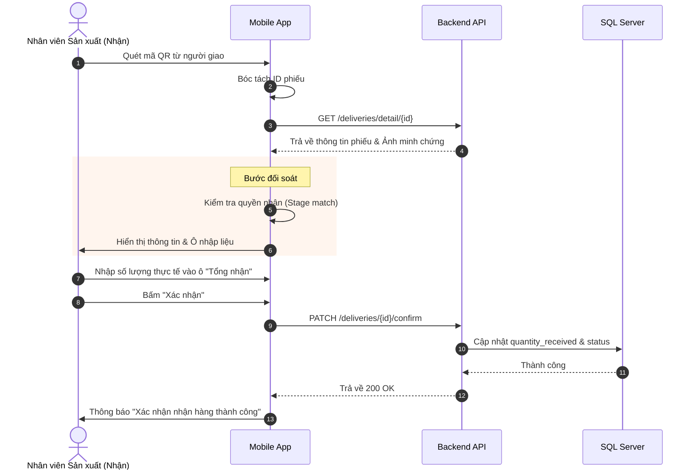

# Hướng dẫn Người dùng & Luồng Xử lý: Thông tin nhận hàng của SX

Tài liệu này hướng dẫn chi tiết quy trình tiếp nhận hàng hóa tại công đoạn sản xuất, bắt đầu từ việc quét mã QR cho đến khi nhập số lượng và xác nhận hoàn tất trên hệ thống SmartFlow.

---

## 1. Hướng dẫn Người dùng

Quy trình này đảm bảo tính chính xác về số lượng linh kiện di chuyển giữa các công đoạn.

### Các bước thực hiện:
1.  **Quét mã QR:** 
    *   Người nhận cầm điện thoại và quét mã QR trên phiếu giao hàng (hoặc trên điện thoại của người giao).
    *   Sau khi quét thành công, ứng dụng tự động mở màn hình **"Thông tin nhận hàng"**.
2.  **Đối soát thông tin:**
    *   **Công đoạn giao:** Tên xưởng/công đoạn vừa chuyển hàng tới.
    *   **Tổng giao:** Số lượng hàng mà công đoạn trước khai báo là đã giao đi.
    *   **Ảnh minh chứng:** Kiểm tra các ảnh thực tế người giao đã chụp để xem tình trạng hàng.
3.  **Nhập số lượng thực nhận:**
    *   Đếm thực tế số lượng hàng nhận được.
    *   Nhập số lượng này vào ô **"Tổng nhận"**.
4.  **Xác nhận nhận hàng:**
    *   Nhấn nút **"Xác nhận"**.
    *   Nhấn **"Đồng ý"** trong bảng thông báo hiện ra.
5.  **Kết quả:** Phiếu sẽ được chuyển trạng thái sang "Chờ Kiểm Tra" và người giao sẽ nhận được thông báo bạn đã nhận hàng thành công.

---

## 2. Luồng Xử lý Kỹ thuật (Technical Logic)

### A. Phía Mobile (Frontend)
1.  **Nhận ID từ QR:** 
    *   Màn hình nhận diện ID phiếu từ chuỗi quét mã (Ví dụ: `DLV-150` -> `150`).
    *   Gọi API `GET /deliveries/detail/{id}` để tải dữ liệu.
2.  **Logic xác thực (Security):**
    *   Hệ thống kiểm tra: `user.stage` (Công đoạn người dùng) PHẢI khớp với `delivery.receiving_stage` (Công đoạn đích của phiếu).
    *   Nếu không khớp, hệ thống sẽ ẩn nút xác nhận hoặc hiện cảnh báo "Bạn không thuộc công đoạn nhận của phiếu này".
3.  **Cập nhật số lượng:**
    *   Gửi yêu cầu `PATCH /deliveries/{id}/confirm`.
    *   Payload gửi lên: `{ "quantity_received": [Số lượng vừa nhập], "sx_receipt": [User_ID], "status": "Chờ Kiểm Tra" }`.

### B. Phía Backend
1.  **Cập nhật Database:** Lưu số lượng thực nhận và người nhận vào bảng `deliveries` trong SQL Server.
2.  **Đồng bộ dữ liệu:** Trạng thái phiếu thay đổi sẽ làm cập nhật tiến độ trong màn hình "Thông tin bàn giao" của cả hai bên.

---

## 3. Biểu đồ Sequence Diagram

Dưới đây là mô tả luồng tương tác:

---

## 4. Các lưu ý quan trọng

*   **Sai lệch số lượng:** Nếu bạn nhận thiếu hàng so với phiếu giao, hãy nhập đúng số lượng thực tế. Hệ thống sẽ báo đỏ phần chênh lệch này để quản lý biết.
*   **Trạng thái phiếu:** Sau khi bạn xác nhận, phiếu sẽ không còn ở Tab **"Tiếp nhận"** nữa mà chuyển sang lịch sử xử lý của QC.

---

> [!TIP]
> Bạn có thể bấm vào ảnh minh chứng trong màn hình để xem phóng to, giúp việc đối soát chi tiết linh kiện dễ dàng hơn.
