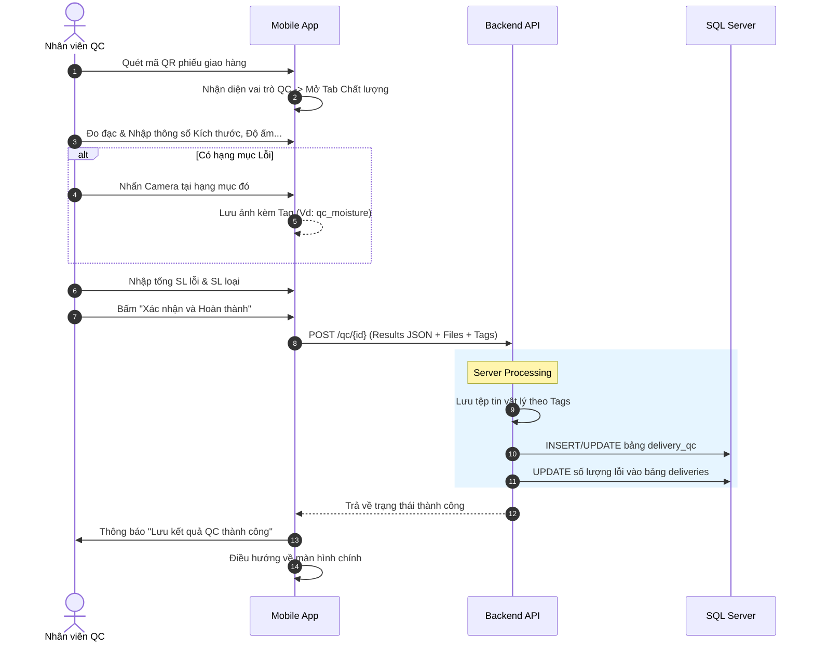

# Hướng dẫn Người dùng & Luồng Xử lý: Xác nhận chất lượng của QC

Quy trình **Xác nhận chất lượng** là bước quan trọng nhất để bộ phận Kiểm tra chất lượng (QC) đánh giá tính hợp lệ của sản phẩm trước khi đưa vào kho hoặc công đoạn tiếp theo.

---

## 1. Hướng dẫn Người dùng (Dành cho QC)

Quy trình bắt đầu khi bạn nhận được hàng từ sản xuất và cần tiến hành kiểm tra theo tiêu chuẩn kỹ thuật (TCKT).

### Các bước thực hiện:
1.  **Quét mã QR:** Sử dụng tính năng quét mã QR trên Header để mở nhanh phiếu giao hàng cần kiểm tra. Hệ thống sẽ tự động đưa bạn vào Tab **"Thông tin chất lượng"**.
2.  **Thực hiện kiểm tra theo từng hạng mục:**
    *   **Kích thước (Size):** Đo đạc Dài, Rộng, Dày và nhập thông số.
    *   **Kết cấu (Structure):** Kiểm tra Độ cong, Cao, Rộng của kết cấu.
    *   **Độ ẩm (Moisture):** Kiểm tra thông số Min/Max của gỗ/vật liệu.
    *   **Ngoại quan (Visual) & Phụ kiện:** Kiểm tra bằng mắt thường.
3.  **Ghi nhận lỗi:** 
    *   Nếu hạng mục nào không đạt, gạt nút sang trạng thái **"Lỗi"**.
    *   **Chụp ảnh minh chứng:** Với mỗi hạng mục lỗi, hãy nhấn biểu tượng Camera để chụp ảnh vị trí lỗi (Tối đa 3 ảnh/hạng mục).
4.  **Tổng hợp số lượng:**
    *   **SL lỗi ghi nhận:** Nhập tổng số lượng sản phẩm có lỗi (Hệ thống tự tính tỷ lệ %).
    *   **SL loại (Scrap):** Nhập số lượng sản phẩm bị loại bỏ không thể sửa chữa.
5.  **Xác nhận & Hoàn thành:** Nhấn nút màu nâu phía dưới để lưu toàn bộ kết quả kiểm tra chất lượng lên hệ thống.

---

## 2. Luồng Xử lý Kỹ thuật (Technical Logic)

### A. Phía Mobile (Frontend)
1.  **Phát hiện Vai trò (Role Detection):** Khi mở phiếu, nếu `user.role` là **QC**, ứng dụng tự động kích hoạt Tab `quality` thay vì tab thông tin bàn giao thông thường.
2.  **Cấu trúc dữ liệu JSON:** Tất cả các thông số đo đạc được gom lại thành một đối tượng JSON (`results_json`) để gửi lên Server một lần duy nhất.
3.  **Quản lý Ảnh theo Tags:** 
    *   Ảnh chụp ở hạng mục nào sẽ được gán Tag tương ứng (Ví dụ: `qc_size`, `qc_moisture`).
    *   Sử dụng `FormData` để gửi mảng `files` kèm mảng `category_tags` để Backend phân loại ảnh.

### B. Phía Backend
1.  **Lưu trữ tập trung:** 
    *   Dữ liệu đo đạc (JSON) lưu vào bảng `delivery_qc`.
    *   Ảnh lưu vào thư mục `static/uploads/qc_test/`.
2.  **Cập nhật phiếu gốc:** Tự động cập nhật `quantity_error` và `quantity_returned` vào bảng `deliveries` để phục vụ báo cáo tiến độ và tỷ lệ lỗi.

---

## 3. Biểu đồ Sequence Diagram

---

## 4. Các quy tắc quan trọng

*   **Tính truy vết (Traceability):** Ảnh lỗi phải đi kèm đúng hạng mục kiểm tra (ví dụ: ảnh đo độ ẩm phải nằm trong mục Độ ẩm) để người sản xuất có thể xem và khắc phục đúng chỗ.
*   **Tự động gợi ý:** Khi bạn đánh dấu một hạng mục là "Lỗi", hệ thống sẽ tự gợi ý số lượng lỗi là 1 để bạn không quên cập nhật tổng số lượng lỗi.

---

> [!TIP]
> Bạn có thể nhấn vào nút **"Xem TCKT"** (Tiêu chuẩn kỹ thuật) trên màn hình để xem lại các yêu cầu kỹ thuật của linh kiện hiện tại nếu chưa rõ.
