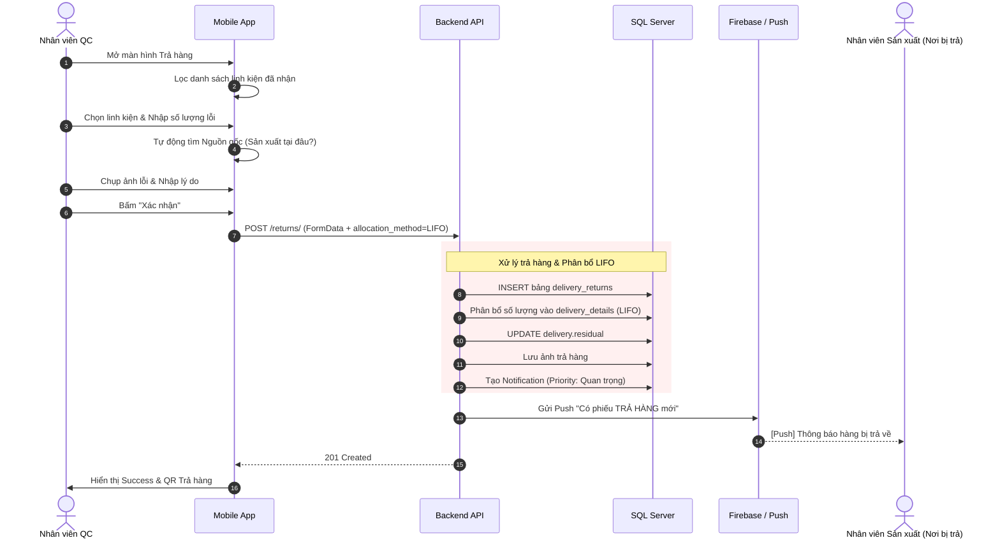

# Hướng dẫn Người dùng & Luồng Xử lý: QC Trả hàng (Delivery Return)

Chức năng **QC Trả hàng** được sử dụng khi bộ phận Kiểm tra chất lượng phát hiện sản phẩm không đạt tiêu chuẩn và cần chuyển trả lại công đoạn sản xuất trước đó để sửa chữa hoặc làm lại.

---

## 1. Hướng dẫn Người dùng (Dành cho QC)

Quy trình này giúp "trả ngược" hàng hóa về đúng nơi đã sản xuất ra nó một cách chính xác.

### Các bước thực hiện:
1.  **Vào màn hình trả hàng:** Tại màn hình "Thông tin bàn giao", nhấn nút **"Tạo nhanh"**. Hệ thống nhận diện bạn là QC và sẽ mở màn hình "Tạo phiếu trả hàng".
2.  **Chọn linh kiện cần trả:**
    *   Hệ thống chỉ liệt kê những linh kiện mà công đoạn hiện tại của bạn **đã từng nhận**.
    *   Chọn đúng tên linh kiện có sản phẩm lỗi.
3.  **Tự động chọn công đoạn nhận:**
    *   Hệ thống sẽ tự động xác định công đoạn đã sản xuất ra linh kiện này để điền vào ô **"Công đoạn nhận (trả)"**.
4.  **Nhập số lượng & Lý do:**
    *   Nhập số lượng hàng lỗi cần trả về.
    *   Nhập lý do trả hàng chi tiết trong phần ghi chú để sản xuất biết cần sửa gì.
5.  **Chụp ảnh minh chứng:** Nhấn biểu tượng Camera để chụp lại các vị trí lỗi (rất quan trọng để bộ phận sản xuất đối chiếu).
6.  **Xác nhận:** Nhấn "Xác nhận". Hệ thống sẽ lưu phiếu và hiển thị **mã QR Trả hàng**.

    > **Lưu ý:** Khi số lượng trả hàng lớn hơn số dư, hệ thống sẽ tự động trừ vào PO cuối cùng (LIFO).

---

## 2. Luồng Xử lý Kỹ thuật (Technical Logic)

### A. Phía Mobile (Frontend)
1.  **Lọc dữ liệu thông minh (Smart Filtering):**
    *   Duyệt qua lịch sử `deliveries` để lấy danh sách tên các linh kiện đã được tiếp nhận thành công tại công đoạn của User.
    *   Chỉ cho phép trả hàng đối với những linh kiện đã có trong kho nhận.
2.  **Truy vết nguồn gốc (Traceability):**
    *   Dựa vào cấu hình kế hoạch (Plan), hệ thống tìm `input_stage` của linh kiện đó để làm công đoạn đích cho phiếu trả.
3.  **Gửi yêu cầu:** Sử dụng `FormData` gửi tới endpoint `POST /returns/`.

### B. Phía Backend
1.  **Ghi nhận nghiệp vụ:** Lưu thông tin vào bảng `delivery_returns`.
2.  **Phân bổ số lượng trả hàng (NEW):**
    *   Khi có `delivery_id`, hệ thống tự động phân bổ số lượng trả hàng vào `delivery_details` theo chiến lược LIFO (mặc định).
    *   Trừ từ số dư (`delivery.residual`) trước, sau đó trừ từ PO cuối cùng (theo thứ tự id DESC).
    *   Cập nhật trực tiếp `delivery_details.quantity` để phản ánh số lượng đã giao thực tế sau khi trừ trả hàng.
3.  **Thông báo khẩn cấp:**
    *   Tạo bản ghi trong bảng `notifications` với mức ưu tiên **"Quan trọng"**.
    *   Gửi thông báo đẩy (FCM) đến điện thoại của nhân viên tại công đoạn sản xuất bị trả hàng để họ xử lý ngay lập tức.

---

## 3. Biểu đồ Sequence Diagram

---

## 4. Các quy tắc quan trọng

*   **Đúng nguồn gốc:** Bạn không thể trả hàng cho một công đoạn không sản xuất ra linh kiện đó. Hệ thống khóa cứng việc chọn công đoạn nhận trả dựa trên quy trình sản xuất.
*   **Minh chứng sống:** Ảnh chụp lỗi tại bước này là căn cứ để tính toán tỷ lệ lỗi và đánh giá năng lực của các tổ sản xuất.
*   **Phân bổ PO (NEW):** Khi số lượng trả hàng lớn hơn số dư, hệ thống sẽ tự động trừ vào PO cuối cùng (LIFO).

---

> [!CAUTION]
> Phiếu trả hàng có ảnh hưởng trực tiếp đến tiến độ chung của Kế hoạch sản xuất. Vui lòng đảm bảo thông tin số lượng trả là chính xác tuyệt đối.
