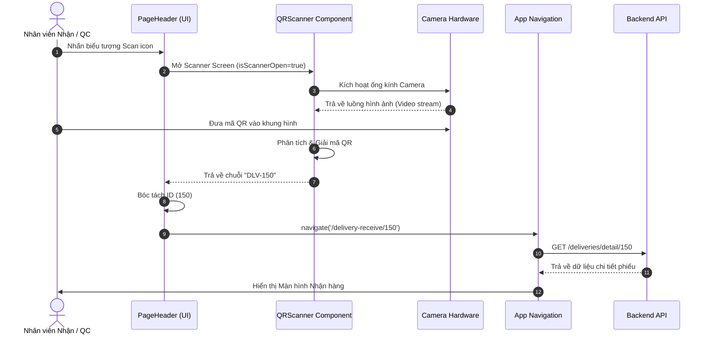

# Hướng dẫn Người dùng & Luồng Xử lý: Quét mã QR (QR Scan)

Mã QR là "chìa khóa" giúp kết nối thông tin giữa người giao và người nhận trong hệ thống SmartFlow một cách nhanh chóng, tránh sai sót nhập liệu tay.

---

## 1. Hướng dẫn Người dùng

Chức năng Quét QR cho phép bạn truy cập nhanh vào thông tin một phiếu giao hàng bất kỳ để thực hiện xác nhận nhận hàng hoặc kiểm tra chất lượng.

### Các bước thực hiện:
1.  **Tìm biểu tượng Quét:** Tại thanh tiêu đề phía trên (Header) của mọi màn hình chính, nhấn vào biểu tượng **Quét mã (Scan)** (hình ô vuông có vạch ngang).
2.  **Cấp quyền Camera:** Nếu là lần đầu sử dụng, vui lòng chọn **"Cho phép"** khi điện thoại yêu cầu quyền truy cập Camera.
3.  **Thực hiện Quét:** 
    *   Cầm điện thoại song song với mã QR (có thể là mã trên màn hình điện thoại của người giao hoặc mã in trên giấy).
    *   Đưa mã QR vào đúng khung ngắm trên màn hình.
4.  **Tự động điều hướng:** Sau khi quét thành công, hệ thống sẽ phát tiếng "Bíp" (tùy thiết bị) và tự động chuyển bạn đến màn hình **"Thông tin kiểm tra"** của chính phiếu đó.
5.  **Xử lý tiếp:** Tại đây, bạn có thể xem lại ảnh minh chứng, nhập số lượng thực nhận và kết quả QC.

---

## 2. Luồng Xử lý Kỹ thuật (Technical Logic)

Quá trình quét mã được tích hợp sâu vào giao diện người dùng để đảm bảo tính tiện lợi cao nhất.

### A. Phía Mobile (Frontend)
1.  **Kích hoạt Component:** `PageHeader` quản lý trạng thái `isScannerOpen`. Khi bật, component `QRScanner` được gắn vào DOM.
2.  **Thư viện quét mã:** Sử dụng thư viện quét mã QR hiệu năng cao, tự động nhận diện vùng chứa mã và giải mã chuỗi text.
3.  **Xử lý chuỗi (Parsing Logic):**
    *   Mã QR của hệ thống thường có định dạng: `DLV-ID` (Ví dụ: `DLV-123`).
    *   Hệ thống sử dụng Regex `match(/(\d+)$/)` để bóc tách lấy phần số ID cuối cùng (Ví dụ: `123`).
4.  **Điều hướng thông minh:** Sử dụng `navigate` để chuyển người dùng sang route: `/delivery-receive/{id}`.

### B. Phía Backend
*   Quá trình quét mã diễn ra hoàn toàn tại phía Client (Mobile). 
*   Backend chỉ nhận yêu cầu khi Mobile thực hiện điều hướng và gọi API `GET /deliveries/detail/{id}` để hiển thị dữ liệu phiếu tương ứng lên màn hình nhận hàng.

---

## 3. Biểu đồ Sequence Diagram

---

## 4. Xử lý sự cố (Troubleshooting)

*   **Không mở được Camera:** Kiểm tra xem ứng dụng đã được cấp quyền Camera trong phần cài đặt của điện thoại chưa (Settings -> SmartFlow -> Permissions).
*   **Quét mãi không được:**
    *   Đảm bảo mã QR không bị lóa sáng (do đèn điện phản chiếu).
    *   Giữ khoảng cách vừa phải (khoảng 15-20cm).
    *   Vệ sinh ống kính Camera nếu bị mờ.
*   **Mã không hợp lệ:** Nếu mã quét được không phải định dạng của hệ thống (ví dụ quét nhầm mã trà sữa), ứng dụng sẽ không thực hiện điều hướng và thông báo cho người dùng.

---

> [!TIP]
> Việc quét mã QR giúp thay thế hoàn toàn việc nhập liệu thủ công ID phiếu, giúp quá trình nhận hàng diễn ra chỉ trong 2-3 giây.
