# Tài liệu Đặc tả Phát triển Chi tiết 18 Màn hình Cốt lõi của Hệ thống SmartFlow

Tài liệu này được biên soạn nhằm phục vụ các nhà phát triển (Developers), nhân viên kiểm thử (Testers) và quản trị viên (Admin) nắm rõ cấu trúc mã nguồn, luồng xử lý nghiệp vụ, giao tiếp API và tương tác cơ sở dữ liệu của 18 màn hình cốt lõi thuộc hệ thống SmartFlow.

---

## 1. KIẾN TRÚC TỔNG QUAN HỆ THỐNG (SYSTEM ARCHITECTURE OVERVIEW)

Hệ thống SmartFlow được thiết kế theo cấu trúc Client-Server hiện đại, tách biệt hoàn toàn giữa tầng xử lý nghiệp vụ (Backend) và tầng giao diện người dùng (Web & Mobile).

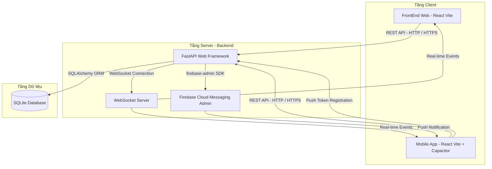

### 1.1 Luồng dữ liệu chính (Core Data Flows)
*   **RESTful API (Xác thực & Nghiệp vụ):** Toàn bộ giao tiếp giữa Client (Web & Mobile) và Backend đều qua REST API. Mỗi yêu cầu (trừ login) phải gửi kèm JWT Access Token trong header `Authorization: Bearer <Token>` để kiểm tra quyền truy cập (Global Auth Check).
*   **WebSocket (Đồng bộ thời gian thực):** Nhằm cập nhật tiến độ sản xuất tức thời mà không cần reload trang, Client thiết lập kết nối WebSocket tới `/ws/stage/{stage_name}`. Khi có sự kiện (tạo phiếu giao, xác nhận QC, hoàn thành nhận), Backend sẽ phát thông báo để tự động tải lại giao diện ở các trạm liên quan.
*   **Firebase Push Notification (Thông báo đẩy):** Dành cho các thông báo quan trọng cần xử lý ngay (ví dụ: QC trả hàng lỗi). Backend gửi lệnh qua SDK `firebase-admin` tới máy chủ Google Firebase, đẩy thông báo trực tiếp đến thiết bị đã đăng ký `fcm_token`.
*   **Capacitor Native Bridge:** Trên Mobile App, Capacitor đóng vai trò cầu nối giúp mã nguồn JavaScript tương tác trực tiếp với phần cứng Android/iOS (Camera quét mã QR, Module in nhiệt Bluetooth/Network, Filesystem lưu tệp cập nhật phần mềm APK).

---

## 2. HƯỚNG DẪN THIẾT LẬP MÔI TRƯỜNG (ENVIRONMENT SETUP GUIDE)

### 2.1 Yêu cầu hệ thống
*   **Python:** Phiên bản 3.8 trở lên.
*   **Node.js:** Phiên bản 18 trở lên.
*   **Hệ điều hành:** Windows (khuyên dùng để chạy trực tiếp các file `.bat` tự động).

### 2.2 Các bước thiết lập chi tiết

#### Bước 1: Thiết lập Backend (FastAPI)
1.  Truy cập thư mục `BackEnd/`.
2.  Khởi tạo môi trường ảo Python và kích hoạt:
    ```bash
    python -m venv venv
    venv\Scripts\activate
    ```
3.  Cài đặt các thư viện phụ thuộc:
    ```bash
    pip install -r requirements.txt
    ```
4.  Cấu hình môi trường: Tạo tệp `.env` dựa trên mẫu `.env.example` với các thông số:
    *   `DATABASE_URL`: Đường dẫn CSDL SQLite (mặc định: `sqlite:///./test_inprocess.db`).
    *   `SECRET_KEY`: Khóa bí mật mã hóa JWT Token.
    *   `ACCESS_TOKEN_EXPIRE_MINUTES`: Thời gian sống của Token (phút).
5.  Khởi tạo và Seed cơ sở dữ liệu ban đầu:
    ```bash
    python seed_roles_permissions.py
    ```

#### Bước 2: Thiết lập Web Frontend & Mobile App
1.  Truy cập thư mục `FrontEnd/` và cài đặt thư viện:
    ```bash
    npm install
    ```
2.  Truy cập thư mục `Mobile/` và cài đặt thư viện:
    ```bash
    npm install
    ```

### 2.3 Công cụ tự động hóa (.bat / .sh)
Hệ thống cung cấp các kịch bản chạy nhanh ở thư mục gốc để thuận tiện cho việc phát triển và vận hành:
*   `run_project.bat`: Tự động khởi chạy đồng thời Backend FastAPI (cổng 8000), Web Frontend (cổng 5173), và Mobile (cổng 5174).
*   `ONE_CLICK_PUBLISH.bat` / `PUBLISH.sh`: Tự động chạy build Frontend, sao chép tài liệu tĩnh vào thư mục Mobile, đồng bộ cấu hình Capacitor và build ứng dụng ra tệp Android APK để phát hành.
*   `SETUP_TEST_ENV.bat`: Tự động dọn dẹp và thiết lập lại cơ sở dữ liệu sạch dành cho việc kiểm thử tự động.

---

## 3. TỔNG QUAN CƠ SỞ DỮ LIỆU (DATABASE ERD OVERVIEW)

Cơ sở dữ liệu của SmartFlow được thiết kế chuẩn hóa để ghi nhận chính xác tiến độ sản xuất (BOM), luồng bàn giao giữa các công đoạn và nhật ký kiểm định chất lượng (QC).

### 3.1 Sơ đồ mối quan hệ thực thể (ERD)

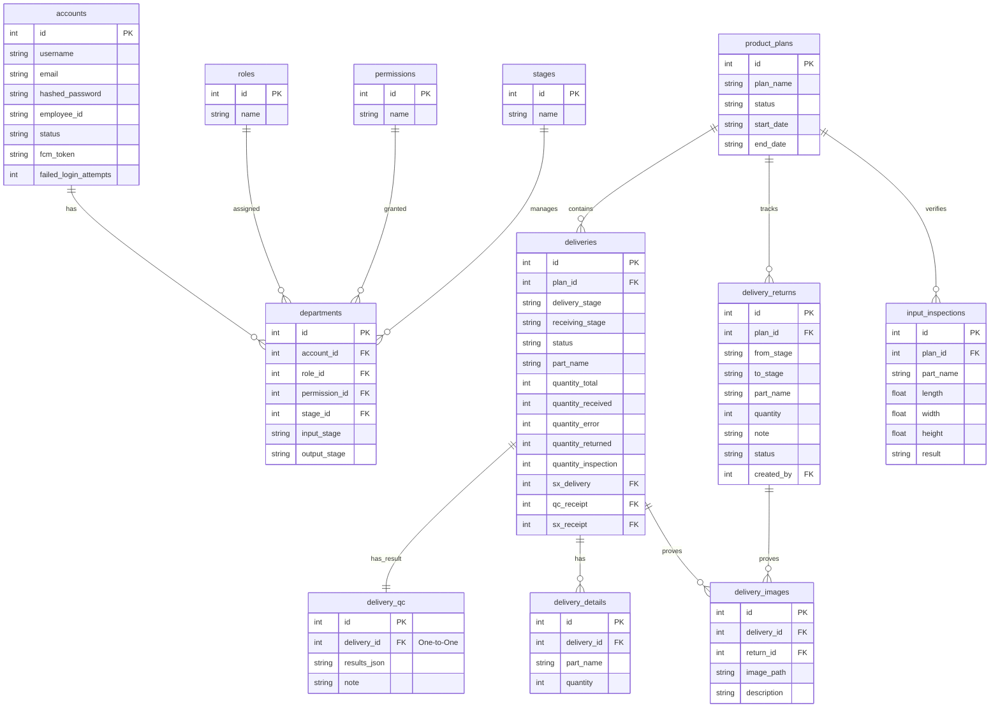

### 3.2 Mô tả các quan hệ chính (Key Relationships)
1.  **Phân quyền (Accounts - Departments):** Người dùng (`accounts`) được gán vai trò (`roles`), quyền hạn (`permissions`) và trạm làm việc (`stages`) thông qua bảng liên kết `departments`. Cho phép lọc dữ liệu hiển thị chính xác theo công đoạn phụ trách.
2.  **Kế hoạch & Bàn giao (Plans - Deliveries):** Mỗi kế hoạch sản xuất (`product_plans`) bao gồm nhiều đợt bàn giao linh kiện (`deliveries`). Trạng thái của kế hoạch được tính toán dựa trên tiến độ bàn giao thành phẩm tại công đoạn cuối.
3.  **Bàn giao & Kiểm định (Deliveries - QC - Returns):**
    *   Mỗi phiếu giao (`deliveries`) có duy nhất 1 bản ghi kiểm định chất lượng (`delivery_qc`) lưu dưới dạng cấu trúc JSON linh hoạt (`results_json`) gồm 8 hạng mục checklist.
    *   Nếu phát hiện lỗi cần trả hàng, phiếu trả hàng (`delivery_returns`) được tạo liên kết với kế hoạch và cập nhật trực tiếp lượng hàng trả `quantity_returned` vào phiếu giao gốc.
4.  **Kiểm soát chất lượng đầu vào (Input Inspections):** Trước khi tổ sản xuất tạo phiếu giao (`deliveries`), QC phải kiểm tra kích thước đầu vào và ghi nhận `result = 'Đạt'` tại bảng `input_inspections`. Nếu không có bản ghi Đạt tương ứng, hệ thống sẽ chặn đứng không cho tạo phiếu giao.

---

## 4. ĐẶC TẢ CHI TIẾT CÁC MÀN HÌNH (SCREEN-LEVEL SPECIFICATIONS)


## 4.1 MH1_MB1_Login — Đăng nhập (Mobile)

### 4.1.1 Mục đích màn hình
Màn hình thực hiện chức năng xác thực thông tin tài khoản người dùng, cấp phát mã JWT Access Token và tải toàn bộ hồ sơ nghiệp vụ (Vai trò, Quyền hạn, Trạm/Công đoạn gán) để người dùng bắt đầu phiên làm việc trên ứng dụng di động.

---

### 4.1.2 Thông tin màn hình

| Thuộc tính | Nội dung |
| :--- | :--- |
| Mã màn hình | MB1 |
| Route | `/login (định nghĩa trong App di động)` |
| Module | Xác thực & Phân quyền (Authentication & Authorization) |
| Người dùng sử dụng | Tất cả nhân viên xưởng (SX, QC) và quản trị viên sử dụng App Mobile |

---

### 4.1.3 Chức năng chính

| STT | Chức năng | Mô tả |
| :--- | :--- | :--- |
| 1 | Xác thực tài khoản: | Cho phép nhập Tên đăng nhập (`username`) và Mật khẩu (`password`) để đăng nhập. |
| 2 | Tự động khóa tài khoản: | Cơ chế bảo mật tự động đổi trạng thái tài khoản thành "Bị khóa" nếu nhập sai mật khẩu liên tiếp quá 5 lần. |
| 3 | Lưu giữ phiên đăng nhập: | Lưu trữ JWT Token và Profile người dùng xuống `localStorage` để duy trì trạng thái đăng nhập. |
| 4 | Đồng bộ FCM Token: | Đăng ký và cập nhật FCM Token (Firebase Cloud Messaging) lên máy chủ ngay sau khi đăng nhập thành công phục vụ việc đẩy thông báo thời gian thực (Push Notification). |

---

### 4.1.4 Luồng xử lý hệ thống

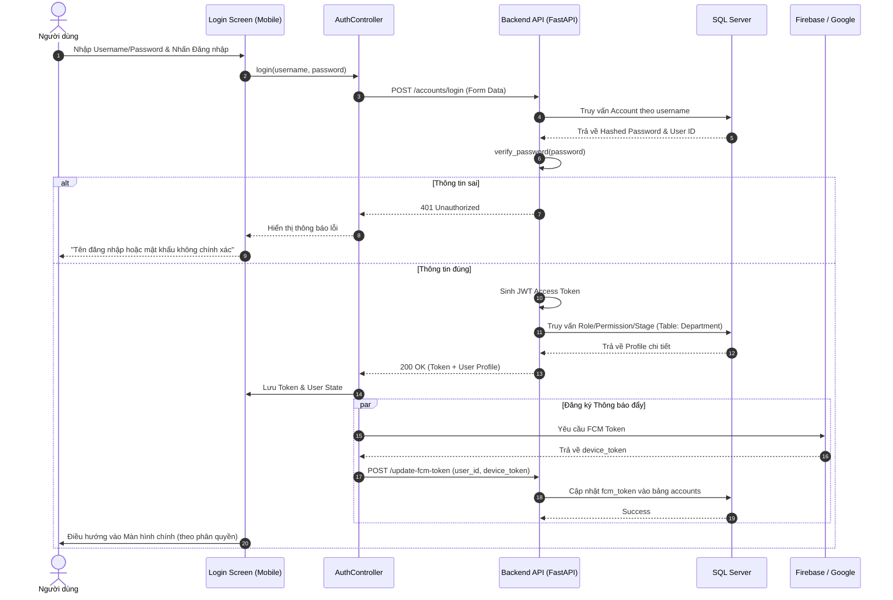

Người dùng mở ứng dụng di động, nhập `username` và `password`, sau đó nhấn nút **ĐĂNG NHẬP**.
2. Frontend thực hiện validate dữ liệu nhập sơ bộ. Nếu hợp lệ, gửi thông tin đăng nhập lên Backend.
3. Backend kiểm tra tài khoản:
   * Nếu tài khoản không tồn tại: Trả về lỗi 401.
   * Nếu tài khoản đang có trạng thái `status == 'Bị khóa'`: Từ chối đăng nhập và thông báo liên hệ Admin.
   * Nếu mật khẩu không khớp: Tăng trường `failed_login_attempts` lên 1. Nếu số lần sai đạt 5, đổi `status` thành `Bị khóa`. Trả về số lần thử còn lại hoặc cảnh báo đã khóa.
   * Nếu mật khẩu đúng: Reset `failed_login_attempts` về 0, tạo JWT Token chứa payload `username`.
4. Backend truy vấn các bản ghi phòng ban (`departments`) liên kết để lấy ra: Vai trò (`Role`), Quyền (`Permission`), và các Công đoạn (`Stage`) được gán cho người dùng này.
5. Trả về thông tin đăng nhập thành công cho Frontend.
6. Frontend lưu `token` và `smartflow_user` vào `localStorage`, đồng thời kích hoạt gọi API đăng ký `fcm_token` của thiết bị rồi chuyển hướng người dùng sang màn hình Dashboard [MB2_DeliveryInfo.jsx](file:///e:/Work/SmartFlow-dev%20%281%29/SmartFlow-dev/Mobile/src/Views/screens/MB2_DeliveryInfo.jsx).
* Định dạng request gửi đi từ Mobile là `application/x-www-form-urlencoded` để tương thích với `OAuth2PasswordRequestForm` của FastAPI.
* Ngay sau khi đăng nhập thành công, Mobile gọi hàm khởi tạo `PushNotificationService.init(userId)` để lấy FCM token và gửi qua API cập nhật token thiết bị.

---

### 4.1.5 API liên quan

| Method | Endpoint | Mục đích |
| :--- | :--- | :--- |
| POST | `/api/v1/accounts/login` | Xác thực tài khoản và trả về token, profile. Định nghĩa tại [account_router.py](file:///e:/Work/SmartFlow-dev%20%281%29/SmartFlow-dev/BackEnd/src/app/api/v1/endpoints/account_router.py#L77-L160). |
| POST | `/api/v1/accounts/update-fcm-token` | Đồng bộ FCM Token thiết bị di động. Định nghĩa tại [account_router.py](file:///e:/Work/SmartFlow-dev%20%281%29/SmartFlow-dev/BackEnd/src/app/api/v1/endpoints/account_router.py#L18-L49). |

---

### 4.1.6 Database liên quan

| Bảng | Mục đích |
| :--- | :--- |
| ``accounts`` | Lưu trữ tài khoản. Ánh xạ qua Model [AccountModel](file:///e:/Work/SmartFlow-dev%20%281%29/SmartFlow-dev/BackEnd/src/app/models/accounts.py#L6). |
| ``departments`` | Liên kết tài khoản với vai trò, quyền, công đoạn. Ánh xạ qua Model [Department](file:///e:/Work/SmartFlow-dev%20%281%29/SmartFlow-dev/BackEnd/src/app/models/departments.py#L6). |

---

### 4.1.7 Business Rules

| Điều kiện | Mô tả |
| :--- | :--- |
| Quy tắc chung | Trường Tên đăng nhập và Mật khẩu không được phép bỏ trống. |
| Quy tắc chung | Giới hạn số lần thử mật khẩu: Tối đa 5 lần. Quá giới hạn tài khoản chuyển trạng thái thành `Bị khóa`. |
| Quy tắc chung | Mã FCM Token khi gửi lên sẽ được xoá khỏi các tài khoản khác trước khi gán cho tài khoản mới để tránh tình trạng một thiết bị nhận thông báo của nhiều tài khoản. |

---

### 4.1.8 File code liên quan

**Frontend:**
* [MB1_Login.jsx](file:///e:/Work/SmartFlow-dev%20%281%29/SmartFlow-dev/Mobile/src/Views/screens/MB1_Login.jsx)

**Backend:**
* [account_router.py](file:///e:/Work/SmartFlow-dev%20%281%29/SmartFlow-dev/BackEnd/src/app/api/v1/endpoints/account_router.py)

> [!NOTE]
> **Ghi chú Dev:**
> Token hết hạn tính bằng phút theo cấu hình `ACCESS_TOKEN_EXPIRE_MINUTES` trong file config.
* Khi test kiểm tra cơ chế khóa tài khoản, có thể vào bảng `accounts` sửa lại trường `failed_login_attempts` về `0` và `status` thành `Hoạt động` để mở khóa thủ công.

---

## 4.2 MH2_MB2_DeliveryInfo — Dashboard Bàn giao (Mobile)

### 4.2.1 Mục đích màn hình
Màn hình đóng vai trò là Dashboard trung tâm giúp nhân viên tại xưởng giám sát toàn bộ các phiếu bàn giao thuộc công đoạn mình phụ trách. Cho phép người dùng theo dõi các phiếu chuẩn bị giao đi, các phiếu đang chuyển đến, và các kế hoạch sản xuất đang hoạt động để tiến hành tạo phiếu giao mới.

---

### 4.2.2 Thông tin màn hình

| Thuộc tính | Nội dung |
| :--- | :--- |
| Mã màn hình | MB2 |
| Route | `/delivery-info` |
| Module | Quản lý bàn giao (Deliveries) |
| Người dùng sử dụng | Nhân viên sản xuất (SX), Nhân viên QC |

---

### 4.2.3 Chức năng chính

| STT | Chức năng | Mô tả |
| :--- | :--- | :--- |
| 1 | Danh sách bàn giao đi/nhận về: | Hiển thị song song danh sách phiếu "Gửi đi" và "Nhận về" tại công đoạn hiện tại. |
| 2 | Bộ lọc trạng thái: | Lọc nhanh các phiếu theo trạng thái: Tất cả, Chờ xử lý, Hoàn thành. |
| 3 | Hiển thị KHSX hoạt động: | Hiển thị các kế hoạch sản xuất (`plans`) đang diễn ra tại công đoạn để sản xuất bấm tạo phiếu bàn giao. |
| 4 | Cập nhật thời gian thực (Realtime Auto-refresh): | Sử dụng kết nối WebSocket lắng nghe các sự kiện luân chuyển hàng hoá để tự động tải lại danh sách mà người dùng không cần reload màn hình. |

---

### 4.2.4 Luồng xử lý hệ thống

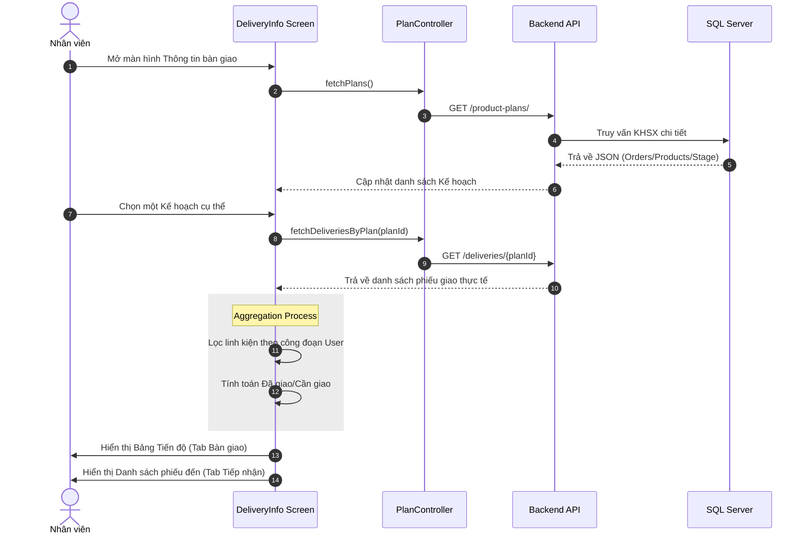

Người dùng truy cập màn hình. Ứng dụng lấy thông tin công đoạn (`stage`) được gán trong Profile người dùng để gửi request lên server.
2. Hệ thống tải song song danh sách phiếu bàn giao (`deliveries`) theo công đoạn gán, danh sách kế hoạch sản xuất (`plans`), thông tin phiếu trả hàng (`returns`), và dữ liệu kiểm định đầu vào QC (`inspections`).
3. Màn hình chia làm 2 tab chính:
   * **Bàn giao:** Liệt kê các phiếu bàn giao do trạm hiện tại gửi đi hoặc nhận về kèm trạng thái (Chờ xác nhận, Chờ kiểm tra, Đã nhận, Trả hàng, Lỗi).
   * **Kế hoạch:** Hiển thị danh sách KHSX để bấm chọn linh kiện tạo phiếu giao (`MB2.1`).
4. Khi có hoạt động giao nhận tại trạm, một tín hiệu WebSocket sẽ được gửi tới tất cả thiết bị di động đang mở Dashboard trạm này để tự động làm mới danh sách hiển thị.* Frontend thực hiện kết nối WebSocket tới endpoint `/ws/stage/{stage_name}`.
* Các sự kiện WebSocket được bắt và xử lý gồm:
  * `NEW_DELIVERY`: Có phiếu giao mới tạo gửi đến trạm.
  * `QC_CONFIRMED`: QC đã hoàn tất kiểm tra đầu vào.
  * `DELIVERY_RECEIVED`: Đối tác đã nhận hàng thành công.
  * `UPDATE_DELIVERY`: Cập nhật chung trạng thái phiếu bàn giao.
* Khi bắt được một trong các sự kiện trên, Frontend tự động trigger hàm `fetchDeliveries()` để cập nhật dữ liệu.

---

### 4.2.5 API liên quan

| Method | Endpoint | Mục đích |
| :--- | :--- | :--- |
| GET | `/api/v1/deliveries/by-plan` | Lấy danh sách phiếu bàn giao theo kế hoạch và công đoạn. Định nghĩa tại [delivery_router.py](file:///e:/Work/SmartFlow-dev%20%281%29/SmartFlow-dev/BackEnd/src/app/api/v1/endpoints/delivery_router.py). |
| GET | `/api/v1/production/{plan_id}` | Lấy chi tiết KHSX và tiến độ. Định nghĩa tại [production_router.py](file:///e:/Work/SmartFlow-dev%20%281%29/SmartFlow-dev/BackEnd/src/app/api/v1/endpoints/production_router.py). |

---

### 4.2.6 Database liên quan

| Bảng | Mục đích |
| :--- | :--- |
| ``deliveries`` | Lưu thông tin phiếu bàn giao. Ánh xạ qua [Delivery](file:///e:/Work/SmartFlow-dev%20%281%29/SmartFlow-dev/BackEnd/src/app/models/deliveries.py#L8). |
| ``product_plans`` | Lưu thông tin kế hoạch sản xuất. Ánh xạ qua Model [ProductPlan](file:///e:/Work/SmartFlow-dev%20%281%29/SmartFlow-dev/BackEnd/src/app/models/product_plan.py#L6). |

---

### 4.2.7 Business Rules

| Điều kiện | Mô tả |
| :--- | :--- |
| Quy tắc chung | Dữ liệu phiếu hiển thị phải được lọc nghiêm ngặt theo công đoạn gán của tài khoản (ngoại trừ vai trò Admin được xem toàn bộ). |
| Quy tắc chung | Phiếu bàn giao hiển thị ở tab "Chờ xử lý" bao gồm các phiếu có trạng thái "Chờ xác nhận", "Chờ kiểm tra". |

---

### 4.2.8 File code liên quan

**Frontend:**
* [MB2_DeliveryInfo.jsx](file:///e:/Work/SmartFlow-dev%20%281%29/SmartFlow-dev/Mobile/src/Views/screens/MB2_DeliveryInfo.jsx)

**Backend:**
* [delivery_router.py](file:///e:/Work/SmartFlow-dev%20%281%29/SmartFlow-dev/BackEnd/src/app/api/v1/endpoints/delivery_router.py)

> [!NOTE]
> **Ghi chú Dev:**
> Cần kiểm tra kỹ cơ chế reconnection của WebSocket khi thiết bị di động đi vào vùng sóng yếu trong xưởng sản xuất và tự động fetch lại dữ liệu bằng HTTP khi kết nối socket bị ngắt.

---

## 4.3 MH2.1_DeliveryCreate — Tạo phiếu Giao (Mobile)

### 4.3.1 Mục đích màn hình
Màn hình dùng để nhân viên sản xuất khai báo thông tin bàn giao linh kiện/sản phẩm sang công đoạn kế tiếp, bao gồm số lượng, dải QR thẻ luân chuyển gán kèm, thông số độ ẩm đo đạc thực tế tại xưởng và hình ảnh chứng thực.

---

### 4.3.2 Thông tin màn hình

| Thuộc tính | Nội dung |
| :--- | :--- |
| Mã màn hình | MB2.1 |
| Route | `Điều hướng từ MB2_DeliveryInfo khi nhấn "Bàn giao" trong Kế hoạch` |
| Module | Quản lý bàn giao (Deliveries) |
| Người dùng sử dụng | Nhân viên sản xuất (SX) tại công đoạn giao |

---

### 4.3.3 Chức năng chính

| STT | Chức năng | Mô tả |
| :--- | :--- | :--- |
| 1 | Khai báo thông tin chi tiết: | Chọn linh kiện từ BOM của KHSX, nhập quy cách và số lượng bàn giao. |
| 2 | Đo thông số độ ẩm (Moisture): | Cho phép nhập 3 giá trị đo độ ẩm thực tế, hệ thống tự động tính toán giá trị trung bình trên giao diện. |
| 3 | Gán mã QR dự phòng (Backup QR): | Quét hoặc nhập mã QR dự phòng (`backup_qr`) để gán cố định cho lô hàng bàn giao, hỗ trợ truy vết nhanh. |
| 4 | Chụp ảnh minh chứng: | Cho phép kích hoạt camera thiết bị di động để chụp ảnh sản phẩm bàn giao đính kèm phiếu giao. |

---

### 4.3.4 Luồng xử lý hệ thống

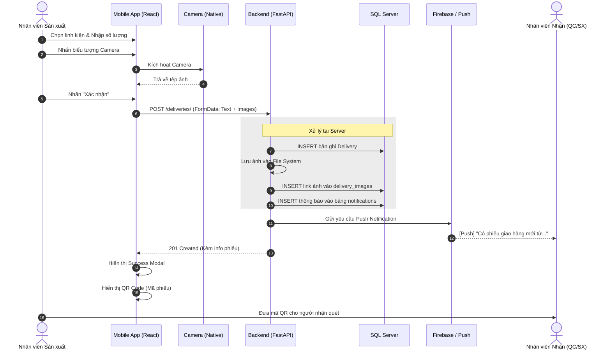

Sản xuất chọn chi tiết linh kiện từ kế hoạch để bàn giao.
2. **Quy tắc chặn cứng (QC Block):** Frontend gọi API kiểm tra kết quả QC đầu vào của chi tiết này. Nếu chi tiết này chưa được QC kiểm tra đạt (tức là không tồn tại bản ghi kiểm định trong `input_inspections` hoặc bản ghi kiểm định gần nhất có `result == 'Không đạt'`), hệ thống hiển thị thông báo lỗi chặn đứng và không cho phép tạo phiếu giao.
3. Nếu QC đầu vào Đạt, người dùng nhập số lượng bàn giao, quét mã QR dự phòng, tiến hành đo và nhập độ ẩm (3 lần đo).
4. Người dùng sử dụng camera chụp lại ảnh sản phẩm bàn giao thực tế.
5. Nhấn **XÁC NHẬN GIAO**. Dữ liệu được nén ảnh và đóng gói dưới dạng `FormData` để gửi lên Backend.
6. Tạo phiếu thành công, hệ thống gửi thông báo đẩy và cập nhật WebSocket cho trạm nhận biết để tiếp nhận hàng.* Frontend gọi API `GET /api/v1/inspections/plan/{plan_id}/part?part_name=...` để kiểm tra trạng thái QC trước khi cho phép điền tiếp thông tin.
* Sử dụng thư viện camera trên điện thoại để chụp ảnh, sau đó chuyển đổi hình ảnh thành Blob/File trước khi append vào `FormData` gửi lên API `POST /api/v1/deliveries/`.

---

### 4.3.5 API liên quan

| Method | Endpoint | Mục đích |
| :--- | :--- | :--- |
| POST | `/api/v1/deliveries/` | Tạo phiếu bàn giao mới (FormData chứa ảnh). Định nghĩa tại [delivery_router.py](file:///e:/Work/SmartFlow-dev%20%281%29/SmartFlow-dev/BackEnd/src/app/api/v1/endpoints/delivery_router.py). |
| GET | `/api/v1/inspections/plan/{plan_id}/part` | Lấy kết quả kiểm tra QC đầu vào mới nhất của chi tiết. Định nghĩa tại [inspection_router.py](file:///e:/Work/SmartFlow-dev%20%281%29/SmartFlow-dev/BackEnd/src/app/api/v1/endpoints/inspection_router.py#L231-L245). |

---

### 4.3.6 Database liên quan

| Bảng | Mục đích |
| :--- | :--- |
| ``deliveries`` | Lưu phiếu giao. Ánh xạ qua [Delivery](file:///e:/Work/SmartFlow-dev%20%281%29/SmartFlow-dev/BackEnd/src/app/models/deliveries.py#L8). |
| ``delivery_images`` | Lưu trữ đường dẫn ảnh bàn giao. Ánh xạ qua Model [DeliveryImage](file:///e:/Work/SmartFlow-dev%20%281%29/SmartFlow-dev/BackEnd/src/app/models/delivery_images.py#L6). |
| ``input_inspections`` | Truy vấn kết quả QC đầu vào. Ánh xạ qua Model [InputInspection](file:///e:/Work/SmartFlow-dev%20%281%29/SmartFlow-dev/BackEnd/src/app/models/input_inspection.py#L6). |

---

### 4.3.7 Business Rules

| Điều kiện | Mô tả |
| :--- | :--- |
| Quy tắc QC: | Linh kiện bàn giao bắt buộc phải có kết quả kiểm tra đầu vào QC Đạt (`result == 'Đạt'`) tại công đoạn hiện tại. |
| Quy tắc độ ẩm: | Max độ ẩm phải lớn hơn hoặc bằng Min độ ẩm. Độ ẩm trung bình được tính toán tự động bằng công thức: `(Đo 1 + Đo 2 + Đo 3) / 3`. |
| Quy tắc chung | Bắt buộc phải có ảnh chụp minh chứng lô hàng và nhập số lượng giao lớn hơn 0. |

---

### 4.3.8 File code liên quan

**Frontend:**
* [MB2.1_DeliveryCreate.jsx](file:///e:/Work/SmartFlow-dev%20%281%29/SmartFlow-dev/Mobile/src/Views/screens/MB2.1_DeliveryCreate.jsx)

**Backend:**
* [delivery_router.py](file:///e:/Work/SmartFlow-dev%20%281%29/SmartFlow-dev/BackEnd/src/app/api/v1/endpoints/delivery_router.py)

> [!NOTE]
> **Ghi chú Dev:**
> Chú ý logic kiểm tra tên linh kiện `part_name` sử dụng toán tử SQL `ilike` để tránh phân biệt chữ hoa chữ thường khi kiểm tra QC đầu vào.

---

## 4.4 MH2.2_MB2.2_DeliveryReceive — Tiếp nhận bàn giao (Mobile)

### 4.4.1 Mục đích màn hình
Màn hình dùng để xử lý quy trình tiếp nhận hàng hoá kép: Nhân viên sản xuất công đoạn nhận xác nhận số lượng thực tế nhận được từ công đoạn giao, sau đó nhân viên QC tiến hành đánh giá 8 chỉ tiêu kiểm tra chất lượng trước khi cho phép đưa hàng vào sản xuất hoặc ra quyết định trả hàng lỗi.

---

### 4.4.2 Thông tin màn hình

| Thuộc tính | Nội dung |
| :--- | :--- |
| Mã màn hình | MB2.2 |
| Route | `Điều hướng từ MB2_DeliveryInfo khi nhấn vào phiếu đang chuyển đến` |
| Module | Quản lý bàn giao (Deliveries & QC) |
| Người dùng sử dụng | Nhân viên sản xuất (SX) công đoạn nhận và Nhân viên QC |

---

### 4.4.3 Chức năng chính

| STT | Chức năng | Mô tả |
| :--- | :--- | :--- |
| 1 | Xác nhận thực nhận (Sản xuất): | Nhân viên sản xuất tại trạm nhận kiểm đếm số lượng thực tế và nhập thông tin xác nhận nhận hàng. |
| 2 | Đánh giá chất lượng QC (Checklist): | QC chấm điểm đạt/không đạt cho 8 hạng mục kiểm định kỹ thuật (Cong vênh, Nứt tét, Độ ẩm, Vệ sinh, Kích thước, Trầy xước, Màu sắc, Biến dạng). |
| 3 | Phân loại số lượng chất lượng: | Nhập số lượng thực đạt, số lượng lỗi giữ lại và số lượng trả lại công đoạn trước. |
| 4 | Chuyển tiếp trả hàng lỗi: | Tự động điều hướng sang màn hình trả hàng (`MB2.3`) nếu phát sinh số lượng cần trả lại cho công đoạn trước. |

---

### 4.4.4 Luồng xử lý hệ thống

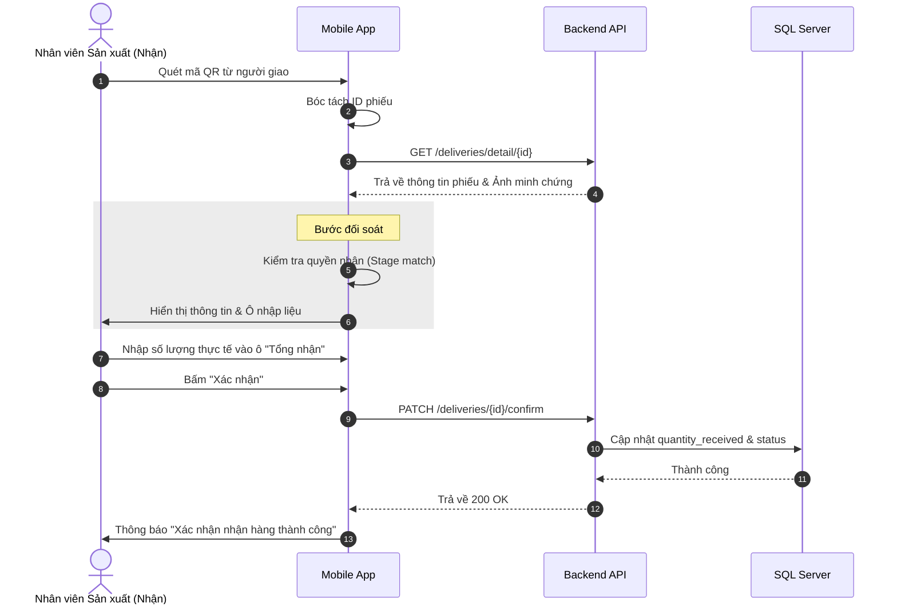

Nhân viên SX tại trạm nhận mở phiếu bàn giao đang chuyển đến, đếm hàng thực tế và điền vào ô **Số lượng nhận**. Nhấn **SX XÁC NHẬN NHẬN**. Phiếu chuyển sang trạng thái `Chờ QC Kiểm Tra`.
2. Nhân viên QC tại trạm mở phiếu đó lên, tiến hành kiểm tra 8 hạng mục chất lượng.
3. QC điền số lượng lỗi (`quantity_error`), số lượng trả lại công đoạn trước (`quantity_returned`).
4. Nếu `quantity_returned > 0`, hệ thống tự động lưu kết quả QC tạm thời và chuyển QC sang màn hình tạo phiếu trả hàng [MB2.3_DeliveryReturn.jsx](file:///e:/Work/SmartFlow-dev%20%281%29/SmartFlow-dev/Mobile/src/Views/screens/MB2.3_DeliveryReturn.jsx).
5. Nếu không có hàng trả lại, QC nhấn **HOÀN THÀNH KIỂM TRA**. Phiếu đóng lại với trạng thái `Đã Nhận` (nếu không có lỗi) hoặc `Lỗi` (nếu có lỗi giữ lại nhưng không trả hàng).
* SX nhận hàng gọi: `PATCH /api/v1/deliveries/{delivery_id}/confirm`.
* QC xác nhận chất lượng gọi: `POST /api/v1/qc/{delivery_id}`.
* Trạng thái phiếu bàn giao tự động cập nhật đồng bộ sau mỗi bước gọi API thông qua trigger logic trên DB hoặc xử lý trực tiếp tại Service của Backend.

---

### 4.4.5 API liên quan

| Method | Endpoint | Mục đích |
| :--- | :--- | :--- |
| PATCH | `/api/v1/deliveries/{delivery_id}/confirm` | Xác nhận tiếp nhận hàng từ SX. Định nghĩa tại [delivery_router.py](file:///e:/Work/SmartFlow-dev%20%281%29/SmartFlow-dev/BackEnd/src/app/api/v1/endpoints/delivery_router.py#L714-L730). |
| POST | `/api/v1/qc/{delivery_id}` | Lưu thông tin đánh giá chất lượng QC. Định nghĩa tại [qc_router.py](file:///e:/Work/SmartFlow-dev%20%281%29/SmartFlow-dev/BackEnd/src/app/api/v1/endpoints/qc_router.py#L20-L172). |

---

### 4.4.6 Database liên quan

| Bảng | Mục đích |
| :--- | :--- |
| ``deliveries`` | Lưu thông tin phiếu nhận. Ánh xạ qua [Delivery](file:///e:/Work/SmartFlow-dev%20%281%29/SmartFlow-dev/BackEnd/src/app/models/deliveries.py#L8). |
| ``delivery_qc`` | Lưu chi tiết checklist đánh giá của QC. Ánh xạ qua Model [DeliveryQC](file:///e:/Work/SmartFlow-dev%20%281%29/SmartFlow-dev/BackEnd/src/app/models/delivery_qc.py#L6). |

---

### 4.4.7 Business Rules

| Điều kiện | Mô tả |
| :--- | :--- |
| Quy tắc chung | Tổng số lượng `Thực nhận + Lỗi + Trả lại` không được vượt quá số lượng giao ban đầu trên phiếu bàn giao (`quantity_total`). |
| Quy tắc chung | Để lưu kết quả QC đạt, toàn bộ 8 chỉ tiêu đánh giá trong checklist bắt buộc phải tích chọn đạt (`true`). |

---

### 4.4.8 File code liên quan

**Frontend:**
* [MB2.2_DeliveryReceive.jsx](file:///e:/Work/SmartFlow-dev%20%281%29/SmartFlow-dev/Mobile/src/Views/screens/MB2.2_DeliveryReceive.jsx)

**Backend:**
* [delivery_router.py](file:///e:/Work/SmartFlow-dev%20%281%29/SmartFlow-dev/BackEnd/src/app/api/v1/endpoints/delivery_router.py)
* [qc_router.py](file:///e:/Work/SmartFlow-dev%20%281%29/SmartFlow-dev/BackEnd/src/app/api/v1/endpoints/qc_router.py)

> [!NOTE]
> **Ghi chú Dev:**
> Đảm bảo xử lý lỗi bất đồng bộ khi hai người dùng (SX bấm nhận và QC bấm kiểm tra) cùng tác động lên một phiếu bàn giao bằng cơ chế khóa bi quan hoặc kiểm tra phiên bản bản ghi.

---

## 4.5 MH2.3_MB2.3_DeliveryReturn — QC Trả hàng (Mobile)

### 4.5.1 Mục đích màn hình
Màn hình thực hiện chức năng lập phiếu trả hàng lỗi ngược về công đoạn trước đó khi phát hiện sản phẩm không đạt tiêu chí chất lượng trong quá trình nhận hàng. Hỗ trợ ghi nhận số lượng trả, lý do lỗi và chụp ảnh minh chứng lỗi để công đoạn giao có căn cứ xử lý lại.

---

### 4.5.2 Thông tin màn hình

| Thuộc tính | Nội dung |
| :--- | :--- |
| Mã màn hình | MB2.3 |
| Route | `/delivery-return` |
| Module | Quản lý trả hàng lỗi (Returns) |
| Người dùng sử dụng | Nhân viên QC tại trạm nhận |

---

### 4.5.3 Chức năng chính

| STT | Chức năng | Mô tả |
| :--- | :--- | :--- |
| 1 | Ghi nhận số lượng trả: | Điền số lượng linh kiện lỗi cần trả ngược về trạm giao trước đó. |
| 2 | Khai báo lý do lỗi: | Nhập mô tả nguyên nhân lỗi chất lượng khiến hàng bị trả lại. |
| 3 | Đính kèm hình ảnh lỗi: | Chụp ảnh trực tiếp chi tiết lỗi sản phẩm bằng camera (tối đa 3 ảnh). |
| 4 | Đồng bộ tự động: | Tự động đồng bộ số lượng trả và cập nhật trạng thái phiếu bàn giao gốc về trạm giao. |

---

### 4.5.4 Luồng xử lý hệ thống

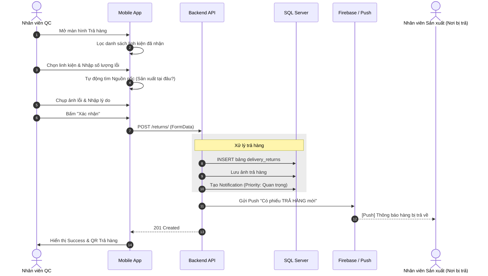

Màn hình tự động hiển thị thông tin phiếu bàn giao bị lỗi và số lượng trả tối đa cho phép.
2. QC nhập số lượng sản phẩm thực tế cần trả, viết lý do lỗi và chụp tối đa 3 ảnh minh chứng.
3. QC nhấn **XÁC NHẬN TRẢ HÀNG**.
4. Hệ thống tải ảnh lên máy chủ, tạo bản ghi phiếu trả hàng trong bảng `delivery_returns`.
5. Đồng thời, hệ thống cập nhật trường `quantity_returned` trên phiếu bàn giao gốc và chuyển trạng thái phiếu gốc sang `Trả Hàng` để công đoạn giao nhận diện được và tiến hành xử lý bù hàng hoặc sửa chữa.* Gửi dữ liệu dưới dạng `FormData` qua API `POST /api/v1/returns/`.
* Quá trình tạo phiếu trả trên Backend sẽ tự động gọi logic đồng bộ để cập nhật trạng thái của phiếu bàn giao tương ứng và phát tín hiệu WebSocket cập nhật danh sách ở cả hai trạm.

---

### 4.5.5 API liên quan

| Method | Endpoint | Mục đích |
| :--- | :--- | :--- |
| POST | `/api/v1/returns/` | Tạo phiếu trả hàng lỗi mới (nhận FormData chứa danh sách ảnh). Định nghĩa tại [return_router.py](file:///e:/Work/SmartFlow-dev%20%281%29/SmartFlow-dev/BackEnd/src/app/api/v1/endpoints/return_router.py#L31-L149). |

---

### 4.5.6 Database liên quan

| Bảng | Mục đích |
| :--- | :--- |
| ``delivery_returns`` | Lưu phiếu trả hàng lỗi. Ánh xạ qua Model [DeliveryReturn](file:///e:/Work/SmartFlow-dev%20%281%29/SmartFlow-dev/BackEnd/src/app/models/delivery_returns.py#L6). |
| ``deliveries`` | Cập nhật thông số trả trên phiếu gốc. Ánh xạ qua [Delivery](file:///e:/Work/SmartFlow-dev%20%281%29/SmartFlow-dev/BackEnd/src/app/models/deliveries.py#L8). |

---

### 4.5.7 Business Rules

| Điều kiện | Mô tả |
| :--- | :--- |
| Quy tắc chung | Số lượng trả hàng phải lớn hơn 0 và không được vượt quá số lượng giao gốc trên phiếu bàn giao (`quantity_total`). |
| Quy tắc chung | Yêu cầu bắt buộc chụp ít nhất 1 ảnh minh chứng chất lượng lỗi trước khi cho phép xác nhận tạo phiếu trả. |

---

### 4.5.8 File code liên quan

**Frontend:**
* [MB2.3_DeliveryReturn.jsx](file:///e:/Work/SmartFlow-dev%20%281%29/SmartFlow-dev/Mobile/src/Views/screens/MB2.3_DeliveryReturn.jsx)

**Backend:**
* [return_router.py](file:///e:/Work/SmartFlow-dev%20%281%29/SmartFlow-dev/BackEnd/src/app/api/v1/endpoints/return_router.py)

> [!NOTE]
> **Ghi chú Dev:**
> Chú ý xử lý rollback giao dịch (Transaction Rollback) trên Backend nếu quá trình tải ảnh lỗi lên máy chủ bị thất bại để tránh rác dữ liệu DB.

---

## 4.6 MH2.4_MB2.4_InputInspection — Kiểm tra đầu vào (Mobile)

### 4.6.1 Mục đích màn hình
Màn hình cho phép QC đo đạc, đánh giá kích thước chi tiết linh kiện thực tế tại xưởng và xác nhận Đạt/Không đạt trước khi tổ sản xuất tạo phiếu bàn giao, nhằm ngăn chặn việc chuyển tiếp các linh kiện sai hỏng kích thước sang công đoạn sau.

---

### 4.6.2 Thông tin màn hình

| Thuộc tính | Nội dung |
| :--- | :--- |
| Mã màn hình | MB2.4 |
| Route | `Điều hướng từ MB2_DeliveryInfo khi chọn KHSX để kiểm tra đầu vào` |
| Module | Kiểm soát chất lượng (QC Inspections) |
| Người dùng sử dụng | Nhân viên QC |

---

### 4.6.3 Chức năng chính

| STT | Chức năng | Mô tả |
| :--- | :--- | :--- |
| 1 | Ghi nhận kích thước thực đo: | Nhập thông số chiều dài, chiều rộng, chiều cao thực đo của linh kiện chi tiết (đơn vị mm). |
| 2 | So khớp chuẩn kích thước: | Hỗ trợ hiển thị kích thước tiêu chuẩn để QC so đối chứng. |
| 3 | Kết luận kiểm định: | Đánh dấu kết quả kiểm tra là "Đạt" hoặc "Không đạt". |
| 4 | Đính kèm ảnh minh chứng: | Chụp tối đa 3 ảnh đo thực tế làm bằng chứng chất lượng. |
| 5 | Chế độ xem lịch sử: | Hỗ trợ xem lại kết quả đã lưu trước đó dưới dạng chỉ đọc (`viewOnly`). |

---

### 4.6.4 Luồng xử lý hệ thống

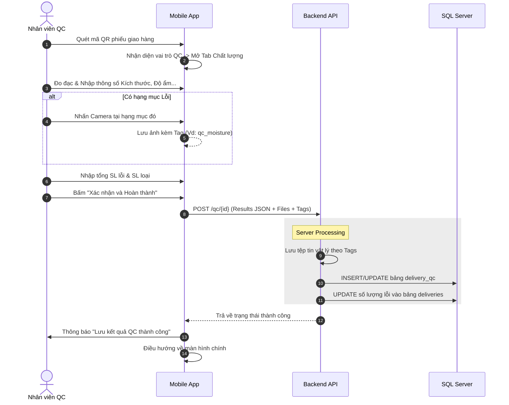

QC nhận linh kiện chuẩn bị bàn giao, thực hiện đo kích thước thực tế bằng thước kẹp hoặc thiết bị đo.
2. Mở màn hình kiểm tra đầu vào của chi tiết đó, nhập các thông số chiều dài, chiều rộng, chiều cao.
3. QC đưa ra kết luận đánh giá Đạt/Không đạt và chụp ảnh chứng thực.
4. Nhấn **LƯU KẾT QUẢ**.
5. Frontend nén ảnh về chất lượng 70% qua Canvas và gửi FormData lên API.
6. Backend lưu thông tin vào bảng `input_inspections`, đồng thời gửi tín hiệu WebSocket thông báo kết quả QC Đạt để màn hình tạo phiếu giao `MB2.1` của sản xuất mở khóa cho phép giao chi tiết này đi.* Frontend thực hiện nén ảnh trước khi tải lên bằng hàm Canvas utility:
  ```javascript
  const canvas = document.createElement('canvas');
  // ... xử lý resize và vẽ ảnh ...
  canvas.toBlob((blob) => { /* gửi blob */ }, 'image/jpeg', 0.7);
  ```
* Gửi request FormData lên API `POST /api/v1/inspections/`.

---

### 4.6.5 API liên quan

| Method | Endpoint | Mục đích |
| :--- | :--- | :--- |
| POST | `/api/v1/inspections/` | Lưu kết quả kiểm tra đầu vào (nhận FormData chứa tối đa 3 ảnh). Định nghĩa tại [inspection_router.py](file:///e:/Work/SmartFlow-dev%20%281%29/SmartFlow-dev/BackEnd/src/app/api/v1/endpoints/inspection_router.py#L130-L197). |

---

### 4.6.6 Database liên quan

| Bảng | Mục đích |
| :--- | :--- |
| ``input_inspections`` | Lưu trữ kết quả đo kích thước đầu vào. Ánh xạ qua Model [InputInspection](file:///e:/Work/SmartFlow-dev%20%281%29/SmartFlow-dev/BackEnd/src/app/models/input_inspection.py#L6). |

---

### 4.6.7 Business Rules

| Điều kiện | Mô tả |
| :--- | :--- |
| Quy tắc chung | Các kích thước đo đạc nhập vào phải là số thực dương lớn hơn 0. |
| Quy tắc chung | Kết quả kiểm tra đầu vào Đạt là điều kiện tiên quyết để hệ thống mở khoá nút tạo phiếu giao cho chi tiết đó tại công đoạn sản xuất. |

---

### 4.6.8 File code liên quan

**Frontend:**
* [MB2.4_InputInspection.jsx](file:///e:/Work/SmartFlow-dev%20%281%29/SmartFlow-dev/Mobile/src/Views/screens/MB2.4_InputInspection.jsx)

**Backend:**
* [inspection_router.py](file:///e:/Work/SmartFlow-dev%20%281%29/SmartFlow-dev/BackEnd/src/app/api/v1/endpoints/inspection_router.py)

> [!NOTE]
> **Ghi chú Dev:**
> Đảm bảo tính toán đúng tỉ lệ nén ảnh trên các dòng máy Android/iOS có camera độ phân giải cao để tránh lỗi tràn bộ nhớ đệm (Out of Memory) trên thiết bị di động.

---

## 4.7 MH4_MB4_PlanTracking — Theo dõi tiến độ KHSX (Mobile)

### 4.7.1 Mục đích màn hình
Màn hình cung cấp giao diện trực quan để người quản lý giám sát tiến độ thực tế của các đơn hàng (PO) và kế hoạch sản xuất đang chạy dưới xưởng, xem chi tiết định mức linh kiện (BOM) và lịch sử bàn giao đệ quy giữa các tổ sản xuất.

---

### 4.7.2 Thông tin màn hình

| Thuộc tính | Nội dung |
| :--- | :--- |
| Mã màn hình | MB4 |
| Route | `/plan-tracking` |
| Module | Theo dõi tiến độ (Planning & Tracking) |
| Người dùng sử dụng | Ban quản lý, Tổ trưởng sản xuất |

---

### 4.7.3 Chức năng chính

| STT | Chức năng | Mô tả |
| :--- | :--- | :--- |
| 1 | Danh sách KHSX phân trang: | Hiển thị danh sách các kế hoạch sản xuất đang chạy kèm tiến độ phần trăm hoàn thành thực tế. |
| 2 | Bộ lọc nâng cao: | Hỗ trợ lọc nhanh theo PO, Tiền tố đơn hàng (Prefix) và Trạng thái kế hoạch (Chưa thực hiện, Đang thực hiện, Hoàn thành). |
| 3 | Xem chi tiết BOM: | Hiển thị danh sách các chi tiết linh kiện cấu thành sản phẩm. |
| 4 | Cây lịch sử bàn giao đệ quy: | Trực quan hóa toàn bộ dòng chảy giao nhận của sản phẩm qua các công đoạn dưới dạng sơ đồ cây phân cấp. |

---

### 4.7.4 Luồng xử lý hệ thống

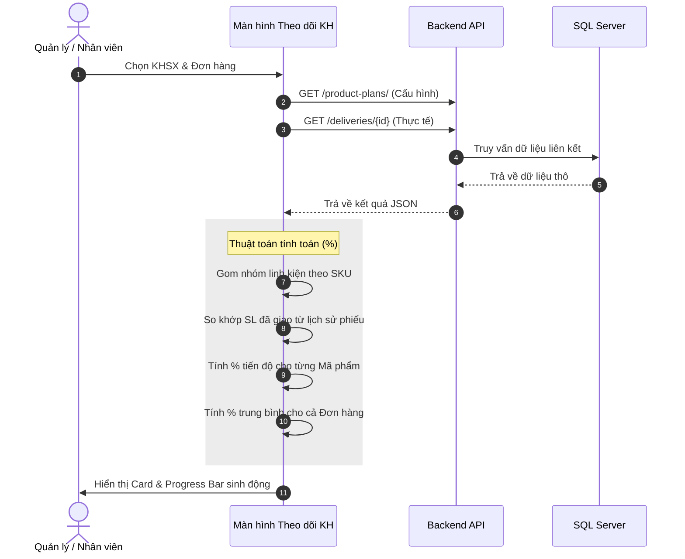

Quản lý mở màn hình, hệ thống gọi API tải danh sách kế hoạch sản xuất theo phân trang 15 bản ghi/lượt.
2. Người dùng sử dụng các bộ lọc PO hoặc trạng thái để tìm kiếm kế hoạch cần quan tâm.
3. Khi click chọn một kế hoạch sản xuất:
   * Ứng dụng hiển thị danh sách BOM chi tiết của sản phẩm.
   * Giao diện vẽ sơ đồ dòng chảy bàn giao đệ quy, thể hiện chi tiết linh kiện đó được giao từ công đoạn nào, đến công đoạn nào, số lượng bao nhiêu, ai giao, ai nhận, có bị lỗi hay trả hàng ở đâu không.* Frontend thực hiện gửi yêu cầu lấy danh sách kế hoạch phân trang qua API `GET /api/v1/production/?skip=...&limit=...`.
* Gọi API lấy chi tiết kế hoạch: `GET /api/v1/production/{plan_id}`.
* Logic tính toán phần trăm hoàn thành của kế hoạch sản xuất được tính động trên Backend dựa trên tỷ lệ giữa số lượng thành phẩm đã qua kiểm định ở công đoạn đóng gói cuối cùng chia cho tổng số lượng PO yêu cầu.

---

### 4.7.5 API liên quan

| Method | Endpoint | Mục đích |
| :--- | :--- | :--- |
| GET | `/api/v1/production/` | Lấy danh sách kế hoạch sản xuất phân trang. Định nghĩa tại [production_router.py](file:///e:/Work/SmartFlow-dev%20%281%29/SmartFlow-dev/BackEnd/src/app/api/v1/endpoints/production_router.py#L42-L46). |
| GET | `/api/v1/production/{plan_id}` | Lấy chi tiết tiến độ và cấu trúc BOM của kế hoạch. Định nghĩa tại [production_router.py](file:///e:/Work/SmartFlow-dev%20%281%29/SmartFlow-dev/BackEnd/src/app/api/v1/endpoints/production_router.py#L47-L50). |

---

### 4.7.6 Database liên quan

| Bảng | Mục đích |
| :--- | :--- |
| ``product_plans`` | Kế hoạch sản xuất. Ánh xạ qua [ProductPlan](file:///e:/Work/SmartFlow-dev%20%281%29/SmartFlow-dev/BackEnd/src/app/models/product_plan.py#L6). |
| ``deliveries`` | Các phiếu giao liên quan để tổng hợp tiến độ. Ánh xạ qua [Delivery](file:///e:/Work/SmartFlow-dev%20%281%29/SmartFlow-dev/BackEnd/src/app/models/deliveries.py#L8). |
| ``bom_details`` | Định mức sản phẩm. Ánh xạ qua Model [BOMDetail](file:///e:/Work/SmartFlow-dev%20%281%29/SmartFlow-dev/BackEnd/src/app/models/bom_detail.py#L6). |

---

### 4.7.7 Business Rules

| Điều kiện | Mô tả |
| :--- | :--- |
| Quy tắc chung | Tiến độ phần trăm không được vượt quá 100% (ngăn ngừa lỗi tính toán khi số lượng thực nhận vượt quá số lượng giao do nhập thừa). |
| Quy tắc chung | Sơ đồ cây bàn giao đệ quy phải đảm bảo tải đúng thứ tự thời gian tạo phiếu. |

---

### 4.7.8 File code liên quan

**Frontend:**
* [MB4_PlanTracking.jsx](file:///e:/Work/SmartFlow-dev%20%281%29/SmartFlow-dev/Mobile/src/Views/screens/MB4_PlanTracking.jsx)

**Backend:**
* [production_router.py](file:///e:/Work/SmartFlow-dev%20%281%29/SmartFlow-dev/BackEnd/src/app/api/v1/endpoints/production_router.py)

> [!NOTE]
> **Ghi chú Dev:**
> Khi số lượng dữ liệu lịch sử bàn giao quá lớn, việc vẽ đệ quy cây giao nhận trên Frontend bằng JS có thể gây trễ giao diện. Cần thiết kế phân cấp lazy-loading cho các nhánh cây lịch sử.

---

## 4.8 MH5_MB5_DailyInspection — Kiểm tra hàng ngày (Mobile)

### 4.8.1 Mục đích màn hình
Màn hình hỗ trợ QC thực hiện ghi nhận số lượng sản phẩm lỗi phát hiện hàng ngày theo từng công đoạn sản xuất, đồng thời cho phép bật/tắt theo dõi nóng các loại lỗi kỹ thuật quan trọng cần giám sát tại xưởng.

---

### 4.8.2 Thông tin màn hình

| Thuộc tính | Nội dung |
| :--- | :--- |
| Mã màn hình | MB5 |
| Route | `/daily-inspection` |
| Module | Kiểm soát chất lượng (QC Inspections) |
| Người dùng sử dụng | Nhân viên QC |

---

### 4.8.3 Chức năng chính

| STT | Chức năng | Mô tả |
| :--- | :--- | :--- |
| 1 | Thống kê sản lượng ngày: | Xem tổng sản lượng sản xuất của công đoạn trong ngày hiện hành. |
| 2 | Danh mục lỗi phân nhóm: | Hiển thị danh sách lỗi theo các tab danh mục lỗi kỹ thuật (Ngoại quan - Visual, Kết cấu - Structure, Nguyên vật liệu - Material, Cần theo dõi). |
| 3 | Bật/tắt theo dõi nóng lỗi: | QC có thể bật/tắt trực tiếp cờ "cần theo dõi" (`needs_tracking`) của từng loại lỗi để hệ thống ưu tiên hiển thị ở tab theo dõi nóng. |
| 4 | Lập phiếu ghi nhận lỗi: | Ghi nhận số lượng lỗi phát hiện tương ứng với từng lỗi và lưu phiếu kiểm tra chất lượng trong ngày. |

---

### 4.8.4 Luồng xử lý hệ thống

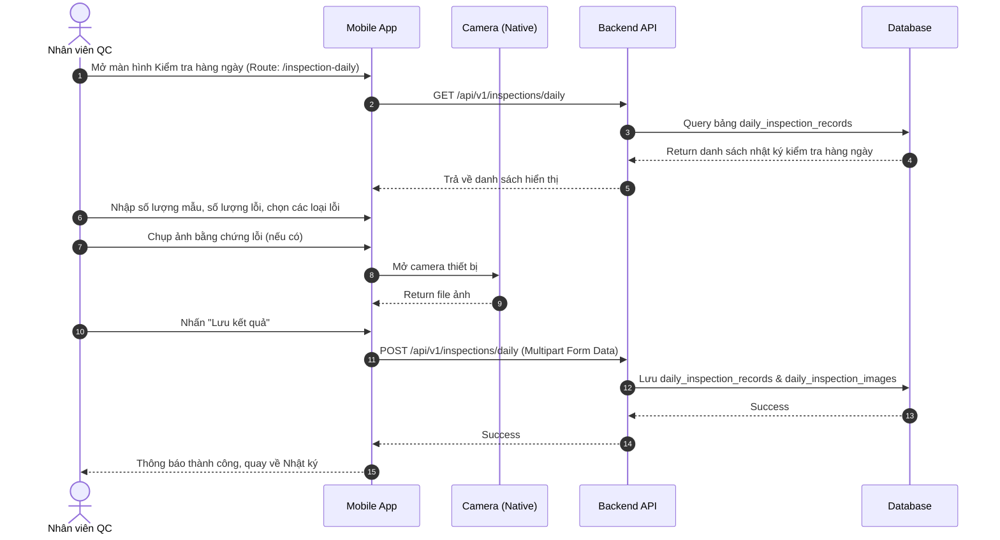

QC chọn công đoạn cần thực hiện kiểm tra hàng ngày.
2. Hệ thống tải về tổng sản lượng sản xuất tại trạm trong ngày hôm nay từ API thống kê sản lượng.
3. QC điền số lượng lỗi phát hiện cho từng lỗi trong danh sách.
4. Đối với các loại lỗi phát sinh nhiều hoặc nghiêm trọng, QC bấm nút bật chế độ **Theo dõi nóng**. Loại lỗi này sẽ ngay lập tức được cập nhật cờ `needs_tracking = True` trên máy chủ và hiển thị ở tab "Cần theo dõi".
5. Nhập xong số lượng, QC nhấn **LƯU PHIẾU**. Hệ thống tự động tính tỉ lệ lỗi và lưu dữ liệu.* Gọi API `GET /api/v1/deliveries/stats/daily?stage=...` để tính tổng sản phẩm.
* Toggle trạng thái theo dõi lỗi bằng cách gọi API `PATCH /api/v1/inspections/defect-types/{defect_id}/toggle-tracking`.
* Lưu phiếu lỗi bằng cách gửi JSON Payload lên `POST /api/v1/inspections/daily`.

---

### 4.8.5 API liên quan

| Method | Endpoint | Mục đích |
| :--- | :--- | :--- |
| POST | `/api/v1/inspections/daily` | Lưu kết quả kiểm tra hàng ngày. Định nghĩa tại [inspection_router.py](file:///e:/Work/SmartFlow-dev%20%281%29/SmartFlow-dev/BackEnd/src/app/api/v1/endpoints/inspection_router.py#L20-L56). |
| GET | `/api/v1/inspections/defect-types` | Lấy danh mục các loại lỗi. Định nghĩa tại [inspection_router.py](file:///e:/Work/SmartFlow-dev%20%281%29/SmartFlow-dev/BackEnd/src/app/api/v1/endpoints/inspection_router.py#L247-L256). |
| PATCH | `/api/v1/inspections/defect-types/{defect_id}/toggle-tracking` | Bật/tắt theo dõi loại lỗi. Định nghĩa tại [inspection_router.py](file:///e:/Work/SmartFlow-dev%20%281%29/SmartFlow-dev/BackEnd/src/app/api/v1/endpoints/inspection_router.py#L257-L269). |

---

### 4.8.6 Database liên quan

| Bảng | Mục đích |
| :--- | :--- |
| ``daily_inspection_records`` | Phiếu kiểm tra lỗi ngày. Ánh xạ qua [DailyInspectionRecord](file:///e:/Work/SmartFlow-dev%20%281%29/SmartFlow-dev/BackEnd/src/app/models/daily_inspection.py#L7). |
| ``daily_inspection_defects`` | Chi tiết số lượng từng lỗi. Ánh xạ qua [DailyInspectionDefect](file:///e:/Work/SmartFlow-dev%20%281%29/SmartFlow-dev/BackEnd/src/app/models/daily_inspection.py#L22). |
| ``defect_types`` | Danh mục lỗi. Ánh xạ qua [DefectType](file:///e:/Work/SmartFlow-dev%20%281%29/SmartFlow-dev/BackEnd/src/app/models/defect_type.py#L5). |

---

### 4.8.7 Business Rules

| Điều kiện | Mô tả |
| :--- | :--- |
| Quy tắc chung | Tỉ lệ lỗi (`defect_rate`) tự động tính theo công thức: `(Tổng số lượng lỗi / Tổng sản lượng sản xuất) * 100`. |
| Quy tắc chung | Chỉ cho phép lưu phiếu khi tổng số lượng lỗi phát hiện lớn hơn hoặc bằng 0. |

---

### 4.8.8 File code liên quan

**Frontend:**
* [MB5_DailyInspection.jsx](file:///e:/Work/SmartFlow-dev%20%281%29/SmartFlow-dev/Mobile/src/Views/screens/MB5_DailyInspection.jsx)

**Backend:**
* [inspection_router.py](file:///e:/Work/SmartFlow-dev%20%281%29/SmartFlow-dev/BackEnd/src/app/api/v1/endpoints/inspection_router.py)

> [!NOTE]
> **Ghi chú Dev:**
> Đảm bảo đồng bộ tức thì trạng thái bật/tắt theo dõi lỗi trên UI bằng cách cập nhật state cục bộ song song với việc gọi API để tối ưu trải nghiệm người dùng.

---

## 4.9 MH6_MB6_StageInspection — Kiểm tra công đoạn (Mobile)

### 4.9.1 Mục đích màn hình
Màn hình cung cấp công cụ cho QC thực hiện lập phiếu đánh giá chất lượng chuyên sâu theo công đoạn sản xuất đối với 3 loại hình chính: Kiểm tra phụ kiện/linh kiện đầu vào, Đánh giá độ bám dính của keo/sơn, và Kiểm tra ngoại quan sau đóng gói.

---

### 4.9.2 Thông tin màn hình

| Thuộc tính | Nội dung |
| :--- | :--- |
| Mã màn hình | MB6 |
| Route | `/stage-inspection` |
| Module | Kiểm soát chất lượng (QC Inspections) |
| Người dùng sử dụng | Nhân viên QC |

---

### 4.9.3 Chức năng chính

| STT | Chức năng | Mô tả |
| :--- | :--- | :--- |
| 1 | Hỗ trợ 3 loại phiếu chuyên biệt: | Biểu mẫu động thay đổi theo loại phiếu: `phu-kien`, `bam-dinh`, `sau-dong-goi`. |
| 2 | Rót đơn hàng PO & sản phẩm: | Chọn đơn hàng PO đang sản xuất để tự động tải về danh sách sản phẩm và linh kiện BOM tương ứng phục vụ kiểm tra. |
| 3 | Tải ảnh kiểm định chuyên nghiệp: | Hỗ trợ chụp và tải nhiều ảnh hiện trường lỗi lên máy chủ lưu trữ. |
| 4 | Lưu trữ dữ liệu động dưới dạng JSON: | Toàn bộ kết quả khảo sát chi tiết và danh sách link ảnh được lưu dưới dạng chuỗi JSON giúp linh hoạt cấu trúc dữ liệu. |

---

### 4.9.4 Luồng xử lý hệ thống

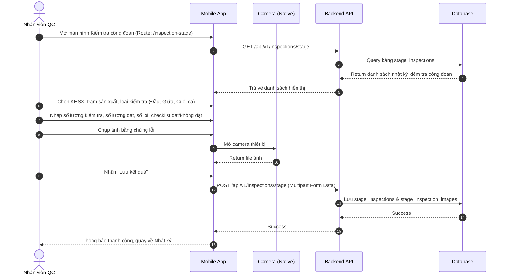

QC mở màn hình, chọn loại hình kiểm tra (`inspection_type`).
2. Chọn mã PO -> Hệ thống load danh sách sản phẩm thuộc PO đó -> QC chọn sản phẩm cần đánh giá.
3. Giao diện hiển thị form nhập liệu tương ứng với loại phiếu đã chọn. QC nhập các chỉ tiêu đạt/lỗi cụ thể và chụp ảnh đính kèm.
4. **Quy trình upload:** QC chụp ảnh -> Frontend gọi API tải ảnh lên trước để nhận về danh sách URL ảnh.
5. QC chọn kết luận đánh giá (Đạt - Pass / Không đạt - Fail) và nhấn **LƯU PHIẾU**. Toàn bộ dữ liệu chi tiết form được đóng gói thành chuỗi JSON và gửi lên API lưu trữ.* Tải ảnh lên riêng biệt qua API `POST /api/v1/inspections/upload` bằng `FormData`. Nhận về mảng đường dẫn: `{"paths": ["/static/uploads/inspections/abc.jpg"]}`.
* Gán mảng đường dẫn này vào trường `images_json` dưới dạng chuỗi JSON: `JSON.stringify(paths)`.
* Lưu phiếu qua `POST /api/v1/inspections/stage`.

---

### 4.9.5 API liên quan

| Method | Endpoint | Mục đích |
| :--- | :--- | :--- |
| POST | `/api/v1/inspections/stage` | Lưu phiếu kiểm tra công đoạn. Định nghĩa tại [inspection_router.py](file:///e:/Work/SmartFlow-dev%20%281%29/SmartFlow-dev/BackEnd/src/app/api/v1/endpoints/inspection_router.py#L77-L103). |
| POST | `/api/v1/inspections/upload` | Tải ảnh kiểm định lên máy chủ. Định nghĩa tại [inspection_router.py](file:///e:/Work/SmartFlow-dev%20%281%29/SmartFlow-dev/BackEnd/src/app/api/v1/endpoints/inspection_router.py#L199-L217). |
| GET | `/api/v1/orders/simple` | Lấy danh sách PO giản lược. Định nghĩa tại [order_router.py](file:///e:/Work/SmartFlow-dev%20%281%29/SmartFlow-dev/BackEnd/src/app/api/v1/endpoints/order_router.py#L67-L87). |
| GET | `/api/v1/orders/by-code/{order_code}/products` | Lấy danh sách sản phẩm theo mã PO. Định nghĩa tại [order_router.py](file:///e:/Work/SmartFlow-dev%20%281%29/SmartFlow-dev/BackEnd/src/app/api/v1/endpoints/order_router.py#L88-L125). |

---

### 4.9.6 Database liên quan

| Bảng | Mục đích |
| :--- | :--- |
| ``stage_inspections`` | Lưu kết quả kiểm tra công đoạn. Ánh xạ qua Model [StageInspection](file:///e:/Work/SmartFlow-dev%20%281%29/SmartFlow-dev/BackEnd/src/app/models/stage_inspection.py#L6). |

---

### 4.9.7 Business Rules

| Điều kiện | Mô tả |
| :--- | :--- |
| Quy tắc chung | Yêu cầu nhập đầy đủ PO, SKU sản phẩm và kết luận kiểm định Pass/Fail. |
| Quy tắc chung | Ảnh chụp đính kèm phải được tải lên máy chủ thành công trước khi lưu bản ghi phiếu kiểm tra công đoạn. |

---

### 4.9.8 File code liên quan

**Frontend:**
* [MB6_StageInspection.jsx](file:///e:/Work/SmartFlow-dev%20%281%29/SmartFlow-dev/Mobile/src/Views/screens/MB6_StageInspection.jsx)

**Backend:**
* [inspection_router.py](file:///e:/Work/SmartFlow-dev%20%281%29/SmartFlow-dev/BackEnd/src/app/api/v1/endpoints/inspection_router.py)

> [!NOTE]
> **Ghi chú Dev:**
> Trường `data_json` và `images_json` trong SQL Server được khai báo kiểu `NVARCHAR(MAX)` hoặc `TEXT`. Khi truy vấn, Backend cần deserialize chuỗi này thành JSON Object trước khi trả về Frontend để tránh lỗi hiển thị.

---

## 4.10 MH7_MA7_PalletCard — Thẻ Pallet / Phiếu Ngoại lệ (Web)

### 4.10.1 Mục đích màn hình
Màn hình Web cung cấp giao diện quản lý tập trung toàn bộ các phiếu bàn giao phát sinh bất thường (ngoại lệ) trên xưởng: Lệch thiếu (Thực nhận < Tổng giao), Lệch thừa (Tổng giao < Thực nhận), QC Trả hàng và Lô hàng phát sinh lỗi QC, giúp quản lý nhanh chóng tìm ra điểm nóng sai sót.

---

### 4.10.2 Thông tin màn hình

| Thuộc tính | Nội dung |
| :--- | :--- |
| Mã màn hình | MA7 |
| Route | `/exception-deliveries` |
| Module | Quản lý bàn giao (Deliveries) |
| Người dùng sử dụng | Ban quản lý, Quản trị viên hệ thống (Web) |

---

### 4.10.3 Chức năng chính

| STT | Chức năng | Mô tả |
| :--- | :--- | :--- |
| 1 | Thống kê phân loại ngoại lệ: | Hiển thị tổng số lượng và tỉ lệ các loại phiếu lỗi/lệch dưới dạng thẻ KPI nổi bật. |
| 2 | Tìm kiếm & Bộ lọc thông minh: | Lọc phiếu theo các nhóm ngoại lệ riêng biệt (Lệch thiếu, Lệch thừa, Trả hàng, Lỗi QC) và tìm kiếm theo mã phiếu hoặc tên linh kiện. |
| 3 | Xem chi tiết phiếu bàn giao: | Modal popup hiển thị đầy đủ thông tin đo độ ẩm, người giao/nhận, 8 chỉ tiêu kiểm tra chất lượng QC của phiếu và ảnh chụp đối chứng từ xưởng. |
| 4 | Phân trang dữ liệu: | Phân trang danh sách phiếu bất thường (15 bản ghi trên một trang) đảm bảo hiệu năng tải trang. |

---

### 4.10.4 Luồng xử lý hệ thống

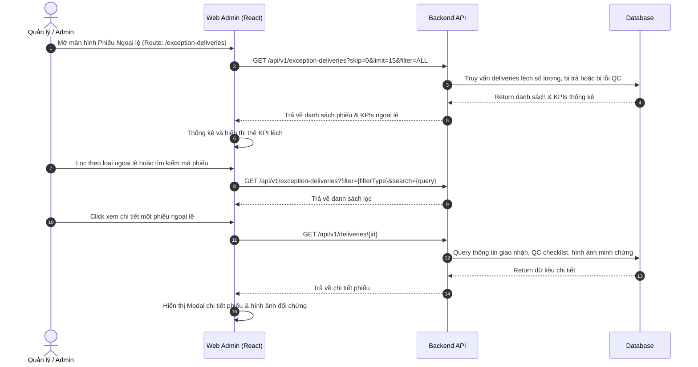

Quản lý truy cập trang Quản lý phiếu ngoại lệ trên giao diện Web.
2. Hệ thống gọi API lấy toàn bộ danh sách phiếu bàn giao có bất thường.
3. Người dùng xem các chỉ số thống kê tổng hợp ở phía trên để nắm bắt tình hình chất lượng xưởng.
4. Sử dụng bộ lọc hoặc ô tìm kiếm để khoanh vùng các phiếu giao nhận bị lệch số lượng lớn.
5. Bấm nút **Xem chi tiết (Eye Icon)** trên một dòng phiếu: Hệ thống mở Modal hiển thị chi tiết phiếu bàn giao, danh sách ảnh bàn giao đi, ảnh trả hàng lỗi (nếu có), thông số ẩm đo được và kết quả checklist QC.* Frontend gọi service `deliveryService.getExceptionDeliveries()` tương ứng với API `GET /api/v1/deliveries/exceptions` để lấy danh sách phiếu ngoại lệ.
* Chi tiết phiếu được lấy qua `deliveryService.getDeliveryDetail(id)` tương ứng với API `GET /api/v1/deliveries/detail/{id}`.
* Logic lọc ngoại lệ tại Backend:
  * **Lệch thừa:** `quantity_received > quantity_total`.
  * **Lệch thiếu:** `quantity_received < quantity_total` và trạng thái không nằm trong nhóm chờ (`Chờ xác nhận`, `Chờ kiểm tra`...).
  * **Trả hàng:** `quantity_returned > 0`.
  * **Lỗi QC:** `status == 'Lỗi'` hoặc `quantity_error > 0`.

---

### 4.10.5 API liên quan

| Method | Endpoint | Mục đích |
| :--- | :--- | :--- |
| GET | `/api/v1/deliveries/exceptions` | Lấy danh sách phiếu bàn giao ngoại lệ. Định nghĩa tại [delivery_router.py](file:///e:/Work/SmartFlow-dev%20%281%29/SmartFlow-dev/BackEnd/src/app/api/v1/endpoints/delivery_router.py#L387-L449). |
| GET | `/api/v1/deliveries/detail/{delivery_id}` | Lấy chi tiết thông tin một phiếu bàn giao. Định nghĩa tại [delivery_router.py](file:///e:/Work/SmartFlow-dev%20%281%29/SmartFlow-dev/BackEnd/src/app/api/v1/endpoints/delivery_router.py#L510-L542). |

---

### 4.10.6 Database liên quan

| Bảng | Mục đích |
| :--- | :--- |
| ``deliveries`` | Phiếu bàn giao. Ánh xạ qua [Delivery](file:///e:/Work/SmartFlow-dev%20%281%29/SmartFlow-dev/BackEnd/src/app/models/deliveries.py#L8). |
| ``delivery_qc`` | Kết quả đánh giá chất lượng. Ánh xạ qua Model [DeliveryQC](file:///e:/Work/SmartFlow-dev%20%281%29/SmartFlow-dev/BackEnd/src/app/models/delivery_qc.py#L6). |

---

### 4.10.7 Business Rules

| Điều kiện | Mô tả |
| :--- | :--- |
| Quy tắc chung | Phiếu bàn giao bị lệch thiếu chỉ được coi là ngoại lệ khi đã kết thúc quy trình nhận hàng (không tính các phiếu đang trong trạng thái chờ xử lý). |

---

### 4.10.8 File code liên quan

**Frontend:**
* [MA7_PalletCard.jsx](file:///e:/Work/SmartFlow-dev%20%281%29/SmartFlow-dev/FrontEnd/src/pages/Manufacture/MA7_PalletCard.jsx)

**Backend:**
* [delivery_router.py](file:///e:/Work/SmartFlow-dev%20%281%29/SmartFlow-dev/BackEnd/src/app/api/v1/endpoints/delivery_router.py)

> [!NOTE]
> **Ghi chú Dev:**
> Tên tệp tin là `MA7_PalletCard.jsx` nhưng component chính bên trong thực chất là `ExceptionDeliveries`. Khi cấu hình Route trong `App.jsx` cần chú ý import đúng đường dẫn tệp tin.

---

## 4.11 MH11_AD11_BackupQRManagement — Quản lý QR dự phòng (Web)

### 4.11.1 Mục đích màn hình
Màn hình Web dành cho Admin quản lý danh sách các thẻ QR cố định luân chuyển trên xưởng. Hỗ trợ tạo tự động dải mã mới, in tem nhãn thẻ theo chuẩn kích thước A7 trên khổ giấy A5 và cưỡng bức giải phóng trạng thái thẻ QR từ "Đang dùng" về "Trống" khi xảy ra sự cố nghẽn luồng.

---

### 4.11.2 Thông tin màn hình

| Thuộc tính | Nội dung |
| :--- | :--- |
| Mã màn hình | AD11 |
| Route | `/admin/backup-qrs (định cấu hình trong outlet router Web)` |
| Module | Quản lý hệ thống (Admin Settings) |
| Người dùng sử dụng | Quản trị viên hệ thống (Admin) |

---

### 4.11.3 Chức năng chính

| STT | Chức năng | Mô tả |
| :--- | :--- | :--- |
| 1 | Hiển thị danh sách thẻ: | Liệt kê các mã QR dự phòng đang có trong hệ thống và trạng thái tương ứng. |
| 2 | Tự động sinh mã hàng loạt: | Nhập số lượng mã cần sinh, hệ thống tự động tính số thứ tự tiếp theo để sinh dải mã dạng nối tiếp (ví dụ: DP-013, DP-014...). |
| 3 | In tem nhãn chuẩn A7/A5: | Chọn các mã QR cần in, hệ thống tự động căn lề vẽ QR Code kích thước A7 đặt ở chính giữa khổ giấy A5 để in ấn trực tiếp từ trình duyệt. |
| 4 | Giải phóng cưỡng bức (Unlock): | Cho phép Admin mở khoá thẻ QR đang bị gán cho phiếu giao sang trạng thái Sẵn sàng để tái sử dụng. |

---

### 4.11.4 Luồng xử lý hệ thống

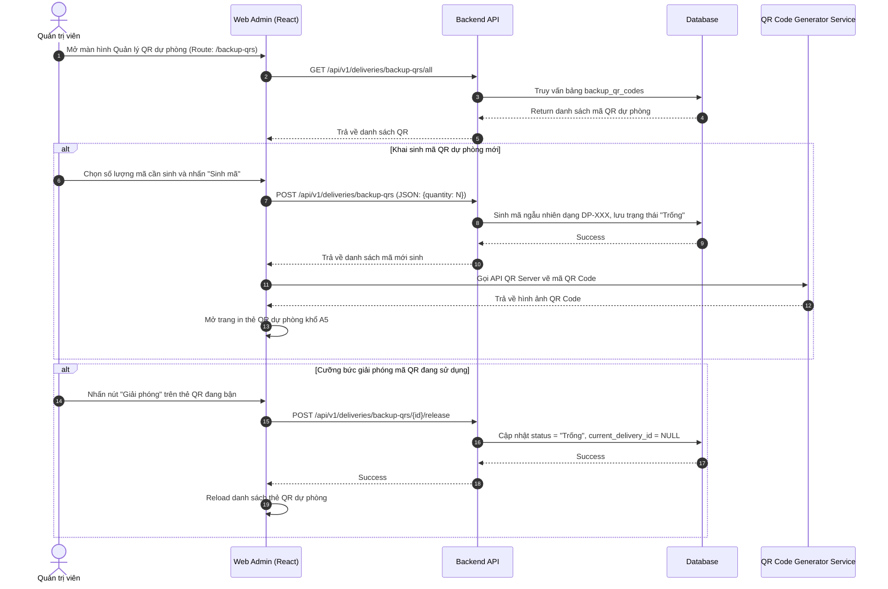

Admin truy cập màn hình, xem danh sách và trạng thái các thẻ QR hiện hữu.
2. **Khai báo thẻ mới:** Admin nhấn nút "Thêm mã mới", nhập số lượng cần tạo (Ví dụ: 10). Hệ thống gửi request lên Backend, Backend tự động tìm mã số thứ tự lớn nhất trong DB (ví dụ: `DP-012`), sinh tiếp 10 mã nối tiếp (`DP-013` đến `DP-022`) với trạng thái ban đầu là `Trống` (Sẵn sàng).
3. **In thẻ luân chuyển:** Admin tích chọn các thẻ cần in, nhấn nút "In thẻ đã chọn". Hệ thống mở một tab trình duyệt mới, vẽ QR Code qua dịch vụ tạo mã QR động và tự động gọi hộp thoại in ấn của trình duyệt.
4. **Giải phóng thẻ:** Khi một lô hàng bị huỷ hoặc kẹt quy trình khiến thẻ QR giữ trạng thái `Đang dùng` vô thời hạn, Admin tìm thẻ đó và nhấn nút **Giải phóng (Unlock)** để đưa trạng thái thẻ về `Trống` và xoá liên kết phiếu giao.* API tạo mới hỗ trợ cả sinh hàng loạt tự động (`quantity`) hoặc thêm thủ công danh sách mã phân tách bằng dấu phẩy qua `POST /api/v1/deliveries/backup-qrs`.
* API giải phóng thẻ: `POST /api/v1/deliveries/backup-qrs/{qr_id}/release` đặt trường `status = "Trống"` và `current_delivery_id = None`.
* Vẽ ảnh QR Code trên trang in sử dụng API QR Server: `https://api.qrserver.com/v1/create-qr-code/?size=150x150&data={qr_code}`.

---

### 4.11.5 API liên quan

| Method | Endpoint | Mục đích |
| :--- | :--- | :--- |
| GET | `/api/v1/deliveries/backup-qrs/all` | Tải toàn bộ danh sách thẻ QR dự phòng. Định nghĩa tại [delivery_router.py](file:///e:/Work/SmartFlow-dev%20%281%29/SmartFlow-dev/BackEnd/src/app/api/v1/endpoints/delivery_router.py#L649-L690). |
| POST | `/api/v1/deliveries/backup-qrs` | Khai báo sinh mã QR dự phòng. Định nghĩa tại [delivery_router.py](file:///e:/Work/SmartFlow-dev%20%281%29/SmartFlow-dev/BackEnd/src/app/api/v1/endpoints/delivery_router.py#L564-L648). |
| POST | `/api/v1/deliveries/backup-qrs/{qr_id}/release` | Cưỡng bức giải phóng thẻ QR. Định nghĩa tại [delivery_router.py](file:///e:/Work/SmartFlow-dev%20%281%29/SmartFlow-dev/BackEnd/src/app/api/v1/endpoints/delivery_router.py#L692-L706). |

---

### 4.11.6 Database liên quan

| Bảng | Mục đích |
| :--- | :--- |
| ``backup_qr_codes`` | Lưu thông tin thẻ QR dự phòng. Ánh xạ qua Model [BackupQRCode](file:///e:/Work/SmartFlow-dev%20%281%29/SmartFlow-dev/BackEnd/src/app/models/backup_qr.py#L6). |

---

### 4.11.7 Business Rules

| Điều kiện | Mô tả |
| :--- | :--- |
| Quy tắc chung | Định dạng mã sinh tự động bắt buộc có tiền tố `DP-` kèm 3 chữ số tự tăng (ví dụ: `DP-001`). |
| Quy tắc chung | Không cho phép giải phóng thẻ QR nếu thẻ đó đang ở trạng thái `Trống` (Sẵn sàng). |

---

### 4.11.8 File code liên quan

**Frontend:**
* [AD11_BackupQRManagement.jsx](file:///e:/Work/SmartFlow-dev%20%281%29/SmartFlow-dev/FrontEnd/src/pages/Admin/AD11_BackupQRManagement.jsx)

**Backend:**
* [delivery_router.py](file:///e:/Work/SmartFlow-dev%20%281%29/SmartFlow-dev/BackEnd/src/app/api/v1/endpoints/delivery_router.py)

> [!NOTE]
> **Ghi chú Dev:**
> Trang in thẻ luân chuyển sử dụng CSS `@media print` thiết lập ngắt trang tự động `page-break-after: always` để đảm bảo mỗi thẻ QR được in chính xác nằm giữa một tờ giấy A5 portrait mà không bị lệch lề hay dồn dòng.

---

## 4.12 MH12_MB7_InspectionLogs — Nhật ký kiểm tra (Mobile)

### 4.12.1 Mục đích màn hình
Màn hình cung cấp nhật ký lịch sử các hoạt động kiểm tra chất lượng (hàng ngày và theo từng công đoạn) đã thực hiện trong xưởng, hỗ trợ tìm kiếm nhanh chóng và xem lại kết quả kiểm tra cũ.

---

### 4.12.2 Thông tin màn hình

| Thuộc tính | Nội dung |
| :--- | :--- |
| Mã màn hình | MB7 |
| Route | `/logs` |
| Module | Quản lý kiểm định chất lượng (Inspections) |
| Người dùng sử dụng | Nhân viên QC, Nhân viên Sản xuất, Giám sát chất lượng |

---

### 4.12.3 Chức năng chính

| STT | Chức năng | Mô tả |
| :--- | :--- | :--- |
| 1 | Danh sách lịch sử gộp: | Tải và hiển thị gộp danh sách lịch sử kiểm định từ hai nguồn khác nhau: Kiểm tra hàng ngày và Kiểm tra công đoạn. |
| 2 | Bộ lọc & Tìm kiếm: | Hỗ trợ lọc và tìm kiếm thời gian thực theo mã lô hàng, tên người kiểm tra hoặc loại hình kiểm tra. |
| 3 | Điều hướng chi tiết: | Bấm vào dòng nhật ký bất kỳ để chuyển hướng xem chi tiết kết quả kiểm định cũ tương ứng. |

---

### 4.12.4 Luồng xử lý hệ thống

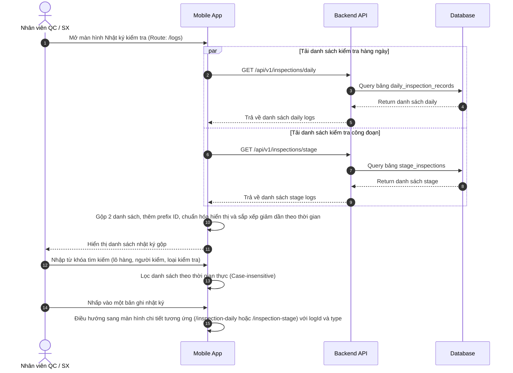

Người dùng mở màn hình Nhật ký kiểm tra.
2. Ứng dụng gọi đồng thời 2 API để lấy danh sách phiếu kiểm tra hàng ngày và phiếu kiểm tra công đoạn.
3. Ứng dụng xử lý gộp dữ liệu:
   * **Bản ghi kiểm tra hàng ngày:** Tiền tố ID là `daily_`, loại hiển thị là "Kiểm tra hằng ngày", kết quả dựa vào `total_defects > 0` (Đạt/Không đạt).
   * **Bản ghi kiểm tra công đoạn:** Tiền tố ID là `stage_`, loại hiển thị chuyển đổi dựa trên `inspection_type` (Đầu vào, Bám dính, Đóng gói), kết quả dựa trên `conclusion` ('pass' -> Đạt, 'fail' -> Không đạt).
4. Sắp xếp danh sách gộp theo mốc thời gian từ mới nhất đến cũ nhất.
5. Người dùng có thể tìm kiếm nhanh trên danh sách. Khi nhấp chọn một bản ghi, hệ thống điều hướng đến màn hình chi tiết tương ứng (`/inspection-daily` hoặc `/inspection-stage`) kèm theo state `logId` và `type`.* Sử dụng `Promise.all` để tải song song dữ liệu từ `apiClient.get('inspections/daily')` và `apiClient.get('inspections/stage')`.
* Dữ liệu trả về được định dạng lại cấu trúc đồng nhất trên client trước khi gán vào state `logs`.

---

### 4.12.5 API liên quan

| Method | Endpoint | Mục đích |
| :--- | :--- | :--- |
| GET | `/api/v1/inspections/daily` | Lấy danh sách phiếu kiểm tra hàng ngày. Định nghĩa tại [get_daily_inspections](file:///e:/Work/SmartFlow-dev%20%281%29/SmartFlow-dev/BackEnd/src/app/api/v1/endpoints/inspection_router.py#L58-L75). |
| GET | `/api/v1/inspections/stage` | Lấy danh sách phiếu kiểm tra công đoạn. Định nghĩa tại [get_stage_inspections](file:///e:/Work/SmartFlow-dev%20%281%29/SmartFlow-dev/BackEnd/src/app/api/v1/endpoints/inspection_router.py#L114-L123). |

---

### 4.12.6 Database liên quan

| Bảng | Mục đích |
| :--- | :--- |
| ``daily_inspection_records`` | Lưu trữ nhật ký kiểm tra hàng ngày. Ánh xạ qua Model [DailyInspectionRecord](file:///e:/Work/SmartFlow-dev%20%281%29/SmartFlow-dev/BackEnd/src/app/models/daily_inspection.py#L7). |
| ``stage_inspections`` | Lưu trữ nhật ký kiểm tra công đoạn. Ánh xạ qua Model [StageInspection](file:///e:/Work/SmartFlow-dev%20%281%29/SmartFlow-dev/BackEnd/src/app/models/stage_inspection.py#L6). |

---

### 4.12.7 Business Rules

| Điều kiện | Mô tả |
| :--- | :--- |
| Quy tắc chung | Chỉ cho phép xem lịch sử, không có chức năng chỉnh sửa hay xóa nhật ký tại màn hình này. |
| Quy tắc chung | Bộ lọc tìm kiếm không phân biệt chữ hoa chữ thường (Case-insensitive). |

---

### 4.12.8 File code liên quan

**Frontend:**
* [InspectionLogs](file:///e:/Work/SmartFlow-dev%20%281%29/SmartFlow-dev/Mobile/src/Views/screens/MB7_InspectionLogs.jsx)

**Backend:**
* [inspection_router.py](file:///e:/Work/SmartFlow-dev%20%281%29/SmartFlow-dev/BackEnd/src/app/api/v1/endpoints/inspection_router.py)

> [!NOTE]
> **Ghi chú Dev:**
> Việc gộp dữ liệu được thực hiện hoàn toàn ở Client. Khi số lượng bản ghi lớn, cần cân nhắc thêm cơ chế phân trang phía Backend cho cả 2 API để tối ưu hiệu năng.

---

## 4.13 MH13_MB8_KPITracking — Theo dõi KPI (Mobile)

### 4.13.1 Mục đích màn hình
Màn hình cung cấp giao diện trực quan cho phép người lao động theo dõi chỉ số hiệu suất công việc cá nhân (KPI) theo tuần/tháng, kiểm tra danh sách đầu việc cần thực hiện (Checklist) và kết quả thực tế so với mục tiêu đề ra.

---

### 4.13.2 Thông tin màn hình

| Thuộc tính | Nội dung |
| :--- | :--- |
| Mã màn hình | MB8 |
| Route | `/kpi` |
| Module | Quản lý hiệu suất (Performance Management) |
| Người dùng sử dụng | Tất cả nhân viên xưởng (SX, QC) và Tổ trưởng |

---

### 4.13.3 Chức năng chính

| STT | Chức năng | Mô tả |
| :--- | :--- | :--- |
| 1 | Thẻ chỉ số KPI: | Hiển thị phần trăm hoàn thành KPI tuần và tháng dưới dạng biểu đồ tròn động (SVG). |
| 2 | Checklist công việc: | Hiển thị danh sách các đầu công việc cần làm trong ngày cùng trạng thái hoàn thành. |
| 3 | Chi tiết KPI: | Thống kê chi tiết các chỉ tiêu đánh giá (Tỷ lệ hàng đạt lần đầu, tỷ lệ lỗi phát hiện, điểm kỷ luật, năng suất...). |
| 4 | Lọc thời gian: | Hỗ trợ lọc chi tiết KPI theo tháng hoặc theo tuần. |

---

### 4.13.4 Luồng xử lý hệ thống

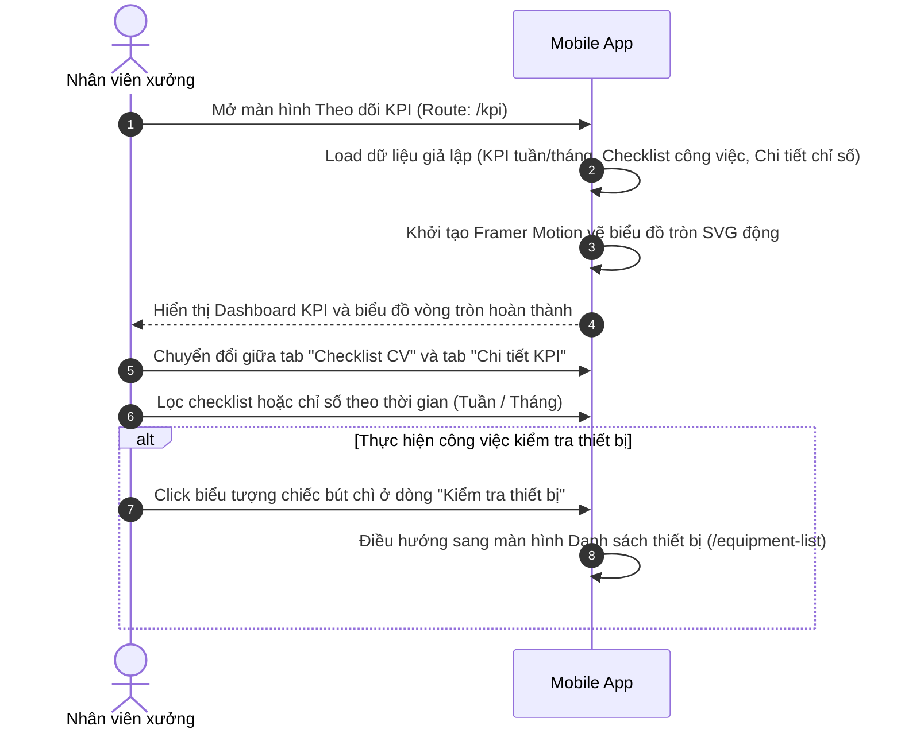

Người dùng mở màn hình Theo dõi KPI.
2. Ứng dụng hiển thị hai biểu đồ vòng tròn thể hiện KPI của tháng và tuần.
3. Người dùng chuyển đổi qua lại giữa hai tab chính:
   * **Checklist CV:** Xem danh sách công việc trong ngày. Có thể bấm biểu tượng chiếc bút chì ở cột "Thực hiện" trên dòng "Kiểm tra thiết bị" để mở danh sách thiết bị cần kiểm tra (`/equipment-list`).
   * **Chi tiết KPI:** Xem các chỉ số KPI định lượng so sánh giữa Mục tiêu và Thực tế.
4. Có thể dùng bộ lọc để hiển thị danh sách checklist hoặc chi tiết KPI theo khoảng thời gian mong muốn.* Vẽ biểu đồ vòng tròn động sử dụng component [CircularProgress](file:///e:/Work/SmartFlow-dev%20%281%29/SmartFlow-dev/Mobile/src/Views/screens/MB8_KPITracking.jsx#L20) bằng thẻ `<svg>` kết hợp với thư viện `framer-motion` để tạo hiệu ứng chạy vòng tròn mượt mà khi load.
* Toàn bộ dữ liệu của màn hình hiện tại đang sử dụng Mock Data hoàn toàn ở Client.

---

### 4.13.5 API liên quan

| Method | Endpoint | Mục đích |
| :--- | :--- | :--- |

---

### 4.13.6 Database liên quan

| Bảng | Mục đích |
| :--- | :--- |

---

### 4.13.7 Business Rules

| Điều kiện | Mô tả |
| :--- | :--- |
| Quy tắc chung | Không áp dụng kiểm tra nghiệp vụ do hiện tại là màn hình hiển thị dữ liệu tĩnh (Mock Data). |

---

### 4.13.8 File code liên quan

**Frontend:**
* [KPITracking](file:///e:/Work/SmartFlow-dev%20%281%29/SmartFlow-dev/Mobile/src/Views/screens/MB8_KPITracking.jsx)

> [!NOTE]
> **Ghi chú Dev:**
> Cần bổ sung các API backend kết nối với bảng chấm công, KPI của nhân viên để thay thế cho mock dữ liệu hiện tại khi triển khai thực tế.

---

## 4.14 MH14_MB8.1_StaffEvaluation — Đánh giá nhân sự (Mobile)

### 4.14.1 Mục đích màn hình
Màn hình di động cung cấp công cụ cho cấp quản lý/tổ trưởng đánh giá kết quả thực hiện công việc (KPI) của một nhân viên cấp dưới trong tháng, đưa ra xếp loại tổng hợp và các ghi chú, đề xuất hành động.

---

### 4.14.2 Thông tin màn hình

| Thuộc tính | Nội dung |
| :--- | :--- |
| Mã màn hình | MB8.1 |
| Route | `/staff-evaluation/:id` |
| Module | Quản lý hiệu suất (Performance Management) |
| Người dùng sử dụng | Tổ trưởng, Quản lý QC, Quản lý xưởng |

---

### 4.14.3 Chức năng chính

| STT | Chức năng | Mô tả |
| :--- | :--- | :--- |
| 1 | Hiển thị thông tin nhân sự: | Hiển thị tên nhân viên, công đoạn, level và bộ phận hiện tại. |
| 2 | Bảng chi tiết KPI: | Liệt kê kết quả thực tế của nhân viên so với mục tiêu ở các chỉ tiêu cốt lõi. |
| 3 | Xếp loại tháng: | Cho phép chọn xếp loại từ A, B, C đến D thông qua các radio button. |
| 4 | Nhận xét & Đề xuất: | Cho phép nhập ghi chú đánh giá chi tiết và đề xuất hành động của quản lý. |

---

### 4.14.4 Luồng xử lý hệ thống

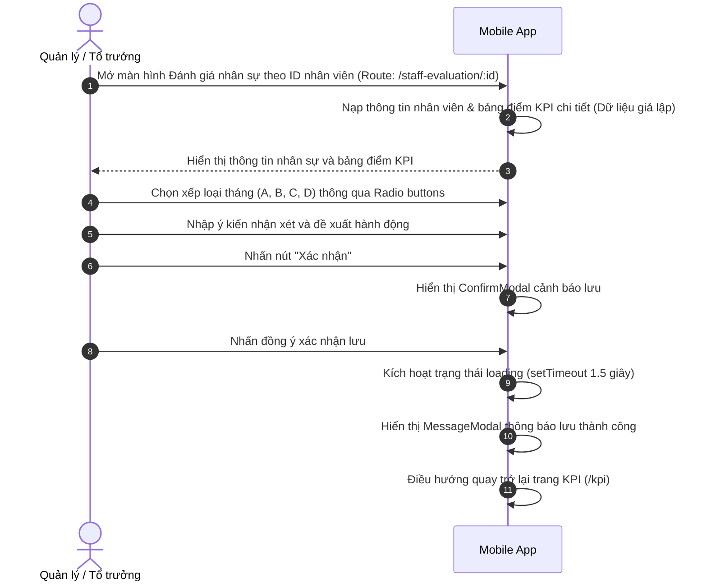

Quản lý truy cập trang đánh giá nhân viên cụ thể theo đường dẫn có ID.
2. Hệ thống tải thông tin cơ bản và bảng điểm KPI chi tiết của nhân viên đó.
3. Quản lý thực hiện:
   * Xem bảng chỉ tiêu chi tiết để đưa ra nhận định.
   * Click chọn xếp loại tháng (A, B, C hoặc D).
   * Nhập ghi chú đánh giá chi tiết và các hành động đề xuất.
4. Nhấn **Xác nhận**: Hệ thống hiển thị Modal xác nhận hành động.
5. Khi đồng ý, hệ thống kích hoạt lưu dữ liệu (giả lập 1.5 giây), hiển thị thông báo thành công và tự động điều hướng quay lại trang `/kpi`.* Trạng thái submit được mô phỏng qua `setTimeout` 1500ms thay thế cho cuộc gọi API thật.
* Sử dụng [ConfirmModal](file:///e:/Work/SmartFlow-dev%20%281%29/SmartFlow-dev/Mobile/src/Views/components/ConfirmModal.jsx) để xác nhận trước khi lưu và [MessageModal](file:///e:/Work/SmartFlow-dev%20%281%29/SmartFlow-dev/Mobile/src/Views/components/MessageModal.jsx) để hiển thị thông báo thành công.

---

### 4.14.5 API liên quan

| Method | Endpoint | Mục đích |
| :--- | :--- | :--- |

---

### 4.14.6 Database liên quan

| Bảng | Mục đích |
| :--- | :--- |

---

### 4.14.7 Business Rules

| Điều kiện | Mô tả |
| :--- | :--- |
| Quy tắc chung | Xếp loại tháng mặc định ban đầu là 'A' và người dùng bắt buộc phải chọn một trong các phân hạng (A, B, C, D). |

---

### 4.14.8 File code liên quan

**Frontend:**
* [StaffEvaluation](file:///e:/Work/SmartFlow-dev%20%281%29/SmartFlow-dev/Mobile/src/Views/screens/MB8.1_StaffEvaluation.jsx)

> [!NOTE]
> **Ghi chú Dev:**
> Hiện tại màn hình được nạp cứng thông tin nhân viên "Hồ Sỹ Khấn". Cần xây dựng API nạp thông tin nhân viên theo `id` truyền từ URL params khi chuyển sang kết nối Backend thật.

---

## 4.15 MH15_MB9_AwardDiscipline — Khen thưởng, kỷ luật (Mobile)

### 4.15.1 Mục đích màn hình
Màn hình hỗ trợ Tổ trưởng/Quản lý nhanh chóng ghi nhận các trường hợp vi phạm quy định hoặc các cá nhân có thành tích xuất sắc trực tiếp tại hiện trường sản xuất, cho phép chụp ảnh bằng chứng để lưu hồ sơ.

---

### 4.15.2 Thông tin màn hình

| Thuộc tính | Nội dung |
| :--- | :--- |
| Mã màn hình | MB9 |
| Route | `/awards` |
| Module | Quản lý nhân sự & Kỷ luật (HR & Discipline) |
| Người dùng sử dụng | Tổ trưởng, Quản lý xưởng, Đại diện QC |

---

### 4.15.3 Chức năng chính

| STT | Chức năng | Mô tả |
| :--- | :--- | :--- |
| 1 | Khai báo vi phạm/khen thưởng: | Chọn nhân viên, loại lỗi/vấn đề vi phạm, mức độ ảnh hưởng và điểm trừ/cộng tương ứng. |
| 2 | Chụp ảnh bằng chứng trực tiếp: | Tích hợp camera thiết bị di động để chụp tối đa 3 ảnh bằng chứng vi phạm tại hiện trường. |
| 3 | Xác nhận hai bước: | Hộp thoại cảnh báo và xác nhận trước khi lưu thông tin khen thưởng, kỷ luật vào hệ thống. |

---

### 4.15.4 Luồng xử lý hệ thống

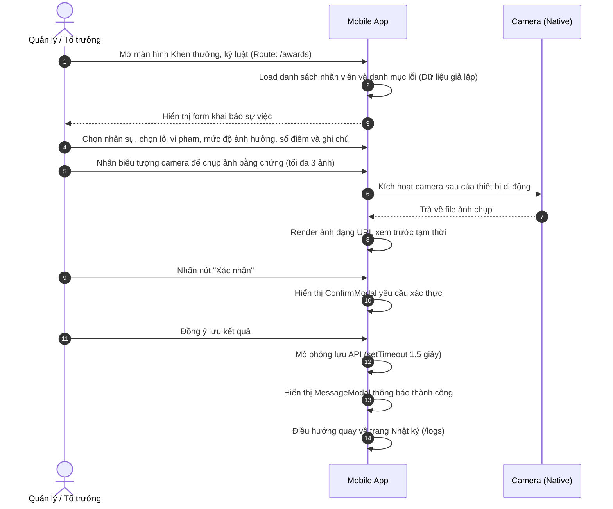

Người dùng mở màn hình Khen thưởng, kỷ luật.
2. Người dùng nhập thông tin: chọn tên nhân viên, chọn hành vi/vấn đề, mức độ ảnh hưởng, nhập số điểm và viết thêm ghi chú mô tả sự việc.
3. Người dùng nhấn biểu tượng camera để chụp ảnh bằng chứng:
   * Nếu chưa có ảnh nào: Nút chụp hiển thị bên cạnh tiêu đề "Bằng chứng".
   * Khi có ảnh: Nút chụp chuyển xuống hiển thị dạng ô nét đứt nối tiếp các ảnh đã chụp. Cho phép chụp tối đa 3 ảnh. Người dùng có thể xóa ảnh bằng cách bấm nút "x" màu đỏ trên góc ảnh.
4. Nhấn **Xác nhận**: Xác nhận hành động qua ConfirmModal. Hệ thống mô phỏng lưu API trong 1.5 giây, hiển thị thông báo thành công và chuyển hướng về trang nhật ký `/logs`.* Thao tác mở camera của thiết bị được thực hiện bằng thẻ `<input type="file" accept="image/*" capture="environment" />` giúp kích hoạt trực tiếp camera sau của điện thoại.
* Tạo URL xem trước ảnh tạm thời bằng `URL.createObjectURL(file)`.
* Quá trình lưu dữ liệu được giả lập bằng `setTimeout` 1.5 giây.

---

### 4.15.5 API liên quan

| Method | Endpoint | Mục đích |
| :--- | :--- | :--- |

---

### 4.15.6 Database liên quan

| Bảng | Mục đích |
| :--- | :--- |

---

### 4.15.7 Business Rules

| Điều kiện | Mô tả |
| :--- | :--- |
| Quy tắc chung | Khống chế số lượng ảnh bằng chứng tối đa là 3 ảnh. |
| Quy tắc chung | Điểm số vi phạm/khen thưởng phải nhập kiểu số (`type="number"`). |

---

### 4.15.8 File code liên quan

**Frontend:**
* [AwardDiscipline](file:///e:/Work/SmartFlow-dev%20%281%29/SmartFlow-dev/Mobile/src/Views/screens/MB9_AwardDiscipline.jsx)

> [!NOTE]
> **Ghi chú Dev:**
> Hiện tại màn hình sử dụng mock data cho danh sách nhân viên và các loại lỗi. Cần tích hợp các API tương ứng để lấy danh sách nhân viên thực tế thuộc bộ phận và danh mục lỗi chuẩn của xưởng.

---

## 4.16 MH16_MB10_EquipmentList — Danh sách thiết bị (Mobile)

### 4.16.1 Mục đích màn hình
Màn hình cung cấp danh sách toàn bộ máy móc, dụng cụ đo lường và thiết bị phụ trợ trong công đoạn, hỗ trợ ghi nhận nhanh kết quả tự kiểm tra thiết bị đầu ca làm việc và cập nhật trạng thái lỗi, hỏng của máy móc về máy chủ.

---

### 4.16.2 Thông tin màn hình

| Thuộc tính | Nội dung |
| :--- | :--- |
| Mã màn hình | MB10 |
| Route | `/equipment-list` |
| Module | Quản lý thiết bị xưởng (Equipments) |
| Người dùng sử dụng | Tổ trưởng, Nhân viên QC, Nhân viên bảo trì |

---

### 4.16.3 Chức năng chính

| STT | Chức năng | Mô tả |
| :--- | :--- | :--- |
| 1 | Danh sách thiết bị: | Liệt kê toàn bộ thiết bị trong xưởng kèm phân loại, mã thiết bị và trạng thái hiện tại. |
| 2 | Bộ lọc phân loại & Trạng thái: | Hỗ trợ lọc danh sách thiết bị theo loại (Đo lường, Giá kệ, Sản xuất, Phụ trợ...) hoặc trạng thái (Bình thường, Bảo trì, Cần thay mới, Chưa kiểm tra). |
| 3 | Đánh giá thiết bị nhanh: | Modal popup cho phép cập nhật trạng thái hoạt động (Bình thường / Cần thay mới), ghi chú lỗi và chụp ảnh minh chứng tại hiện trường. |
| 4 | Đồng bộ thủ công: | Nút làm mới dữ liệu nhanh để tải dữ liệu thiết bị mới nhất từ database. |

---

### 4.16.4 Luồng xử lý hệ thống

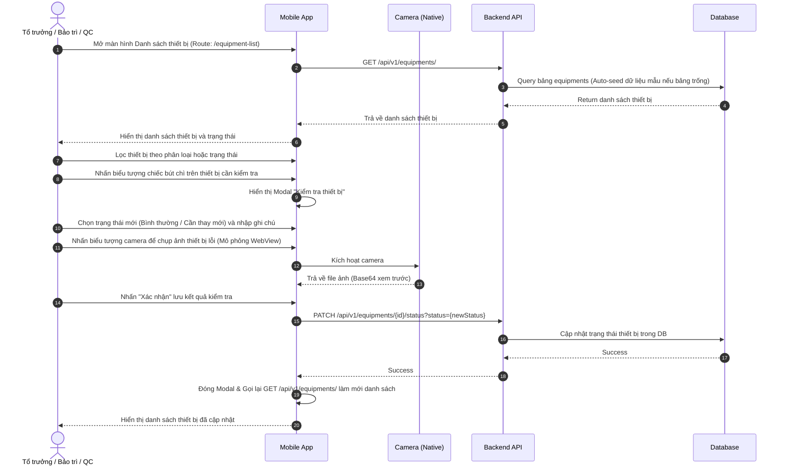

Người dùng truy cập trang danh sách thiết bị. Ứng dụng tải danh sách thiết bị hiện có từ database.
2. Người dùng sử dụng các bộ lọc để tìm kiếm thiết bị cần kiểm tra.
3. Muốn cập nhật trạng thái thiết bị, người dùng nhấn biểu tượng chiếc bút chì trên dòng tương ứng:
   * Hệ thống hiển thị Modal "Kiểm tra thiết bị".
   * Người dùng chọn kết quả: "Bình thường" (màu xanh) hoặc "Cần thay mới" (màu đỏ).
   * Nhập thêm ghi chú mô tả và nhấn biểu tượng camera để đính kèm ảnh chụp hiện trạng thiết bị.
4. Nhấn **Xác nhận**: Hệ thống gọi API cập nhật trạng thái thiết bị lên máy chủ.
5. Sau khi lưu thành công, Modal đóng lại và ứng dụng tự động làm mới danh sách thiết bị.* Frontend gọi API `GET /api/v1/equipments/` để lấy danh sách thiết bị.
* Khi lưu kết quả kiểm tra, Frontend thực hiện request dạng `PATCH /api/v1/equipments/{id}/status?status={newStatus}` để đổi trạng thái thiết bị trong cơ sở dữ liệu.
* Nút chụp ảnh minh chứng kích hoạt hộp thoại chọn file của trình duyệt để mô phỏng camera trên môi trường WebView.

---

### 4.16.5 API liên quan

| Method | Endpoint | Mục đích |
| :--- | :--- | :--- |
| GET | `/api/v1/equipments/` | Lấy danh sách thiết bị xưởng. Định nghĩa tại [get_equipments](file:///e:/Work/SmartFlow-dev%20%281%29/SmartFlow-dev/BackEnd/src/app/api/v1/endpoints/equipment_router.py#L9-L56). |
| PATCH | `/api/v1/equipments/{equipment_id}/status` | Cập nhật trạng thái thiết bị. Định nghĩa tại [update_equipment_status](file:///e:/Work/SmartFlow-dev%20%281%29/SmartFlow-dev/BackEnd/src/app/api/v1/endpoints/equipment_router.py#L58-L69). |

---

### 4.16.6 Database liên quan

| Bảng | Mục đích |
| :--- | :--- |
| ``equipments`` | Lưu trữ máy móc thiết bị xưởng. Ánh xạ qua Model [Equipment](file:///e:/Work/SmartFlow-dev%20%281%29/SmartFlow-dev/BackEnd/src/app/models/equipment.py#L5). |

---

### 4.16.7 Business Rules

| Điều kiện | Mô tả |
| :--- | :--- |
| Quy tắc chung | Backend triển khai cơ chế tự động chèn dữ liệu mẫu (Auto-seed) gồm 10 thiết bị cơ bản nếu phát hiện bảng `equipments` trong cơ sở dữ liệu hoàn toàn trống để tránh lỗi giao diện cho người dùng đầu tiên. |

---

### 4.16.8 File code liên quan

**Frontend:**
* [EquipmentList](file:///e:/Work/SmartFlow-dev%20%281%29/SmartFlow-dev/Mobile/src/Views/screens/MB10_EquipmentList.jsx)

**Backend:**
* [equipment_router.py](file:///e:/Work/SmartFlow-dev%20%281%29/SmartFlow-dev/BackEnd/src/app/api/v1/endpoints/equipment_router.py)

> [!NOTE]
> **Ghi chú Dev:**
> Hiện tại ảnh chụp minh chứng trong Modal kiểm tra thiết bị mới chỉ được mô phỏng hiển thị trên UI và chưa được gửi lên server trong API PATCH. Cần mở rộng API PATCH hoặc tạo API upload riêng để lưu trữ ảnh thiết bị lỗi lên máy chủ khi nâng cấp.

---

## 4.17 MH17_MB11_QualityInspectionDetail — Kiểm tra chất lượng chi tiết (Mobile)

### 4.17.1 Mục đích màn hình
Màn hình cung cấp giao diện đo đạc, kiểm định chuyên sâu cho từng chỉ tiêu kỹ thuật cụ thể (độ ẩm, độ phẳng, kết cấu, kích thước...) của một lô hàng đang bàn giao, hỗ trợ chụp ảnh lỗi thực tế làm bằng chứng trực quan.

---

### 4.17.2 Thông tin màn hình

| Thuộc tính | Nội dung |
| :--- | :--- |
| Mã màn hình | MB11 |
| Route | `/quality-detail/:id/:category` |
| Module | Kiểm định chất lượng giao nhận (QC Deliveries) |
| Người dùng sử dụng | Nhân viên QC (Quality Control) |

---

### 4.17.3 Chức năng chính

| STT | Chức năng | Mô tả |
| :--- | :--- | :--- |
| 1 | Hướng dẫn kiểm tra trực quan: | Hiển thị chi tiết yêu cầu kỹ thuật và phương pháp đo đạc chuẩn (HDKT) cho từng hạng mục kiểm tra cụ thể. |
| 2 | Đánh giá Đạt/Fail nhanh: | Nút bấm chọn kết luận kiểm tra nhanh dạng trượt đổi màu nổi bật (Xanh lá cho Đạt, Đỏ cho Fail). |
| 3 | Chụp ảnh bằng chứng hàng loạt: | Cho phép chụp tối đa 10 ảnh minh chứng lỗi (đối với QC) hoặc 40 ảnh (đối với tài khoản kiểm tra đặc biệt) trực tiếp bằng camera. |
| 4 | Nén ảnh tự động: | Tự động nén ảnh chụp xuống chất lượng 70% trên Canvas trước khi xử lý nhằm giảm thiểu lưu lượng mạng và dung lượng lưu trữ trên máy chủ. |
| 5 | Lưu trữ tạm thời (Offline Pending Store): | Kết quả và ảnh chụp được lưu trữ tạm thời tại bộ nhớ cục bộ ứng dụng, tránh mất dữ liệu khi mất kết nối mạng và không gọi API lưu trực tiếp từ màn hình này. |

---

### 4.17.4 Luồng xử lý hệ thống

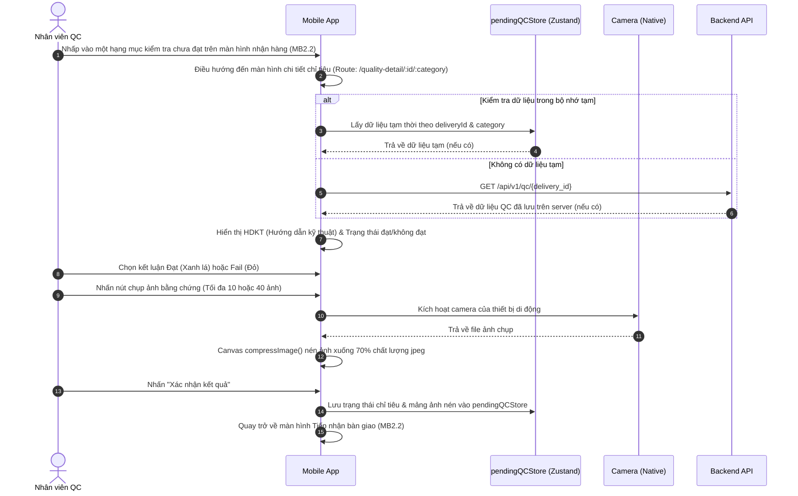

Người dùng tại màn hình Tiếp nhận bàn giao (`MB2.2`) click vào một hạng mục kiểm tra chưa hoàn thành.
2. Ứng dụng chuyển hướng đến màn hình kiểm tra chi tiết hạng mục đó.
3. Hệ thống nạp dữ liệu theo thứ tự ưu tiên:
   * **Ưu tiên 1:** Lấy dữ liệu tạm thời chưa lưu từ `pendingQCStore` (nếu có).
   * **Ưu tiên 2:** Gọi API lấy dữ liệu QC đã được lưu trên máy chủ từ trước làm dữ liệu dự phòng.
4. QC đọc hướng dẫn kỹ thuật hiển thị tương ứng với hạng mục kiểm tra (ví dụ: đo độ ẩm gỗ yêu cầu 8-12%).
5. QC bấm chọn kết luận Đạt hoặc Fail.
6. QC bấm chụp ảnh bằng chứng (bắt buộc chụp từ camera thực tế):
   * Ảnh chụp được nén tự động trên Canvas xuống 70% chất lượng ban đầu.
   * Hiển thị danh sách ảnh kèm số lượng thực tế. Có thể xóa các ảnh chụp lỗi bằng cách nhấn dấu "x".
7. Nhấn **Xác nhận kết quả**: Hệ thống lưu toàn bộ dữ liệu chỉ tiêu này (trạng thái đạt, mảng ảnh cũ, mảng ảnh mới) vào `pendingQCStore` dưới dạng khóa là ID phiếu bàn giao và quay trở lại màn hình chính Tiếp nhận bàn giao.* Trình duyệt hoặc thiết bị di động ép mở camera thông qua `<input type="file" accept="image/*" capture="environment" />`.
* Logic nén ảnh động sử dụng hàm [compressImage](file:///e:/Work/SmartFlow-dev%20%281%29/SmartFlow-dev/Mobile/src/Views/screens/MB11_QualityInspectionDetail.jsx#L93-L133) dựng trên HTML5 Canvas để thay đổi kích thước ảnh (tối đa 1024x1024px) và xuất ra Blob dưới định dạng `image/jpeg` chất lượng 0.7.
* Cơ chế lưu trữ tạm: Sử dụng [pendingQCStore](file:///e:/Work/SmartFlow-dev%20%281%29/SmartFlow-dev/Mobile/src/store/pendingQCStore.js) lưu giữ trạng thái trong bộ nhớ RAM của ứng dụng SPA.

---

### 4.17.5 API liên quan

| Method | Endpoint | Mục đích |
| :--- | :--- | :--- |
| GET | `/api/v1/qc/{delivery_id}` | Gọi dự phòng khi load trang để lấy thông tin kết quả QC đã có sẵn. Định nghĩa tại [get_qc_results](file:///e:/Work/SmartFlow-dev%20%281%29/SmartFlow-dev/BackEnd/src/app/api/v1/endpoints/qc_router.py#L173-L190). |

---

### 4.17.6 Database liên quan

| Bảng | Mục đích |
| :--- | :--- |
| ``delivery_qc`` | Lưu trữ trạng thái kết quả QC dạng JSON. Ánh xạ qua Model [DeliveryQC](file:///e:/Work/SmartFlow-dev%20%281%29/SmartFlow-dev/BackEnd/src/app/models/delivery_qc.py#L7). |
| ``delivery_images`` | Lưu trữ đường dẫn ảnh minh chứng QC (có `description` dạng `qc_{category}`). Ánh xạ qua Model [DeliveryImage](file:///e:/Work/SmartFlow-dev%20%281%29/SmartFlow-dev/BackEnd/src/app/models/delivery_images.py#L6). |

---

### 4.17.7 Business Rules

| Điều kiện | Mô tả |
| :--- | :--- |
| Quy tắc chung | Yêu cầu bắt buộc QC phải chọn kết luận Đạt hoặc Fail trước khi nhấn lưu kết quả. |
| Quy tắc chung | Giới hạn số lượng ảnh tối đa: 10 ảnh đối với vai trò QC thông thường và 40 ảnh đối với các vai trò kiểm tra đặc biệt khác. |

---

### 4.17.8 File code liên quan

**Frontend:**
* [QualityInspectionDetail](file:///e:/Work/SmartFlow-dev%20%281%29/SmartFlow-dev/Mobile/src/Views/screens/MB11_QualityInspectionDetail.jsx)

**Backend:**
* [qc_router.py](file:///e:/Work/SmartFlow-dev%20%281%29/SmartFlow-dev/BackEnd/src/app/api/v1/endpoints/qc_router.py)

**State / Store / Services:**
* [pendingQCStore.js](file:///e:/Work/SmartFlow-dev%20%281%29/SmartFlow-dev/Mobile/src/store/pendingQCStore.js)

> [!NOTE]
> **Ghi chú Dev:**
> Lưu ý rằng màn hình này **hoàn toàn không gọi API để lưu kết quả lên DB khi bấm nút Xác nhận kết quả**. Nó chỉ cập nhật vào `pendingQCStore`. Việc lưu trữ thật sự lên Database được thực hiện tập trung tại màn hình cha `MB2.2_DeliveryReceive` khi người dùng bấm nút xác nhận cuối cùng của cả phiếu bàn giao.

---

## 4.18 MH18_MB12_ThermalPrint — In nhiệt (Mobile)

### 4.18.1 Mục đích màn hình
Màn hình chuyên biệt hỗ trợ in tem nhãn nhiệt dán trên các pallet hàng luân chuyển với kích thước khổ giấy tiêu chuẩn 58mm. Hỗ trợ hiển thị mã QR Code chứa ID phiếu giao nhận và thông tin tổng quát của lô hàng để quét nhanh tại các trạm kế tiếp.

---

### 4.18.2 Thông tin màn hình

| Thuộc tính | Nội dung |
| :--- | :--- |
| Mã màn hình | MB12 |
| Route | `/thermal-print` |
| Module | Quản lý bàn giao & In ấn (Deliveries & Print) |
| Người dùng sử dụng | Nhân viên sản xuất, Tổ trưởng |

---

### 4.18.3 Chức năng chính

| STT | Chức năng | Mô tả |
| :--- | :--- | :--- |
| 1 | Vẽ tem nhiệt khổ 58mm: | Thiết kế giao diện tem in tối ưu cho máy in nhiệt mini cầm tay (khổ rộng 58mm), hiển thị rõ ràng mã vạch/QR Code và các thông số linh kiện, số lượng. |
| 2 | Tự động kích hoạt in: | Tự động kích hoạt lệnh in ấn trình duyệt ngay sau khi dữ liệu của trang được tải hoàn tất (độ trễ 500ms). |
| 3 | Cơ chế in ấn WebView di động: | Tích hợp API cầu nối đặc biệt (Bridge) gửi mã HTML sang WebView lớp ngoài của ứng dụng Android để in trực tiếp thông qua máy in kết nối Bluetooth/USB mà không bị hệ điều hành chặn. |

---

### 4.18.4 Luồng xử lý hệ thống

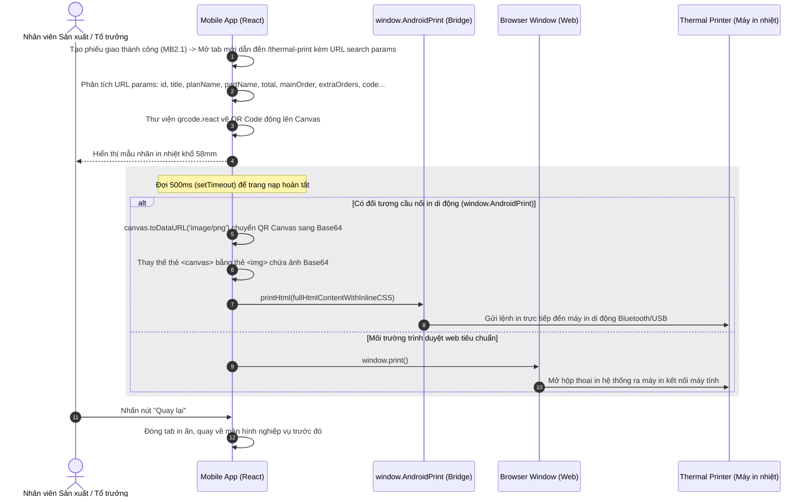

Sau khi nhân viên Sản xuất tạo phiếu giao thành công tại màn hình `MB2.1`, ứng dụng tự động mở một tab/cửa sổ mới dẫn đến route `/thermal-print` kèm theo đầy đủ các tham số thông tin phiếu qua URL params.
2. Ứng dụng phân tích URL params, hiển thị giao diện mẫu nhãn in gồm: tiêu đề, mã QR Code động, ID phiếu, tên linh kiện, số lượng tổng và danh sách đơn hàng chính phụ.
3. Sau 500ms kể từ khi trang nạp thành công:
   * Nếu đang chạy trong WebView của ứng dụng Android có hỗ trợ cầu nối in (`window.AndroidPrint.printHtml`), hệ thống sẽ chuyển đổi thành phần Canvas vẽ QR Code sang dạng ảnh Base64, chèn kèm CSS định dạng trang in và gọi hàm cầu nối để in trực tiếp.
   * Nếu ở môi trường trình duyệt web tiêu chuẩn: Kích hoạt hộp thoại in ấn mặc định của trình duyệt (`window.print()`).
4. Người dùng có thể nhấn nút "Quay lại" ở đầu trang để đóng tab in ấn và quay lại màn hình nghiệp vụ trước đó.* Sử dụng thư viện `qrcode.react` (thành phần `QRCodeCanvas`) để vẽ mã QR động lên màn hình.
* **Ultimate Print Fix:** WebView của Android mặc định chặn lệnh `window.print()`. Ứng dụng giải quyết bằng cách phát hiện đối tượng cầu nối `window.AndroidPrint`. Đoạn mã canvas QR được chuyển đổi thành chuỗi Base64 qua phương thức `canvas.toDataURL('image/png')` rồi chèn thay thế thẻ `<canvas>` bằng thẻ `` trước khi gửi toàn bộ chuỗi HTML kèm CSS inline sang phía native Android để máy in nhiệt hoạt động chính xác.
* Tự động kích hoạt in được bọc trong hook `useEffect` có cài đặt `setTimeout` 500ms.

---

### 4.18.5 API liên quan

| Method | Endpoint | Mục đích |
| :--- | :--- | :--- |

---

### 4.18.6 Database liên quan

| Bảng | Mục đích |
| :--- | :--- |

---

### 4.18.7 Business Rules

| Điều kiện | Mô tả |
| :--- | :--- |
| Quy tắc chung | Yêu cầu tham số `id` bắt buộc phải tồn tại trong URL Search Params. Nếu không có `id`, màn hình sẽ chặn xử lý và hiển thị thông báo lỗi "Không tìm thấy mã phiếu!". |

---

### 4.18.8 File code liên quan

**Frontend:**
* [ThermalPrint](file:///e:/Work/SmartFlow-dev%20%281%29/SmartFlow-dev/Mobile/src/Views/screens/MB12_ThermalPrint.jsx)

> [!NOTE]
> **Ghi chú Dev:**
> Tệp tin CSS in sử dụng media query `@media print` với cấu hình `@page { size: 58mm auto; margin: 0; }` để triệt tiêu các thông tin header/footer mặc định của trình duyệt (như ngày in, tiêu đề trang) giúp tem in ra sạch sẽ và vừa vặn với giấy nhiệt.
