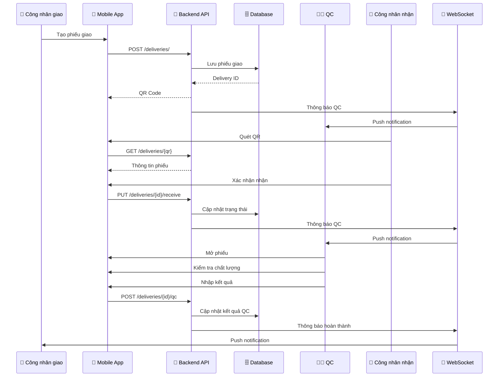

# Delivery Flow

Tài liệu này mô tả chi tiết luồng bàn giao linh kiện trong SmartFlow v2.

---

## 📋 Mục lục (Table of Contents)

1. [Tổng quan](#-tổng-quánverview)
2. [Sequence Diagram](#-sequence-diagram)
3. [Các bước trong luồng](#-các-bước-trong-luồng)
4. [Trạng thái phiếu giao](#-trạng-thái-phiếu-giao)
5. [API Endpoints](#-api-endpoints)

---

## 🎯 Tổng quan (Overview)

Luồng bàn giao cho phép công nhân tạo phiếu giao linh kiện giữa các công đoạn sản xuất.

**Các vai trò tham gia:**
- Công nhân giao (Delivery Person)
- Công nhân nhận (Receiving Person)
- QC (Quality Control)
- Quản lý (Manager)

---

## 🔄 Sequence Diagram



---

## 📝 Các bước trong luồng

### 1. Tạo Phiếu Giao

**Công nhân giao thực hiện:**
1. Mở Mobile App
2. Chọn "Tạo phiếu giao"
3. Chọn kế hoạch sản xuất
4. Chọn công đoạn giao và nhận
5. Chọn linh kiện cần giao
6. Nhập số lượng
7. Chụp ảnh minh chứng
8. Nhập ghi chú (nếu có)
9. Gửi phiếu

**Kết quả:**
- Phiếu giao được tạo với trạng thái "Chờ xác nhận"
- QR code được tạo và hiển thị
- Thông báo được gửi đến QC

### 2. Quét Mã QR

**Công nhân nhận thực hiện:**
1. Mở Mobile App
2. Chọn "Nhận phiếu giao"
3. Quét mã QR từ phiếu
4. Xem thông tin phiếu

**Kết quả:**
- Thông tin phiếu giao được hiển thị
- Có thể xem ảnh minh chứng

### 3. Xác Nhận Nhận Hàng

**Công nhân nhận thực hiện:**
1. Kiểm tra số lượng thực nhận
2. Nhập số lượng nhận được
3. Nhập ghi chú (nếu có)
4. Xác nhận nhận hàng

**Kết quả:**
- Phiếu giao chuyển sang trạng thái "Đã nhận"
- Thông báo được gửi đến QC

### 4. Kiểm Tra Chất Lượng

**QC thực hiện:**
1. Mở thông báo từ phiếu giao
2. Xem thông tin phiếu
3. Thực hiện kiểm tra theo checklist
4. Nhập kết quả kiểm tra
5. Ghi chú lỗi (nếu có)
6. Lưu kết quả

**Kết quả:**
- Phiếu giao chuyển sang trạng thái "Hoàn thành" hoặc "Lỗi"
- Thông báo được gửi đến công nhân giao

### 5. Hoàn Thành

**Khi phiếu giao hoàn thành:**
- Số lượng được cập nhật trong hệ thống
- KPI được ghi nhận
- Thống kê được cập nhật

---

## 📊 Trạng thái Phiếu Giao

| Trạng thái | Mô tả | AI có thể chuyển |
|------------|-------|-----------------|
| `Chờ xác nhận` | Phiếu mới tạo, chờ nhận | → Đã nhận |
| `Đã nhận` | Đã được công nhân nhận | → Hoàn thành, Lỗi |
| `Hoàn thành` | QC kiểm tra đạt | - |
| `Lỗi` | QC kiểm tra không đạt | → Hoàn thành (sau sửa) |

---

## 🔌 API Endpoints

### Tạo Phiếu Giao

```
POST /api/v1/deliveries/
Content-Type: multipart/form-data
```

**Request:**
```
plan_id: 1
delivery_stage: "Định hình"
receiving_stage: "Lắp ráp"
part_name: "Chân ghế"
quantity_total: 100
specification: "Gỗ sồi, 50x50mm"
note: "Giao buổi sáng"
files: [image1.jpg, image2.jpg]
```

**Response:**
```json
{
  "id": 123,
  "qr_code": "DLV-20260603-001",
  "backup_qr": "DLV-BACKUP-001",
  "status": "Chờ xác nhận"
}
```

### Xác Nhận Nhận Hàng

```
PUT /api/v1/deliveries/{id}/receive
```

**Request:**
```json
{
  "quantity_received": 98,
  "note": "Nhận đủ, 2 bị hỏng"
}
```

### QC Kiểm Tra

```
POST /api/v1/deliveries/{id}/qc
```

**Request:**
```json
{
  "result": "Đạt",
  "quantity_error": 2,
  "quantity_returned": 0,
  "note": "2 cái bị sước nhẹ, vẫn dùng được"
}
```

---

## ⚠️ Xử lý ngoại lệ

### Phiếu giao không tìm thấy

- Kiểm tra lại mã QR
- Yêu cầu công nhân giao cung cấp mã dự phòng

### Số lượng không khớp

- Công nhân nhận ghi chú rõ lý do
- QC kiểm tra và xác nhận

### Lỗi chất lượng

- Phiếu chuyển sang trạng thái "Lỗi"
- Tạo phiếu trả hàng mới
- Công nhân giao sửa và giao lại

---

**Last Updated:** 2026-06-03
