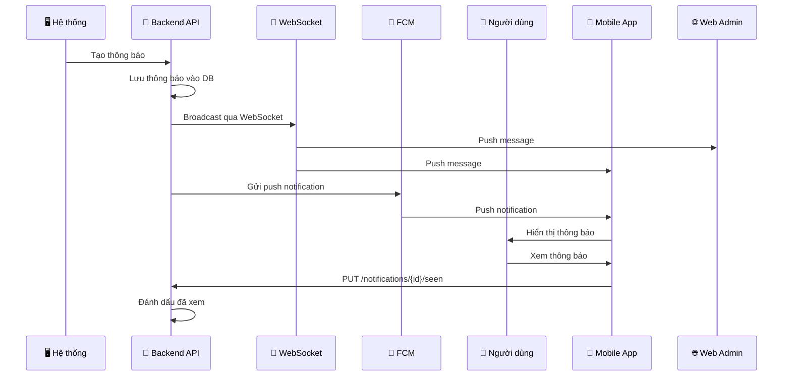

# Notification Flow

Tài liệu này mô tả chi tiết luồng thông báo trong SmartFlow v2.

---

## 📋 Mục lục (Table of Contents)

1. [Tổng quan](#-tổng-quánverview)
2. [Sequence Diagram](#-sequence-diagram)
3. [Các bước trong luồng](#-các-bước-trong-luồng)
4. [Loại thông báo](#-loại-thông-báo)
5. [API Endpoints](#-api-endpoints)

---

## 🎯 Tổng quan (Overview)

Luồng thông báo quản lý việc gửi và nhận thông báo thời gian thực trong hệ thống.

**Các vai trò tham gia:**
- Hệ thống (System)
- Người dùng (User)
- Backend API
- WebSocket Server
- FCM (Firebase Cloud Messaging)

---

## 🔄 Sequence Diagram



---

## 📝 Các bước trong luồng

### 1. Tạo Thông Báo

**Hệ thống tự động tạo thông báo khi:**
- Phiếu giao mới được tạo
- Phiếu giao được nhận
- Phiếu giao hoàn thành QC
- Đơn hàng hoàn thành
- Kế hoạch mới được tạo
- Sự cố CAPA xảy ra

**Kết quả:**
- Thông báo được lưu vào database
- Thông báo được gửi qua WebSocket
- Push notification được gửi qua FCM

### 2. Nhận Thông Báo

**Người dùng nhận thông báo qua:**
- **WebSocket**: Thời gian thực khi app đang mở
- **FCM Push**: Khi app ở background
- **Badge count**: Số thông báo chưa đọc

**Kết quả:**
- Thông báo hiển thị trên thiết bị
- Badge count được cập nhật
- Danh sách thông báo được cập nhật

### 3. Xem Thông Báo

**Người dùng thực hiện:**
1. Click vào thông báo
2. Mở chi tiết thông báo
3. Xem nội dung thông báo
4. Click action button (nếu có)

**Kết quả:**
- Thông báo được đánh dấu đã xem
- Badge count giảm
- Điều hướng đến màn hình liên quan

### 4. Đánh Dấu Đã Xem

**Hệ thống tự động đánh dấu:**
- Khi người dùng mở thông báo
- Khi người dùng xem danh sách thông báo

**Kết quả:**
- Thông báo chuyển sang trạng thái "Đã xem"
- Badge count được cập nhật

---

## 🔔 Loại Thông Báo

### 1. Thông Báo Phiếu Giao

**Trigger:**
- Phiếu giao mới được tạo
- Phiếu giao được nhận
- Phiếu giao hoàn thành QC

**Nội dung:**
- Tên phiếu giao
- Công đoạn giao/nhận
- Số lượng
- Trạng thái

**Action:**
- Mở chi tiết phiếu giao

### 2. Thông Báo Đơn Hàng

**Trigger:**
- Đơn hàng mới được tạo
- Đơn hàng hoàn thành
- Đơn hàng quá hạn

**Nội dung:**
- Mã đơn hàng
- Khách hàng
- Ngày giao hàng
- Trạng thái

**Action:**
- Mở chi tiết đơn hàng

### 3. Thông Báo Kế Hoạch

**Trigger:**
- Kế hoạch mới được tạo
- Kế hoạch hoàn thành
- Kế hoạch quá hạn

**Nội dung:**
- Mã kế hoạch
- Tháng/Năm
- Tiến độ
- Trạng thái

**Action:**
- Mở chi tiết kế hoạch

### 4. Thông Báo CAPA

**Trigger:**
- Sự cố CAPA mới
- Hành động khắc phục đến hạn
- CAPA hoàn thành

**Nội dung:**
- Mã sự cố
- Mô tả
- Mức độ nghiêm trọng
- Hạn xử lý

**Action:**
- Mở chi tiết CAPA

---

## 📊 Trạng thái Thông Báo

| Trạng thái | Mô tả |
|------------|-------|
| `Chưa xem` | Thông báo mới, chưa được xem |
| `Đã xem` | Đã được người dùng xem |

---

## 🔌 API Endpoints

### Lấy Danh Sách Thông Báo

```
GET /api/v1/notifications/
```

**Query Parameters:**
- `skip` (optional): Số bản ghi bỏ qua (default: 0)
- `limit` (optional): Số bản ghi lấy (default: 20)
- `unread_only` (optional): Chỉ thông báo chưa đọc

**Response:**
```json
{
  "total": 50,
  "skip": 0,
  "limit": 20,
  "unread_count": 5,
  "items": [
    {
      "id": 1,
      "title": "Phiếu giao mới",
      "message": "Bạn có 1 phiếu giao mới cần xác nhận",
      "type": "delivery",
      "created_at": "2026-06-03T10:30:00",
      "is_read": false
    }
  ]
}
```

### Đánh Dấu Đã Xem

```
PUT /api/v1/notifications/{id}/seen
```

**Response:**
```json
{
  "id": 1,
  "is_read": true,
  "seen_at": "2026-06-03T10:35:00"
}
```

### Cập Nhật FCM Token

```
POST /api/v1/notifications/fcm-token
```

**Request:**
```json
{
  "fcm_token": "new_fcm_token_here"
}
```

---

## 🔌 WebSocket

### Kết Nối WebSocket

**URL:**
```
ws://localhost:8000/ws/{user_id}
```

**Message Format:**
```json
{
  "type": "notification",
  "data": {
    "id": 1,
    "title": "Phiếu giao mới",
    "message": "Bạn có 1 phiếu giao mới cần xác nhận",
    "type": "delivery"
  }
}
```

### Heartbeat

**Interval:** 30 giây

**Message:**
```json
{
  "type": "ping"
}
```

---

## 📈 Thống Kê Thông Báo

### Thống kê theo loại

```
GET /api/v1/reports/notifications?type=delivery
```

### Thống kê theo người dùng

```
GET /api/v1/reports/notifications/user?user_id=1
```

---

## ⚠️ Xử lý ngoại lệ

### Không nhận được thông báo

- Kiểm tra kết nối internet
- Kiểm tra quyền thông báo
- Kiểm tra FCM token

### Thông báo trùng lặp

- Hệ thống tự động loại bỏ trùng
- Dựa trên ID thông báo

---

**Last Updated:** 2026-06-03
