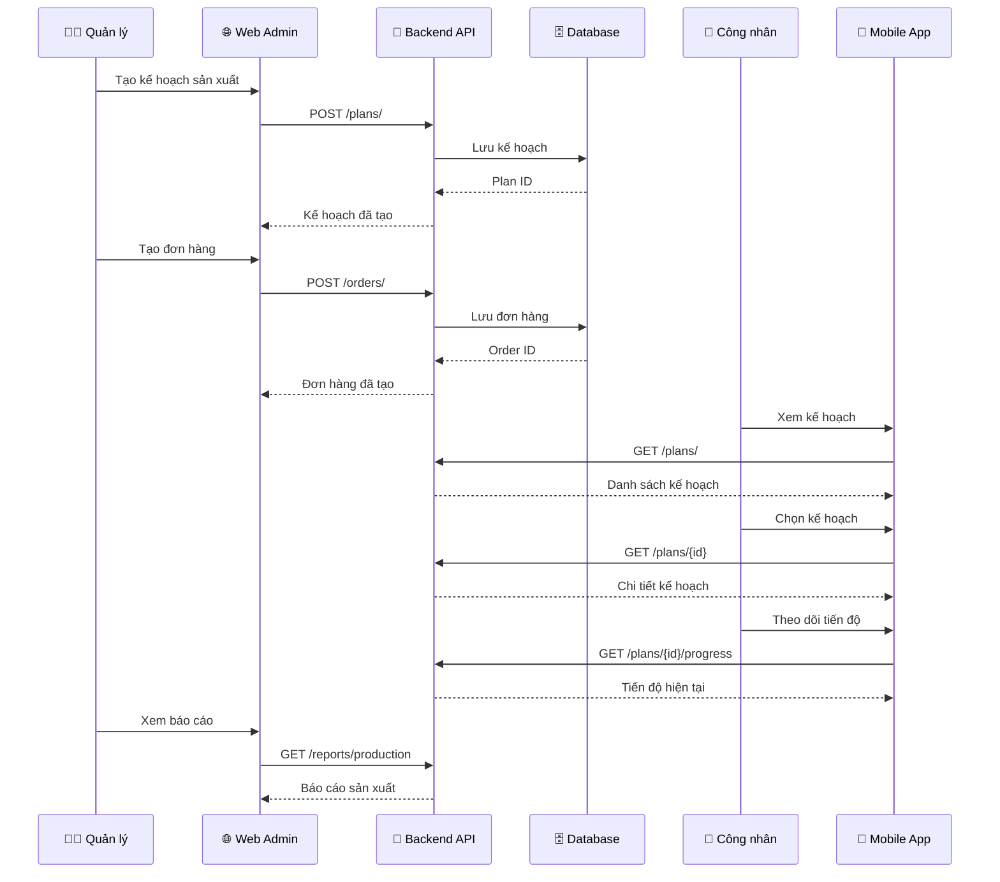

# Production Flow

Tài liệu này mô tả chi tiết luồng sản xuất trong SmartFlow v2.

---

## 📋 Mục lục (Table of Contents)

1. [Tổng quan](#-tổng-quánverview)
2. [Sequence Diagram](#-sequence-diagram)
3. [Các bước trong luồng](#-các-bước-trong-luồng)
4. [Trạng thái đơn hàng](#-trạng-thái-đơn-hàng)
5. [API Endpoints](#-api-endpoints)

---

## 🎯 Tổng quan (Overview)

Luồng sản xuất quản lý toàn bộ quy trình từ kế hoạch sản xuất đến hoàn thành đơn hàng.

**Các vai trò tham gia:**
- Quản lý (Manager)
- Kế hoạch (Planner)
- Công nhân (Worker)
- QC (Quality Control)

---

## 🔄 Sequence Diagram



---

## 📝 Các bước trong luồng

### 1. Tạo Kế Hoạch Sản Xuất

**Quản lý thực hiện:**
1. Đăng nhập Web Admin
2. Chọn "Kế hoạch sản xuất"
3. Click "Tạo kế hoạch mới"
4. Nhập thông tin:
   - Mã kế hoạch
   - Tên kế hoạch
   - Tháng/Năm
   - Ngày dự kiến hoàn thành
5. Lưu kế hoạch

**Kết quả:**
- Kế hoạch sản xuất được tạo
- Trạng thái: "Mới"
- Có thể thêm đơn hàng vào kế hoạch

### 2. Tạo Đơn Hàng

**Quản lý thực hiện:**
1. Chọn kế hoạch đã tạo
2. Click "Thêm đơn hàng"
3. Nhập thông tin đơn hàng:
   - Mã đơn hàng
   - Mã lệnh sản xuất
   - Khách hàng
   - Ngày giao hàng
   - Sản phẩm
   - Số lượng
4. Đánh dấu ưu tiên (nếu cần)
5. Lưu đơn hàng

**Kết quả:**
- Đơn hàng được tạo và gán vào kế hoạch
- Trạng thái: "Chờ sản xuất"
- Điểm ưu tiên được tính toán

### 3. Theo Dõi Tiến Độ

**Công nhân thực hiện:**
1. Mở Mobile App
2. Chọn "Theo dõi kế hoạch"
3. Xem danh sách kế hoạch
4. Chọn kế hoạch cần theo dõi
5. Xem tiến độ:
   - Tổng số đơn hàng
   - Đơn hàng hoàn thành
   - Đơn hàng đang làm
   - Đơn hàng chờ
   - Tiến độ theo công đoạn

**Kết quả:**
- Tiến độ thời gian thực được hiển thị
- Có thể xem chi tiết từng đơn hàng

### 4. Cập Nhật Trạng Thái

**Công nhân thực hiện:**
1. Chọn đơn hàng đang làm
2. Cập nhật trạng thái:
   - "Đang làm" khi bắt đầu
   - "Hoàn thành" khi xong
3. Nhập số lượng hoàn thành
4. Lưu cập nhật

**Kết quả:**
- Trạng thái đơn hàng được cập nhật
- Tiến độ kế hoạch được tính lại
- Thông báo được gửi đến quản lý

### 5. Hoàn Thành Kế Hoạch

**Khi tất cả đơn hàng hoàn thành:**
1. Quản lý kiểm tra tiến độ
2. Xác nhận hoàn thành kế hoạch
3. Lưu ngày hoàn thành
4. Xuất báo cáo

**Kết quả:**
- Kế hoạch chuyển sang trạng thái "Hoàn thành"
- Báo cáo được tạo
- KPI được ghi nhận

---

## 📊 Trạng thái Đơn Hàng

| Trạng thái | Mô tả | AI có thể chuyển |
|------------|-------|-----------------|
| `Chờ sản xuất` | Đơn hàng mới tạo | → Đang làm |
| `Đang làm` | Đang được sản xuất | → Hoàn thành, Tạm dừng |
| `Tạm dừng` | Tạm dừng sản xuất | → Đang làm, Hủy |
| `Hoàn thành` | Đã hoàn thành | - |
| `Hủy` | Đã hủy | - |

---

## 📊 Trạng thái Kế Hoạch

| Trạng thái | Mô tả | AI có thể chuyển |
|------------|-------|-----------------|
| `Mới` | Kế hoạch mới tạo | → Đang làm |
| `Đang làm` | Đang được thực hiện | → Hoàn thành |
| `Hoàn thành` | Đã hoàn thành | - |

---

## 🔌 API Endpoints

### Tạo Kế Hoạch

```
POST /api/v1/plans/
```

**Request:**
```json
{
  "code": "KHSX-07-2026",
  "name": "Kế hoạch tháng 7",
  "month": 7,
  "year": 2026,
  "estimated_date": "2026-07-31T00:00:00"
}
```

### Tạo Đơn Hàng

```
POST /api/v1/orders/
```

**Request:**
```json
{
  "order_code": "PO-2026-002",
  "production_code": "SX-2026-002",
  "customer": "Khách hàng B",
  "delivery_date": "2026-07-15T00:00:00",
  "estimated_date": "2026-07-10T00:00:00",
  "plan_id": 1,
  "is_priority": 0
}
```

### Lấy Tiến Độ

```
GET /api/v1/plans/{id}/progress
```

**Response:**
```json
{
  "plan_id": 1,
  "total_orders": 10,
  "completed_orders": 3,
  "in_progress_orders": 5,
  "pending_orders": 2,
  "overall_progress": 50,
  "stage_progress": [
    {"stage": "Định hình", "progress": 80},
    {"stage": "Lắp ráp", "progress": 50}
  ]
}
```

---

## 📈 Báo Cáo Sản Xuất

### Báo cáo theo tháng

```
GET /api/v1/reports/production?month=6&year=2026
```

### Báo cáo theo công đoạn

```
GET /api/v1/reports/production/stage?stage=Định hình
```

### Báo cáo theo nhân viên

```
GET /api/v1/reports/production/worker?worker_id=1
```

---

## ⚠️ Xử lý ngoại lệ

### Đơn hàng chậm tiến độ

- Hệ thống cảnh báo khi quá hạn
- Quản lý điều chỉnh kế hoạch
- Tăng cường nhân lực

### Đơn hàng bị hủy

- Cập nhật trạng thái
- Giải phóng tài nguyên
- Cập nhật kế hoạch

---

**Last Updated:** 2026-06-03
