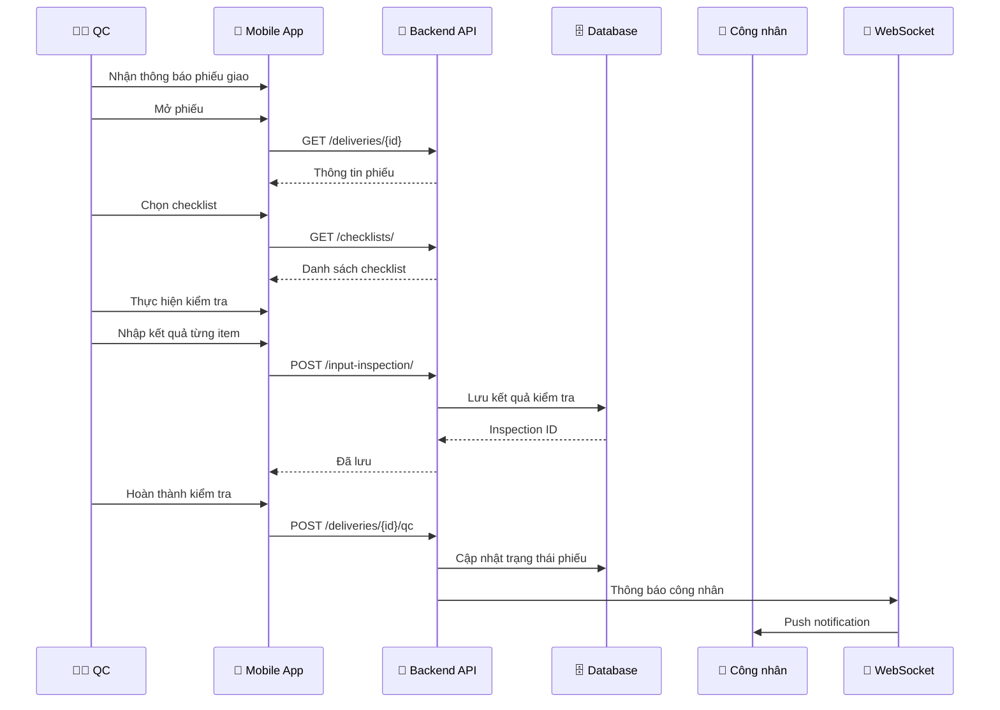

# QC Flow

Tài liệu này mô tả chi tiết luồng kiểm tra chất lượng trong SmartFlow v2.

---

## 📋 Mục lục (Table of Contents)

1. [Tổng quan](#-tổng-quánverview)
2. [Sequence Diagram](#-sequence-diagram)
3. [Các bước trong luồng](#-các-bước-trong-luồng)
4. [Loại kiểm tra](#-loại-kiểm-tra)
5. [API Endpoints](#-api-endpoints)

---

## 🎯 Tổng quan (Overview)

Luồng QC quản lý các hoạt động kiểm tra chất lượng trong quy trình sản xuất.

**Các vai trò tham gia:**
- QC (Quality Control)
- Công nhân giao (Delivery Person)
- Công nhân nhận (Receiving Person)
- Quản lý (Manager)

---

## 🔄 Sequence Diagram



---

## 📝 Các bước trong luồng

### 1. Nhận Thông Báo

**QC thực hiện:**
1. Nhận thông báo từ hệ thống
2. Xem thông tin phiếu giao
3. Mở phiếu để kiểm tra

**Kết quả:**
- Thông tin phiếu giao được hiển thị
- Có thể xem ảnh minh chứng

### 2. Chọn Checklist

**QC thực hiện:**
1. Chọn loại checklist phù hợp:
   - Kiểm tra đầu vào
   - Kiểm tra công đoạn
   - Kiểm tra hàng ngày
2. Xem danh sách items cần kiểm tra

**Kết quả:**
- Checklist được tải
- Items kiểm tra được hiển thị

### 3. Thực Hiện Kiểm Tra

**QC thực hiện:**
1. Kiểm tra từng item trong checklist
2. Đánh giá kết quả:
   - Đạt
   - Không đạt
3. Nếu không đạt:
   - Chọn loại lỗi
   - Nhập số lượng lỗi
   - Ghi chú chi tiết
4. Lưu kết quả từng item

**Kết quả:**
- Kết quả kiểm tra được lưu
- Có thể chỉnh sửa trước khi hoàn thành

### 4. Hoàn Thành Kiểm Tra

**QC thực hiện:**
1. Xem lại tất cả kết quả
2. Nhập kết quả tổng thể:
   - Đạt
   - Không đạt
3. Nhập số lượng tổng kiểm tra
4. Nhập số lượng tổng lỗi
5. Nhập số lượng trả về (nếu có)
6. Ghi chú tổng thể
7. Lưu kết quả

**Kết quả:**
- Phiếu giao chuyển trạng thái
- Thông báo được gửi đến công nhân
- KPI được ghi nhận

---

## 🔍 Loại Kiểm Tra

### 1. Kiểm Tra Đầu Vào (Input Inspection)

**Mục đích:** Kiểm tra linh kiện khi nhận từ công đoạn trước

**Checklist:**
- Kiểm tra kích thước
- Kiểm tra bề mặt
- Kiểm tra màu sắc
- Kiểm tra độ ẩm
- Kiểm tra số lượng

### 2. Kiểm Tra Công Đoạn (Stage Inspection)

**Mục đích:** Kiểm tra sản phẩm sau khi hoàn thành công đoạn

**Checklist:**
- Kiểm tra lắp ráp
- Kiểm tra độ chính xác
- Kiểm tra hoàn thiện
- Kiểm tra tem nhãn

### 3. Kiểm Tra Hàng Ngày (Daily Inspection)

**Mục đích:** Kiểm tra mẫu hàng ngày

**Checklist:**
- Kiểm tra mẫu ngẫu nhiên
- Kiểm tra quy cách
- Kiểm tra đóng gói

---

## 📊 Kết Quả Kiểm Tra

| Kết quả | Mô tả | Hành động tiếp theo |
|---------|-------|-------------------|
| `Đạt` | Tất cả kiểm tra đạt | Phiếu hoàn thành |
| `Không đạt` | Có lỗi phát hiện | Tạo phiếu trả hàng |
| `Cần kiểm tra lại` | Không chắc chắn | Kiểm tra lại |

---

## 🔌 API Endpoints

### Lấy Checklist

```
GET /api/v1/checklists/
```

**Query Parameters:**
- `type` (optional): Loại checklist (Input, Stage, Daily)

**Response:**
```json
{
  "items": [
    {
      "id": 1,
      "name": "Checklist Kiểm Tra Đầu Vào",
      "type": "Input",
      "items": [
        "Kiểm tra kích thước",
        "Kiểm tra bề mặt",
        "Kiểm tra màu sắc"
      ]
    }
  ]
}
```

### Tạo Kiểm Tra

```
POST /api/v1/input-inspection/
```

**Request:**
```json
{
  "delivery_id": 123,
  "checklist_id": 1,
  "quantity_checked": 98,
  "quantity_error": 2,
  "defect_type_id": 5,
  "result": "Lỗi",
  "note": "2 cái bị sước"
}
```

### Cập Nhật Kết Quả QC

```
POST /api/v1/deliveries/{id}/qc
```

**Request:**
```json
{
  "result": "Đạt",
  "quantity_error": 2,
  "quantity_returned": 0,
  "note": "2 cái bị sước nhẹ, vẫn dùng được"
}
```

---

## 📈 Thống Kê QC

### Thống kê lỗi theo loại

```
GET /api/v1/reports/qc/defects?start_date=2026-06-01&end_date=2026-06-30
```

### Thống kê theo công nhân

```
GET /api/v1/reports/qc/worker?worker_id=1
```

### Thống kê theo công đoạn

```
GET /api/v1/reports/qc/stage?stage=Định hình
```

---

## ⚠️ Xử lý ngoại lệ

### Lỗi nghiêm trọng

- Ngưng sử dụng linh kiện
- Báo cáo ngay cho quản lý
- Tạo CAPA nếu cần

### Lỗi nhẹ

- Ghi nhận lỗi
- Có thể sử dụng sau khi sửa
- Theo dõi kỹ hơn

---

**Last Updated:** 2026-06-03
