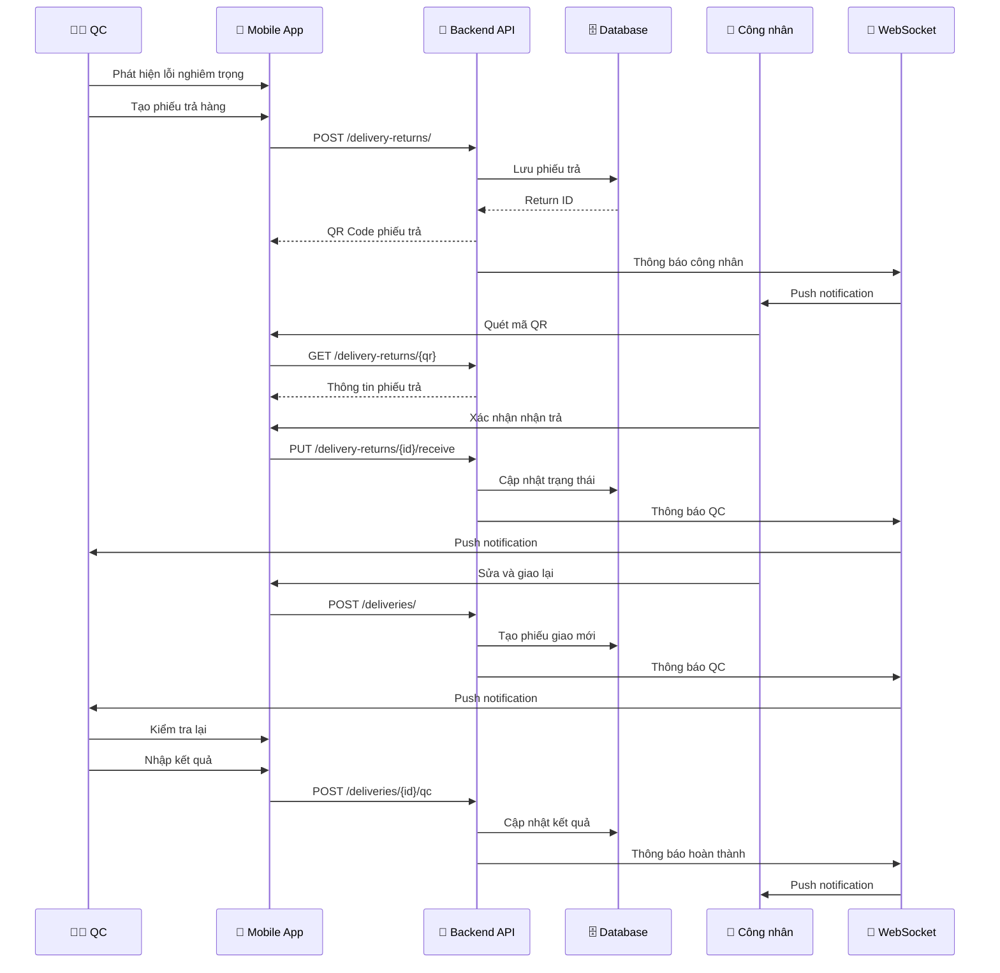

# Return Flow

Tài liệu này mô tả chi tiết luồng trả hàng trong SmartFlow v2.

---

## 📋 Mục lục (Table of Contents)

1. [Tổng quan](#-tổng-quánverview)
2. [Sequence Diagram](#-sequence-diagram)
3. [Các bước trong luồng](#-các-bước-trong-luồng)
4. [Trạng thái phiếu trả](#-trạng-thái-phiếu-trả)
5. [API Endpoints](#-api-endpoints)

---

## 🎯 Tổng quan (Overview)

Luồng trả hàng quản lý việc trả lại linh kiện không đạt chất lượng về công đoạn trước.

**Các vai trò tham gia:**
- QC (Quality Control)
- Công nhân giao (Delivery Person)
- Công nhân nhận (Receiving Person)
- Quản lý (Manager)

---

## 🔄 Sequence Diagram



---

## 📝 Các bước trong luồng

### 1. Tạo Phiếu Trả

**QC thực hiện khi phát hiện lỗi nghiêm trọng:**
1. Mở Mobile App
2. Chọn "Tạo phiếu trả hàng"
3. Chọn phiếu giao gốc
4. Nhập thông tin:
   - Lý do trả
   - Loại lỗi
   - Số lượng trả
   - Ghi chú chi tiết
5. Chụp ảnh minh chứng
6. Gửi phiếu trả

**Kết quả:**
- Phiếu trả được tạo
- QR code được tạo
- Thông báo được gửi đến công nhân giao

### 2. Nhận Phiếu Trả

**Công nhân giao thực hiện:**
1. Nhận thông báo phiếu trả
2. Quét mã QR phiếu trả
3. Xem thông tin phiếu trả
4. Xem lý do trả
5. Xem ảnh minh chứng

**Kết quả:**
- Thông tin phiếu trả được hiển thị
- Có thể xem chi tiết lỗi

### 3. Xác Nhận Nhận Trả

**Công nhân giao thực hiện:**
1. Kiểm tra số lượng thực nhận
2. Xác nhận lý do trả
3. Nhập số lượng nhận về
4. Ghi chú (nếu có)
5. Xác nhận nhận trả

**Kết quả:**
- Phiếu trả chuyển sang trạng thái "Đã nhận"
- Thông báo được gửi đến QC
- Số lượng được cập nhật trong kho

### 4. Sửa và Giao Lại

**Công nhân giao thực hiện:**
1. Sửa lại linh kiện lỗi
2. Tạo phiếu giao mới
3. Giao lại đến công đoạn nhận
4. Chờ QC kiểm tra lại

**Kết quả:**
- Phiếu giao mới được tạo
- Thông báo được gửi đến QC

### 5. Kiểm Tra Lại

**QC thực hiện:**
1. Mở phiếu giao mới
2. Kiểm tra lại linh kiện
3. Nhập kết quả kiểm tra
4. Nếu đạt: Hoàn thành
5. Nếu không đạt: Tạo phiếu trả mới

**Kết quả:**
- Phiếu giao hoàn thành hoặc tạo phiếu trả mới
- Luồng kết thúc hoặc tiếp tục

---

## 📊 Trạng thái Phiếu Trả

| Trạng thái | Mô tả | AI có thể chuyển |
|------------|-------|-----------------|
| `Chờ nhận` | Phiếu trả mới tạo | → Đã nhận |
| `Đã nhận` | Đã được công nhân nhận về | → Đã xử lý |
| `Đã xử lý` | Đã sửa và giao lại | → Hoàn thành |
| `Hoàn thành` | Đã hoàn thành xử lý | - |

---

## 🔌 API Endpoints

### Tạo Phiếu Trả

```
POST /api/v1/delivery-returns/
```

**Request:**
```json
{
  "delivery_id": 123,
  "reason": "Lỗi nghiêm trọng: Vết nứt",
  "defect_type_id": 2,
  "quantity_returned": 10,
  "note": "10 cái có vết nứt, không thể sử dụng",
  "images": ["image1.jpg", "image2.jpg"]
}
```

**Response:**
```json
{
  "id": 456,
  "qr_code": "RET-20260603-001",
  "status": "Chờ nhận",
  "created_at": "2026-06-03T11:00:00"
}
```

### Xác Nhận Nhận Trả

```
PUT /api/v1/delivery-returns/{id}/receive
```

**Request:**
```json
{
  "quantity_received": 10,
  "note": "Đã nhận về, sẽ sửa lại"
}
```

### Cập Nhật Trạng Thái

```
PUT /api/v1/delivery-returns/{id}/status
```

**Request:**
```json
{
  "status": "Đã xử lý"
}
```

---

## 📈 Thống Kê Trả Hàng

### Thống kê theo lý do

```
GET /api/v1/reports/returns/reason?start_date=2026-06-01&end_date=2026-06-30
```

### Thống kê theo công đoạn

```
GET /api/v1/reports/returns/stage?stage=Định hình
```

### Thống kê theo loại lỗi

```
GET /api/v1/reports/returns/defect?defect_type_id=2
```

---

## ⚠️ Xử lý ngoại lệ

### Phiếu trả không tìm thấy

- Kiểm tra lại mã QR
- Yêu cầu QC cung cấp mã dự phòng

### Số lượng không khớp

- Công nhân ghi chú rõ lý do
- QC kiểm tra và xác nhận

### Lặp lại lỗi

- Tạo CAPA để điều tra nguyên nhân
- Tăng cường kiểm tra tại công đoạn nguồn
- Đào tạo lại công nhân

---

## 📝 Checklist Trả Hàng

### Trước khi tạo phiếu trả

- [ ] Xác nhận lỗi nghiêm trọng
- [ ] Chụp ảnh minh chứng
- [ ] Ghi rõ lý do trả
- [ ] Chọn đúng loại lỗi

### Khi nhận phiếu trả

- [ ] Kiểm tra số lượng
- [ ] Xác nhận lý do
- [ ] Lên kế hoạch sửa
- [ ] Thời gian sửa dự kiến

### Sau khi sửa

- [ ] Kiểm tra lại chất lượng
- [ ] Giao lại đúng số lượng
- [ ] Chờ QC kiểm tra
- [ ] Cập nhật trạng thái

---

**Last Updated:** 2026-06-03
