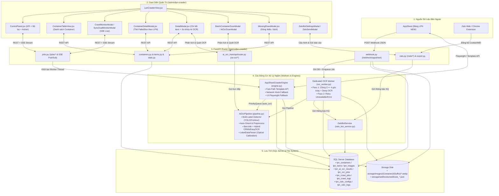
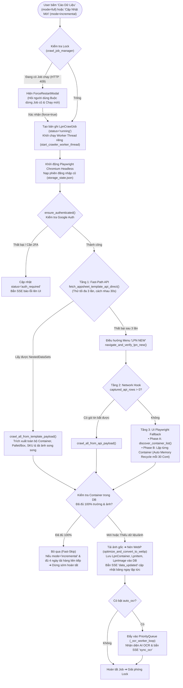
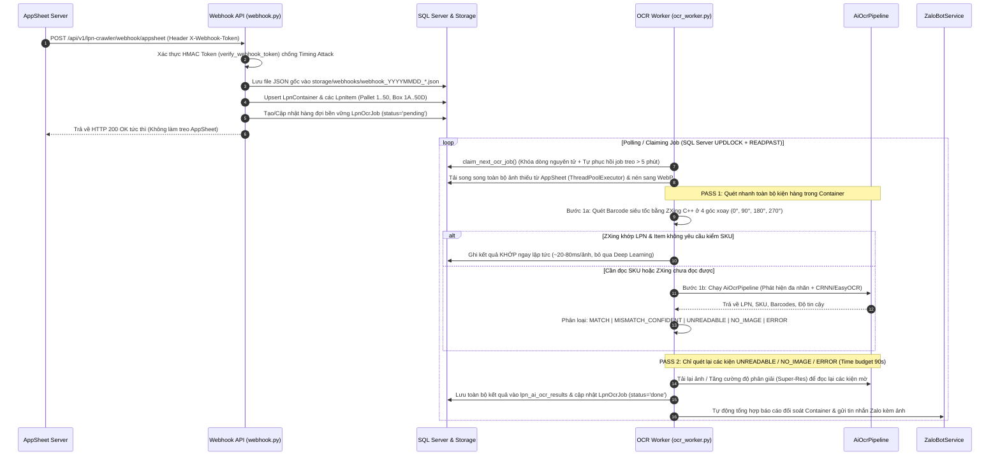
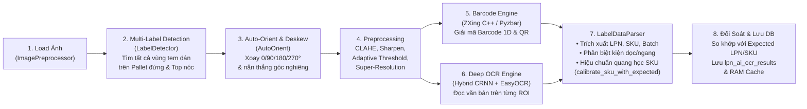
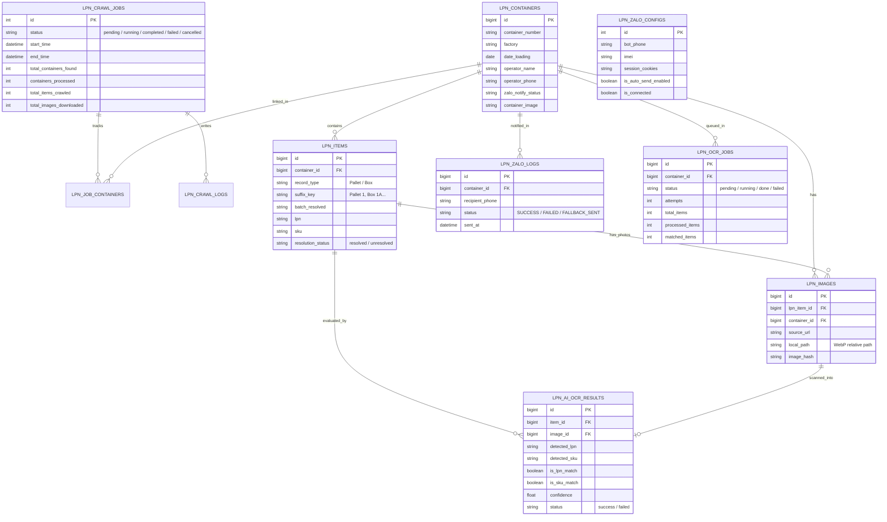

# TÀI LIỆU KIẾN TRÚC & TOÀN BỘ LUỒNG XỬ LÝ PHÂN HỆ `/admin/lpn-crawler`

> [!IMPORTANT]
> Tài liệu này mô tả chi tiết **100% kiến trúc và luồng xử lý từ đầu đến cuối (End-to-End)** của phân hệ **Quản lý Crawl Dữ Liệu Container, Pallet/Box, AI OCR & Zalo Bot (`/admin/lpn-crawler`)** trong hệ thống **SmartFlow ERP v3**.

---

## 1. Tổng Quan Kiến Trúc & Cây Thư Mục Phân Hệ

Phân hệ được gắn tại route `/admin/lpn-crawler` trên Web ([`App.jsx`](file:///p:/APP/SmartFlow/SmartFlow_v2_Test/FrontEnd/Web/Shared/app/App.jsx#L101)) và mount vào Backend tại prefix `/api/v1/lpn-crawler` ([`routes.py`](file:///p:/APP/SmartFlow/SmartFlow_v2_Test/BackEnd/app/routes.py#L158-L162) ➔ [`router.py`](file:///p:/APP/SmartFlow/SmartFlow_v2_Test/lpn_crawler/backend/api/router.py#L79-L97)).

```
lpn_crawler/
├── frontend/                                   # GIAO DIỆN QUẢN TRỊ REACT (/admin/lpn-crawler)
│   ├── pages/
│   │   └── LpnCrawlerView.jsx                  # Trang chính quản lý state, bộ lọc, SSE & Modals
│   ├── components/
│   │   ├── ControlPanel.jsx                    # 4 thẻ KPI + Thanh công cụ (Crawl, Sync, Batch Scan, Export, Zalo)
│   │   ├── ContainerTableView.jsx              # Bảng danh sách Container & Trạng thái đối soát
│   │   ├── ContainerCardView.jsx               # Chế độ hiển thị dạng thẻ (Card View)
│   │   ├── ContainerDetailModal.jsx            # Chi tiết Container & danh sách thẻ kiện hàng gom theo Pallet
│   │   ├── DetailModal.jsx                     # Chi tiết từng kiện Pallet/Box, Bounding Box ROI & Xác nhận (Resolve)
│   │   ├── CrawlMonitorModal.jsx               # Popup theo dõi tiến trình Crawl (SSE Live Progress & Logs)
│   │   ├── SyncDualMonitorModal.jsx            # Popup theo dõi kép: Crawl + AI OCR Realtime
│   │   ├── BatchContainerScanModal.jsx         # Quét AI OCR hàng loạt các Container chưa quét
│   │   ├── AiOcrScanModal.jsx                  # Quét AI OCR theo lô hình ảnh tùy chọn
│   │   ├── MissingRowsModal.jsx                # Quản lý & cào bù các dòng thiếu/lệch dữ liệu
│   │   ├── ZaloBotSettingsModal.jsx            # Cấu hình Cookie/IMEI Zalo Bot & Kiểm tra kết nối
│   │   ├── ZaloSendModal.jsx                   # Xem trước & Gửi báo cáo Container qua Zalo
│   │   ├── DashboardModal.jsx                  # Thống kê tổng hợp toàn thời gian (All-Time Stats)
│   │   └── LogModal.jsx                        # Tra cứu & lọc lịch sử nhật ký Crawl/OCR
│   └── services/
│       └── api.js                              # Client gọi REST API & EventSource SSE
│
├── backend/                                    # BACKEND API, CRAWLER ENGINE & WORKER
│   ├── api/
│   │   ├── router.py                           # Master Router tổng hợp tất cả sub-routers
│   │   └── routes/
│   │       ├── jobs.py                         # Quản lý Crawl Job, Lock, Pause/Resume & SSE Pub/Sub
│   │       ├── containers.py                   # Danh sách Container, bộ lọc, chi tiết Container
│   │       ├── items.py                        # Chi tiết Item, xóa hàng loạt, dòng thiếu/lệch & retry
│   │       ├── webhook.py                      # AppSheet Webhook Receiver thời gian thực
│   │       ├── zalo.py                         # Cấu hình Zalo Bot, gửi báo cáo & lịch sử gửi
│   │       ├── stats.py                        # Tính toán 4 KPI thẻ tổng quan (7 ngày & Toàn thời gian)
│   │       ├── images.py                       # Phục vụ file ảnh WebP trực tiếp từ ổ cứng
│   │       ├── export.py                       # Xuất báo cáo Excel (.xlsx)
│   │       └── logs.py                         # API phân trang và xóa lịch sử log
│   ├── crawler/
│   │   ├── engine.py                           # AppSheetCrawlerEngine điều phối 3 tầng Crawl + Auto OCR Queue
│   │   ├── api_crawler.py                      # Tầng 1: Fast-Path AppSheet Template API & Network Hook
│   │   ├── dom_crawler.py                      # Tầng 3: UI Playwright DOM Fallback
│   │   ├── browser_auth.py                     # Quản lý phiên đăng nhập Google & điều hướng 'LPN NEW'
│   │   ├── parser.py                           # Chuẩn hóa dữ liệu bóc tách từ AppSheet
│   │   └── telemetry.py                        # Ghi log DB, phát sự kiện SSE, tính tốc độ & ETA
│   ├── worker/
│   │   ├── manager.py                          # Quản lý khóa tiến trình (Singleton Job Lock, Cancel/Pause flags)
│   │   └── ocr_worker.py                       # Dedicated OCR Worker chạy độc lập xử lý hàng đợi lpn_ocr_jobs
│   ├── services/
│   │   ├── storage.py                          # Tối ưu hóa & chuyển đổi ảnh sang chuẩn WebP
│   │   ├── pallet_grouping.py                  # Gom nhóm kiện hàng Pallet đứng & Top nóc
│   │   ├── validators.py                       # Kiểm tra các trường bị thiếu/lệch (check_item_missing_fields)
│   │   ├── zalo_bot_service.py                 # Dịch vụ gửi tin nhắn và hình ảnh qua Zalo
│   │   └── excel.py                            # Khởi tạo file Excel báo cáo
│   └── models/
│       ├── models.py                           # 9 bảng SQLAlchemy ORM
│       └── schemas.py                          # Pydantic Schemas
│
└── ai_ocr_train/                               # ĐỘNG CƠ AI OCR & TRAINING LAB
    ├── api/
    │   └── router.py                           # API phân tích ảnh (/ai-ocr/analyze), quét container, cache RAM
    └── core/
        ├── pipeline.py                         # AiOcrPipeline 8 bước xử lý đa nhãn (Multi-Label Aware)
        ├── label_detector.py                   # Phát hiện tất cả vùng tem dán trên kiện hàng (YOLO / Contour)
        ├── auto_orient.py                      # Tự động xoay 0/90/180/270° & nắn thẳng góc nghiêng
        ├── preprocessor.py                     # Tiền xử lý ảnh (CLAHE, Threshold, Sharpen, Super-Resolution)
        ├── barcode_engine.py                   # Giải mã Barcode 1D & QR Code (ZXing C++ / Pyzbar)
        ├── ocr_engine.py                       # Nhận diện chữ Deep Learning (Hybrid CRNN + EasyOCR)
        └── parser.py                           # Trích xuất LPN/SKU/Batch & Hiệu chuẩn quang học SKU
```

---

## 2. Sơ Đồ Kiến Trúc Luồng Tổng Thể (Master Architecture Flowchart)



---

## 3. Chi Tiết 5 Luồng Xử Lý Nghiệp Vụ Cốt Lõi

### 3.1. Luồng 1: Khởi Tạo Màn Hình & Đồng Bộ Trạng Thái UI ([`LpnCrawlerView.jsx`](file:///p:/APP/SmartFlow/SmartFlow_v2_Test/lpn_crawler/frontend/pages/LpnCrawlerView.jsx))

Khi người dùng mở trang `/admin/lpn-crawler`, các hook `useEffect` thực hiện tuần tự:

1. **Kiểm tra Tiến trình đang chạy (`fetchCurrentJob`)**:
   - Gọi `GET /api/v1/lpn-crawler/jobs/current` ([`jobs.py`](file:///p:/APP/SmartFlow/SmartFlow_v2_Test/lpn_crawler/backend/api/routes/jobs.py#L244-L267)).
   - Nếu không có worker nào giữ lock trong RAM nhưng trong DB có job trạng thái `running` (do máy chủ từng khởi động lại), Backend tự động dọn dẹp chuyển trạng thái sang `interrupted` (*Orphan Cleanup*).
   - Nếu phát hiện có job đang `running` hoặc `pending`, Frontend tự động bật popup theo dõi ([`CrawlMonitorModal`](file:///p:/APP/SmartFlow/SmartFlow_v2_Test/lpn_crawler/frontend/components/CrawlMonitorModal.jsx) hoặc [`SyncDualMonitorModal`](file:///p:/APP/SmartFlow/SmartFlow_v2_Test/lpn_crawler/frontend/components/SyncDualMonitorModal.jsx)), nạp 300 dòng log lịch sử gần nhất từ DB (`GET /logs`) và đăng ký kênh **SSE** (`GET /jobs/{job_id}/sse`).
2. **Nạp Thống kê KPI (`fetchKpiStats`)**:
   - Gọi `GET /api/v1/lpn-crawler/stats` ([`stats.py`](file:///p:/APP/SmartFlow/SmartFlow_v2_Test/lpn_crawler/backend/api/routes/stats.py)) để hiển thị 4 thẻ KPI trên [`ControlPanel.jsx`](file:///p:/APP/SmartFlow/SmartFlow_v2_Test/lpn_crawler/frontend/components/ControlPanel.jsx):
     - **Tổng số Container**
     - **Tổng số dòng SKU / Kiện hàng**
     - **Tổng số Hình ảnh đã tải**
     - **Tổng số Dòng Thiếu / Lệch Dữ Liệu**
   - Tự động cập nhật định kỳ mỗi **45 giây** hoặc ngay khi nhận sự kiện SSE `data_updated` / `sync_ocr`.
3. **Tải Danh sách Container (`fetchContainers`)**:
   - Gọi `GET /api/v1/lpn-crawler/containers/cards` ([`containers.py`](file:///p:/APP/SmartFlow/SmartFlow_v2_Test/lpn_crawler/backend/api/routes/containers.py)) kèm các tham số lọc (`search`, `container_number`, `factory`, `operator_name`, `batch`, `sku`, `lpn`, `startDate`, `endDate`, `sort`, `page`, `page_size`).
   - Đồng thời ở trang 1, gọi `GET /api/v1/lpn-crawler/ai-ocr/unscanned-containers?limit=1` để hiển thị badge số lượng Container chưa quét AI OCR trên nút **"Quét Hàng Loạt"**.
4. **Kiểm tra trạng thái Zalo Bot (`refreshZaloStatus`)**:
   - Gọi `GET /api/v1/lpn-crawler/zalo/status` ([`zalo.py`](file:///p:/APP/SmartFlow/SmartFlow_v2_Test/lpn_crawler/backend/api/routes/zalo.py#L126-L167)) để hiển thị đèn báo kết nối Zalo Bot (Đã kết nối / Chưa cấu hình) và số tin nhắn đã gửi trong ngày.

---

### 3.2. Luồng 2: Tiến Trình Cào Dữ Liệu AppSheet (`Full Crawl` & `Incremental Sync`)

Được điều phối bởi [`jobs.py`](file:///p:/APP/SmartFlow/SmartFlow_v2_Test/lpn_crawler/backend/api/routes/jobs.py) và [`AppSheetCrawlerEngine`](file:///p:/APP/SmartFlow/SmartFlow_v2_Test/lpn_crawler/backend/crawler/engine.py#L32-L1114).



#### Cơ chế 3 tầng thu thập tự động chuyển đổi (3-Tier Fallback):
1. **Tầng 1 — Fast-Path Template API (`Fast-Path API`)**:
   - Ngay khi xác thực Google thành công, [`fetch_appsheet_template_api_direct()`](file:///p:/APP/SmartFlow/SmartFlow_v2_Test/lpn_crawler/backend/crawler/api_crawler.py) chủ động gọi trực tiếp endpoint nội bộ của AppSheet để tải toàn bộ cấu trúc dữ liệu `NestedDataSets` (gồm bảng `LPN NEW` và bảng tra cứu SKU).
   - Nếu thất bại, tự động thử lại tối đa **3 lần** (mỗi lần chờ 30 giây).
2. **Tầng 2 — Network Response Hook (`Fast-Path Network Hook`)**:
   - Listener `page.on("response")` ([`engine.py`](file:///p:/APP/SmartFlow/SmartFlow_v2_Test/lpn_crawler/backend/crawler/engine.py#L608-L645)) tự động bắt mọi gói JSON chứa dữ liệu bảng khi trình duyệt tải trang.
3. **Tầng 3 — Quét Giao Diện DOM Playwright (`UI Playwright Fallback`)**:
   - Nếu cả 2 tầng API đều không khả dụng, Engine tự động điều hướng vào menu `LPN NEW` trên giao diện web AppSheet:
     - **Phase A (`discover_container_list`)**: Cuộn danh sách ảo thu thập toàn bộ danh sách mã Container.
     - **Phase B (`crawl_single_container`)**: Mở chi tiết từng Container, bóc tách từng dòng Pallet/Box, tải hình ảnh và tự động reload trình duyệt sau mỗi **30 Container** (`AUTO MEMORY RECYCLE`) để giải phóng 100% RAM Chromium.

#### Cơ chế Kiểm tra Trùng lặp, Tự chữa lành (`Self-Healing`) & Dừng thông minh (`Incremental Stop`):
- Với mỗi Container, Engine kiểm tra trong DB xem Container đã tồn tại và tất cả các `LpnItem` đã đầy đủ dữ liệu + hình ảnh chưa (qua hàm [`check_item_missing_fields`](file:///p:/APP/SmartFlow/SmartFlow_v2_Test/lpn_crawler/backend/services/validators.py)).
- **Nếu thiếu bất kỳ trường hay ảnh nào**: Engine tự động đánh dấu `is_rehealing = True` và cào bổ sung phần bị thiếu.
- **Nếu đã đầy đủ 100%**:
  - Ở chế độ `full`: Bỏ qua tức thì (`0.001s`).
  - Ở chế độ `incremental` (Cập nhật dữ liệu mới): Khi gặp đủ **4 ngày tải hàng (`date_loading`) khác nhau** đã đầy đủ dữ liệu (hoặc 5 Container liên tiếp nếu không có ngày tải hàng), Engine tự động dừng sớm và báo hoàn tất đồng bộ.

---

### 3.3. Luồng 3: Đồng Bộ Thời Gian Thực Qua AppSheet Webhook & Persistent OCR Worker

Khi nhân viên hiện trường bấm lưu mới hoặc chỉnh sửa Container trên ứng dụng AppSheet, AppSheet lập tức gọi Webhook về SmartFlow:
- **File xử lý**: [`webhook.py`](file:///p:/APP/SmartFlow/SmartFlow_v2_Test/lpn_crawler/backend/api/routes/webhook.py) và tiến trình độc lập [`ocr_worker.py`](file:///p:/APP/SmartFlow/SmartFlow_v2_Test/lpn_crawler/backend/worker/ocr_worker.py).



---

### 3.4. Luồng 4: Pipeline Nhận Diện Tem Nhãn Đa Nhãn AI OCR ([`pipeline.py`](file:///p:/APP/SmartFlow/SmartFlow_v2_Test/lpn_crawler/ai_ocr_train/core/pipeline.py))

Mỗi bức ảnh kiện hàng (`Pallet` hoặc `Box`) khi đi qua [`AiOcrPipeline.process_image()`](file:///p:/APP/SmartFlow/SmartFlow_v2_Test/lpn_crawler/ai_ocr_train/core/pipeline.py#L88-L150) sẽ trải qua **8 bước xử lý chuyên sâu**:



- **Quy tắc phân biệt vị trí kiện hàng (`Package Position`)**:
  - Kiện có hậu tố chữ cái (VD: `Box 10A`, `Pallet 5B`) ➔ Nhận diện là **Kiện dọc / Top nóc** (`vertical`).
  - Kiện chỉ có số (VD: `Pallet 1`, `Box 10`) ➔ Nhận diện là **Kiện ngang / Pallet đứng** (`horizontal`).
- **Hiệu chuẩn quang học (`Optical Calibration`)**: Hàm `LabelDataParser.calibrate_sku_with_expected()` tự động sửa các lỗi nhầm lẫn ký tự quang học phổ biến (như `0` ↔ `O`, `1` ↔ `I`, `5` ↔ `S`, `8` ↔ `B`) khi đối chiếu với danh mục SKU hợp lệ.
- **Tự động điền khuyết (`Auto-Fill Missing Data`)**: Nếu bản ghi `LpnItem` từ AppSheet bị khuyết mã `lpn` hoặc `sku` nhưng AI OCR đọc được mã hợp lệ trên ảnh, hệ thống tự động điền bổ sung vào bảng `lpn_items` ([`engine.py`](file:///p:/APP/SmartFlow/SmartFlow_v2_Test/lpn_crawler/backend/crawler/engine.py#L276-L285)).

---

### 3.5. Luồng 5: Các Tác Vụ Kiểm Soát Chất Lượng, Xử Lý Lỗi & Báo Cáo Trên Giao Diện

| STT | Chức năng trên UI | Component Frontend | API Endpoint Backend | Luồng xử lý chi tiết |
| :-: | :--- | :--- | :--- | :--- |
| **1** | **Xem chi tiết Container & Thẻ Pallet** | [`ContainerDetailModal.jsx`](file:///p:/APP/SmartFlow/SmartFlow_v2_Test/lpn_crawler/frontend/components/ContainerDetailModal.jsx) | `GET /containers/{id}/detail` ([`containers.py`](file:///p:/APP/SmartFlow/SmartFlow_v2_Test/lpn_crawler/backend/api/routes/containers.py)) | Gom nhóm các `LpnItem` theo cụm Pallet ([`pallet_grouping.py`](file:///p:/APP/SmartFlow/SmartFlow_v2_Test/lpn_crawler/backend/services/pallet_grouping.py)), hiển thị ảnh Container, trạng thái khớp từng mã LPN/SKU, cho phép **Quét AI OCR toàn bộ Container** hoặc **Xác nhận thủ công (Resolve)**. |
| **2** | **Xem chi tiết từng Kiện & So khớp trực quan** | [`DetailModal.jsx`](file:///p:/APP/SmartFlow/SmartFlow_v2_Test/lpn_crawler/frontend/components/DetailModal.jsx) | `POST /ai-ocr/analyze` ([`router.py`](file:///p:/APP/SmartFlow/SmartFlow_v2_Test/lpn_crawler/ai_ocr_train/api/router.py)) | Hiển thị ảnh đánh dấu vùng tem (Bounding Box ROI), so sánh trực tiếp **Mã AppSheet (CSDL)** vs **Mã AI đọc trên tem**, cho phép Admin bấm **Xác nhận hợp lệ (`resolved`)** kèm ghi chú. |
| **3** | **Quét Hàng Loạt Container Chưa Quét** | [`BatchContainerScanModal.jsx`](file:///p:/APP/SmartFlow/SmartFlow_v2_Test/lpn_crawler/frontend/components/BatchContainerScanModal.jsx) | `GET /ai-ocr/unscanned-containers`<br>`POST /ai-ocr/scan-container/{id}` | Lọc danh sách các Container chưa quét hoặc quét dở dang, chạy tuần tự từng Container kèm thanh tiến độ thời gian thực, tự động cập nhật trạng thái ngoài bảng chính. |
| **4** | **Xử lý Danh Sách Thiếu / Lệch Dữ Liệu** | [`MissingRowsModal.jsx`](file:///p:/APP/SmartFlow/SmartFlow_v2_Test/lpn_crawler/frontend/components/MissingRowsModal.jsx) | `GET /missing-rows`<br>`POST /retry-missing` ([`items.py`](file:///p:/APP/SmartFlow/SmartFlow_v2_Test/lpn_crawler/backend/api/routes/items.py)) | Liệt kê mọi dòng thiếu LPN, thiếu SKU, thiếu ảnh hoặc AI OCR báo lệch mã (`check_item_missing_fields` trong [`validators.py`](file:///p:/APP/SmartFlow/SmartFlow_v2_Test/lpn_crawler/backend/services/validators.py)). Hỗ trợ cào bù hoặc quét lại AI OCR. |
| **5** | **Cấu hình & Gửi Báo Cáo Zalo Bot** | [`ZaloBotSettingsModal.jsx`](file:///p:/APP/SmartFlow/SmartFlow_v2_Test/lpn_crawler/frontend/components/ZaloBotSettingsModal.jsx)<br>[`ZaloSendModal.jsx`](file:///p:/APP/SmartFlow/SmartFlow_v2_Test/lpn_crawler/frontend/components/ZaloSendModal.jsx) | `GET/POST /zalo/config`<br>`POST /zalo/resend/{container_id}` ([`zalo.py`](file:///p:/APP/SmartFlow/SmartFlow_v2_Test/lpn_crawler/backend/api/routes/zalo.py)) | Chỉ cho phép Admin cấu hình IMEI/Cookies (hoặc đồng bộ tự động từ Chrome Extension `zlapi-extension.zip`). Gửi báo cáo tổng hợp Container kèm hình ảnh tới SĐT người phụ trách hoặc SĐT quản lý dự phòng, lưu lịch sử vào `lpn_zalo_logs`. |
| **6** | **Xuất Báo Cáo Excel** | [`ControlPanel.jsx`](file:///p:/APP/SmartFlow/SmartFlow_v2_Test/lpn_crawler/frontend/components/ControlPanel.jsx) | `GET /export/excel` ([`export.py`](file:///p:/APP/SmartFlow/SmartFlow_v2_Test/lpn_crawler/backend/api/routes/export.py) & [`excel.py`](file:///p:/APP/SmartFlow/SmartFlow_v2_Test/lpn_crawler/backend/services/excel.py)) | Xuất danh sách Container, Pallet/Box, LPN, SKU, Batch và kết quả kiểm tra ra file `.xlsx` theo bộ lọc hiện tại. |

---

## 4. Sơ Đồ Quan Hệ Cơ Sở Dữ Liệu (ERD)

Toàn bộ 9 bảng dữ liệu của phân hệ `/admin/lpn-crawler` được định nghĩa tại [`models.py`](file:///p:/APP/SmartFlow/SmartFlow_v2_Test/lpn_crawler/backend/models/models.py):



---

## 5. Bảng Tổng Hợp Toàn Bộ REST API Endpoints (`/api/v1/lpn-crawler`)

| Nhóm | HTTP Method & Path | File Xử Lý | Mô Tả Chức Năng |
| :--- | :--- | :--- | :--- |
| **Jobs & SSE** | `POST /jobs/start` | [`jobs.py`](file:///p:/APP/SmartFlow/SmartFlow_v2_Test/lpn_crawler/backend/api/routes/jobs.py) | Khởi chạy tiến trình Crawl (`mode=full` hoặc `incremental`, `auto_ocr=true/false`). |
| | `POST /jobs/{job_id}/stop` | [`jobs.py`](file:///p:/APP/SmartFlow/SmartFlow_v2_Test/lpn_crawler/backend/api/routes/jobs.py) | Dừng khẩn cấp Job đang chạy và giải phóng Lock. |
| | `POST /jobs/{job_id}/pause` | [`jobs.py`](file:///p:/APP/SmartFlow/SmartFlow_v2_Test/lpn_crawler/backend/api/routes/jobs.py) | Tạm dừng tiến trình Crawl đang chạy. |
| | `POST /jobs/{job_id}/resume` | [`jobs.py`](file:///p:/APP/SmartFlow/SmartFlow_v2_Test/lpn_crawler/backend/api/routes/jobs.py) | Tiếp tục tiến trình Crawl đang tạm dừng. |
| | `POST /jobs/reset-lock` | [`jobs.py`](file:///p:/APP/SmartFlow/SmartFlow_v2_Test/lpn_crawler/backend/api/routes/jobs.py) | Giải phóng toàn bộ Lock bị kẹt trong bộ nhớ. |
| | `GET /jobs/current` | [`jobs.py`](file:///p:/APP/SmartFlow/SmartFlow_v2_Test/lpn_crawler/backend/api/routes/jobs.py) | Lấy thông tin Job hiện tại (tự động dọn dẹp job mồ côi). |
| | `GET /jobs/{job_id}/sse` | [`jobs.py`](file:///p:/APP/SmartFlow/SmartFlow_v2_Test/lpn_crawler/backend/api/routes/jobs.py) | Kênh EventSource SSE phát trực tiếp tiến độ, log, `data_updated` và `sync_ocr`. |
| **Containers** | `GET /containers/cards` | [`containers.py`](file:///p:/APP/SmartFlow/SmartFlow_v2_Test/lpn_crawler/backend/api/routes/containers.py) | Lấy danh sách Container phân trang kèm thống kê trạng thái OCR. |
| | `GET /containers/{id}/detail` | [`containers.py`](file:///p:/APP/SmartFlow/SmartFlow_v2_Test/lpn_crawler/backend/api/routes/containers.py) | Lấy chi tiết Container và danh sách kiện hàng gom theo cụm Pallet. |
| | `GET /filter-options` | [`containers.py`](file:///p:/APP/SmartFlow/SmartFlow_v2_Test/lpn_crawler/backend/api/routes/containers.py) | Lấy danh sách gợi ý bộ lọc (Factory, Operator, Năm, Tháng). |
| **Items & Missing** | `GET /items/{item_id}` | [`items.py`](file:///p:/APP/SmartFlow/SmartFlow_v2_Test/lpn_crawler/backend/api/routes/items.py) | Lấy chi tiết một kiện hàng Pallet/Box kèm ảnh và kết quả OCR. |
| | `POST /items/batch-delete` | [`items.py`](file:///p:/APP/SmartFlow/SmartFlow_v2_Test/lpn_crawler/backend/api/routes/items.py) | Xóa hàng loạt các Container/Item đã chọn. |
| | `DELETE /items/delete-all` | [`items.py`](file:///p:/APP/SmartFlow/SmartFlow_v2_Test/lpn_crawler/backend/api/routes/items.py) | Xóa toàn bộ dữ liệu CSDL LPN Crawler. |
| | `GET /missing-rows` | [`items.py`](file:///p:/APP/SmartFlow/SmartFlow_v2_Test/lpn_crawler/backend/api/routes/items.py) | Truy vấn danh sách các dòng bị thiếu trường/ảnh hoặc lệch kết quả AI OCR. |
| | `POST /retry-missing` | [`items.py`](file:///p:/APP/SmartFlow/SmartFlow_v2_Test/lpn_crawler/backend/api/routes/items.py) | Cào bù hoặc quét lại các dòng bị thiếu dữ liệu. |
| **AI OCR** | `POST /ai-ocr/analyze` | [`ai_ocr_train/api/router.py`](file:///p:/APP/SmartFlow/SmartFlow_v2_Test/lpn_crawler/ai_ocr_train/api/router.py) | Phân tích chi tiết 1 bức ảnh (vẽ ROI, xoay, tiền xử lý, đọc Barcode + OCR). |
| | `POST /ai-ocr/scan-container/{id}` | [`ai_ocr_train/api/router.py`](file:///p:/APP/SmartFlow/SmartFlow_v2_Test/lpn_crawler/ai_ocr_train/api/router.py) | Quét AI OCR toàn bộ các kiện hàng trong 1 Container. |
| | `GET /ai-ocr/unscanned-containers` | [`ai_ocr_train/api/router.py`](file:///p:/APP/SmartFlow/SmartFlow_v2_Test/lpn_crawler/ai_ocr_train/api/router.py) | Lấy danh sách các Container chưa được quét đầy đủ. |
| **Webhook** | `GET/POST /webhook/appsheet` | [`webhook.py`](file:///p:/APP/SmartFlow/SmartFlow_v2_Test/lpn_crawler/backend/api/routes/webhook.py) | Cổng nhận dữ liệu thời gian thực từ AppSheet & đẩy vào hàng đợi `lpn_ocr_jobs`. |
| **Zalo Bot** | `GET/POST /zalo/config` | [`zalo.py`](file:///p:/APP/SmartFlow/SmartFlow_v2_Test/lpn_crawler/backend/api/routes/zalo.py) | Xem và cập nhật cấu hình Cookie/IMEI/SĐT nhận của Zalo Bot. |
| | `POST /zalo/resend/{container_id}` | [`zalo.py`](file:///p:/APP/SmartFlow/SmartFlow_v2_Test/lpn_crawler/backend/api/routes/zalo.py) | Gửi hoặc gửi lại báo cáo đối soát Container qua Zalo. |
| **KPI, Ảnh & Excel**| `GET /stats` | [`stats.py`](file:///p:/APP/SmartFlow/SmartFlow_v2_Test/lpn_crawler/backend/api/routes/stats.py) | Lấy bộ 4 chỉ số KPI tổng quan (7 ngày gần nhất & toàn thời gian). |
| | `GET /images/view` | [`images.py`](file:///p:/APP/SmartFlow/SmartFlow_v2_Test/lpn_crawler/backend/api/routes/images.py) | Phục vụ file ảnh WebP từ thư mục lưu trữ `storage/images`. |
| | `GET /export/excel` | [`export.py`](file:///p:/APP/SmartFlow/SmartFlow_v2_Test/lpn_crawler/backend/api/routes/export.py) | Xuất dữ liệu Container & Kiện hàng ra file Excel `.xlsx`. |

